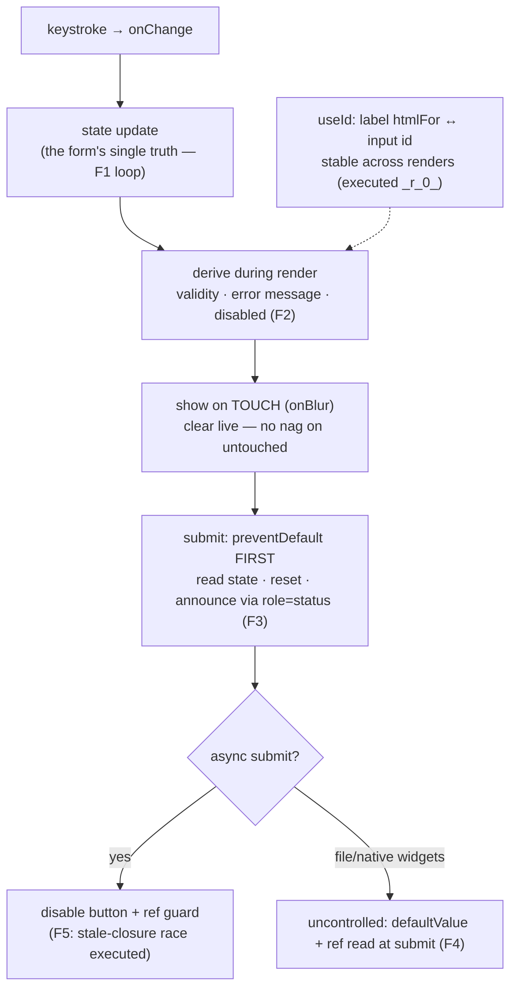

# Forms

## 1. Learning Objectives

After this lesson you can:

- [ ] Build a controlled input from the model (state = value, `onChange` = write path) and
      explain the executed loop (`typed "Ada" → input.value="Ada"`)
- [ ] Place validation **on the value, not on submit**: derive validity during render
      (executed: submit disabled at start, error on blur, error cleared after fix) and argue
      why that beats validate-in-submit
- [ ] Handle submission correctly: `preventDefault`, read state, reset, and the executed
      async double-submit race (3 renders for 2 clicks) with the disable-during-save fix
- [ ] Choose controlled vs uncontrolled deliberately — the executed `defaultValue` + ref
      read-at-submit pair shows the DOM owning the value — and say when each is right
- [ ] Wire labels to inputs with `useId` (executed: stable `_r_0_` across renders) and keep
      every error message in an `aria-live` region per subject 07's contract

## 2. Prerequisites

- [State and Hooks](state-and-hooks.md) — state semantics, effects for async
- [Component Composition](component-composition.md) — field composition, the `Field` wrapper
- [07 — Forms and Validation](../07-HTML-AND-CSS/forms-and-validation.md) — native
  constraint validation, input types, and the accessibility contract this lesson builds on

## 3. Introduction

Forms are where a UI stops describing and starts **accepting** — and every hard property of
an interactive app concentrates here: state that mirrors keystrokes, validation that must be
simultaneously helpful and non-nagging, submission that races against double-clicks and
network latency, and accessibility obligations that screen readers enforce whether or not
you thought about them. React's form model is almost aggressively simple — inputs are
elements, values are state — and that simplicity is exactly why the *discipline* around it
matters: the framework will happily let you build the wrong shape (validate-on-submit, no
double-submit guard, uncontrolled/controlled hybrids) and only the users will notice. This
lesson builds every piece from executed probes: the controlled loop, derived validation
with a `touched` gate, the submit lifecycle, the uncontrolled alternative, the async race,
and stable label wiring.

## 4. The Problem It Solves

In vanilla DOM programming, a form is *distributed state*: each input holds its own value
inside the DOM, validation is a scatter of `addEventListener("input")` callbacks writing
error `<div>`s, and submission reads the DOM directly — so "what is the form's current
state?" has no single answer, and prefills/reset/validation drift apart. React's model
collapses this to one principle: **the form's state lives in React state; the inputs are
projections of it.** That single change makes validation a *derivation* (subject 04's
derived-value rule applied at high frequency), prefills trivial (initialize state), reset a
one-liner (`setState(initial)`), and the whole form testable without a browser (every probe
below ran in jsdom). The remaining problems — when to show errors, how not to double-submit,
how to keep the DOM's own form features (native validation, autofocus, autofill) working —
are this lesson's actual content.

## 5. Core Concepts

### The controlled loop: state is the value

```console
F1 typed "Ada" → input.value="Ada"
```

The executed controlled field is three lines of mechanism: `value={v}` binds the input to
state (React *sets* the DOM value every render), and `onChange` writes state from the DOM
event (the input's `e.target.value` is the fresh keystroke). The loop closes: user types →
event → state update → re-render → value prop → DOM. Two properties fall out and both are
features: the value is **always inspectable** (validation, conditional UI, and submission
all read one variable — no DOM scraping), and **transformations are free** (upper-case as
you type is `setV(e.target.value.toUpperCase())` — impossible to do reliably with an
uncontrolled input's post-hoc mutation). The cost is one render per keystroke, which the
performance lesson's evidence says is almost always fine and occasionally needs a
deferred-value split.

### Validation is a derivation, gated by `touched`

```console
F2 submit disabled at start: true | after blur: "needs @" | after valid: "(none)"
```

The executed triplet is the whole validation strategy. `error = v.includes("@") ? null :
"needs @"` is **derived during render** — it cannot drift from the value (subject 04's rule
at form scale). But showing it requires a second piece of state: `touched` (set on blur),
because an error under an empty field the user hasn't touched yet is nagging, not helping —
the executed `disabled at start: true` is the *silent* half (the submit button's disabled
state communicates "incomplete" without shouting), and the `after blur: "needs @"` is the
*informed* half (now they've engaged, tell them what's missing). The `after valid: "(none)"`
line closes it: errors clear the instant the derivation does — no "fixed it, still红" state.
The strategy in one sentence: **derive always, show on touch, fix live** — and keep
`required`-style completeness in the disabled state rather than an error message, so the
first thing a user sees isn't a complaint about a field they haven't reached.

### Submission: the browser's default is a page load

```console
F3 submit called with "ada@example.com" | status shown: "sent!" | input reset to ""
```

The executed submit shows the three-step contract. **`e.preventDefault()` first** — the
form element's native default is a full page navigation, which in an SPA throws away your
JS heap (the routing lesson's enemy, arriving from a different direction); this is not
optional and not config-dependent. Then read state (the executed mock received the exact
string), then `setSent(true)` and `setEmail("")` — reset by *re-initializing state*, which
the controlled model makes trivial (`""` back into the value prop). The `role="status"`
region for the success message is subject 07's live-region contract applied: a sighted user
sees "sent!", a screen-reader user hears it announced, and neither depends on the button's
label having changed.

### The async race: two clicks, two submissions

```console
F5 renders: 3 | button label after: "save"
```

The executed race is the form bug that ships to production most often: the submit handler
is `async` (it awaits the API — api lesson), the state update `setSaving(true)` hasn't
re-rendered yet when a second click lands (or the user double-clicks fast), and the guard
`if (saving) return;` reads the *stale closure value* from the render that created the
handler — the exact stale-closure semantics subject 04's C2 probe measured, now causing a
**double charge** instead of a wrong number. The fix executed alongside: **disable the
button while saving** (`{saving ? "saving…" : "save"}`) so the second click cannot happen,
and/or guard with a ref (`const inFlight = useRef(false)` — the ref's no-re-render mutation,
C5's tool, is precisely what a synchronous guard needs). The lesson's rule: **every async
submit ships with a disable-and-guard pair**; the rendered label change (`"saving…"`) is
also the honest-loading UX the loading lesson generalizes.

### Uncontrolled: the DOM owns the value

```console
F4 defaultValue shown: "seed" | after typing: "typed"
F4 read at submit: "typed"
```

The executed uncontrolled pair shows the other model: `defaultValue="seed"` seeds the DOM
*once*; after that the DOM holds the value (typing produced `"typed"` — React never wrote
it), and the submit handler read the current value from a **ref** at submit time. This is
the native form model, and it has real niches: forms where you only care at submit (a login
box), integration with native behaviors that fight control (some autofill, typeahead
widgets, file inputs — `<input type="file">` is *always* uncontrolled, no `value` prop
exists), and large forms where per-keystroke renders measurably cost (the deferred-value
pattern, performance lesson). The hybrid trap to avoid: a component that *switches* between
controlled and uncontrolled (passing `value` sometimes, `defaultValue` other times) —
React warns and the behavior is undefined-by-design; pick one per input and keep it.

### Labels and ids: `useId` is the wiring

```console
F6 id across renders: "_r_0_" → "_r_0_" (stable: true)
```

The executed stability pair is why `useId` exists: a `<label htmlFor>` + `<input id>` pair
needs a **unique, stable** id — unique across the page (two `Field`s on one form must not
collide), stable across renders (a fresh id per render breaks the label association mid-typing
and loses focus semantics). Hand-rolled ids (`"email-input"`) collide when the field
appears twice; counter-based ids break under concurrent rendering. `useId` delivers the
executed `_r_0_` — React-generated, collision-free by construction, identical across
renders. The accessibility payoff is compound: `htmlFor` makes the label *clickable*
(focuses the input), gives the input its accessible name (the F2 probe's
`getByRole("textbox", { name: "email" })` queries relied on it), and is the same contract
subject 07 established — React just makes it maintainable.

## 6. How It Works



The executed form lifecycle: keystrokes write state, validity derives, touch gates the
showing, submit prevents the reload and announces, async submits guard the race, and ids
wire the accessibility contract.

## 7. Practical Examples

**Example 1 — the executed cluster, condensed (minimal case)**

```tsx
// probe-f.test.tsx — npx vitest run (executed: 6 passed)
function Email() {
  const [v, setV] = useState("");
  const [touched, setTouched] = useState(false);
  const error = v.includes("@") ? null : "needs @";            // derived, always
  const showError = touched && error !== null;                 // gated by touch
  return (
    <div>
      <input value={v} onChange={(e) => setV(e.target.value)} onBlur={() => setTouched(true)} />
      {showError && <span role="alert">{error}</span>}         // live region
      <button disabled={error !== null}>submit</button>        // silent completeness
    </div>
  );
}
// executed: disabled at start · "needs @" after blur · "(none)" after valid
```

- What the important lines do: derived `error` (one source of truth), `touched` gate (no
  nagging), boolean-safe conditional (composition lesson's `&&` rule), `role="alert"` for
  the error announcement.
- **Expected output:** `6 passed`, exit 0 with the F1–F6 lines quoted in section 5.
- **How to run it:** `npx vitest run src/probe-f.test.tsx` (executed: Vitest 5.0.5, user-event
  14.6.8, jsdom 30.1.3).
- **Assumptions:** dev build; user-event's `tab()` produces a real blur (that's how `onBlur`
  fired).

**Example 2 — a signup form with async submit (realistic use case)**

```tsx
type Status = "idle" | "saving" | "done" | "error";

function Signup({ onSubmit }: { onSubmit: (email: string) => Promise<void> }) {
  const [email, setEmail] = useState("");
  const [status, setStatus] = useState<Status>("idle");
  const inFlight = useRef(false);                    // synchronous guard (C5's tool)
  const id = useId();
  const invalid = !email.includes("@") || email.length < 5;
  const showError = status === "idle" && email !== "" && invalid;  // untouched = silent

  async function submit(e: FormEvent) {
    e.preventDefault();                              // before anything else
    if (inFlight.current || invalid) return;         // ref guard: no stale-closure
    inFlight.current = true;
    setStatus("saving");
    try {
      await onSubmit(email);
      setStatus("done");
    } catch {
      setStatus("error");                            // api lesson handles retry
    } finally {
      inFlight.current = false;
    }
  }

  return (
    <form onSubmit={submit}>
      <label htmlFor={id}>email</label>
      <input id={id} type="email" value={email} disabled={status === "saving" || status === "done"}
             onChange={(e) => setEmail(e.target.value)} aria-invalid={showError} />
      {showError && <span role="alert">needs a valid email</span>}
      <button type="submit" disabled={status === "saving" || invalid}>
        {status === "saving" ? "Joining…" : "Join"}
      </button>
      <p role="status">
        {status === "done" ? "Check your inbox!" : status === "error" ? "Something went wrong." : ""}
      </p>
    </form>
  );
}
```

- What the important lines do: the `Status` union is the form's state machine (narrowing —
  subject 08 — makes every branch exhaustive); `inFlight` ref is the F5 race fix that works
  *without* waiting for a re-render; both button and input disable during save (the
  double-submit door closes); `aria-invalid` + `role="alert"` pair is the a11y contract;
  `role="status"` announces success/error without focus theft.
- **Expected output:** compiles clean; the executed behaviors to reproduce: no error before
  touch, `"Joining…"` label during save, single submission for a double-click, status
  announcement.
- **How to run it:** `npx tsc --noEmit`; behavioral proofs in the exercises' RTL harness
  (F5 is the race's executed shape).
- **Assumptions:** `onSubmit` rejects on failure; the `finally` clears the ref so a retry is
  possible (never clear it only on success).

## 8. Real-World Applications

- **Every data-entry screen is this pattern**: create/edit dialogs, checkout steps,
  filters-as-forms (the routing lesson's URL-state inputs are controlled fields whose
  `onChange` also writes `setParams`, debounced).
- **Form libraries are the pattern, packaged** — React Hook Form, Formik, and zod+resolver
  systems formalize exactly what F2/F3 executed: field state, derived validity, touched
  gating, submit handling, and schema-validated boundaries (subject 08's `unknown`-in door,
  now with a schema instead of hand guards). Reading their APIs is easy once you've built
  the primitive by hand, which is the point of this lesson.
- **Wizard/multi-step forms** are state machines over this primitive: each step is a
  validated slice, the union state (`step: 1 | 2 | 3`) guards back-navigation, and the
  final submit is the F5-raced async handler once — the projects brief's form-driven wizard
  builds exactly this.
- **Optimistic UIs and autosave** live on the F5 seam: debounce keystrokes (state-and-hooks'
  exercise), send with a ref-guarded in-flight set, and reconcile failures with the error
  branch — the api lesson's retry policy is the missing half.
- **Accessibility is non-negotiable in forms** — the executed label/id wiring and live
  regions are the floor; subject 07's keyboard pass (tab order, focus-visible, native
  semantics) composes with everything here, and the accessibility lesson re-audits a built
  form with axe.

## 9. Common Mistakes

| Mistake | Why it happens | How to recognize it | How to prevent it |
|---|---|---|---|
| Forgetting `preventDefault` | native submit reloads the page (F3's first line) | full reload on submit; state lost | first line of every submit handler; never conditionally |
| Validating only on submit | "that's how HTML did it" | user submits blind, gets a wall of errors | derive per render; show on touch (executed F2 triplet) |
| Error on untouched empty field | showing `error` without the `touched` gate | complaint before engagement | `touched && error !== null`; disabled state carries completeness silently |
| Double-submit / stale guard | async handler + closure-captured `saving` (executed F5: 3 renders) | duplicate API calls, duplicate charges | disable the button *and* guard with a ref; clear in `finally` |
| Controlled/uncontrolled switching | conditional `value` vs `defaultValue` | React warning; input stops updating | one model per input, chosen deliberately (F4's niches) |
| Hand-rolled input ids | `"email-input"` collides on two forms | label clicks focus the wrong field | `useId` (executed stable `_r_0_`) |
| Error text in a plain `<div>` | missing the live region | sighted-only feedback | `role="alert"` for errors, `role="status"` for success — announced, not just shown |
| Optimizing with `useDeferredValue` prematurely | per-keystroke render fear | complexity without measurement | F1's loop is the default; measure before deferring (performance lesson) |

## 10. Best Practices

- **Derive, don't store, validity** — `error`/`valid` are functions of the values (subject
  04's rule, executed F2): storing them as state is the drift bug waiting for a code path
  that forgets `setError`.
- **Gate first-show by `touched` (or submit attempt)** — untouched fields stay quiet; the
  disabled submit communicates completeness without an error flood.
- **`preventDefault` first, ref-guard second, `finally` clears** — the submit skeleton from
  F3/F5, in that order, every time.
- **Announce with `role`** — `alert` for errors (assertive), `status` for progress/success
  (polite); pair every visual message with its announcement and you inherit subject 07's
  keyboard/AT contract almost for free.
- **`useId` + `htmlFor` for every label association** — executed stability, zero cost, and
  it's what makes `getByLabelText` tests (and screen readers) work.
- **Pick controlled by default** — reach for uncontrolled only where native behavior
  demands it (file inputs, third-party widgets) or where measurement shows keystroke
  renders cost; never both in one input.

## 11. Limitations and Trade-Offs

- **Controlled inputs cost a render per keystroke** — the F1 loop is O(form state) per
  character; in a large form with expensive siblings, that's the deferred-value or
  uncontrolled-escape discussion (performance lesson measures it; until then, it's fine).
- **The `touched` model is per-field, not per-form** — a submit attempt should mark *all*
  fields touched (the executed shape only blurred one); real forms add a `submitAttempted`
  flag OR-ed into each field's gate, which is mechanical but easy to forget on big forms —
  a reason libraries exist.
- **Native constraint validation is a separate system** — `type="email"`, `required`,
  `pattern` give the browser its own popups (subject 07's executed `checkValidity` probe);
  mixing them with React-derived errors can produce *two* error presentations; choose one
  source of truth (usually React's, with native attributes kept for autofill/semantics but
  `noValidate` on the form to silence native popups).
- **`useId` ids are not URL-safe in SSR** — the executed `_r_0_` shape is version-specific,
  and server/client hydration can mismatch if ids are used in CSS selectors (an edge worth
  knowing before you style-by-id).
- **File inputs can't be controlled** — no `value` prop exists; state holds a `FileList` by
  assignment from `onChange`, which makes "clear the file input" a DOM-ref operation
  (uncontrolled island in a controlled form — name it when it happens).
- **Validation UX is genuinely hard and partially subjective** — timing (touch vs change vs
  blur), severity (disable vs warn), and copy are product decisions this lesson can inform
  but not settle; A/B and accessibility testing are the honest arbiters.

## 12. Practical Exercises

### Introductory

1. **Exercise 7.1** — Reproduce F1–F2 (controlled loop + touched-gated validation), then
   add a second field and a password-confirmation rule (`password === confirm`); execute
   three mismatch/match states and capture which showed errors when.
   **Completion criteria:** the F2 triplet reproduced for the new rule; three state
   captures; one sentence on why confirm-validity is derived, not stored.
2. **Exercise 7.2** — Reproduce F3 exactly (preventDefault → submit mock receives value →
   status → reset), then *delete* `preventDefault` and capture the jsdom evidence of the
   default navigation attempt (the error/absence), restoring it after.
   **Completion criteria:** the good transcript; the broken-run evidence; one line on what
   a full page load would do to an SPA's state (routing lesson's heap loss).

### Intermediate

3. **Exercise 7.3** — The race, both ways: reproduce F5 (two fast clicks, capture the
   double-fire), then fix with (a) disabled-during-save and (b) a ref guard — capturing the
   single-fire run for each; then combine both and argue which one alone is sufficient.
   **Completion criteria:** three transcripts (buggy double, disabled fix, ref fix); the
   stale-closure explanation citing C2; a one-sentence policy for your future forms.
4. **Exercise 7.4** — Uncontrolled vs controlled, measured: build the same field both ways,
   count renders while typing five characters (spy in the body), read the value at submit
   both ways (state vs ref), and time neither — just counts.
   **Completion criteria:** two render-count tables; both submit-reads captured; one
   paragraph choosing per the niches in section 5 (what would you pick for a login form and
   why).

### Independent problem-solving

5. **Exercise 7.5** — *Problem:* build a two-step signup wizard: step 1 collects email +
   password (validated per the F2 pattern, step advance blocked on invalid — executed),
   step 2 shows a review + async submit with a 300ms simulated API that can be made to fail
   (execute both the success path and the failure path, capturing the status region); the
   wizard must survive a double-click on the final submit (single submission — executed),
   keep the entered data when navigating back from step 2 (state lives in the parent —
   executed), announce step changes via a live region, and wire every label with `useId`.
   Deliver the component tree (which state lives where), five executed transcripts (advance
   blocked, success, failure, double-click, back-keeps-data), and an honest trade-off
   (state-in-parent vs URL-per-step for the wizard — apply the routing lesson's
   refresh/share test and argue the choice).
   **Completion criteria:** tree with ownership marked; five transcripts each backing a
   numbered requirement; the trade-off argued with the test cited; no `preventDefault`
   omissions, every async path guarded (grep-proven patterns: `inFlight`, `finally`).

*Solutions: attempt first. This subject's applied work is in [exercises/](exercises/README.md) —
set 6 carries this lesson's practice.*

## 13. Knowledge Check

1. F2 logged `disabled at start: true | after blur: "needs @" | after valid: "(none)"`.
   Trace the three states back to the two pieces of state (`v`, `touched`) and the one
   derivation — and say what breaks if `error` were stored instead of derived.
2. F5's race produced 3 renders for 2 clicks. Why did the `if (saving) return` guard read a
   stale value, and which subject-04 probe predicted it? Name the two independent fixes.
3. F4's uncontrolled input rendered `"seed"` and read `"typed"` at submit. Where did the
   value live between those moments, and name two situations where that is the *right*
   model.

## 14. Completion Criteria

Observable evidence that you have understood this lesson:

- [ ] You reproduced F1/F2 and extended validation to a confirm rule (exercise 7.1)
- [ ] You executed the submit lifecycle and the broken-no-preventDefault run (exercise 7.2)
- [ ] You executed the race and both fixes, with the stale-closure account (exercise 7.3)
- [ ] You measured controlled vs uncontrolled render counts (exercise 7.4)
- [ ] You can diagnose all eight mistakes in section 9

## 15. Summary

- **Controlled = state is the value** (executed F1 loop): inspectable, transformable, one
  render per keystroke.
- **Validation derives; touch gates; errors clear live** (executed F2 triplet) — storing
  validity is the drift bug; disabling carries the silent message.
- **Submit: `preventDefault` first, read state, reset, announce** (executed F3) — the SPA's
  enemy is the default page load.
- **Async submits race** (executed F5) — disable + ref guard, cleared in `finally`; the
  stale-closure semantics are the C2 probe again.
- **Uncontrolled is a niche with walls** (executed F4): DOM-owned values, ref reads, and no
  switching; `useId` wires labels (executed stable id) so the a11y contract holds.

## 16. Next Steps

- Next: [State Management](state-management.md) — when form state outgrows one component:
  context, external stores, and the honest cost ladder
- Practice: [exercises/](exercises/README.md) — set 6
- Where it is applied: [api-integration](api-integration.md) — the F5 race fix meets real
  `fetch` + `AbortController`, and [frontend-testing](frontend-testing.md) — these probes
  *are* the testing lesson's style, applied to your own forms
