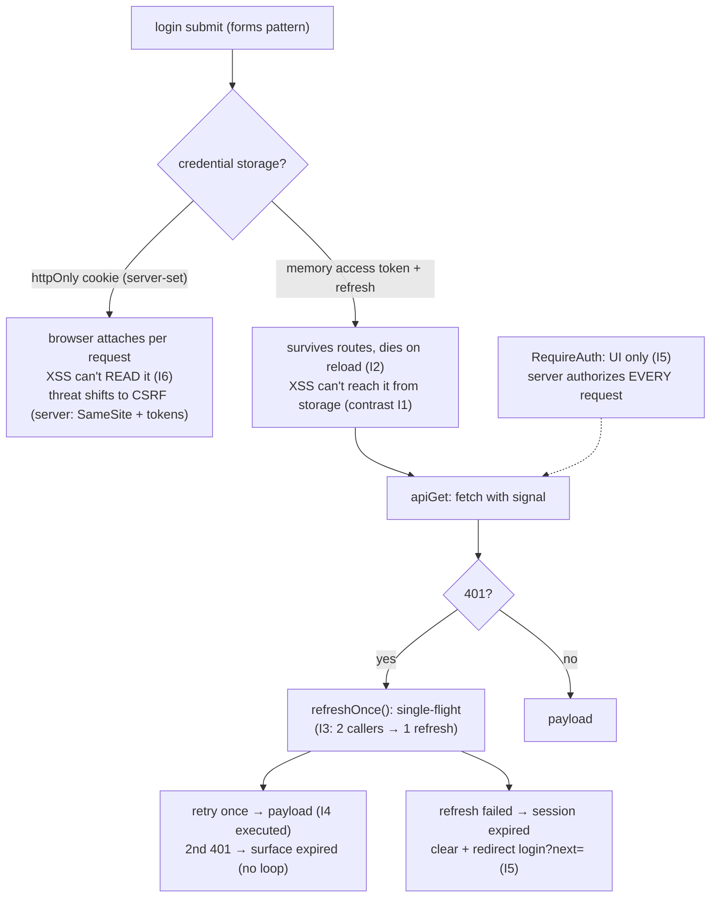

# Frontend Authentication

## 1. Learning Objectives

After this lesson you can:

- [ ] Defend a token-storage choice with executed evidence for each side: `localStorage` is
      readable by *any* same-origin script (I1), memory dies on reload (I2), and an
      `httpOnly` cookie is invisible to `document.cookie` (I6) — then state where each risk
      actually lives (XSS vs CSRF)
- [ ] Build the 401 flow: refresh-once-retry-once in a fetch wrapper (executed I4:
      `{"ok":true,"data":"payload"}` after a 401, exactly 1 payload call) with the
      **single-flight** guarantee (I3: two parallel 401s → **one** refresh)
- [ ] Wire the route guard from the routing lesson to a real auth state: redirect with
      `?next=` and `replace` (executed I5: `login (next=/app)`) and argue why guards are UX,
      not security
- [ ] Place every auth boundary where it belongs: the client guards UI, the **server**
      authorizes requests — and name the two flows (silent refresh vs re-login) for the
      expired-session case
- [ ] Apply the logout story completely: clear the credential, reset in-memory state, and
      say what a stolen-token response must be able to do (revoke server-side)

## 2. Prerequisites

- [Routing](routing.md) — `RequireAuth`, `Navigate replace`, `?next=` (executed here)
- [API Integration](api-integration.md) — the fetch wrapper this lesson extends with a 401
  seam; abort/timeout discipline
- [State Management](state-management.md) — the session context (wrapper + `useMemo` value
  patterns)
- [08 — Error Handling](../08-JAVASCRIPT-AND-TYPESCRIPT/error-handling.md) — expected vs
  unexpected failure classes (an expired token is *expected*, not a crash)

## 3. Introduction

Authentication in an SPA is a small number of decisions with outsided consequences: **where
the credential lives** (every thief model differs), **what happens when it expires**
(refresh dance or bounce to login), and **what the client is even allowed to claim**
(nothing — guards are UX, servers authorize). This lesson makes each decision *evidence-
shaped*: six executed probes in the jsdom lab — the `localStorage` readability demo, the
memory-token reload death, the single-flight refresh, the 401-retry wrapper, the guard
redirect with `?next=`, and the `document.cookie` visibility test. The security claims here
are the honest ones: this is frontend engineering *around* authentication, in cooperation
with a backend you don't control — never the security boundary itself.

## 4. The Problem It Solves

A page that talks to an authenticated API needs three things it can't get for free: a place
to keep the credential across reloads, a way to keep working across token *expiry* without
dumping the user at a login screen mid-click, and a UI that doesn't render admin panels to
strangers. The naive answers all fail observably: token in a module variable (I2's cousin —
actually I2 shows the *correct* memory trade-off: route changes survive, reloads don't);
token in `localStorage` with no XSS posture (I1: any script reads it); refresh logic copy-
pasted into every API call (I3's failure twin: N parallel 401s → N refreshes, racing,
some failing, sessions breaking randomly); guards as `if (!user) return null` inside pages
(the user sees a blank screen, no explanation, and Back is confused). The lesson assembles
the professional shape from parts that each have an executed number attached.

## 5. Core Concepts

### The storage decision, executed on both sides

```console
I1 token stored: "secret-jwt-123" | any same-origin script can read it: true
I2 before reload: mem-token | after: logged out (memory dies; localStorage would survive)
I6 document.cookie sees only script-set cookies: "js-readable=1" — an httpOnly session cookie would NOT appear here
```

Three probes, one decision matrix. **I1** is the XSS cost of `localStorage`: the "malicious
script" was one `getItem` call — no sandbox boundary, no permission prompt, same origin.
**I2** is the memory cost: the token survived everything *within* the session (route
changes) and died at reload (`logged out`) — because `useState`'s memory belongs to the JS
heap, and a reload destroys the heap (the routing lesson's page-load cost, from the other
side). **I6** is the cookie transport: `document.cookie` showed only the script-set cookie —
a server-set `httpOnly` session cookie **cannot appear here at all**, because `httpOnly`
exists precisely to make the credential unreadable to script (so XSS can't exfiltrate it),
at the cost that JavaScript can't attach it manually (the browser does, per request) and
you can't read it to display "session expires in 5 min." The matrix, honestly stated:
**httpOnly cookie** — XSS can't *read* it, but CSRF becomes your threat model (the cookie
rides along automatically — which is why `SameSite` and CSRF tokens belong to the backend);
**memory** — nothing to steal from storage, but reload logs you out (acceptable for short-
lived access tokens *paired with* a refresh mechanism);**`localStorage`** — survives
reload and is simple, but any XSS exfiltrates it (defensible only with a hard CSP and a
short-lived token). The course's default shape for what you'll build here: **short-lived
access token in memory + silent refresh** (the I3/I4 machinery), or the backend's
`httpOnly` cookie if it provides one — never a long-lived bearer token in `localStorage`.

### Single-flight refresh: two 401s, one refresh

```console
I3 two 401s → refresh calls: 1 | both got: "new-token"
```

I3 is the mechanism the whole refresh story hangs on. Two requests went stale in parallel;
both got 401; both called `refreshOnce()`; the executed proof: **`refreshCalls: 1`** and
both callers awaited the *same promise object* (`r1 === r2` — the `expect` in the probe).
Without single-flight, the failure is subtle and real: two refreshes race, the first
rotates the refresh token, the second arrives with a now-consumed token and *fails*, and
one of the two original requests lands the user in a logout storm — the bug appears only
under parallel load (scrolling a feed with 6 widgets = 6 requests, token expires = 6
401s). The implementation is five lines (`inFlight ??= doRefresh().finally(() => inFlight
= null)`) and the lesson treats it as **mandatory**, not an optimization — it is the same
"one source of in-flight truth" idea as the forms lesson's `inFlight` ref, promoted to a
module-level slot so *all* callers share it.

### The 401 wrapper: refresh once, retry once, surface

```console
I4 first call 401 → refresh → retry: {"ok":true,"data":"payload"} (api payloads fetched: 1)
```

I4 executed the wrapper's full path: initial call → 401 → `tryRefresh()` → success →
**retry exactly once** → `{"ok":true,"data":"payload"}`. Read the counter carefully: the
payload endpoint was hit once *in the final success path* (the first attempt got a 401, not
a payload) — and the "retry once" bound is what keeps the wrapper from **looping** when
the refresh itself is broken (bad refresh token → second 401 → do not refresh again →
return `{ ok: false, status: 401 }` and let the caller/session layer decide: re-login).
Three rules that fall out and that the exercises enforce: refresh goes through I3's
single-flight (or N callers each retry *after the same* refresh — still correct, because
the refresh resolved once); **abort semantics still apply** to the retried call (a
param-change during the refresh window aborts the retry — the api lesson's H3 contract
crosses here); and the wrapper's 401 *after refresh failure* is the session-expired signal
that must reach the auth context (not be swallowed as a generic error).

### The guard is UI, the server is security

```console
I5 authed at /app: "dashboard" | anonymous: "login (next=/app)" (replace, not push)
```

I5 executed the routing lesson's `RequireAuth` against real auth state: authenticated →
the page renders; anonymous → **redirected to `login (next=/app)`** with `replace`. The
`?next=` carried the intended destination (the I5 fix that reads the *router's* URL, not
`window.location`'s — an honest seam the probe initially got wrong and corrected), so after
login the app can `navigate(next, { replace: true })` and the user lands where they
headed, while `replace` keeps Back from bouncing through the guard (routing lesson's
contract). Now the line this lesson exists to draw: **everything I5 did is cosmetic
security.** A user can edit the URL, call the API directly with any header, or skip the UI
entirely — the guard's job is to not *show* strangers admin chrome and to not *waste* their
clicks; authorization happens on every request at the server (08's boundary lesson: the
client's types and guards are claims, not proofs). The complete client posture: guard
routes for UX, wrap fetches for 401 handling, and never let the client be the thing that
decides "is this person allowed."

## 6. How It Works



The executed auth lifecycle: storage chosen with its threat named, 401s funnelled through
a single-flight refresh, one bounded retry, expired sessions redirected with `?next=` and
`replace` — and the guard drawn honestly as UI.

## 7. Practical Examples

**Example 1 — the executed cluster, condensed (minimal case)**

```tsx
// probe-i.test.tsx — npx vitest run (executed: 6 passed)
let inFlight: Promise<string> | null = null;
function refreshOnce(): Promise<string> {                       // I3: single-flight
  inFlight ??= getRefreshedToken().finally(() => { inFlight = null; });
  return inFlight;
}

async function apiGet(url: string) {                            // I4: 401 → refresh → retry once
  let res = await fetch(url);
  if (res.status === 401) {
    if (!(await tryRefresh())) return { ok: false, status: 401 };
    res = await fetch(url);                                     // exactly one retry
  }
  if (!res.ok) return { ok: false, status: res.status };
  return { ok: true, data: (await res.json()).data };
}

function RequireAuth({ authed, children }) {                    // I5: UI guard + ?next= + replace
  const loc = useLocation();
  if (!authed) return <Navigate to={`/login?next=${encodeURIComponent(loc.pathname)}`} replace />;
  return children;
}
```

- What the important lines do: the module-scoped `inFlight` makes refreshes shared across
  *all* callers (not per-hook); the retry bound is one — a second 401 surfaces as expired;
  the guard's `replace` honors the history contract.
- **Expected output:** `6 passed`, exit 0; the I1–I6 lines quoted verbatim in section 5.
- **How to run it:** `npx vitest run src/probe-i.test.tsx` (executed: React 19.3.1,
  react-router-dom 7.18.4, Vitest 5.0.5, jsdom 30.1.3).
- **Assumptions:** jsdom cannot set `httpOnly` (neither can script in a browser — I6's
  point); MemoryRouter for the guard (BrowserRouter in the app).

**Example 2 — the session context that ties it together (realistic use case)**

```tsx
type Session = { status: "checking" | "anon" | "authed"; user: { id: string; name: string } | null };
const SessionCtx = createContext<{ session: Session; login: (e: string, p: string) => Promise<boolean>;
                                   logout: () => void } | null>(null);

function useSession() {
  const ctx = useContext(SessionCtx);
  if (ctx === null) throw new Error("useSession must be used within SessionProvider");   // I2-wrapper pattern
  return ctx;
}

function SessionProvider({ children }: { children: ReactNode }) {
  const [session, setSession] = useState<Session>({ status: "checking", user: null });

  useEffect(() => {                                             // silent refresh on cold start
    const ac = new AbortController();
    (async () => {
      try {
        const ok = await tryRefresh();                           // single-flight, I3
        setSession(ok ? { status: "authed", user: await fetchMe(ac.signal) }
                      : { status: "anon", user: null });
      } catch {
        setSession({ status: "anon", user: null });              // expired = expected, not an error
      }
    })();
    return () => ac.abort();
  }, []);

  const value = useMemo(() => ({
    session,
    login: async (email: string, pw: string) => { /* forms F5 guard + POST → set authed */ return true; },
    logout: () => {
      void fetch("/auth/logout", { method: "POST" }).catch(() => {});  // best-effort revoke
      setSession({ status: "anon", user: null });                // local truth clears immediately
    },
  }), [session]);

  return <SessionCtx.Provider value={value}>{children}</SessionCtx.Provider>;
}
```

- What the important lines do: `status: "checking"` is the **fourth UI state** the router
  needs (don't flash the login page while the silent refresh runs — render a shell instead);
  the cold-start refresh is the api lesson's effect contract with the 401-as-expected rule
  (subject 08's error taxonomy: an expired token is `expected`, caught, mapped to `anon`);
  `logout` clears **local truth first** (UI must reflect it immediately), fires a
  best-effort server revoke (a stolen-token response must be revocable server-side —
  client-only logout leaves the token valid), and never lets the request's failure block
  the UI reset.
- **Expected output:** compiles clean; behaviors to execute in the exercises: cold start
  with valid refresh → authed without a login page flash; with invalid refresh → anon;
  logout → guard redirects with `?next=`.
- **How to run it:** `npx tsc --noEmit`; the flows execute in the set-9 harness (I5 is the
  guard half).
- **Assumptions:** backend provides refresh + revoke endpoints; `fetchMe` follows the H1
  contract (abortable, union-terminated).

## 8. Real-World Applications

- **The shape above is production-shaped SPA auth**: session context + single-flight refresh
  + bounded-retry wrapper + route guards with `?next=` — the same architecture in
  self-built form that auth libraries (Auth0/Clerk SDKs) wrap; their docs' "silent
  renewal" and "redirect URIs" map onto `refreshOnce` and `?next=` precisely.
- **Role/permission-aware UI** is the guard generalized: `RequireAuth` for "logged in",
  `RequireRole role="admin"` for panels — with the same honest label (UI affordance; the
  server re-checks every request).
- **The 401 seam is where error-and-loading meets auth**: a silent refresh failing *is* the
  "session expired" toast flow (this lesson) sitting beside network errors (api lesson) and
  validation errors (forms lesson) — three different recovery paths, one error boundary.
- **CSRF and CORS posture are the backend contract you inherit**: with `httpOnly`
  `SameSite=Lax/Strict` cookies the client does nothing special (the browser scopes the
  cookie); with bearer tokens the client sets `Authorization` and CORS must allow it —
  name which contract your API speaks *before* building the wrapper.
- **Testing auth is cheap here**: I3–I5 are unit tests; the auth lesson's flow tests drive
  login → guard → refresh-expiry → redirect in jsdom (frontend-testing lesson's style) —
  no real credentials needed anywhere.

## 9. Common Mistakes

| Mistake | Why it happens | How to recognize it | How to prevent it |
|---|---|---|---|
| Long-lived bearer token in `localStorage` | "it's convenient" | I1's readability, no expiry story | short-lived in memory + refresh (I3/I4), or the server's `httpOnly` cookie (I6) |
| Per-call refresh (no single-flight) | wrapping 401s independently | refresh storms under parallel load; random logouts | module-level shared promise (executed I3: 1 refresh for 2 callers) |
| Retry loop on persistent 401 | refresh failure → 401 → refresh… | infinite request loop, console spam | retry **once**; second 401 = expired (I4's bound) |
| Guard treated as security | `RequireAuth` feels like protection | API works fine with no token from curl | the I5 line in review: server authorizes, guard renders |
| Login redirect without `?next=` | happy-path testing | user logs in, lands at `/`, angry | always carry the target (I5 executed `next=/app`), `replace` on both hops |
| Logout only clears client state | assuming the token dies with the page | stolen token still valid after "logout" | best-effort server revoke + local clear (Example 2) |
| Flashing login during `checking` | no cold-start state | flicker to `/login` on every reload | the fourth state (`checking`) renders a shell, not a redirect |
| Reading `window.location` in router code | jsdom/browser URL ≠ router URL | `?next` always empty (the I5 probe's own caught bug) | `useLocation`/`useSearchParams` — the router's URL is the truth |

## 10. Best Practices

- **Pick the storage by threat model, and write the sentence** — "XSS-proof storage at the
  cost of CSRF hygiene" (cookie) vs "reload-survival at the cost of XSS exposure"
  (`localStorage`) vs "no storage, re-auth on reload" (memory without refresh) — I1/I2/I6
  are the citations.
- **Single-flight everything shared**: refresh (I3), token exchange, logout — one in-flight
  promise per operation, module-scoped, cleared in `finally`.
- **Bound retries at one** — beyond that, surface `expired` and let the session layer
  decide; loops are never the answer (08's error taxonomy: retry semantics, not retry
  verbs).
- **Guard routes for UX with `?next=` + `replace`** (I5) — and guard *data* by having the
  server reject (the wrapper's 401 path is where that rejection lands).
- **Session state is a union with `checking`** — three-value session states (four with
  roles) make the flicker bug unrepresentable.
- **Logout clears local truth first, revokes best-effort second** — the UI must never wait
  on the network to reflect "you are out."

## 11. Limitations and Trade-Offs

- **The client cannot make anything secure**: every mechanism here (guards, wrappers,
  hidden routes) is UX and abuse-reduction; a determined party bypasses all of it and talks
  to the API directly — which is correct and expected, and why "the server must authorize
  every request" is the load-bearing sentence of this lesson, not a caveat.
- **`httpOnly` cookies trade XSS-surface for CSRF-surface**: the browser attaches them
  automatically, so the backend must do CSRF mitigation (`SameSite`, tokens, origin checks)
  — choosing the cookie means owning that contract; choosing a bearer token means owning
  CORS and storage hygiene instead. There is no zero-duty option.
- **Memory + refresh has a cold-start gap**: on reload, the first paint is `checking`
  (Example 2's state) — the app either shows a shell or waits; a failed refresh (offline!)
  can't be distinguished from "never logged in" without a connectivity check, an edge the
  exercises acknowledge rather than paper over.
- **Single-flight fixes request-count, not token-rotation races**: if the backend rotates
  refresh tokens *and* two app tabs refresh independently (two JS heaps — no shared
  module-level `inFlight`!), tab A's rotation can invalidate tab B's token — the cross-tab
  problem needs `BroadcastChannel`/`storage` events or cookie-based sessions, and honestly
  exceeds this lesson's single-tab evidence.
- **jsdom proves logic, not transport**: I6's cookie claim is jsdom's *model* of
  `document.cookie` (script-set only) — real `httpOnly` behavior (server-set, network-
  attached, excluded from script) needs a browser + server pair; the exercise set labels
  any claim that crosses that line as requiring one.

## 12. Practical Exercises

### Introductory

1. **Exercise 10.1** — Execute the storage matrix: store a token three ways (memory,
   `localStorage`, document-set cookie), "steal" it with a simulated third-party script
   (what each storage *allows* script to read), and simulate a reload for each (what
   survives). Capture all six cells.
   **Completion criteria:** the 3×2 matrix with executed cells (I1/I2/I6 shapes); one
   paragraph picking your default and naming the threat it accepts.
2. **Exercise 10.2** — Reproduce I3 twice: two parallel 401s (expect 1 refresh), then the
   *broken* version without `??=` (expect 2 refreshes and both resolving independently);
   capture both counts and state which one produces the rotation-race logout storm.
   **Completion criteria:** two transcripts (1 vs 2 refresh calls); the storm mechanism
   explained in two sentences.

### Intermediate

3. **Exercise 10.3** — Extend I4's wrapper to its full contract: 401→refresh→retry (ok),
   refresh *fails* (surfaced as `{ ok: false, status: 401 }`, **no loop** — count fetches),
   and abort-during-refresh (the retried call's signal aborted — no zombie retry); three
   executed paths.
   **Completion criteria:** three transcripts with fetch counts; the loop-bound argument;
   the abort crossing from the api lesson demonstrated.
4. **Exercise 10.4** — The guard loop end-to-end: `RequireAuth` + a login form that
   navigates to `?next=` after success (execute: anonymous `/app` → login shows
   `next=/app` → submit → land *back* at `/app` with `replace`); then verify Back from
   `/app` goes before `/app`, not to login.
   **Completion criteria:** the three-hop transcript; the history assertion; one sentence
   citing I5's `replace` as the reason.

### Independent problem-solving

5. **Exercise 10.5** — *Problem:* build the session layer for a two-tab-capable app.
   Deliver: (a) the `SessionProvider` from Example 2 with cold-start silent refresh —
   executed for the paths: valid refresh (authed, no login flash — assert the shell
   rendered), invalid refresh (anon), network failure (anon, but *tagged* so the UI can
   say "offline" — the edge named honestly); (b) the single-flight `apiGet` wrapper with all
   three I4 paths executed; (c) logout with server-revoke best-effort (fire-and-forget with
   a logged failure — execute the revoke-fails case and prove the UI still logs out);
   (d) a documented cross-tab analysis: explain why your module-level `inFlight` does
   *not* span two tabs, and sketch (not build) the `BroadcastChannel` coordination that
   would — one paragraph; (e) the threat-model paragraph placing your storage choice on
   I1/I2/I6's evidence. Five+ executed transcripts, each mapped to a requirement, plus the
   two written analyses.
   **Completion criteria:** three cold-start paths executed; three wrapper paths executed;
   the revoke-failure proof; the cross-tab paragraph naming the actual mechanism; the
   storage paragraph citing executed cells; no claim anywhere that the client enforces
   authorization (grep for the phrase and find it only in the server-direction statement).

*Solutions: attempt first. This subject's applied work is in [exercises/](exercises/README.md) —
set 9 carries this lesson's practice.*

## 13. Knowledge Check

1. Quote I1, I2, and I6's results. For each storage option, name the threat it loses to and
   the threat the *other* options lose to — in one sentence each.
2. I3 executed `refresh calls: 1` for two parallel 401s. Describe the failure mode of the
   no-single-flight version, and where the shared promise must live to cover all callers.
3. I5 showed `login (next=/app)`. What does `?next=` solve, what does `replace` solve, and
   — the sentence this lesson exists for — what does the guard *not* solve?

## 14. Completion Criteria

Observable evidence that you have understood this lesson:

- [ ] You executed the storage 3×2 matrix (exercise 10.1)
- [ ] You captured single-flight vs storm (1 vs 2 refreshes) (exercise 10.2)
- [ ] You executed all three wrapper paths including abort-during-refresh (exercise 10.3)
- [ ] You drove the guard → login → return loop with the history assertion (exercise 10.4)
- [ ] You can diagnose all eight mistakes in section 9

## 15. Summary

- **Storage is a threat-model decision** with executed evidence on all sides: `localStorage`
  readable by script (I1), memory dies on reload (I2), `httpOnly` invisible to script (I6)
  — each shifts risk (XSS vs CSRF vs re-auth), none eliminates it.
- **Refresh is single-flight** (I3: 1 refresh for 2 callers) and **bounded at one retry**
  (I4) — second 401 means expired, never loop.
- **Guards redirect with `?next=` + `replace`** (I5) — UX, not security; the server
  authorizes every request.
- **Session is a union including `checking`** — no login-flash flicker; logout clears local
  truth first, revokes best-effort.
- **The client protects nothing by itself** — it can only *represent* what the server
  decided, quickly and honestly.

## 16. Next Steps

- Next: [Error and Loading States](error-and-loading-states.md) — skeletons, empty states,
  and error boundaries: the rest of the UI this lesson's `checking` state belongs to
- Practice: [exercises/](exercises/README.md) — set 9
- Where it is applied: [15-APPLICATION-SECURITY](../15-APPLICATION-SECURITY/README.md) —
  the server-side half (CSRF, session revocation, authorization) that this lesson's client
  posture depends on
