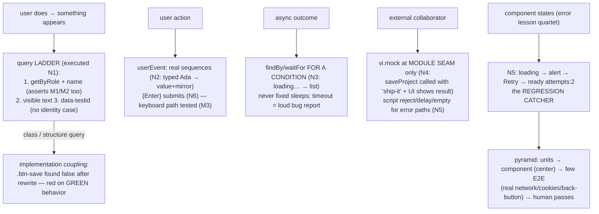

# Frontend Testing

## 1. Learning Objectives

After this lesson you can:

- [ ] Query the accessibility tree instead of the DOM structure and prove the resilience
      difference (executed N1: role query found BUTTON after a full markup rewrite;
      `.btn-save` class query found nothing — the implementation-coupled query broke)
- [ ] Drive components with `userEvent` through real event sequences (executed N2: typed
      `Ada`, controlled value and mirror both updated) and say why raw `fireEvent` is
      the weaker tool
- [ ] Test async state transitions the way users experience them (executed N3: `findBy`
      waited through `Loading users…` → the list; N5: error → `alert` → Retry →
      `loaded (attempts: 2)`)
- [ ] Mock at the **module contract** boundary (executed N4: `saveProject` called with
      `"ship-it"`) — testing behavior through collaborators, not implementation details
- [ ] Write tests that fail when behavior regresses and survive correct refactors — the
      testing pyramid for components, and what still needs E2E and a human

## 2. Prerequisites

- [Accessibility](accessibility.md) — role/name queries are this lesson's vocabulary
- [Error and Loading States](error-and-loading-states.md) — the states the async tests assert
- [08 — Modules](../08-JAVASCRIPT-AND-TYPESCRIPT/modules.md) — imports are the seam mocks attach to

## 3. Introduction

Component tests are **executable specifications of behavior**: they describe what the
user does and what appears, in the user's vocabulary (roles, names, visible text) — and
by construction they resist the two failure modes of test suites: breaking on correct
refactors (the executed N1 pair is the whole argument: same UI, rewritten markup, role
query passes and class query fails) and passing while the product is broken (N5's full
error→retry contract would catch a regression in *any* of those steps). This lesson's
cluster is the method: query the tree (N1), drive real interactions (N2, N6), wait the
way users wait (N3, N5), mock only at module seams (N4) — and hold everything to the
standard that a test suite is only as good as the failures it can catch.

## 4. The Problem It Solves

Two ways component testing goes wrong, both executed into the open here. **Coupled
tests** assert implementation — class names, internal state, call order — so the first
honest refactor (rename `.btn-save`, restructure the wrapper) fails green behavior; N1's
second half executed exactly this: the rewritten Save button kept its role and name but
lost the class, and the class query returned null. **Hollow tests** assert the easy
thing instead of the important thing — that a component *rendered*, that a function was
called — so a broken Retry button or a never-resolving load still passes; N3 and N5 are
the counter-pattern: the assertions wait for the state the user cares about (list
arrived; error shown, retried, recovered with `attempts: 2` proving the second attempt
actually ran). The toolchain (Vitest + React Testing Library) exists to make the right
thing the easy thing: role queries *require* you to specify what a user would say ("the
Save button"), `userEvent` *requires* real event sequences, and `findBy`/`waitFor`
*require* waiting for outcomes rather than asserting intermediate renders. What the
toolchain cannot do — network reality, cross-tab flows, real browsers, real AT — is
this lesson's honest boundary into E2E and human testing.

## 5. Core Concepts

### Query by role: N1's resilience experiment, executed

```console
N1 v2 role found: BUTTON | N1 class .btn-save found: false
```

N1 rendered Save-v1 (`<div className="toolbar"><button className="btn-save">`) and
Save-v2 (`<section><span><button><strong>Save</strong>`) — the same UI, two DOMs — and
ran both queries against each. The role query found `BUTTON` in both versions (role and
accessible name survived the rewrite — users never saw the structure); the class query
found `.btn-save` in v1 and **nothing** in v2. That executed pair is this lesson's
foundational argument, stated as a rule: **tests should break when behavior changes, not
when structure does.** The query-priority ladder the discipline follows — `getByRole`
first (it constrains to what AT exposes, *and* checks semantics: a `<div onClick>` that
lost its role fails the query, making M1's contract testable), then accessible name
(`{ name: "Save" }` — which also asserts M2's naming), then visible text, then
`data-testid` as the honest escape hatch for things with no semantic identity (a chart
canvas, a purely decorative region). Every query you *don't* need (container walking,
`querySelector`) is coupling you didn't add.

### Drive it like a user: userEvent vs fireEvent

```console
N2 value: Ada | mirror: Ada
```

N2 typed `Ada` through `userEvent.type` and the controlled input's value *and* its
mirror span both read `Ada` — the full controlled-input contract (the forms lesson's
value/onChange loop) exercised in one action. The distinction this executes: `userEvent`
builds the real event sequence (focus, keydown, keypress, textInput, input, keyup — and
`pointerdown`/`click` for clicks), while `fireEvent` dispatches **one synthetic event**
per call. For controlled inputs that difference is practical (fireEvent.change can
bypass the keystroke behavior real typing exercises), and for everything else it's
about honesty: a test that types should type — N6 made that concrete, pressing `{Enter}`
inside the form to submit it, a keyboard path that exists for real users (M3's floor)
and must exist in tests. The related `userEvent.setup()` pattern (v14) also delays
between events, catching the race bugs a fast synthetic dispatch hides. `fireEvent` keeps
a narrow role: events with no user sequence (a bare `scroll`), or deliberately testing
degenerate input.

### Wait the way users wait: findBy and waitFor

```console
N3 found after wait: ada | list items: 2
```

N3 asserted the *loading* state immediately (`getByRole("status")` → "Loading users…"),
then `findByText("ada")` — which polls until the 50 ms promise resolved and the list
rendered. The executed sequence is the async-testing contract: **assert what's visible
now, then wait for what the user waits for** — never `sleep` and hope, never assert the
absence of loading as proof of success (loading disappears in the error path too — N5 is
why the suite has both). The failure mode `findBy`/`waitFor` protects against is the
classic false red/green: asserting synchronously after a click that triggers a promise
(fails even though the code is right) or, worse, `await new Promise(r => setTimeout(r,
100))` as a "wait" — fixed delays pass on fast machines and flake on loaded ones.
Waiting must be *for a condition*, with a timeout that fails loudly (Vitest's default
`findBy` timeout) — and a timeout failure is a first-class bug report: something the
user would have waited for never arrived (an aborted fetch left no handler — the api
lesson's failure class — and the test caught it).

### Mock at the module seam: N4's contract

```console
N4 saveProject called with: ["ship-it"]
```

N4 `vi.mock("./fakeapi", factory)` replaced the api module wholesale, clicked Save, and
asserted two things: the component **called `saveProject` with `"ship-it"`** (the
mock's call args — the component's outbound contract) and the UI **showed `Saved
ship-it`** (the inbound result flowed through). The executed pattern's rules: mock at
the **seam you don't own or can't run in CI** (the network — one module, one place) —
never mock the component's own modules or React itself (you'd be testing the mock); the
factory replaces the *whole* module, so export shapes must match (a renamed export in
the real module that the factory forgot fails here first — a good failure); and the mock
is the place to script reality (reject, delay past the timeout, return the empty array)
— which is how N5-style error paths get executed deterministically. The alternative that
belongs in the same lesson: integration tests that mock *less* (a stubbed HTTP layer
under a real hook+component tree) catch contract drift that module mocks hide — the
pyramid below prices which to write where.

### The pyramid, and what belongs where

The cluster is component-test shaped, and that's deliberate — component tests are the
**center of gravity**: fast (no browser), precise (one component's contract), and
refactor-resistant (N1). Below them, pure units (hooks' reducers, the state lesson's
derive functions — trivial to test, no DOM); above them, **E2E** for the flows no
component test can see: real network, real routing (deep link → back button), auth
cookies, multi-tab — the routing and auth lessons' contracts; and beside the pyramid,
the human passes (keyboard-only, screen reader, the accessibility lesson's section 11).
The pricing: component tests for every interactive component's states (the error lesson's
quartet × N5's flow), a handful of E2E happy paths plus the one recovery path that matters
(login failure, offline retry), and **no** snapshot tests of DOM structure (they re-couple
to structure — N1's argument, verbatim) — inline snapshots of *output strings* are the
one defensible exception. The suite's real acceptance test: deliberately break each
contract (delete the Retry handler, remove the `alt`, drop an await) and watch the
matching test fail — the same deliberate-break method as exercise 15.1's a11y probe.

## 6. How It Works



The executed method: query the tree, drive like a user, wait for conditions, mock at
seams — then place each test where its failure signal is cheapest.

## 7. Practical Examples

**Example 1 — the executed cluster, condensed (minimal case)**

```tsx
// probe-n.test.tsx — npx vitest run (executed: 6 passed)
// N1 resilience:
render(<SaveV1 />);  getByRole("button", { name: "Save" });   // ✓
render(<SaveV2 />);  getByRole("button", { name: "Save" });   // ✓  (new markup)
document.querySelector(".btn-save");                          // null — coupling broke

// N2 user-driven input:
await userEvent.type(screen.getByLabelText("Name"), "Ada");  // value === "Ada" | mirror === "Ada"

// N3 async by condition:
expect(screen.getByRole("status").textContent).toContain("Loading");
const li = await screen.findByText("ada");                    // polls through the 50ms load

// N4 module-seam mock:
vi.mock("./fakeapi", () => ({ saveProject: vi.fn(async (name) => ({ id: 1, name })) }));
await userEvent.click(screen.getByRole("button", { name: "Save project" }));
expect(api.saveProject).toHaveBeenCalledWith("ship-it");

// N5 the full recovery contract:
const alert = await screen.findByRole("alert");               // waits loading → error
await userEvent.click(screen.getByRole("button", { name: "Retry" }));
await screen.findByText(/loaded \(attempts: 2\)/);            // passed THROUGH loading

// N6 keyboard as a user (M3's floor in test form):
await userEvent.type(screen.getByLabelText("Title"), "report{Enter}"); // submits
```

- What the important lines do: role+name as the default query (N1), real event
  sequences (N2, N6), condition-polling (N3, N5), contract-boundary mocking (N4).
- **Expected output:** `6 passed`, exit 0; the console lines quoted in section 5.
- **How to run it:** `npx vitest run src/probe-n.test.tsx` (executed: React 19.3.1,
  Vitest 5.0.5, jsdom 30.1.3, @testing-library/react 16.3.0,
  @testing-library/user-event 14.6.1, @testing-library/jest-dom matchers).
- **Assumptions:** jsdom environment; fake timers NOT used (the probes use real short
  timers — deterministic enough at 30–50 ms and honest about polling).

**Example 2 — a component's contract suite (realistic use case)**

The error lesson's `ProjectsPage`, specified as its test file:

```tsx
describe("ProjectsPage", () => {
  it("shows skeleton, then rows, for a happy load", async () => {
    render(<ProjectsPage />);                                  // api seam mocked → 2 rows
    expect(screen.getByRole("status")).toHaveTextContent(/Loading/);
    expect(await screen.findByRole("cell", { name: "alpha" })).toBeInTheDocument();
  });

  it("empty search guides instead of erroring (J3)", async () => {
    render(<ProjectsPage />);                                  // mock returns []
    await userEvent.type(screen.getByLabelText("Search projects"), "zzz");
    expect(await screen.findByText(/No projects match/)).toBeInTheDocument();
    expect(screen.queryByRole("alert")).toBeNull();            // success≠failure
  });

  it("500 → alert with retry that passes through loading (N5)", async () => {
    render(<ProjectsPage />);                                  // mock rejects once, then resolves
    expect(await screen.findByRole("alert")).toBeInTheDocument();
    await userEvent.click(screen.getByRole("button", { name: "Retry" }));
    expect(await screen.findByText("alpha")).toBeInTheDocument();
    expect(screen.queryByRole("alert")).toBeNull();
  });

  it("is keyboard-operable (M3): type, Enter, rows arrive", async () => {
    render(<ProjectsPage />);
    await userEvent.type(screen.getByLabelText("Search projects"), "alp{Enter}");
    expect(await screen.findByRole("cell", { name: "alpha" })).toBeInTheDocument();
  });
});
```

- What the important lines do: one test per *user-observable state* (the quartet as
  specifications), the N5 recovery shape, `queryByRole(...)).toBeNull()` asserting the
  *absence* of the wrong state (an alert leaking into success is its own bug), and the
  keyboard path kept in the suite because users have it.
- **Expected output:** all green against the mocked seam; deleting the Retry handler's
  `setAttempt` (the deliberate break) turns test 3 red — the acceptance method of
  section 5.
- **How to run it:** `npx vitest run` — full suite in CI before every push.
- **Assumptions:** api seam mocked at the module boundary (N4); the a11y contract is
  additionally checked by the axe step of exercise 15.5.

## 8. Real-World Applications

- **Contract tests as change insurance**: role+name queries (N1) mean the design system
  can restyle and restructure freely while the suite guards behavior — the exact
  economics of refactor confidence.
- **CI gates**: Vitest on every push, plus a coverage floor on components (statement
  coverage is a floor, not a goal — the goal is the deliberate-break method); axe
  attached to the render (accessibility lesson) makes a11y regressions push-blocking.
- **Error-path coverage as product insurance**: the api lesson's reject/timeout/abort
  scripts behind the N4 mock are how the recovery UX (N5) is guaranteed to keep working —
  the paths QA hits least and users hit most.
- **Visual regression (Playwright screenshots) extends N1 honestly**: structure may
  change freely, *appearance* changes must be intentional — a separate signal, never
  via DOM snapshots.
- **Test review as design review**: a new component's test file written *first* forces
  the state quartet and keyboard path to be enumerated before implementation — the error
  lesson's "states are a design deliverable" made procedural.

## 9. Common Mistakes

| Mistake | Why it happens | How to recognize it | How to prevent it |
|---|---|---|---|
| Structure/class queries | DOM-first thinking | tests red after cosmetic refactors (executed N1) | query ladder: role → name → text → testid |
| Testing implementation state | asserting `state.s` / internal calls | green suite, broken product | assert what renders; drive via user events (N2, N6) |
| Fixed sleeps as waits | `setTimeout` in the test | flakes under load, slow suite | `findBy`/`waitFor` on conditions (N3); timeout = bug |
| Mocking too deep | mocking the component's own helpers | tests pass while wiring is broken | mock only the network/module seam (N4); integration-test the rest |
| Hollow assertions | "renders without throwing" | suite always green | per-state assertions + wrong-state absence (Example 2's `queryBy...toBeNull`) |
| Testing only the happy path | speed | retry/empty regress silently (N5's class) | quartet coverage: happy, empty, error, recovery |
| Over-reliance on E2E | "test the real thing" | slow, flaky CI; browser-bound | pyramid: E2E for flows only components can't see (section 5) |
| DOM snapshot tests | snapshot convenience | every refactor rewrites snapshots | banned for DOM (N1's argument); inline output-string snapshots only |

## 10. Best Practices

- **The query ladder is law**: `getByRole` + accessible name first (N1's executed
  resilience; it asserts M1/M2 for free), `data-testid` only for identity-less nodes.
- **userEvent + `setup()`** for every interaction (N2, N6) — keyboard paths included,
  because M3 made them load-bearing.
- **Assert states, wait by condition** (N3): loading asserted now, outcome awaited, wrong
  state asserted absent (Example 2).
- **Mock at the seam, script reality** (N4): reject/resolve/delay per test — the error
  paths are the point; keep the mock's export shape honest.
- **One user story per test** (N5's flow read as prose): a named behavior a PM could
  read aloud.
- **Deliberately break your suite** before trusting it — each contract broken, its test
  red, revert (the acceptance method, borrowed from exercise 15.1).
- **Place by cost**: units → components (center) → few E2E (network/cookies/back-button)
  → human passes (a11y, real devices) — each tier only what it alone can see.

## 11. Limitations and Trade-Offs

- **jsdom is not a browser** — no real layout, no real focus semantics in all engines,
  no CSS effects: rendering *appearance* and true hit-testing are unverified here;
  layout/visual claims belong to the browser (Playwright/screenshot) tier.
- **Module mocks can hide contract drift** — the factory pins the module's shape (a
  good failure when exports change, but behavior changes *inside* the seam are invisible);
  the mitigation is the integration tier with a stubbed HTTP layer, plus contract checks
  against types (08's `implements`) rather than mocks alone.
- **Accessibility assertions ≠ AT verified** — role queries prove the tree (M1–M6), not
  announcement quality on real NVDA/VoiceOver (the accessibility lesson's section 11
  stands unchanged).
- **Coverage numbers are vanity without the break method** — 90% statement coverage can
  still hide the unasserted Retry bug; the deliberate-break exercise is the honest
  metric and costs real time.
- **Real timers keep tests honest but slower** — fake timers accelerate suites but let
  you drift from user-perceived time (transitions, debounce — the performance lesson's
  flows); the probes used real 30–50 ms timers deliberately; choose per suite and say so.
- **E2E flakes are not free** — every flaky flow taxes trust in the whole suite; the
  lesson's pyramid keeps E2E to flows only components cannot see, each with condition
  waits (N3's rule at the browser level).

## 12. Practical Exercises

### Introductory

1. **Exercise 16.1** — Re-execute the N cluster (all six), then run the deliberate-break
   drill: (a) delete the Retry handler's state update → which test goes red? (b) rename
   `.btn-save`-style classes in a component with a class query → red on green? (c) make
   the loader hang (never resolve) → which test times out, and how long did it wait?
   **Completion criteria:** six baselines green; three breaks with the exact failing test
   and its failure message quoted; one paragraph on why (b)'s red is a *test* bug while
   (a)'s and (c)'s are *product* bugs.
2. **Exercise 16.2** — Convert five coupled tests of yours: for each, list the query used
   (class? structure? state?), rewrite it on the ladder (role+name first), and execute
   both versions against a deliberately changed DOM — prove old red / new green.
   **Completion criteria:** five conversions; the before/after transcripts under markup
   change; your personal rule for when `data-testid` is legitimate, written with N1's
   result cited.

### Intermediate

3. **Exercise 16.3** — The error-path suite: take one data view and script all four
   api behaviors behind the N4 seam (resolve / resolve-empty / reject / slow-past-
   timeout), writing one test per behavior plus the recovery flow (reject → Retry →
   resolve, N5's shape). Include a flake-hunter run: run the suite 20× and report any
   intermittent failure with its cause.
   **Completion criteria:** five tests (four behaviors + recovery) with the wrong-state
   absence assertions; 20-run flake report — zero flakes, or the diagnosed cause fixed.
4. **Exercise 16.4** — Hook units below components: extract one inline logic path
   (filter+sort, validation rules) into a pure function and test it directly (table-
   driven: inputs → expected outputs, no DOM), then keep one component test proving the
   wiring calls it. Compare test count and runtime against your previous component-only
   approach.
   **Completion criteria:** the pure-function suite (≥6 cases incl. empty and boundary),
   one wiring test, the before/after counts, and your written rule for the unit/
   component boundary.

### Independent problem-solving

5. **Exercise 16.5** — *Problem:* build the minimum suite that would have caught your
   worst frontend bug. Take a real bug from your history (or the projects'): (a) write
   the bug as a failing test FIRST (red — quote it), then fix the product (green —
   quote it); (b) enumerate the bug's *class* (off-by-one? stale closure? missing state?
   race?) and add two more tests of that class from nearby code — at least one that
   would also have been red; (c) place each test correctly in the pyramid: which of
   them could only live in E2E (real network/cookies/back-button), which belong at the
   component seam; (d) wire it into CI with a runtime budget (state your ceiling and the
   current suite time); (e) write the maintenance note: which queries/assertions will
   need edits when the design system next changes, and why the ladder minimizes that
   list. Deliver: the red→green transcripts, the class analysis with three tests, the
   pyramid placement rationale, the CI config with timing, and the maintenance note.
   **Completion criteria:** red first then green (both quoted); at least three tests of
   the bug's class with evidence one is also red pre-fix; pyramid placement argued per
   test; suite under your stated budget on a cold run.

*Solutions: attempt first. This subject's applied work is in [exercises/](exercises/README.md) —
set 12 carries this lesson's practice.*

## 13. Knowledge Check

1. N1 executed one UI, two DOMs: the role query found BUTTON both times, `.btn-save`
   found nothing in v2. State the rule this proves, and walk the query ladder down to
   the `data-testid` escape hatch with the justification for each rung.
2. N2 typed through `userEvent` and N6 submitted with `{Enter}` while N4 mocked at the
   module seam. Why is `fireEvent` the weaker default, and where exactly does mocking
   stop being honest (the seam rule)?
3. N3 waited with `findBy` and N5 waited for the recovery path. Why is a fixed sleep a
   bug in a test, and what does a `findBy` timeout actually report to you?

## 14. Completion Criteria

Observable evidence that you have understood this lesson:

- [ ] You re-executed the N cluster plus the deliberate-break drill (exercise 16.1)
- [ ] You converted five coupled tests to the ladder with before/after transcripts (exercise 16.2)
- [ ] You shipped the four-behavior error suite with a 20× flake report (exercise 16.3)
- [ ] You extracted and unit-tested one logic path with the boundary rule (exercise 16.4)
- [ ] You can diagnose all eight mistakes in section 9

## 15. Summary

- **Query the accessibility tree** (executed N1): role+name survives refactors,
  structure queries don't — tests break on behavior, never on structure.
- **Drive like a user** (executed N2, N6): `userEvent` real sequences, keyboard paths
  included (M3's floor made testable).
- **Wait for conditions, never sleeps** (executed N3): `findBy` polls the outcome; a
  timeout is a loud product bug.
- **Mock the seam only** (executed N4): contract args *and* flowed-through UI asserted;
  script reject/empty/slow to execute the error paths.
- **The recovery contract is the suite's heart** (executed N5): loading → alert → retry →
  ready with attempts proved — the deliberate-break drill proves each test's worth.
- **Place by what each tier alone sees**: units, components (center), few E2E, human
  passes — with structure snapshots banned outright.

## 16. Next Steps

- Next: [Build and Deployment](build-and-deployment.md) — the suite gates the pipeline:
  production builds, environment config, and shipping the code the tests specified
- Practice: [exercises/](exercises/README.md) — set 12
- Where it is applied: [API Integration](api-integration.md) — its abort/timeout/retry
  behaviors are exactly what exercise 16.3 scripts behind the mock seam

