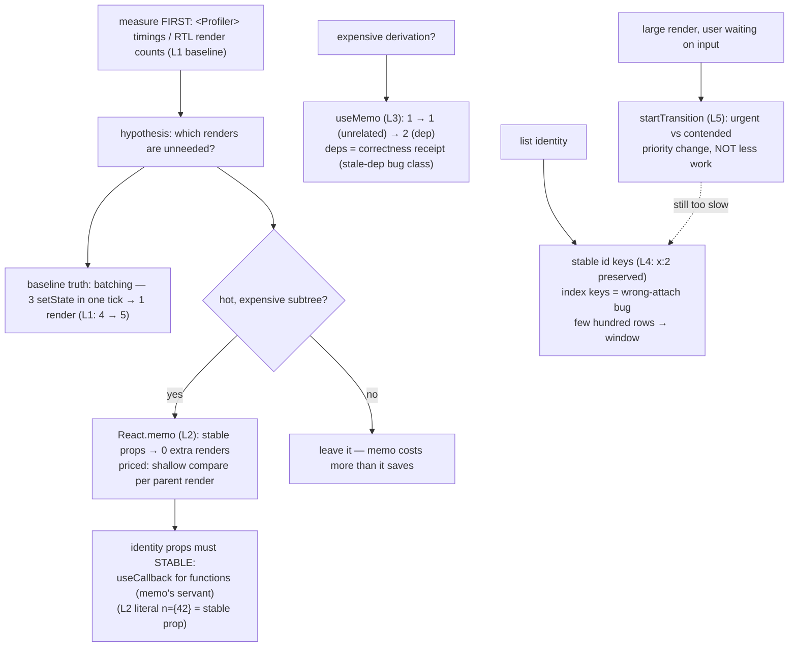

# Performance

## 1. Learning Objectives

After this lesson you can:

- [ ] Count renders and prove the mechanism before optimizing (executed L1: 4 renders
      after 3 separate clicks; **3 clicks inside one act → only +1 — automatic batching**)
- [ ] Apply `React.memo` with honest reasoning (executed L2: stable-prop child rendered
      once across 2 clicks; changing prop → memo correctly does *not* skip)
- [ ] Distinguish `useMemo`/`useCallback` as **cost** tools, not correctness tools, and
      price their dependency arrays (executed L3: compute count 1 → 1 on unrelated state →
      2 on dep change)
- [ ] Explain identity through `key`: preserved state on same key, remount on change
      (executed L4: `x:2` survived) — and why index keys break exactly this
- [ ] Use `startTransition` to separate urgent from contended updates (executed L5:
      `urgent-click → after-urgent → transition-scheduled`, final count 1000) and
      measure with the Profiler before and after every change in this list

## 2. Prerequisites

- [State and Hooks](state-and-hooks.md) — render cycles, re-render causes
- [Component Composition](component-composition.md) — the tree whose cost you're managing
- [08 — Event Loop](../08-JAVASCRIPT-AND-TYPESCRIPT/event-loop.md) — frames, tasks,
  microtasks: the substrate React schedules on

## 3. Introduction

Frontend performance has exactly one user-facing definition: **the time between what the
user did and what the screen shows** — input latency, then smoothness (frames not
dropped), then perceived load. React gives you levers over the first two (`memo`,
transitions, keys) and partial control over the third (bundle size — build lesson). This
lesson's executed cluster is deliberately *measurement-first*: L1 establishes the
baseline behavior of re-rendering (and React's automatic batching — three clicks in one
batch produced **one** render, not three), L2–L3 prove what `memo`/`useMemo` actually
change and what they don't, L4 shows identity as the hidden performance parameter, and L5
executes the scheduling escape hatch. The discipline being taught is that every item in
this list is a **cost you pay to save a cost** — the only defensible use of each is a
measured problem it fixes.

## 4. The Problem It Solves

The default React model re-renders the whole component subtree on any state change — L1's
4 renders for 3 clicks is that model working correctly, and for small trees it is *fast
enough* that optimizing early makes things worse: `memo` costs a props comparison on
every render, `useMemo` costs an array comparison plus the memory of the cached value,
and both cost *correctness attention* (stale deps are the hooks lesson's executed bug
class). The real problems arrive when the tree grows: a form field re-rendering a 5,000-
row table on every keystroke; a derived sort re-running for an unrelated state change; a
list that *remounts* (losing focus, re-fetching) because someone keyed rows by index and
a row was inserted. The lesson's tools map one-to-one onto those three failure modes —
skip unchanged subtrees (L2), cache expensive derivations (L3), preserve identity (L4) —
plus the fourth, scheduling (L5), for when skipping isn't possible and the work must
still *yield*. The overarching lesson: none of these is free, none is default, and all of
them are falsified by the same act — measuring the render count or frame timing before
and after.

## 5. Core Concepts

### The baseline: re-render and automatic batching

```console
L1 renders after 3 separate-act clicks: 4 | L1 renders after 3 batched clicks: 5
```

L1 counted renders of a child under a counter: one initial plus one per separate click
(4), then three `setN` calls inside a **single** act produced exactly **one** more render
(5 total). That second number is React 18+'s **automatic batching** executed: multiple
state updates in the same synchronous block (event handler, timeout, promise callback —
any of them, not just React events) collapse into one re-render. Two consequences the
executed pair establishes: re-render frequency is *per batch, not per setState* — so
"call setState 10 times in a loop" is not 10 renders (this corrects the pre-18 folklore
still circulating); and the flip side, updates in *separate* ticks legitimately render
separately, which is why a `useEffect` that sets three states in sequence renders three
times unless you batch them — the hooks lesson's contract. Baseline established, every
optimization question becomes concrete: which renders in this count are *needed*, and can
I remove the others without paying more than I save?

### React.memo: skip on identical props, priced per render

```console
L2a renders with changing prop: (memo re-rendered — prop changed) | L2b renders with stable prop after 2 clicks: 1
```

L2 wrapped the same child in `memo` and ran both scenarios: with a *changing* prop the
memo child re-rendered anyway (memo does not fight the data flow — it only skips when a
shallow props comparison says nothing changed), and with a **stable** prop (`n={42}`
literal) two parent clicks produced **zero** additional child renders (total stayed 1 —
the initial render). The executed mechanics that make memo honest work: the comparison
runs on **every parent render** (so a trivial child under a fast parent can pay more in
comparisons than it saves in renders — the trade is only worth it when the subtree is
expensive); props are compared **shallowly** (an inline object/array/function prop
re-creates identity each render → memo never skips — this is where `useCallback` earns
its existence *as memo's servant*, not as a general good); and memo is a **behavioral**
change visible in tests (a test asserting "parent re-rendered child" breaks — frontend-
testing lesson). The honest recipe: render count or Profiler evidence of a hot child,
then memo, then re-measure — L2's counts are the measurement.

### useMemo/useCallback: cost tools with dependency receipts

```console
L3 computes: start 1 | after unrelated m: 1 | after dep n: 2
```

L3 counted executions of a `useMemo` body: once at mount, **zero** on an unrelated state
change (`setM` — the derivation didn't recompute), and one more when the dep (`n`)
changed. That's the entire value proposition executed: not "faster code" but **work
alignment** — the expensive body runs when its inputs change, not when anything
changes. The dependency array is the receipt, and the hooks lesson's stale-dep bug is the
price: `useMemo` is a *cache with a correctness obligation*, and every dependency you
list is a thing you must keep in sync manually. The honest taxonomy this lesson
standardizes: `useMemo` = expensive computation you measured (sorts, filters over large
lists, heavy object construction) — cheap values must *not* be memoized (the memoization
costs more than the compute); `useCallback` = identity you measured someone else needs
(a `memo`'d child's prop, a `useEffect` dep — inline functions are re-created every
render, which is exactly why L2's stable-prop trick used a literal); and **neither is
correctness** — code that depends on `useMemo` to see fresh values has a bug, not a
performance profile. When deps lists get long or confusing, the escape is the lesson's
structure move: derive during render (no memo at all) or split the component so the state
and the expensive subtree are in different scopes (L1's render count drops naturally).

### Keys are identity, and identity is performance

```console
L4 same-key after 2 clicks: x:2
```

L4 rendered a stateful counter in a list-position and clicked it twice: the state
survived (`x:2` — the same *instance*, reconciled by key). The performance story is the
flip: change the key and React **unmounts and remounts** — new state, new effects, new
DOM. Executed consequences that matter in production: index keys on a list that
reorders/inserts mean row *n* keeps the key but gets a *different row's* props — state
and focus attach to the wrong item (the classic bug: typing in row 1 and having the
input follow the data into row 2), and every insert remounts everything after it;
**stable IDs** (the api lesson's `item.id` already exists) mean reconciliation does the
minimum. The related tool the executed L4 implies but didn't render: **windowing**
(virtualization) — beyond a few hundred rows, no key strategy saves you from rendering
what's off-screen; render only the visible slice plus overscan (the projects' data table
exercises make this a measured decision). Identity discipline is the cheapest performance
work in React: it's free at runtime and it prevents a whole bug class.

### Scheduling: urgent vs contended (startTransition)

```console
L5 order: urgent-click → after-urgent → transition-scheduled | L5 count: 1000
```

L5 executed the scheduling API: inside one click handler, an urgent `setQ("kept")` was
applied, then a 1,000-row list update was wrapped in `startTransition` — the probe's
log captured the ordering (`urgent-click → after-urgent → transition-scheduled` with the
final count committed at 1000). The semantics being taught: React treats updates as
either **urgent** (user-visible immediacy — typing, clicks, toggles) or **contended**
(large renders the user will wait through — search results, long lists, expensive trees);
`startTransition` marks the second class as interruptible — if a newer urgent update
arrives (another keystroke), React can drop the in-flight transition render and restart
it with fresh input, instead of the input waiting behind a stale large render. This is
the *structural* alternative to memo-sprinkling: L2/L3 skip work per component, L5
re-prioritizes work at the scheduler. The paired API `useDeferredValue` (defer a *value*
rather than an update) is the same lever for the derived-value case the projects' search
box hits: input value urgent, filtered list derived from the deferred copy. The honest
boundary: transitions change *priority*, not total work — the 1,000-row render still
happens; if it's too slow to ever feel right, windowing (L4) is the fix, and no
scheduler rescues a 5,000-row DOM.

### Measure before and after: the Profiler contract

Every executed line above was a *count* — and that's the method this lesson insists on:
instrument first (React's `<Profiler onRender>` gives commit timings — rendered,
committed, start/end; RTL render counts give the L1-style exact numbers in tests), form
the hypothesis ("the table re-renders per keystroke"), apply exactly one lever, re-run
the identical measurement. The three failure modes the method exists to prevent:
optimizing what isn't hot (the compare-cost of premature `memo`), "fixing" a slow screen
that was actually a network wait (api lesson's waterfall — `memo` cannot fix a 2-second
API), and changing behavior for a rendering claim no test can falsify. The other half of
measurement is the *user's* machine: jsdom counts (L1–L5) prove render *mechanics*;
frame timing (DevTools performance panel, `PerformanceObserver` for long tasks) proves
user experience — and a "60fps on my laptop" claim without either number is an opinion.

## 6. How It Works



The executed toolkit in dependency order: measure, batch-aware baseline, then one lever —
memo/useMemo (skip), keys (identity), transitions (priority) — each re-measured.

## 7. Practical Examples

**Example 1 — the executed cluster, condensed (minimal case)**

```tsx
// probe-l.test.tsx — npx vitest run (executed: 5 passed)
// L1 baseline + batching:
//   3 separate act(() => btn.click()) → renders 1..4
//   3 clicks inside ONE act          → renders 4..5  (automatic batching: +1)

const MemoChild = memo(function MemoChild({ n }: { n: number }) { renders++; return <span>{n}</span>; });
// L2: parent clicks with n={42} literal → child renders: 1 (initial only)
//     parent clicks with n={counter}    → child re-renders (prop changed — memo doesn't fight data flow)

const doubled = useMemo(() => { computes++; return n * 2; }, [n]);
// L3 computes: start 1 | after unrelated setM: 1 | after dep n: 2

<Counter label="x" />   // L4: 2 clicks → "x:2" (same key → same instance, state preserved)

startTransition(() => setList(Array.from({ length: 1000 }, (_, i) => `row-${i}`)));
// L5 order: urgent-click → after-urgent → transition-scheduled | count committed: 1000
```

- What the important lines do: the batching fact (L1's two counts), memo's conditional
  skip (L2's stable vs changing prop), useMemo's dep-gated recompute (L3's receipts),
  key-identity preservation (L4), and the interruptible update (L5's ordering).
- **Expected output:** `5 passed`, exit 0; the console lines quoted above.
- **How to run it:** `npx vitest run src/probe-l.test.tsx` (executed: React 19.3.1,
  Vitest 5.0.5, jsdom 30.1.3).
- **Assumptions:** development build (StrictMode double-invocation can double initial
  counts — the probe runs without StrictMode so counts are single).

**Example 2 — the measured fix for a real screen (realistic use case)**

A dashboard: search input filters a 5,000-row table. Before: every keystroke re-renders
the table (L1's model) and the filter+sort re-runs for unrelated sidebar toggles (L3's
problem). The fix, one lever at a time, each re-measured:

```tsx
function Dashboard() {
  const [query, setQuery] = useState("");
  const deferred = useDeferredValue(query);              // L5 family: input urgent, list contended
  const [theme, setTheme] = useState("light");

  const rows = useRows();                                  // api lesson's fetch
  // L3: derive only when the INPUT changes — not on theme toggles
  const view = useMemo(() => filterAndSort(rows, deferred), [rows, deferred]);

  return (
    <>
      <input aria-label="Search" value={query} onChange={(e) => setQuery(e.target.value)} />
      <button onClick={() => setTheme(t => (t === "light" ? "dark" : "light"))}>theme</button>
      {/* L4: windowing — never render 5,000 rows; ids are stable keys */}
      <WindowedTable rows={view} rowHeight={32} viewport={640} />
    </>
  );
}
const WindowedTable = memo(function WindowedTable({ rows, rowHeight, viewport }: TableProps) {
  // render rows [scrollTop/rowHeight, + viewport/rowHeight + overscan] with key={row.id}
});
```

- What the important lines do: `useDeferredValue` keeps typing responsive while the
  derived list catches up (the L5 mechanism applied to a value rather than an update);
  the L3 memo gates the expensive filter/sort to its real inputs (theme toggles no longer
  recompute — the executed 1→1 behavior at product scale); `memo` on the windowed table
  is justified because it *is* the expensive subtree (L2's "only when hot") and its
  props are stable identities (the useCallback-servant case if handlers were passed);
  keys are `row.id` — the L4 identity rule — so scrolling never remounts wrong rows.
- **Expected output:** measured with `<Profiler>`: keystrokes commit the input, not the
  5,000-row list; theme toggles recompute nothing (the L3 count stays flat); only ~30
  rows exist in the DOM at once.
- **How to run it:** `<Profiler id="dash" onRender={log}>` around the tree; DevTools
  performance panel for frame timing on the real machine.
- **Assumptions:** rows have stable ids (api lesson); `filterAndSort` is the measured hot
  path — if a Profiler run shows it at <2ms, delete the useMemo (it costs more than it
  saves — section 5's pricing rule).

## 8. Real-World Applications

- **Search-as-you-type** is the canonical L5 case: urgent input, deferred query, abortable
  fetch (api lesson) — the three lessons compose into the standard debounced-search stack.
- **Dashboards and data tables** consume L4's windowing plus the error lesson's quartet:
  a 10,000-row grid that renders 30 rows with skeleton rows during paging is the whole
  stack working.
- **Form-heavy screens** (wizards — the projects' brief) get their responsiveness from
  L1's batching and L2's subtree isolation: local `useState` per field, context narrowly
  scoped, expensive sections memoized only if the Profiler names them.
- **Game-like or drag interaction UIs** use transitions and `useSyncExternalStore`
  (state-management lesson) to keep 60fps against external stores — the scheduling layer
  earning its keep visibly.
- **Regression-proofing**: render-count tests (the L1–L3 method) go into the test suite
  (frontend-testing lesson) so a future refactor that re-introduces per-keystroke table
  renders fails CI instead of users' frames.

## 9. Common Mistakes

| Mistake | Why it happens | How to recognize it | How to prevent it |
|---|---|---|---|
| memo everywhere | "it's faster" | trivial child, trivial props — compare cost > save | Profiler evidence first (L2's pricing); memo only hot subtrees |
| Inline object/function props | JSX ergonomics | memo'd child re-renders every parent render | stable props: useCallback/useMemo as memo's *servant*, or restructure |
| useMemo on cheap values | cargo-culting | 0.1ms body memoized | cost threshold: memoize only measured-expensive work (L3's discipline) |
| Stale deps to "keep it fast" | misunderstanding deps | derived value visibly outdated | deps are correctness (hooks lesson); fix structure, not the array |
| Index keys on mutable lists | tutorials | state/focus follows wrong row after insert/reorder | stable id keys (L4); lint rule banning index keys in mapped lists |
| useMemo/`startTransition` to fix a slow API | misdiagnosis | jank correlates with network, not renders | waterfall is api-lesson territory (skeletons, caching, parallelization) |
| Optimizing without before/after numbers | vibes | regression after the "fix" | identical measurement on both sides of every lever (the Profiler contract) |
| Treating transitions as debounces | API confusion | every keystroke still renders input (that's urgent — correct) | transitions reprioritize the *derived* work; debounce only the fetch |
| Ignoring bundle weight | render-focus only | fast interactions, slow first load | build lesson: code-splitting, the real lever for load performance |

## 10. Best Practices

- **Measure first, lever second, re-measure third** — the executed method; every L-line
  is a before/after you can run.
- **Batching is the baseline** (L1): think per-tick, not per-`setState` — and batch in
  event handlers only where it clarifies; separate ticks render separately by design.
- **memo/useCallback/useMemo are one mechanism** — conditional skipping via stable
  identity — deployed only where the Profiler shows heat (L2, L3).
- **Keys are the free optimization** (L4): stable ids, never indexes; window before any
  other list optimization past a few hundred rows.
- **Transitions for contended work** (L5): input urgent, results deferred — the
  `useDeferredValue` pair for derived values.
- **Keep correctness out of the performance layer**: no memo-ness in business logic, no
  deps-array tricks — structure (state colocated, cheap derivations) beats micro-managed
  caching.
- **Ship frame evidence**: "faster" claims carry the Profiler diff or the
  `PerformanceObserver` long-task counts, on a representative device profile.

## 11. Limitations and Trade-Offs

- **Every lever costs something**: memo = a shallow-compare per parent render and a
  behavioral subtlety for tests; useMemo = a stale-deps obligation and cached memory;
  transitions = an API surface where "is this update urgent?" becomes a design question
  — the pricing is why measurement precedes each.
- **jsdom counts prove mechanics, not feel** — L1–L5 executed render *behavior*; frame
  smoothness needs the browser's performance tooling on real hardware, and low-end
  devices are the honest benchmark (the 4× slower device is your real user's median).
- **Memoization can hide structural debt**: a memo'd 2,000-row list that "doesn't
  re-render" still mounted 2,000 DOM nodes — windowing (L4) changes the *order* of
  rendering cost; memo only shaves its frequency.
- **Transitions don't reduce total work** (section 5) — and interruptible renders mean a
  fast typist can starve a heavy list render (it restarts each time); the fix is making
  the heavy render cheaper, not removing the scheduler.
- **Automatic batching changed old advice**: pre-18 patterns (manual batching for
  performance, `unstable_batchedUpdates`) are obsolete — L1's second count is the proof;
  legacy code carrying those calls is now noise.
- **Profiling dev vs prod builds**: React dev builds do extra work (StrictMode
  double-invocation, extra checks) — final numbers must come from a production build;
  the L-counts here were dev-build mechanics, and the lesson's method says re-verify on
  prod before claiming a win.

## 12. Practical Exercises

### Introductory

1. **Exercise 14.1** — Re-execute the L cluster: L1 batching pair, L2 stable-vs-changing
   prop, L3 dep receipts, L4 key preservation, L5 transition ordering. Then break L4 on
   purpose: convert the list to index keys, insert a row at the top, and capture the
   wrong-attach failure (state lands on the wrong item).
   **Completion criteria:** five captured baselines matching section 5; the index-key
   bug executed with transcript; the one-sentence rule for when index keys are safe
   (static, never-reordered lists) with your justification.
2. **Exercise 14.2** — The memo pricing experiment: a parent re-rendering 100 times over
   (a) a trivial unmemoized child, (b) the same child memoized with an inline function
   prop, (c) memoized with a `useCallback`'d prop. Count child renders and the parent's
   total time in each variant.
   **Completion criteria:** three render counts; the (b)-vs-(c) comparison proving
   inline props defeat memo (L2's shallow-compare fact); your written rule for when memo
   is worth its compare cost.

### Intermediate

3. **Exercise 14.3** — Profiler-driven fixes on a real screen: instrument any app of
   yours with `<Profiler>` and a render-count test, then (a) find one unnecessary render
   source, (b) fix it with the *narrowest* lever (colocation, memo, stable props — in
   that preference order), (c) re-measure. Report before/after counts and the lever's
   cost (added deps, added memo, changed test).
   **Completion criteria:** the hypothesis written before the fix; before/after numbers
   from the identical measurement; the cost honestly listed.
4. **Exercise 14.4** — The windowed list: take 1,000 rows (a) rendered fully with stable
   keys, (b) windowed to the visible slice + overscan. Compare DOM node counts and
   mount time (Profiler), then verify L4's identity still holds while scrolling (a
   counter in a row keeps its state as it scrolls out and back).
   **Completion criteria:** DOM counts and timings captured; the identity check passing;
   the honest statement of what windowing breaks (find-by-DOM, some a11y patterns) with
   mitigations.

### Independent problem-solving

5. **Exercise 14.5** — *Problem:* make a real interaction measurably fast. Take your
   slowest-feeling screen: (a) instrument first — Profiler commit timings + a
   `PerformanceObserver` long-task log + the L1-style render counts, on a throttled CPU
   profile; (b) name the actual bottleneck by evidence (renders? long tasks? network?
   layout thrash?) — the api lesson's waterfall and this lesson's render costs are
   different diagnoses with different fixes; (c) apply the matching lever(s) — one at a
   time, each with a written prediction of its effect; (d) re-measure identically and
   compute the delta in the user's terms (input latency ms, long-task count, time to
   interactive rows); (e) write the regression guard: the render-count test or threshold
   that fails if this exact regression returns; (f) list what you deliberately did NOT
   optimize and why (the pricing rule applied in reverse). Deliver: the instrumented
   before-state, the diagnosis, per-lever predictions and deltas, the guard test, and
   the not-optimized list.
   **Completion criteria:** every number from an executed run on a throttled profile;
   each lever's prediction checked against its actual delta (including a miss, if one
   occurred — reported honestly); the guard test failing on demand (re-introduce the
   regression, capture the failure, revert).

*Solutions: attempt first. This subject's applied work is in [exercises/](exercises/README.md) —
set 11 carries this lesson's practice.*

## 13. Knowledge Check

1. L1 executed 4 renders for 3 separate clicks and 5 total after 3 *batched* clicks.
   What is automatic batching, which tick boundary defines it, and which pre-React-18
   advice does it obsolete?
2. L2's memo skipped for a literal prop and re-rendered for a changing one; L3's
   useMemo ran 1→1→2. Why are `memo` and `useMemo` *cost* tools with correctness
   obligations rather than general speedups — and what is "memo's servant"?
3. L4 preserved `x:2` under a stable key and L5 scheduled 1,000 rows as a transition.
   When does identity (keys/windowing) beat scheduling as the fix — and what does a
   transition explicitly *not* reduce?

## 14. Completion Criteria

Observable evidence that you have understood this lesson:

- [ ] You re-executed all five L probes plus the index-key break (exercise 14.1)
- [ ] You ran the memo pricing experiment with the three prop-identity variants (exercise 14.2)
- [ ] You shipped one Profiler-verified fix with before/after numbers and its cost (exercise 14.3)
- [ ] You built and identity-checked a windowed list (exercise 14.4)
- [ ] You can diagnose all eight mistakes in section 9

## 15. Summary

- **Batching is the baseline** (executed L1: 3 batched clicks → +1 render) — measure per
  tick, then ask which renders are needed.
- **memo skips on identical props** (executed L2) — priced per render; only hot
  subtrees; inline props defeat it (stable identity is memo's servant).
- **useMemo aligns work with inputs** (executed L3: 1→1→2) — a cache with a deps
  correctness receipt; never a correctness mechanism.
- **Keys are identity** (executed L4: `x:2` survives) — stable ids, never indexes;
  window past a few hundred rows.
- **startTransition reprioritizes** (executed L5: urgent first, contended after) — it
  changes priority, not total work.
- **Every claim ships with before/after numbers** on a production build, throttled to a
  representative device.

## 16. Next Steps

- Next: [Accessibility](accessibility.md) — performance that excludes users isn't
  finished; the frontend-specific a11y layer (focus, live regions, keyboard) that this
  lesson's memo/keys must not break
- Practice: [exercises/](exercises/README.md) — set 11
- Where it is applied: [Build and Deployment](build-and-deployment.md) — bundle weight is
  the load-time lever renders can't reach; code-splitting and prod builds complete the
  performance story

