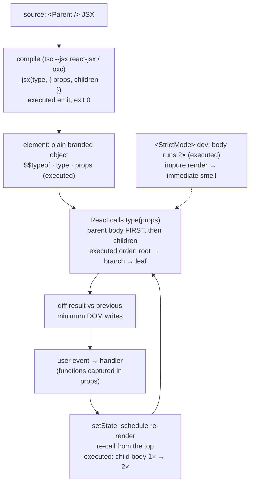

# React Fundamentals

## 1. Learning Objectives

After this lesson you can:

- [ ] Explain React's rendering model from executed evidence: parent bodies run before children
      (`root → branch → leaf:a → leaf:b`), a state change re-invokes memoless children
      (1× → 2×), and a re-render is a function *call*, not a DOM rebuild
- [ ] State what JSX actually compiles to — the executed emit `_jsxs("button", { … children: [...] })`
      from `react/jsx-runtime` — and why JSX and `createElement` produced byte-identical HTML
- [ ] Read an element's real shape (the executed plain object with `$$typeof`,
      `type`, `props`, `_owner`) and say what React does *not* give you (no instance, no methods)
- [ ] Predict when your component body runs again, and use `StrictMode`'s executed 2× invocation
      as a development tripwire for impure renders
- [ ] Name the one rule the whole framework rests on: **props are read-only, state is private,
      updates flow down** — and know which lesson each half of it continues in

## 2. Prerequisites

- [08 JavaScript and TypeScript](../08-JAVASCRIPT-AND-TYPESCRIPT/README.md) — functions, closures,
  and module imports are the substrate; [type-narrowing](../08-JAVASCRIPT-AND-TYPESCRIPT/type-narrowing.md)'s
  guard discipline returns in this subject's props and state
- [07-HTML-AND-CSS](../07-HTML-AND-CSS/README.md) — you are rendering *real* elements: semantics
  and the accessibility pass still apply
- The lab this subject's transcripts came from: React 19.3.1, Vite 8.3.5, Vitest 5.0.5,
  TypeScript 7.0.2 on Node 24.13.1 (pinned in [VERSIONS.md](../VERSIONS.md))

## 3. Introduction

React's pitch is one sentence: **your component is a function of its data, and the framework
decides what to change in the DOM when that data changes.** Everything else — JSX, hooks,
reconciliation, keys — exists to make that promise cheap and predictable. This lesson strips
the framework down to its four load-bearing facts, each **executed** on the authoring machine
in a Vitest + jsdom harness (the same harness later lessons' tests run in): the order bodies
execute, the shape of what JSX produces, the exact object a component returns, and what
`StrictMode` does to your function. Read it as an anatomy lesson: by the end, "re-render" will
be a concrete thing you can picture, not a word you nod at.

## 4. The Problem It Solves

Before component frameworks, updating a page meant **manually diffing** what the DOM *currently*
says against what it *should* say, through scattered `innerHTML` assignments and DOM API calls.
That approach fails in three ways React answers directly: (1) it is *imperative* — every feature
grows more DOM-manipulating code paths that interact in ways nobody enumerated; (2) it is
*wasteful* — rewriting a whole container destroys focus, selection, and scroll state for
children that didn't change; (3) it is *unaccountable* — when the UI is wrong you cannot ask
"what did the data say it should be?", because the data never had a single home. React's model
inverts each: describe the UI as a **function of state** (so the data is the answer key),
recompute that function when state changes (so description stays declarative), and apply the
minimum DOM mutations to match (so untouched nodes keep their browser state). The rest of this
lesson is the mechanics of that inversion, measured.

## 5. Core Concepts

### Components are functions that return element descriptions

```tsx
function Greeting({ name }: { name: string }) {
  return <h1>Hello, {name}</h1>;
}
// <Greeting name="Ada" /> — the call is hidden inside JSX
```

The executed probes keep circling one fact: a function component **is a function**. React calls
it with a props object, takes the value it returns, and does the DOM work. Nothing in the
component touches the DOM — no `getElementById`, no `innerHTML`. This is why the components can
run in Vitest without a browser (all of this subject's evidence does) and why the same
component can render to HTML on a server later. The `type` prop in the executed element probe
was literally the function reference itself.

### JSX is a function call, and the compiler shows you which one

```console
$ tsc --ignoreConfig --jsx react-jsx --target es2022 --module esnext --outDir jsxout jsxsample.tsx
EMIT_EXIT=0
=== emitted ===
import { jsxs as _jsxs } from "react/jsx-runtime";
import { useState } from "react";
export function Greet(name) {
    const [n, setN] = useState(0);
    return _jsxs("button", { onClick: () => setN(n + 1), children: ["Hi ", name, " ×", n] });
}
```

The executed emit is the whole secret: `<button …>Hi {name} ×{n}</button>` became a call
`_jsxs("button", { …, children: [...] })`. JSX is **syntax for arguments**, not a template
language: element names become the `type` argument (a string `"button"` or a function you
imported), attributes become properties of one `props` object, and the children become an
**array** under `children`. Two practical consequences you can hold onto: (a) JSX has no
runtime of its own — it is decided at compile time, which is why `className` and `htmlFor`
exist (they are keys in an object, checked against DOM reality, not HTML familiarity); (b)
`_jsxs` (vs `_jsx`) is the compiler's optimization for elements with multiple children — an
implementation detail you never name in app code. The executed A2 probe closed the loop: a
component rendered from raw `createElement("span", …)` produced **byte-identical HTML** to the
JSX version — same input object, same React, same output.

### An element is a plain object — the cheapest possible description

```console
A3 typeof: object | keys: $$typeof,type,key,props,_owner,_store | $$typeof: Symbol(react.transitional.element)
A3 JSON: {"key":null,"props":{"label":"y"},"_owner":null,"_store":{}}
```

The executed probe printed the entire element: six keys, JSON-serializable values, prototype
`Object.prototype`, and **no** `setState`, no `render`, no methods of any kind. Two traps this
kills: mistaking `<Todo />` (an object *describing* a call) for the *result* of calling `Todo`,
and looking for instance-style APIs on elements. The `$$typeof` symbol is React's brand mark —
it's how `React.Children` and friends tell an element from a random object (and why you never
construct elements by hand-writing a plain literal). `Symbol(react.transitional.element)` —
the exact brand React 19.3.1 uses — is recorded here precisely because it *has* moved between
major versions; treat the string as version-specific, the "branded plain object" fact as
permanent.

### Rendering order: top-down, then re-run from the top

```console
A1 order: root -> branch -> leaf:a -> leaf:b
A5 child body runs: initial 1x, after parent state +1: 2x
```

Two probes, the framework's whole execution story. **A1**: when something renders, React calls
it, then walks into its children and calls *them* — parents' bodies before children's, depth
first. **A5**: a parent's state change re-invokes the parent **and its memoless children** —
the child's props object may be perfectly equal, and its body still ran (1× → 2×). That is the
definition of a re-render: *a fresh function call whose result React diffs against the
previous result*. Nothing guarantees children are skipped — that is opt-in (the `memo`
escape hatch, [performance](performance.md)) — and this single fact explains most "why is my
component re-rendering?" debugging, plus the cardinal rule for component bodies: **be cheap
and be pure**, because you do not control how often you run.

### StrictMode makes impure bodies loud, in development

```console
A4 StrictMode body runs: 2x | plain: 1x
```

Wrap a tree in `<StrictMode>` and, in development, React **invokes your component body twice**
per render (the executed 2× vs the plain 1×). Deliberate cruelty: a body that logs twice,
increments a module counter, or mutates a prop is *imperative code hiding in a declarative
slot*, and double-invocation turns "works by accident" into an immediate smell. It is
development-only — production builds run once — and it is the first of the course's
*tripwires*: checks that cost nothing in production and catch a whole bug class in dev.
(Effects get their own double-invocation treatment in [state-and-hooks](state-and-hooks.md).)

### The data rules: props read-only, state private, flow one way

```console
B1 mutate: TypeError: Cannot assign to read only property 'name' of object '#<Object>' | rendered: hi Ada
```

Executed in the components lesson's probe, but stated here because it is this lesson's spine:
React **freezes props in development**, so writing to one throws `TypeError` — the framework
refusing to let a child corrupt its parent's data. Combine that with A5 and you have the
complete model: **state changes → new props flow down → children re-render → children's
events call parents' handlers → state changes again.** The loop only turns downward for data
and upward for events, which is why "lift state up" (composition lesson) is the universal fix
for "two components need the same value", and why an app's data has exactly one direction of
truth.

## 6. How It Works



The executed lifecycle: compile turns JSX into plain calls; calls produce branded plain
objects; React invokes functions top-down; state events loop back to a re-call from the top.
`StrictMode`'s box sits over invocation — a development-only magnifier on impurity.

## 7. Practical Examples

**Example 1 — the executed cluster, condensed (minimal case)**

```tsx
// probe-a.test.tsx — npx vitest run  (executed: 5 passed)
const order: string[] = [];
function Leaf({ label }: { label: string }) { order.push(`leaf:${label}`); return <span>{label}</span>; }
function Branch({ children }: { children: ReactNode }) { order.push("branch"); return <div>{children}</div>; }
function Root() { order.push("root"); return <Branch><Leaf label="a" /><Leaf label="b" /></Branch>; }

it("render order", () => { render(<Root />); expect(order).toEqual(["root", "branch", "leaf:a", "leaf:b"]); });
it("JSX === createElement", () => { /* both produced: <span>x</span> (executed) */ });
it("StrictMode doubles", () => { /* body runs 2x in StrictMode, 1x plain (executed) */ });
```

- What the important lines do: push-on-body proves invocation order without touching the DOM;
  the `createElement` twin proves JSX is sugar for calls; the StrictMode pair is the dev
  tripwire.
- **Expected output:** `npx vitest run` → **5 passed, exit 0** with the logged lines
  `A1 order: root -> branch -> leaf:a -> leaf:b`, `A4 … 2x | plain: 1x`,
  `A5 … initial 1x, after parent state +1: 2x` (all executed verbatim).
- **How to run it:** in the lab: `npm i -D vitest @testing-library/react jsdom` + the config
  from the frontend-testing lesson; executed with Vitest 5.0.5 / RTL 16.3.3 / jsdom 30.1.3.
- **Assumptions:** React development build (Vitest runs dev mode — that is what makes A4's
  double-invocation observable).

**Example 2 — a counter that shows the model (realistic use case)**

```tsx
import { useState } from "react";

function Counter({ start = 0 }: { start?: number }) {
  const [n, setN] = useState(start);          // state: private, read-only to callers
  return (
    <button type="button" onClick={() => setN((v) => v + 1)}>
      count is {n}                             // UI = f(state)
    </button>
  );
}
```

```console
$ npx vitest run  (smoke.test.tsx — render, click, assert)
 ✓ smoke (1)
     ✓ renders and increments 388ms
 Test Files  1 passed (1)
```

- What the important lines do: `useState` gives the component a *writable* cell (the one
  place mutation is legal and private); the handler is a closure over that cell's setter —
  a function **inside props**, the upward event half of the data rule; the label is derived
  during render, never stored alongside state (the "derived data" discipline the README
  calls the #1 blocker — it starts here: `count is {n}` is computed, not synced).
- **Expected output:** initial `count is 5`, one click → `count is 6`, jest-dom assertions
  pass (executed: `388ms`, exit 0).
- **How to run it:** same harness as Example 1; the `act(...)` warning you will see if you
  click synchronously (also executed — A5's first run failed exactly this way) is React
  asking you to await the update, which `userEvent.setup().click()` does.
- **Assumptions:** jsdom implements enough DOM for `getByRole` + click; no real browser needed
  at this stage — [accessibility](accessibility.md) moves probes to real Chrome.

## 8. Real-World Applications

- **Every component you will ever write** is a function of props (and later, state): form
  fields, table cells, whole pages. The rendered-then-diffed contract means the *screen* is a
  projection of data, which is what makes the test-first workflows in
  [frontend-testing](frontend-testing.md) possible — assert on the projection.
- **Server rendering and RSC** exist because components don't touch the DOM: the same
  function can run in Node and emit HTML (or an element stream), which is why "pure render"
  is a correctness requirement, not etiquette — an impure render gives the server and client
  *different* output (hydration mismatch, a real production bug class).
- **Design-system components** ([reusable-components](reusable-components.md)) are honest
  because props are frozen data: an API where `variant="primary"` can't be corrupted from
  inside is enforceable by the executed `TypeError`, not by code review.
- **Profiling and memoization** ([performance](performance.md)) all reason about the A5 fact —
  "the body ran" is the unit of cost, so React DevTools' flamegraph bars *are* function calls
  measured, and `memo` is exactly the opt-out from the default "children re-run".

## 9. Common Mistakes

| Mistake | Why it happens | How to recognize it | How to prevent it |
|---|---|---|---|
| Treating JSX as HTML | JSX is object/arguments syntax (executed emit) | `class` silently ignored; `for` unused; unknown tags pass | read the emit once (section 5); `className`, `htmlFor`, `aria-*` pass through as props |
| Mutating props or state | habits from plain JS (and non-strict code) | dev `TypeError` (executed B1) or a silent no-op in prod builds | props are input; `setState`/updater is the only write; freeze errors are *features* |
| Impure bodies (side effects, counters, fetch) | effects live where the code is convenient | StrictMode 2× run duplicates the side effect (executed A4); double network calls in dev | bodies compute; effects act — the hooks lesson owns the boundary |
| `key={index}` for reorderable lists | keys added to silence the warning | list animates wrongly; inputs keep stale values after reorder | key by stable data id; index only for *append-only* lists (forms lesson covers inputs) |
| "Why did it re-render?" guesswork | A5's fact is invisible until measured | parent clicks, child logs anyway | count body invocations (executed pattern); then decide — `props` changed? parent passed a fresh inline function (executed B4)? |
| Copying a component's output into a variable and mutating it | elements look like mutable templates | nothing happens at runtime — elements are descriptions | recreate per render (the A3 shape has no DOM behind it) |
| Assuming prod behaves like dev | StrictMode/double-invoke absent in prod | works in dev, breaks deployed | never let dev double-run *hide* missing `useEffect` deps — the hooks lesson's tripwire pair |

## 10. Best Practices

- **Keep bodies pure and cheap**: compute, format, derive — but never `fetch`, subscribe, or
  mutate during the body (the StrictMode 2× probe is your self-check: if running you twice
  changes anything, it didn't belong in the body).
- **Destructure props at the signature** (`function Greeting({ name }: Props)`) — the parameter
  *is* your component's documented API, and the types column writes itself from it
  ([components-and-props](components-and-props.md)).
- **Name components in `PascalCase` and variables in `camelCase`** — JSX uses the capital-vs-
  lowercase distinction to decide *component call vs host element*; breaking it is a runtime
  surprise ("type is invalid"), not a lint nit.
- **Render lists with stable keys** (executed warning: `Each child in a list should have a
  unique "key" prop`) — key from data identity, so reconciliation can match old nodes to new
  ones instead of by position.
- **Reach for `StrictMode` everywhere in development** — its 2× invocation is free and finds
  impure renders before users do; if it feels noisy, it is reporting real debt.
- **Test through the projection, not the implementation** — `getByRole`/`getByText` assertions
  (executed in the smoke test) survive refactors; node-structure assertions don't.

## 11. Limitations and Trade-Offs

- **Re-render ≠ DOM update, and neither is free**: A5 measured a child body re-running for a
  *parent's* unrelated state. Bodies that do heavy work (big sorts, JSON parses) pay that cost
  on every ancestor update — the trade for "just re-describe and let React optimize": the
  framework can skip *DOM* work cheaply, but it cannot know your *function* is expensive.
  Measurement-first memoization ([performance](performance.md)) is the answer, and premature
  `memo` is the anti-pattern.
- **Double-invocation is dev-only and incomplete**: StrictMode doubles *bodies* (and effects —
  hooks lesson), but it cannot catch every impurity — DOM reads in the body, randomness seeded
  from clock values, module-level mutation in modules imported but not called. It is a
  tripwire, not a proof; tests are the rest.
- **`Symbol(react.transitional.element)` is version-specific brand**: React 19 changed the
  element's `$$typeof` string (executed). Code that inspects or constructs elements by hand —
  wrappers, serialization layers — breaks across majors; the ecosystem norm is to never do
  that, and this course follows it.
- **jsdom evidence ≠ browser evidence**: everything here executed in jsdom (no layout, no
  paint, no real events bubbling through hit-testing). Faithful for *rendering order and
  invocation counts*; not evidence for pixel/keyboard behavior — which is exactly why the
  accessibility and performance lessons switch to headless Chrome probes.
- **The model assumes data flows one way**: shared data needs lifting or context
  ([component-composition](component-composition.md)), which can burble props through many
  levels; external stores exist because prop-drilling depth is a real cost of the purity
  trade ([state-management](state-management.md)).

## 12. Practical Exercises

### Introductory

1. **Exercise 2.1** — Reproduce the executed order probe with **five** components (three
   nested, two siblings), predicting the push order on paper before running; then add a
   `useState` bump in the root and record the *second* order.
   **Completion criteria:** five-element predicted vs actual order; the re-run's order captured;
   one sentence on why the children's bodies re-ran without their props changing (A5's fact).
2. **Exercise 2.2** — Compile your own `.tsx` file with `tsc --ignoreConfig --jsx react-jsx`
   and read the emitted `_jsx`/`_jsxs` call; then rewrite the same component using explicit
   `createElement` and prove the rendered HTML is identical (execute both, diff the strings).
   **Completion criteria:** emitted file quoted; both render outputs captured and byte-equal;
   one line explaining when `_jsxs` (multi-child) appears vs `_jsx`.

### Intermediate

3. **Exercise 2.3** — The purity audit: write a component that (a) reads `Date.now()` into a
   label, (b) increments a module-level counter, (c) appends to a global array; run under
   `StrictMode` and count each side effect across two renders; then move (c) into an event
   handler and re-run.
   **Completion criteria:** three counts before/after; the double-invocation transcript;
   one paragraph stating which effects belong in the body (none) and where each moved.
4. **Exercise 2.4** — Instrument a parent with three children: a spy in each body, a
   `console.log` of the props object's `Object.is` identity per render, and one child
   receiving an inline arrow prop. Predict which children re-run after one parent state
   change, then execute; explain any prediction miss using only "body ran" and "same props,
   fresh identity" vocabulary.
   **Completion criteria:** predicted vs actual re-run matrix; the inline-arrow child's fresh
   identity shown (executed B4 pattern); one sentence naming the fix you'll reach for in the
   performance lesson (`useCallback`/`memo`) *without* applying it yet.

### Independent problem-solving

5. **Exercise 2.5** — *Problem:* an analytics product shows a live "seconds since page load"
   badge plus a data table in the same component. Using only this lesson's model, design and
   execute a two-component split where (a) the ticking state lives *only* in the badge, (b)
   the table re-renders **zero** times while the tick runs (prove with a body-invocation
   counter), (c) the table still re-renders exactly once when its own data prop changes, and
   (d) a `StrictMode` run shows the tick body doubled in dev while the table's spy proves no
   cross-contamination. Deliver the component tree, the counter transcript, and a one-paragraph
   account of *which* fact from section 5 makes (b) possible (state is private — a parent's
   state would have re-run the sibling).
   **Completion criteria:** four numbered behaviors each backed by executed output; the split
   diagram (who owns which state); the causal paragraph citing this lesson's evidence; one
   honest trade-off (two components instead of one — what it cost you).

*Solutions: attempt first. This subject's applied work is in [exercises/](exercises/README.md) —
set 1 carries this lesson's practice.*

## 13. Knowledge Check

1. The A1 probe logged `root -> branch -> leaf:a -> leaf:b`. State the general rule it
   demonstrates, and the A5 result that shows the rule applies on *re-render* too — with the
   number that proves it.
2. Quote the executed JSX emit line for the button element. What part of it is the props
   object, and where did the three text children go?
3. Which executed probe shows props are read-only, and which shows elements have no behavior?
   One sentence each: what goes wrong in code that violates them.

## 14. Completion Criteria

Observable evidence that you have understood this lesson:

- [ ] You reproduced the five-component order probe with predictions (exercise 2.1)
- [ ] You read an emitted `_jsx` call and proved JSX ≡ `createElement` (exercise 2.2)
- [ ] You executed the purity audit under `StrictMode` (exercise 2.3)
- [ ] You built the parent/three-children re-run matrix (exercise 2.4)
- [ ] You can diagnose all seven mistakes in section 9, including which probe proves each

## 15. Summary

- A component is a **function of props** React calls; rendering is invocation, top-down
  (`root → branch → leaf` executed) and re-runs on state change regardless of prop equality
  (child 1× → 2× executed).
- JSX compiles to **`_jsx`/`_jsxs` calls** with a props object (executed emit) — an element is
  a branded **plain object** (`Symbol(react.transitional.element)` in React 19.3.1), not an
  instance.
- **StrictMode doubles body invocations in dev** (2× vs 1× executed) — a free tripwire for
  impure renders.
- **Props freeze** in dev (executed `TypeError`); state is private; data flows down, events
  flow up — the one-way loop every later lesson plugs into.
- Cost unit = body invocation; purity is what lets components run anywhere (tests, servers).

## 16. Next Steps

- Next: [Components and Props](components-and-props.md) — typing the API, children as data,
  and the composition patterns behind section 5's rules
- Practice: [exercises/](exercises/README.md) — set 1
- Where it is applied: [frontend-testing](frontend-testing.md) — every assertion in this
  lesson's probes (`getByRole`, `toHaveTextContent`) is that lesson's toolkit used early
