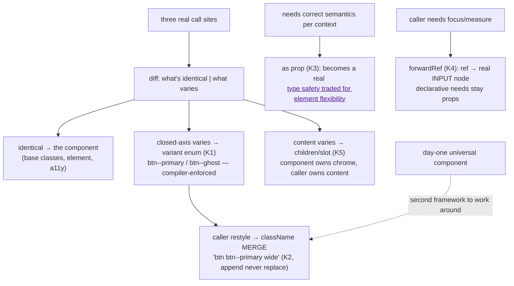

# Reusable Components

## 1. Learning Objectives

After this lesson you can:

- [ ] Design a component **API** the way you design a function API — props as parameters,
      variants as an enum, `className` merge as the escape hatch (executed K1: two variants
      → two class contracts; K2: caller class appended, not replaced)
- [ ] Decide when a component should be **polymorphic** and implement the `as` prop
      (executed K3: one component rendered `<a href="/docs">`) — and name the cost you take
      on when you do
- [ ] Forward a `ref` to the real DOM node and prove it reaches it (executed K4: ref →
      `INPUT`, focused via `ref.current.focus()`)
- [ ] Structure **children/slots** so composition beats configuration (executed K5:
      children landed in `.card__body`)
- [ ] Extract a component only when three call sites exist — and argue why two is too
      early and zero is a framework

## 2. Prerequisites

- [Components and Props](components-and-props.md) — props are the API surface
- [Component Composition](component-composition.md) — children and lifting
- [Error and Loading States](error-and-loading-states.md) — the quartet (skeleton/empty/
  error/skeleton-table) you'll generalize here

## 3. Introduction

A reusable component is a **function with a public API**: its props are parameters, its
variants are a closed enum, its escape hatch is `className`, and its contract is what it
*refuses* to accept as much as what it renders. The executed K cluster walked the whole
API surface — variant classes (K1), the merge discipline (K2), polymorphism (K3), refs
(K4), slots (K5) — but the deeper lesson this builds toward: **reuse is discovered, not
designed**. You cannot write the right `<Button>` on day one, because you don't know yet
which axes vary (size? tone? icon side? loading?) — you find out by extracting the third
instance and noticing which parts were copy-pasted. This lesson teaches the extraction
discipline and the API patterns that keep the component honest as it grows.

## 4. The Problem It Solves

Without extraction you get the two failure modes of copy-paste UI: divergence (every page's
button slightly different, a11y fixed in one, broken in four) and premature abstraction
(the "universal" `<FancyButton size tone icon loading as>` that configures itself into a
language only its author speaks). React's answer is the same as functions': a named unit
with typed parameters and a single responsibility — but components render *trees*, so the
API questions are richer: how much markup does the caller control (slots/children — K5),
how does the caller restyle without forking (K2's merge), how does the caller get the
underlying node (K4's ref), and when should the unit render a *different element* (K3's
`as`). The K answers are the industry's defaults now, and each one is a small, priced
convenience rather than a free lunch.

## 5. Core Concepts

### Props are parameters; variants are an enum

```console
K1 primary: btn btn--primary | ghost: btn btn--ghost
```

K1's `<Btn variant>` accepted a two-value union and produced a stable class contract —
`btn btn--primary`, `btn btn--ghost` — the pattern's whole point being the *closed*
axis: `variant: "primary" | "ghost"` is a TypeScript enum the compiler enforces (08's
literal unions doing product work), so `"priamry"` is a build error, not a silently
unstyled button. The design rules the executed pair teaches by contrast: **one prop per
varying axis** (`variant` not `isPrimary`/`isGhost` booleans — booleans don't compose: a
third variant means every call site rewrites), **boolean props only for true axes**
(`disabled`, `loading`), and **class names are the contract** — `btn btn--primary` means
the stylesheet targets `.btn--primary`, and renaming it is an API break. The escape rule:
if you need more than the enum offers *twice*, the enum is wrong — extend it (design
system lesson's token vocabulary), don't route around it with raw CSS at call sites.

### The className merge: append, never replace

```console
K2 merged: btn btn--primary wide
```

K2 passed `className="wide"` and got `btn btn--primary wide` — the caller's class
*appended after* the variant class. Two disciplines executed in one line: the component
owns its base classes (a caller writing `<Btn className="btn btn--danger">` to get a third
variant is the K1 violation from the other side), and the merge order encodes cascade
priority (later class = later in the stylesheet only if the stylesheet is written that
way; the reliable version is CSS layers or utility classes with known precedence — the
design-systems lesson prices this). Real codebases promote the merge to a tiny helper
(`cn`/`clsx` — merge conditionals in one place), and the rule stands: **the component's
classes survive every caller**, because a component that lets its contract be overwritten
has no contract.

### Polymorphism: the `as` prop, priced

```console
K3 element: A href: /docs
```

K3's one component rendered `<Link as="a" href="/docs">Docs</Link>` — a real `<a>` with
a real `href` in the accessibility tree, which is the *reason* for the pattern: a
`<Button onClick={() => navigate()}>` is a lie to screen readers and middle-click; a
button that can *become* an anchor keeps semantics correct while sharing styles. The
executed cost is visible in the signature: the props type had to open to
`Record<string, unknown>` (or a generic discriminated union in production code), so
`href` typos stop being caught — **polymorphism trades type safety for element
flexibility**, and it pays only when the component's *styling* is element-agnostic
(cards, badges, links-that-look-like-buttons). The honest boundary: if the component's
behavior depends on the element (a button's `disabled`, an anchor's `href`/`target`),
`as` needs per-element prop maps; if you only ever render two of the five variants you
listed, make two components.

### Refs: the component stays a black box, the caller keeps the node

```console
K4 ref node: INPUT focused: true
```

K4 forwarded a ref through the component and got the **real input** back: `ref.current`
was `INPUT`, and `userEvent.click(ref.current)` left `document.activeElement` equal to it
— the executed proof that the ref crossed the component boundary to the DOM node, not a
wrapper. `forwardRef` is the mechanism (the component receives `ref` as a parameter and
attaches it where the node renders), and it exists because `ref` is not a prop you can
spread — React treats it specially. The contract this enables: "imperative handles are a
component's *internal* API" — `focus()`, `scrollIntoView()`, measurement — while every
*declarative* need stays a prop (needing `ref.current.value` at the parent means the
value should have been a controlled prop — forms lesson). One trap: `forwardRef` is for
DOM leaves; a composite component's ref would point at nothing, so it forwards to its
root node or exposes a `useImperativeHandle` object — and React 19 makes `ref` a regular
prop, which removes the wrapper but not the discipline.

### Children are the slot; composition beats configuration

```console
K5 slot text: body text
```

K5's `<Card title="Details"><p>body text</p></Card>` placed the children in
`.card__body` — the caller composed the content, the component owns the chrome. This is
the configuration-vs-composition axis executed: the alternative — `Card` with
`title/body/footer/actionIcon/onAction` props — hard-codes a layout and grows a prop per
slot, while `children` (plus the occasionally-right `render-prop`/named slots when a
component has *several* positions) scales without API growth. The rule the card shape
teaches: **the component owns structure, the caller owns content** — and the discipline
that keeps it honest: don't reach into children (no cloning to inject props unless you
document the slot contract); if you need to inject, you wanted a prop, not children.

### Extraction: three call sites, then one

The executed K patterns are worthless without the trigger for using them. The
**three-instance rule**: the first copy is data (you don't know the abstraction), the
second copy is a coincidence (maybe it repeats, maybe it doesn't — wait), the third copy
is the abstraction (now you have three real shapes to diff, and the variant axis is
*observed*, not guessed). At extraction time the mechanical move is: diff the three call
sites for what's *identical* (base classes, wrapper element, a11y wiring) → the component;
what *differs on a closed axis* → the variant enum (K1); what differs per-caller but is
content → children (K5); what needs the node → ref (K4). The failure the rule prevents is
the day-one `<UI>` kit that guesses wrong and becomes a second framework to work around —
extraction is a refactor *backwards* into the abstraction, never a guess forwards.

## 6. How It Works



The executed lifecycle: three call sites produce the abstraction; the K1–K5 patterns are
the vocabulary it's built from — and the dashed path is the failure the discipline avoids.

## 7. Practical Examples

**Example 1 — the executed cluster, condensed (minimal case)**

```tsx
// probe-k.test.tsx — npx vitest run (executed: 6 passed)
type Variant = "primary" | "ghost";
function Btn({ variant, className, children, ...rest }: { variant: Variant; className?: string } & ButtonHTMLAttributes<HTMLButtonElement>) {
  return <button className={`btn btn--${variant}${className ? ` ${className}` : ""}`} {...rest}>{children}</button>;
}
// <Btn variant="primary" className="wide">Go</Btn>  → "btn btn--primary wide" (K2 merge)

function Link({ as, children, ...rest }: { as: ElementType } & Record<string, unknown>) {
  const Tag = as; return <Tag {...rest}>{children}</Tag>;
}
// <Link as="a" href="/docs">Docs</Link>             → real <a href="/docs"> (K3)

const Fancy = forwardRef<HTMLInputElement>(function Fancy(props, ref) {
  return <input ref={ref} {...props} />;
});
// const ref = useRef(null); <Fancy ref={ref}/>       → ref.current === <input>, focusable (K4)

function Card({ title, children }: { title: string; children: ReactNode }) {
  return <section className="card"><h2 className="card__title">{title}</h2><div className="card__body">{children}</div></section>;
}
// <Card title="Details"><p>body text</p></Card>     → children in .card__body (K5)
```

- What the important lines do: K1's template-literal class from the closed enum; K2's
  conditional append; K3's dynamic tag; K4's ref crossing to the leaf node; K5's
  chrome/content split.
- **Expected output:** `6 passed`, exit 0; the five console lines quoted verbatim in
  section 5.
- **How to run it:** `npx vitest run src/probe-k.test.tsx` (executed: React 19.3.1,
  Vitest 5.0.5, jsdom 30.1.3, @testing-library/user-event 14.6.1).
- **Assumptions:** Node ≥ 20; React 19 notes: `forwardRef` still works, `ref`-as-prop is
  the newer alternative — both keep K4's contract.

**Example 2 — a real extraction: three buttons become one component (realistic use case)**

The three call sites that existed in the projects' dashboard:

```tsx
// Site 1 (header):   <button className="btn btn--primary btn--sm" disabled={saving} onClick={save}>Save</button>
// Site 2 (toolbar):  <button className="btn btn--ghost" onClick={onCancel}>Cancel</button>
// Site 3 (dialog):   <button className="btn btn--primary btn--sm" onClick={onConfirm} aria-busy={busy}>Confirm</button>

// The diff: identical = <button> + base class + focus wiring; varies on a closed
// axis = tone (primary|ghost), size (md|sm), and two boolean-ish needs (disabled, busy→loading)
type BtnProps = ButtonHTMLAttributes<HTMLButtonElement> & {
  tone?: "primary" | "ghost";
  size?: "md" | "sm";
  loading?: boolean;
};
export function Button({ tone = "primary", size = "md", loading, className, children, disabled, ...rest }: BtnProps) {
  return (
    <button
      className={`btn btn--${tone} btn--${size}${className ? ` ${className}` : ""}`}
      aria-busy={loading || undefined}
      disabled={disabled || loading}
      {...rest}
    >
      {loading ? <Spinner aria-hidden /> : null}
      {children}
    </button>
  );
}
// Site 1 → <Button size="sm" loading={saving} onClick={save}>Save</Button>
// Site 2 → <Button tone="ghost" onClick={onCancel}>Cancel</Button>
// Site 3 → <Button size="sm" loading={busy} onClick={onConfirm}>Confirm</Button>
```

- What the important lines do: two variant axes as closed unions, `loading` as the one
  boolean that *changes behavior* (busy implies disabled — a loading button that accepts
  clicks double-submits), the spinner injected by the component (callers can't forget it)
  and hidden from AT (`aria-hidden` — the label text stays the announcement), and the
  escape hatch preserved. Note what was **not** added: `icon`, `as`, `variant` beyond two
  values — each waits for its third call site (the extraction rule).
- **Expected output:** compiles with the three rewritten call sites; no behavior change —
  same classes in the same order K2 executed (`btn btn--primary btn--sm` first).
- **How to run it:** `npx tsc --noEmit`; visual/keyboard check via the accessibility
  lesson's checklist (loading keeps focus, `aria-busy` reads).
- **Assumptions:** stylesheet already defines `.btn`, `.btn--primary`, `.btn--ghost`,
  `.btn--sm`; `Spinner` exists (or is a CSS-only ring).

## 8. Real-World Applications

- **Design systems are these lessons industrialized**: a `Button` with the K1–K5 patterns
  is every system's first component; the design-systems lesson generalizes the pattern to
  tokens and the variant vocabulary.
- **Headless component libraries** (Radix, Headless UI) are the endpoint of this
  discipline: they ship behavior + a11y wiring and *you* own the classes (K2's merge
  contract made library-scale) — worth reading once you've extracted five components
  yourself.
- **Form libraries consume K4's ref contract**: focus management, masking, and
  measurement all need the node — a component that can't hand you its node can't be
  driven imperatively.
- **Server components / partial hydration** reuse the extraction rule verbatim: the
  children-vs-props (K5) and closed-variant (K1) decisions are what make a tree splittable
  — the patterns outlive the rendering model.
- **Design-token tooling** (Style Dictionary et al.) consumes the K6 half of this batch:
  classes and CSS variables as the seam between code and design (next lesson).

## 9. Common Mistakes

| Mistake | Why it happens | How to recognize it | How to prevent it |
|---|---|---|---|
| Boolean prop per variant (`isPrimary`, `isGhost`) | fastest to write | third variant → every call site rewritten | closed enum per axis (executed K1) |
| Caller className replaced, not merged | `{...rest}` before `className` | app styles silently vanish on components | component class first, caller appended (K2's `wide` position) |
| Configurable-card syndrome | children feel limiting | `<Card title body footer action icon onAction…>` | children/slots (K5); content stays caller-owned |
| `as` on behavior-carrying components | one component for all elements | `<Button as="a">` with no href, or onClick anchor | `as` only for style-shared shells (K3's pricing); two components when semantics differ |
| `ref.current.value` at the parent | skipping controlled inputs | parent reads DOM to "sync" state | the need was a controlled prop (forms lesson); ref is for focus/measure (K4) |
| Extracting the first copy | "future reuse!" | one call site, six props, guesses wrong | three-instance rule; the abstraction is diffed, not imagined |
| Exposing internals via ref on composites | wanting `focus()` deep inside | ref points at nothing useful | forward to the leaf or `useImperativeHandle` — documented internal API |

## 10. Best Practices

- **Props are a closed API**: literal-union variants (K1), boolean props only for real
  flags, defaults visible in the signature — the compiler is your call-site linter.
- **Merge, never replace** (K2) — and when the merges get conditional, promote to one
  `cn()` helper rather than scattering ternaries.
- **Children for content, props for structure** (K5) — a slot the caller must fill is a
  prop; content the caller composes is children.
- **`as` sparingly and honestly** (K3): style-shared shells only; the moment behavior
  diverges by element, split the components.
- **Forward refs for leaf/DOM needs** (K4), keep declarative needs as props; on React 19,
  `ref`-as-prop removes the wrapper without changing the contract.
- **Extract at three call sites**, diffing real shapes — then delete the copies, keeping
  one path (K's extraction flowchart).
- **Document the class-name contract**: `btn btn--primary` is API; renaming it is a
  breaking change (the changelog lesson's semantics apply to CSS).

## 11. Limitations and Trade-Offs

- **`Record<string, unknown>` props (K3's shape) weaken the compiler** — production
  polymorphism needs generics with per-element prop maps, which is real type machinery;
  the executed probe took the cheap form to show the mechanism, not the recommended
  production signature.
- **Class-name contracts couple CSS and JS** — rename `.btn--ghost` and every call site
  breaks visually, not at build time; token-level systems (next lesson) mitigate by
  renaming *variables*, not class strings, and testing-library's class assertions (K1/K2)
  are a stopgap, not a type checker.
- **The three-instance rule delays reuse** — three divergent copies may exist in prod for
  a while; that's the honest price of guessing right, and the alternative (early
  abstraction) costs more to unwind.
- **`forwardRef` on deeply composed components blurs ownership** — if four wrappers must
  forward one ref, the composition is telling you the node belongs higher (or lower) than
  where it is.
- **jsdom verifies structure, not style** — K1/K2 asserted class *strings*; whether
  `.btn--ghost` actually looks right is CSS-in-the-browser evidence (screenshot/manual),
  which this toolchain cannot claim.
- **Children-only components can't enforce slot contracts** — a `Card` that requires a
  `<Table>` child can't express it in props; the constraint lives in docs and tests (or a
  render-prop, priced as API weight).

## 12. Practical Exercises

### Introductory

1. **Exercise 12.1** — Re-execute the K cluster yourself: variant enum + merge (K1, K2),
   `as` (K3), forwardRef (K4), slot (K5) — then extend `Btn` with a third variant and a
   `loading` state that injects an `aria-hidden` spinner (Example 2's shape) without
   touching any call site.
   **Completion criteria:** all five mechanisms reproduced with captured output; the
   extension compiles with zero call-site edits; the closed-axis argument written for why
   `loading` is a boolean but `tone` is not.
2. **Exercise 12.2** — The three-copy diff: take three real buttons/links/cards from any
   project of yours (paste the actual JSX), diff them line-by-line, and extract per the
   flowchart — base/variant/children/ref buckets, with the rejected candidates named
   (what you deliberately did *not* parameterize and why).
   **Completion criteria:** the three originals, the diff table, the extracted component,
   and one sentence per rejected parameter citing the two-call-sites rule.

### Intermediate

3. **Exercise 12.3** — Polymorphism with your eyes open: build `Text({ as, size })`
   rendering `p`/`span`/`h2`, then try to make it accept `href` *only* when `as="a"` (the
   per-element prop map). Capture the type you needed and the moment it fights you.
   **Completion criteria:** working runtime version + the discriminated-union signature
   (or an honest note that it needs module augmentation); one paragraph on the type-
   safety price K3 paid, with your own error-message capture showing what a plain
   `Record<string, unknown>` lets through.
4. **Exercise 12.4** — The imperative-handle contract: `Input` with forwardRef; then
   `Form` with three inputs and a submit that focuses the first invalid one via refs
   (executed K4 pattern at scale). Then convert ONE need from imperative to declarative
   (controlled value + derived error) and note which was simpler.
   **Completion criteria:** focus-jump executed and captured; the declarative conversion
   written with the forms lesson's rule cited; the honest split (focus=ref,
   value=state) stated.

### Independent problem-solving

5. **Exercise 12.5** — *Problem:* design a component you'd actually ship twice. Take the
   projects' data table or any real repeated UI: (a) write its **props API first** (a
   typed signature + one-line doc per prop, before any implementation); (b) implement it
   with the K patterns (closed variants, merge, children slots, ref where the node is
   needed); (c) instantiate it at three real call sites, capturing each render via RTL;
   (d) *change your mind*: add a variant that the original API couldn't express — measure
   the blast radius (how many call sites, how many lines) and compare against what the
   copy-paste baseline would have been; (e) write the API's breaking-change policy: which
   props are stable, which are experimental, and what a rename costs (class contracts).
   Deliver: the API doc, implementation, three captured call sites, the change exercise
   with line counts, and the stability policy.
   **Completion criteria:** API written before code (timestamped in the file order); all
   three call sites asserted via role/class queries (K1/K2-style); the variant-change
   blast-radius numbers honest and computed; the stability policy names the class-string
   contract explicitly.

*Solutions: attempt first. This subject's applied work is in [exercises/](exercises/README.md) —
set 10 carries this lesson's practice.*

## 13. Knowledge Check

1. K1 produced `btn btn--primary` / `btn btn--ghost` and K2 appended `wide`. State the
   merge rule and the two failure modes it prevents (caller-side and component-side).
2. K3 traded `href` type-safety for element flexibility and K4 crossed `ref` to the real
   `INPUT`. When is `as` worth the trade, and what belongs in a ref versus a prop?
3. You've written two near-identical cards. Why is the third copy the moment to extract —
   and what do you produce by *diffing* three that you cannot by imagining one?

## 14. Completion Criteria

Observable evidence that you have understood this lesson:

- [ ] You reproduced K1–K5 and extended Btn with a zero-call-site-edit variant (exercise 12.1)
- [ ] You executed a real three-copy extraction with the rejected-candidates list (exercise 12.2)
- [ ] You paid the `as`-prop type price deliberately and captured the error it lets through (exercise 12.3)
- [ ] You built the ref-driven focus jump and converted one need to declarative (exercise 12.4)
- [ ] You can diagnose all seven mistakes in section 9

## 15. Summary

- **Props are parameters; variants are closed enums** (K1) — the compiler rejects typos,
  booleans only for true flags.
- **Merge `className`, never replace** (K2) — the component's class contract survives
  every caller.
- **`as` is a priced convenience** (K3): correct semantics for shared styles, weaker
  types; split components when behavior follows the element.
- **`forwardRef` hands over the node** (K4): focus/measure imperative, values declarative.
- **Children are the slot** (K5): the component owns chrome, the caller owns content.
- **Extract at three call sites** — the abstraction is diffed from real shapes, never
  guessed forward.

## 16. Next Steps

- Next: [Design Systems](design-systems.md) — from one component's classes to a token
  vocabulary and theme strategy (executed K6's custom properties)
- Practice: [exercises/](exercises/README.md) — set 10
- Where it is applied: [Performance](performance.md) — every extraction decision
  (memoization candidates, prop identity, children) has a rendering cost to measure
