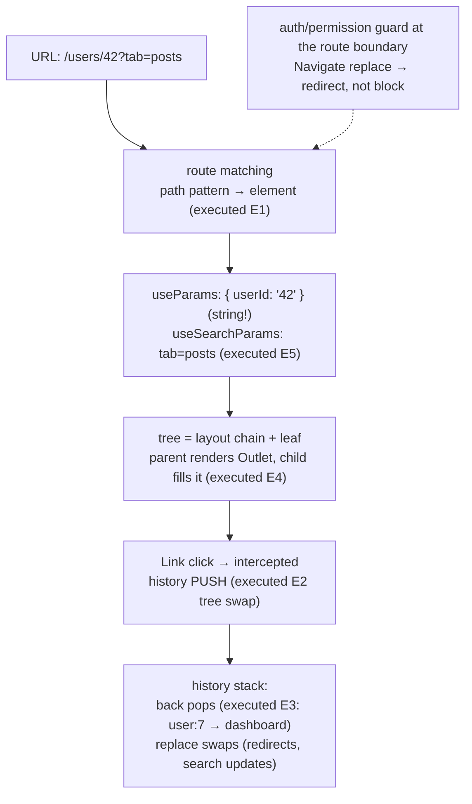

# Routing

## 1. Learning Objectives

After this lesson you can:

- [ ] Map a URL to a component tree from executed evidence: path params arrive via
      `useParams` (`/users/:userId` → `user:42`), nested routes fill a parent's `<Outlet>`
      (`settings-layoutprofile pane`), and search params are *state in the address bar*
- [ ] Honor the back-button contract: `Link` pushes, `navigate(-1)` pops (executed:
      `user:7 → back-at-dashboard`) — and say why `replace` navigation exists
- [ ] Structure routes as a data model: nested layouts, index routes, and the route-object
      form that makes guards and loaders possible
- [ ] Apply the routing-state rule: **the URL is the right home for state that must survive
      refresh, be shareable, or drive which view renders** — and name the three kinds of
      state in a routed app
- [ ] Wire an auth guard at the route boundary (redirect, not block) with the executed
      `Navigate` pattern from the authentication lesson's preview

## 2. Prerequisites

- [State and Hooks](state-and-hooks.md) — `useEffect` timing for data-on-navigation
- [Component Composition](component-composition.md) — layouts are composed wrappers; the
  `<Outlet>` is a slot
- [08 — Modules](../08-JAVASCRIPT-AND-TYPESCRIPT/modules.md) — route tables as data;
  [type narrowing](../08-JAVASCRIPT-AND-TYPESCRIPT/type-narrowing.md) for param types

## 3. Introduction

A routed app is a component tree **selected by the address bar**. That sentence hides three
hard problems React doesn't solve itself: mapping URLs to elements, keeping history (the
back button is a *user* feature, not a browser relic), and sharing layout chrome across
views. React Router (7.18.4 here) answers all three with one idea: **the route table is
data, and the current URL picks from it.** This lesson builds that model from executed
probes in the Vitest lab — params, navigation, history, nesting, search-state, and active
links — then adds the discipline the probes can't: which state belongs in the URL, and how
guards and data-loading attach to the boundary without breaking the back button.

## 4. The Problem It Solves

Before client-side routing, every navigation was a **full page load**: the browser threw
away the JS heap, re-fetched the document, and rebuilt state from scratch — slow, and it
made multi-pane UIs (a list that keeps its scroll position next to a detail pane) nearly
impossible. The fix — intercept link clicks, swap the component tree, *push* the new URL
onto browser history — creates its own obligations, which is what routing libraries
actually provide: **history integration** (back/forward work because the URL changes
through the real History API), **declarative matching** (a URL string becomes a component
tree without a growing `if/else` chain), and **composition of layout with view** (a settings
shell around three panes, executed below via `<Outlet>`). Skipping the library to hand-roll
`popstate` handlers is possible and instructive; shipping with one is the professional
default because the edge cases (nested histories, hash vs path, scroll restoration, guards
that don't trap the back button) are individually subtle and collectively a lot.

## 5. Core Concepts

### Matching: the URL picks an element

```console
E1 rendered: user:42
E2 after link click: user:7
```

The two probes pin the mechanism. `Route path="/users/:userId"` declares a **segment
pattern**; when the URL matches, React Router renders that route's `element` and exposes
the dynamic segment as a **string** through `useParams` — `user:42` from `/users/42`.
`Link` is the second half: rendered as a real `<a href>`, but its click is intercepted, so
`user:7` appeared *without a page load*, and the previous tree (`dash`) was unmounted —
the executed `queryByTestId("dash")` absence is the tree swap, not a hidden element. Two
rules that follow and that beginners violate constantly: params are **strings** (parse
explicitly — `Number(userId)`, subject 08's guard discipline: `Number.isNaN` on the parse
before use), and navigation must use `Link`/`navigate`, never `window.location.href =` —
the latter performs the full reload the whole model exists to avoid.

### History is a contract: push, pop, replace

```console
E3 initial: user:7 | after navigate(-1): back-at-dashboard
```

The executed pair is the back-button contract in miniature: after clicking a link (a
**push** — a new history entry), `navigate(-1)` **popped** it and the dashboard re-rendered
— the user's mental model ("back goes where I was") is enforced by real history entries, not
by app-side bookkeeping. The third verb, **replace**, is the one to know before you need it:
`navigate("/login", { replace: true })` swaps the current entry instead of stacking — the
correct move for redirects (a failed auth bounce should not leave "back" pointing at the
page that immediately bounced you), for multi-step wizards' intermediate URLs, and for
search-param updates that shouldn't pollute history. The failure mode of ignoring this: the
back button traps users in redirect loops, which reads as "the app is broken" even though
every screen works.

### Nesting: layouts are routes too

```console
E4 layout + outlet: settings-layoutprofile pane
```

The executed nesting probe rendered `/settings/profile` and got **both** the parent's
chrome (`settings-layout`) and the child's pane (`profile pane`) — because
`<Route path="/settings" element={<SettingsLayout />}>` with a child `<Route path="profile">`
means: *render the layout, and put the matched child where the layout renders `<Outlet />`*.
This is composition from the previous lesson, applied to routing: the layout owns the shell
(heading, nav, error boundary); the child owns the pane; neither knows about the other's
internals. The patterns this unlocks, all standard: an `path="settings"` parent with three
sibling children (tabs-as-routes — each pane is a real URL, shareable and back-button-safe);
a `path="users"` parent with `":userId"` children (list+detail in one tree); and an index
route (`<Route index element={…} />`) for the parent's default child. The rule: **if two
URLs share chrome, they share a parent route** — copying the chrome into two elements is
the composition lesson's configuration-tower mistake at the routing level.

### Search params are URL state — the shareable kind

```console
E5 before: q= | after setParams({q:"ada"}): q=ada
```

The `useSearchParams` probe showed the whole pattern: read `params.get("q")` during render
(`q=` — absent, so the default), and `setParams({ q: "ada" })` wrote it into the address —
which now *contains* the query, is **bookmarkable**, **survives refresh**, and **encodes the
view's state** in one place. This is the routing-state rule made concrete. A routed app has
three kinds of state, and choosing the home for each is the design work: **URL state**
(filters, search text, pagination, selected tab, modal-open-with-id — anything you'd want
back after a refresh or in a shared link); **server state** (fetched data — lives on the
server, cached client-side; the api lesson); and **client state** (form drafts, toasts,
theme — ephemeral, per-session, belongs in component state or a store). The test: *if losing
this on refresh would be a bug, it's URL state.* The executed `q=ada` is the archetype —
a search box that doesn't put `?q=` in the address is a search you can't share.

### Active links and the navigation surface

```console
E6 at /search — search className: "active-link" | home: "plain-link"
```

The executed `NavLink` pair shows the library computing activeness for you: the `className`
callback receives `{ isActive }`, and at `/search` the search link got `"active-link"` while
the `end`-guarded home link correctly reported `"plain-link"` (without `end`, `/` matches
every path — the documented footgun, which the probe deliberately included). The callback
form matters beyond convenience: activeness is *derived from the same URL* the router
renders from, so nav chrome can never disagree with the current view — the composition
lesson's "derive, don't store" rule applied to navigation.

## 6. How It Works



The executed routing lifecycle: URL → pattern → params → composed tree; navigation pushes
real history entries so back works; guards intercept at the boundary, redirecting with
`replace` rather than trapping history.

## 7. Practical Examples

**Example 1 — the executed cluster, condensed (minimal case)**

```tsx
// probe-e.test.tsx — npx vitest run (executed: 6 passed)
<MemoryRouter initialEntries={["/users/42"]}>
  <Routes>
    <Route path="/users/:userId" element={<UserPage />} />       {/* E1: useParams → "42" */}
    <Route path="/settings" element={<SettingsLayout />}>        {/* E4: layout + Outlet */}
      <Route path="profile" element={<ProfilePane />} />
    </Route>
  </Routes>
</MemoryRouter>

function SearchPage() {
  const [params, setParams] = useSearchParams();                  // E5: URL as state
  return <button onClick={() => setParams({ q: "ada" })}>search</button>;
}
```

- What the important lines do: `initialEntries` makes the router testable (the MemoryRouter
  is the *same* router with an in-memory history — that's why this whole lesson ran under
  Vitest); the nested pair demonstrates Outlet-filling; `setParams` writes the address.
- **Expected output:** `6 passed`, exit 0 with the E1–E6 log lines quoted in section 5.
- **How to run it:** `npx vitest run src/probe-e.test.tsx` (executed: react-router-dom
  7.18.4, Vitest 5.0.5, jsdom 30.1.3).
- **Assumptions:** `MemoryRouter` in tests, `BrowserRouter` in the app (build lesson wires
  the real one).

**Example 2 — a routed app with guard and loaders (realistic use case)**

```tsx
// Route table as data — readable, filterable, guard-able
const routes = [
  { path: "/", element: <Home /> },
  {
    path: "/app",
    element: <RequireAuth><AppLayout /></RequireAuth>,   // guard wraps the LAYOUT, not each pane
    children: [
      { index: true, element: <Navigate to="/app/projects" replace /> },   // replace: no loop
      { path: "projects", element: <Projects /> },
      { path: "projects/:projectId", element: <ProjectDetail /> },
      { path: "settings", element: <SettingsLayout />,
        children: [{ path: "profile", element: <Profile /> }] },
    ],
  },
  { path: "/login", element: <Login /> },
  { path: "*", element: <NotFound /> },                   // explicit catch-all — never a blank screen
];

function RequireAuth({ children }: { children: ReactNode }) {
  const { user } = useAuth();
  const location = useLocation();
  if (!user) {
    // redirect (replace) + carry the target so login can return you
    return <Navigate to={`/login?next=${encodeURIComponent(location.pathname)}`} replace />;
  }
  return children;
}
```

- What the important lines do: the **guard sits at the layout boundary** — one check
  protects the whole subtree (composition lesson: arrangement the component owns); the
  redirect uses **`replace`** so Back from login goes where it *should* (before the app), not
  back into the bounce loop (E3's contract, negative space); `?next=` carries intent as URL
  state (the search-param pattern, E5) so login can `navigate(next, { replace: true })`;
  the explicit `*` route prevents the framework's default blank page.
- **Expected output:** compiles clean; unauthenticated `/app/projects` → rendered at
  `/login?next=%2Fapp%2Fprojects` (the auth lesson executes the full flow).
- **How to run it:** `npx tsc --noEmit`; runtime flows in the auth lesson's harness.
- **Assumptions:** `useAuth` from the auth lesson's context; react-router v7 declarative
  form (the data-router/loader form is the same table plus `loader` keys — named below).

## 8. Real-World Applications

- **Every multi-view product is a route table**: the `projects/:projectId` shape is issue
  trackers, CRMs, and admin panels; `settings/*` tab-routes are account areas; `*` catch-alls
  and typed 404s are the professionalism line every reviewer checks.
- **URL-as-state is what makes apps linkable** — a bug tracker whose filter/sort/page live
  in the URL lets you paste "the view I'm looking at" into a ticket; that's E5's `q=ada`
  generalized, and it is usually the cheapest UX win available.
- **Guards at the boundary** (`RequireAuth` wrapping a layout) are how permission-aware
  routing works — the auth lesson executes the redirect-with-`next` flow end to end, and
  note the honest limit: guards are UX, not security; the server still authorizes every
  request (the api lesson's 401 handling is the real boundary).
- **Scroll restoration and focus management** on navigation are accessibility obligations
  the library participates in (move focus to the new view's heading; the accessibility
  lesson's keyboard contract extends to route changes — a routed SPA that leaves focus
  behind on navigation fails the same pass as a page that doesn't).
- **Testing routes is cheap because the router is data**: `MemoryRouter` + the same RTL
  harness (executed throughout) means every navigation flow — guards, params, redirects —
  is a unit test, not a browser automation task ([frontend-testing](frontend-testing.md)).

## 9. Common Mistakes

| Mistake | Why it happens | How to recognize it | How to prevent it |
|---|---|---|---|
| Treating params as numbers | params are strings (executed `user:42` is `"42"`) | `"42" === 42` bugs; sort/compare wrong | parse at the boundary with a guard (subject 08): `Number.isNaN(Number(id))` → 404 route |
| `window.location.href =` navigation | forgetting Link exists | full page reload; state loss; slow | `Link` (push) / `navigate` (programmatic) only |
| Back-button traps from redirect loops | `navigate` (push) for auth redirects | Back re-triggers the guard bounce | `replace` for redirects (the `RequireAuth` pattern); test back after a redirect |
| Copying layout chrome per page | not nesting routes | two copies of the same shell, drift between them | parent route + `<Outlet>` (executed E4) |
| Client state in the URL, or URL state in a store | the three-kinds rule is new | filters lost on refresh; links that don't share the view | refresh/share test: both fail → URL state (`useSearchParams`) |
| Omitting the catch-all route | happy-path routing | unmatched URL → blank screen | explicit `<Route path="*">` with a real 404 |
| Forgetting `end` on `/` NavLinks | the documented footgun (E6 included it) | home link always "active" | `end` on prefix-of-everything paths |

## 10. Best Practices

- **Keep the route table as data** (one array/object) — it becomes greppable, testable, and
  the natural home for guards and titles; JSX `<Routes>` works too, but the data form scales
  to programmatic decisions.
- **Nest by shared chrome** — a layout is a parent route; siblings under it are tabs/panes
  (executed E4); the index route makes the default explicit.
- **URL for durable state, store for ephemeral** — apply the refresh/share test per piece of
  state; `useSearchParams` is the honest default for anything a user might want to keep.
- **Redirect with `replace`, navigate with push** — and *say which* at every call site; the
  back-button contract (executed E3) is a user-visible quality bar.
- **Parse params at the boundary** — one guarded parse per route (`:projectId` → typed id or
  404), so the rest of the subtree trusts its inputs (the loading lesson's error path is the
  sibling case).
- **Test navigation as flows** — `MemoryRouter` + RTL: guard-bounce, param-swap, back-pop
  are each a few lines (executed E1–E6 are exactly that shape).

## 11. Limitations and Trade-Offs

- **Client routing is not a security boundary**: `RequireAuth` hides UI; it cannot protect
  data — the URL is user-controlled, and a determined user edits it directly. Security
  lives server-side (auth lesson's explicit statement); routing guards are UX courtesy.
- **Param strings and `NaN`**: `Number("abc")` is `NaN`, not an exception — the guard is
  *your* job every time; a route `path="/items/:id"` renders with any string, and the
  subtree downstream either handles the `NaN` or crashes (the error-boundary lesson is the
  safety net; the parse is the fix).
- **The library's two faces**: the declarative form used here (`<Routes>`, `useParams`) is
  simple and fully general for rendering; the data-router form (`createBrowserRouter` with
  `loader`/`action` keys) moves data fetching into the router — better suspense/defer
  integration, more concepts, and a migration boundary teams under-estimate. The api lesson
  covers the `useEffect`-fetch form this lesson's components assume; be able to name the
  loader alternative when you choose against it.
- **History is global per router instance**: two independent `MemoryRouter`s don't share
  history (fine in tests), but in the app, modals-as-routes and nested router instances
  need deliberate design — "open in a new tab" and "browser back" constrain what a modal
  route can mean.
- **Search-param updates fight render frequency**: `setParams` triggers a navigation, which
  re-renders the route tree — typing-per-keystroke into `useSearchParams` is a real
  performance trap; the standard fix is local state + debounced commit to the URL (the
  state-and-hooks debounce exercise, applied at the boundary).

## 12. Practical Exercises

### Introductory

1. **Exercise 6.1** — Reproduce E1–E2: a `/users/:userId` route, two different initial
   entries rendered, one `Link` click captured with the tree swap; then add a
   `?tab=profile` search param to the link's `to` and read it in the page.
   **Completion criteria:** two param renders; the swap transcript; the search param read
   and displayed; one sentence on why the param is a string.
2. **Exercise 6.2** — Reproduce E3 exactly (push via link, pop via `navigate(-1)`), then
   repeat with a **redirect** that uses `navigate("/login")` (no replace) and click Back —
   capture the bounce; fix with `replace: true` and capture Back working.
   **Completion criteria:** four transcripts (push/pop good, push-bounce bad, replace fixed);
   one paragraph on which real-world flow each corresponds to.

### Intermediate

3. **Exercise 6.3** — Build the settings shell: `/settings` layout with three tab-routes
   (`profile`, `notifications`, `danger`) rendered through `<Outlet>`, a `NavLink` row with
   activeness classes (capture E6-style output at two URLs, including the `end` footgun on
   a root link), and an index route redirecting to `profile`.
   **Completion criteria:** three URLs each rendering shell+pane; two activeness captures;
   the index redirect verified; one sentence on why each tab being a real URL matters
   (share/back).
4. **Exercise 6.4** — URL-state search: a list view whose text query, sort, and page live in
   search params (`useSearchParams`); execute query → sort → page and capture the URL at
   each step; then simulate a refresh by re-mounting with the final URL and show the view
   restores identically.
   **Completion criteria:** three URL states captured; the restore transcript (same view from
   URL alone); one paragraph applying the refresh/share test to each parameter.

### Independent problem-solving

5. **Exercise 6.5** — *Problem:* design and execute the routing layer for a docs site:
   version-prefixed paths (`/v2/guides/:slug`), a layout with sidebar (active section via
   `NavLink`), client-side search whose query lives in the URL (`/v2/search?q=`), a
   "redirect old slug" flow (permanent old slugs map to new ones — `replace`, *not* push,
   so Back isn't polluted; execute the pop behavior), a 404 for unknown slugs, and a
   print-friendly layout toggle that also lives in the URL. Deliver: the route table as
   data, executed transcripts for (a) slug render, (b) redirect then Back, (c) search
   restore-after-remount, (d) 404, and a written analysis naming which pieces of state are
   URL state and *why the test* (refresh/share) puts them there — plus one honest
   trade-off (per-version layouts vs a single version-aware layout).
   **Completion criteria:** route table compiles; four transcripts executed; every state
   classified with the test cited; the redirect's `replace` argued from E3's contract; the
   trade-off defended.

*Solutions: attempt first. This subject's applied work is in [exercises/](exercises/README.md) —
set 5 carries this lesson's practice.*

## 13. Knowledge Check

1. E1 rendered `user:42` from `/users/42`. What are the param's type, and what two
   obligations does that type create at the boundary?
2. E3 logged `initial: user:7 | after navigate(-1): back-at-dashboard`. Explain what "push"
   meant at the link click, and the one-word fix for a redirect that shouldn't be in
   history.
3. E4 produced `settings-layoutprofile pane`. What does `<Outlet />` do, and what is the
   rule for when two URLs should share a parent route?

## 14. Completion Criteria

Observable evidence that you have understood this lesson:

- [ ] You reproduced param rendering, the tree swap, and a search-param read (exercise 6.1)
- [ ] You executed the push/pop pair *and* the redirect-bounce/replace-fix pair (exercise 6.2)
- [ ] You built the settings shell with active links and the `end` capture (exercise 6.3)
- [ ] You executed URL-state search with restore-after-remount (exercise 6.4)
- [ ] You can diagnose all seven mistakes in section 9

## 15. Summary

- **URL → pattern → params → composed tree** (executed E1/E2/E4): params are strings,
  layouts are routes, `<Outlet>` is the composition slot.
- **History is push/pop/replace** (executed E3): Back is a contract; redirects use `replace`.
- **Three kinds of state** — URL (durable/shareable: filters, tabs, ids), server (fetched),
  client (ephemeral) — with the refresh/share test deciding the home.
- **Guards live at the route boundary and redirect** — and they are UX, not security (the
  server authorizes).
- **The route table is data**: nested layouts, index routes, an explicit catch-all, and
  testability via `MemoryRouter` are all consequences of that one choice.

## 16. Next Steps

- Next: [Forms](forms.md) — controlled inputs, validation strategy, and submission — the
  most state-heavy screens in any routed app
- Practice: [exercises/](exercises/README.md) — set 5
- Where it is applied: [frontend-authentication](frontend-authentication.md) — the
  `RequireAuth` + `?next=` flow executed end to end, with token storage trade-offs
