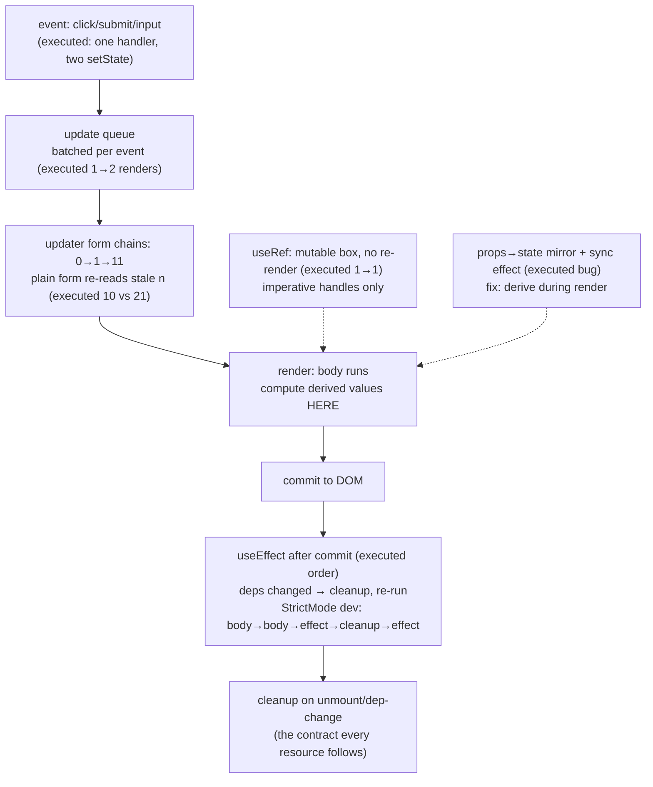

# State and Hooks

## 1. Learning Objectives

After this lesson you can:

- [ ] Explain `setState` semantics from executed evidence: two updates in one handler **batch**
      into one re-render (`renders 1 → 2`, final `n=2`), and the functional updater is what
      makes multi-step updates correct (`10` vs `21`)
- [ ] Place every side effect deliberately: bodies compute, `useEffect` acts after commit —
      with the executed mount trace `body → effect → effect-v=0` and the StrictMode
      `body → body → effect → cleanup → effect` double-run as your tripwire
- [ ] State the dependency-array contract (`[v]` re-runs on change, `[]` once) and choose
      between re-running an effect and re-computing during render (`useMemo`'s executed
      identity stability)
- [ ] Use `useRef` for mutable non-rendering state (executed: ref write did **not** re-render)
      and know its two real jobs
- [ ] Diagnose the props-mirroring bug and the derived-value anti-pattern by rule, and
      explain why the "useEffect to sync" fix is itself the bug

## 2. Prerequisites

- [React Fundamentals](react-fundamentals.md) — re-render = re-invocation; StrictMode's 2× body
- [Components and Props](components-and-props.md) — callback identity; the props freeze
- [08 — Promises and async/await](../08-JAVASCRIPT-AND-TYPESCRIPT/promises-and-async-await.md) —
  async boundaries matter in effects; [event loop](../08-JAVASCRIPT-AND-TYPESCRIPT/event-loop.md)
  for why effects run after paint

## 3. Introduction

State is the half of the data model that **changes**: props flow in read-only (components
lesson), and state is the component's private writable cell — the only place mutation is
legal. Hooks are the API for that cell and for everything that must happen *around*
rendering: subscribing to effects, caching computations, holding mutable handles. This
lesson's evidence is six executed probe clusters run under StrictMode in the Vitest lab —
chosen because each one demonstrates a semantic that people learn the expensive way in
production: batching, the stale closure, effect timing, the double-invocation tripwire,
memo identity, and the props-mirror trap. By the end you should be able to predict *when
your code runs* and *what value it sees* — the two questions every hooks bug reduces to.

## 4. The Problem It Solves

In class components, "when does my code run?" had a dozen answers: `componentDidMount`,
`componentDidUpdate`, `shouldComponentUpdate`, `getDerivedStateFromProps` — each with
different timing and easy to get subtly wrong. Hooks collapse this to **three questions**,
answered mechanically: does this value change over time (state), must something happen after
render (effect), and can something be reused across renders (memo/ref). The trade is real:
hooks *remove* the lifecycle vocabulary but *demand* discipline the class API left implicit
— a missing dependency silently skips an update; a body that computes-with-side-effects
double-fires under StrictMode. The framework gives you fewer, simpler primitives and the
corresponding responsibility for wiring them correctly. Every probe below is a semantics
check you can re-run, so "I think hooks do X" becomes "I measured that hooks do X."

## 5. Core Concepts

### `setState` batches; the functional updater composes

```console
C1 renders: before click 1, after one click 2 | text: n=2
C2 after stale-form click: 10 | after updater-form click: 21
```

**C1** is the batching fact: the handler called `setN(v => v+1)` *twice*, and the component
re-rendered **once** (`1 → 2` renders) with the composed result `n=2`. React collects
updates fired in the same event and applies them together — that is why counting renders to
debug "it called setState three times" misleads. **C2** shows *why the functional form
exists*: `setN(n + 1); setN(n + 10)` captures `n` **once** from the render's closure, so both
writes compute from `0` and the last one (`10`) wins — the stale value made the second
update lie. `setN(v => v + 1); setN(v => v + 10)` chains: `0 → 1 → 11`, final `21` — each
updater receives the previous *queued* value. The rule from the executed pair: **when the
new value depends on the old, always use the updater form**; the plain form is only sound
for absolute values (a server-provided total, a route's id).

### Effects run after commit — and StrictMode proves it

```console
C3 mount trace: body -> effect -> effect-v=0
C3 StrictMode mount trace: body -> body -> effect -> cleanup -> effect
```

The mount trace pins the timing: the body rendered **first**, the effect ran after — effects
run *after* React commits the result to the DOM, never during render. That ordering is the
entire design: effects can read the real DOM, focus elements, measure boxes — because they
run after the DOM exists. The StrictMode trace is the tripwire: in development, React runs
the mount cycle **twice** with cleanup in between (`body → body → effect → cleanup →
effect`), so an effect that isn't cleanup-safe — a subscription that never unsubscribes, a
timer that never clears — is *visibly* wrong in dev: double network calls, double
subscriptions, leaked intervals. The contract this encodes: **every effect that acquires a
resource releases it in the returned cleanup function.** And the boundary rule: effects are
for synchronizing with things *outside* React (network, timers, subscriptions, DOM focus) —
if a value can be computed from props/state during render, computing it in an effect is
the anti-pattern the README warns about (section 5's last entry makes it concrete).

### The dependency array is a contract, not a hint

```console
C4 unrelated re-render keeps memo identity: true / cb stable: true | dep change replaces: true
```

Every hook that takes `deps` (`useEffect`, `useMemo`, `useCallback`) re-runs **when a dep
changes by reference** — `Object.is` equality, per subject 08's identity rules. C4's probe
holds the other half of the contract: an *unrelated* state change left both the memoized
value and the callback **reference-identical** (`true / true`), while changing the dep
replaced them (`true`). That is the caching boundary in one measurement. Two failure modes
to hold in mind: a **missing dep** (`useEffect(fetch, [])` when the effect reads `id`) means
the effect never sees the change — the classic stale-data bug; an **over-eager dep** (adding
a value that changes every render) defeats the memo entirely. The correct discipline, which
the exercises drill: list every value the effect *reads*; if that makes it re-run too often,
the bug is usually that the computation belongs in the body (derived data) — not that the
deps need editing.

### `useRef`: mutable, persistent, invisible to React

```console
C5 renders 1 -> 1 (ref mutated, no re-render) | DOM text: renders=1 ref=0
```

The C5 probe mutated a ref in a click handler and **nothing re-rendered** (`1 → 1`) — by
design. A ref is a box whose `.current` can change freely without React noticing, and which
survives between renders. That is exactly two jobs: holding **imperative handles** (a timer
id, a DOM node, an AbortController from the api lesson) and holding a value whose mutation
must *not* schedule rendering. The DOM text `ref=0` proves the subtle half: the rendered
output shows the value from *this* render's snapshot — refs are not reactive data, and
reading `.current` during render gives you whatever the last effect left there. If you find
yourself rendering a ref's value, you wanted state.

### Mirroring props into state is the bug generator

```console
C6 after prop swap: mirror=two
```

The C6 component did the classic mistake: `useState(value)` to "track" a prop, then
`useEffect(() => setMirror(value))` to "fix" it — which worked (`mirror=two`) *and* ran the
effect on **every render** (no deps = re-run each time; the trace's effect count proves it).
The honest fix is the derived-value rule: **don't store what you can compute.**
`const derived = value` during render is correct, instantaneous, and bug-free — state exists
for values with independent lifetimes (things a user changes, responses a server returns),
never for copies of inputs. The executed pair — the mirror *plus* its effect "fix" — is the
canonical shape of this bug in the wild: two pieces of machinery (state + effect) to
reproduce one line of arithmetic, each a new chance to drift.

## 6. How It Works



The executed state lifecycle: batched updates compose through updaters, render computes,
effects synchronize (twice, in dev, with cleanup between), refs sit outside the loop, and
the mirror anti-pattern is shown as the detour it is.

## 7. Practical Examples

**Example 1 — the executed cluster, condensed (minimal case)**

```tsx
// probe-c.test.tsx — npx vitest run (executed: 6 passed)
function Two() {
  const [n, setN] = useState(0);
  return <button onClick={() => { setN((v) => v + 1); setN((v) => v + 1); }}>n={n}</button>;
}
// one click → renders 1→2, text "n=2" (executed: batched)

function Trace() {
  const [v, setV] = useState(0);
  useEffect(() => { /* after commit */ }, [v]);   // deps: re-run only when v changes
  useEffect(() => { const t = setInterval(tick, 1000); return () => clearInterval(t); }, []);
  return <span>{v}</span>;
}
// StrictMode mount: body → body → effect → cleanup → effect (executed)
```

- What the important lines do: updaters make the double-increment compose; the dep array
  scopes re-runs; the cleanup-returning effect is the contract C3's double-run enforces.
- **Expected output:** `6 passed`, exit 0; the C1–C6 log lines quoted verbatim in section 5.
- **How to run it:** `npx vitest run src/probe-c.test.tsx` (executed: Vitest 5.0.5, React
  19.3.1, jsdom 30.1.3; StrictMode wrapper is what makes the traces visible).
- **Assumptions:** dev build (StrictMode semantics are dev-only); jsdom supplies timers.

**Example 2 — a subscription effect done right (realistic use case)**

```tsx
function useOnline() {
  const [online, setOnline] = useState(() => navigator.onLine);
  useEffect(() => {
    const up = () => setOnline(true);
    const down = () => setOnline(false);
    window.addEventListener("online", up);
    window.addEventListener("offline", down);
    return () => {                      // cleanup: StrictMode's double-run demands it
      window.removeEventListener("online", up);
      window.removeEventListener("offline", down);
    };
  }, []);                               // deps: reads none of props/state — []
  return online;                        // derived value: state, not mirror
}
```

- What the important lines do: the *initializer function* `() => navigator.onLine` reads the
  browser once (not on every re-render — the closure-capture trap from C2); the effect
  subscribes and **returns the matching unsubscribe** — exactly what C3's dev double-run
  verifies (without it: double subscriptions in dev, leaked listeners in prod); `[]` is
  honest here because the effect reads no external values.
- **Expected output:** compiles clean; under StrictMode the add/remove listener pair runs
  twice and the DOM stays at one subscription (the exercises reproduce this with a counting
  spy).
- **How to run it:** `tsc --noEmit` for the contract; runtime needs a browser or jsdom's
  `window` events (the exercises' harness).
- **Assumptions:** `navigator.onLine` exists in the environment; the state initializer form
  avoids the every-render reread.

## 8. Real-World Applications

- **Every data view in a real app** is state + effect + cleanup: fetch-on-mount with
  `AbortController` in the cleanup (api-integration lesson — the C3 contract applied), search
  inputs with debounced timers, WebSocket subscriptions — all resource-shaped: acquire in
  the effect, release in the cleanup.
- **Forms are state machines** ([forms](forms.md)): controlled inputs are `useState` (or a
  library's equivalent) with validation derived during render — the derived-value rule makes
  "is this form valid?" a computation, not a second piece of state to keep in sync.
- **Global state** ([state-management](state-management.md)) is the same hooks, moved: context
  providers hold `useState`, external stores subscribe with the exact C3 effect pattern —
  the cleanup contract is what keeps store subscriptions leak-free across route changes.
- **Timer/interval UIs** (clocks, polling dashboards) live on the C5/C3 seam: the *handle*
  goes in a ref (no re-render per tick of the id), the *value* goes in state, and the
  cleanup clears the interval — the three-piece pattern the exercises assemble.

## 9. Common Mistakes

| Mistake | Why it happens | How to recognize it | How to prevent it |
|---|---|---|---|
| Stale multi-step update (`setN(n+1); setN(n+10)`) | plain form reads the render's `n` (executed `10`) | final value smaller than expected; works until batching changes | functional updater for every value derived from the previous (`v => …`) |
| Missing effect deps | "it should only run once" | data never refreshes after id changes | list every read; if too many, the computation belongs in the body |
| Effect for derived data | copying the mirror pattern (executed C6) | extra render per update; drift bugs | compute during render; state only for independent lifetimes |
| Resource without cleanup | dev works, leaks in prod | StrictMode shows double-run (executed trace) | return the cleanup that undoes the acquisition — every resource, every time |
| Rendering a ref's `.current` | treating refs as state (C5 proved no re-render) | UI shows a stale snapshot | refs are handles (timer ids, DOM nodes); data is state |
| Using state for a prop's value | the mirror bug's root | two sources of truth for one value | derive: `const x = props.x` — state is for *your* lifetime, not your parent's |
| Updating state after unmount | async callback fires post-cleanup | React 19 logs nothing; earlier versions warned | cleanup sets an `alive` flag or aborts the request (api lesson) |

## 10. Best Practices

- **Default to deriving**: compute during render (body) unless the value has an *independent*
  lifetime — C6's mirror-plus-effect is two machines for one line of arithmetic.
- **Updaters by default**: `setN(v => v + 1)` costs nothing and is correct under batching;
  reserve `setN(absolute)` for genuinely absolute values.
- **Effects that acquire must release**: C3's StrictMode trace is your acceptance test —
  if dev double-runs break it, the cleanup is missing, not "React being weird."
- **Read deps from the body's actual reads**: if the effect reads `id` and `url`, both are
  deps; if that re-runs too much, memoize the *inputs* (the `useMemo` in C4) rather than
  trimming the array.
- **One state per independent fact**: three booleans that always change together are one
  `status` union (subject 08's discriminated shape) — fewer states, impossible
  contradictions.
- **Use the initializer form** (`useState(() => expensive())`) so the expensive read runs
  once, not per render — the closure half of C2 applied to state creation.

## 11. Limitations and Trade-Offs

- **Batching is invisible and event-scoped**: C1 measured one re-render for two updates
  *inside one handler*; updates from timeouts, promises, or native listeners each flush
  separately (the api lesson's executed async probes show the extra renders) — "I set state
  twice, why twice rendered?" is now answerable, but the answer depends on *where* the calls
  fired.
- **`Object.is` deps are shallow and reference-based**: a rebuilt object/array literal each
  render (`useEffect(f, [{ a }])`) re-runs forever unless memoized — the same identity churn
  the components lesson measured for callbacks, now with correctness consequences (missing
  data) instead of only performance ones.
- **StrictMode's double-run is dev-only and incomplete**: it catches acyclic subscription
  leaks loudly, but cannot catch a resource whose cleanup is *wrong but idempotent-looking*,
  and production won't re-run anything — the double-run is a rehearsal, not a verifier; real
  leak detection needs the performance lesson's measurement tools.
- **`useRef` is a deliberate escape hatch from the model**: mutating `.current` during render
  (instead of in an effect) creates timing-dependent renders that StrictMode's double-run
  makes *worse*, not better — refs belong to effects and handlers, and the type system won't
  stop you from breaking that.
- **Effects don't compose**: two effects reading the same value re-run independently; the
  "normalize state into one derivation" discipline scales further than adding effects —
  which is why the state-management lesson moves shared logic out of effects entirely once it
  crosses a component boundary.

## 12. Practical Exercises

### Introductory

1. **Exercise 4.1** — Reproduce C1 and C2 in one file: the batched double-increment (record
   render count *and* final value), then the stale-vs-updater pair (`10` vs `21`); then add a
   third update to the updater chain and predict the result before running.
   **Completion criteria:** three captured outcomes; the batching explanation citing the
   C1 numbers; the third-updater prediction matching execution.
2. **Exercise 4.2** — The StrictMode effect trace: an effect that appends to a module-level
   array with a cleanup that pops; run under `StrictMode`, print the array after mount and
   after unmount; then delete the cleanup and re-run.
   **Completion criteria:** the executed `body→body→effect→cleanup→effect` analogue captured;
   the no-cleanup run showing the leak (array grows); one sentence on why dev doubling is
   the *feature* that found it.

### Intermediate

3. **Exercise 4.3** — A `useCounter` hook (increment/decrement/reset, initial value param)
   with three tests: initial value, each operation, and the batched double-call case; then
   convert one test to use the stale plain form and capture the wrong result.
   **Completion criteria:** five passing tests; the stale-form failure captured; one paragraph
   on why the hook returns *functions* (`{inc, dec}`) rather than exposing `setN`.
4. **Exercise 4.4** — The deps audit: an effect logging "fetched {userId}" with deps
   `[userId]`, mounted in a parent that swaps the child's `userId` prop; capture the run
   count across (a) parent re-render with same id, (b) id change, (c) StrictMode mount.
   **Completion criteria:** three run counts matching the dep contract (1 / 2 / double-mount);
   the "same props, no re-run" line cited from C4's identity fact.

### Independent problem-solving

5. **Exercise 4.5** — *Problem:* build a `useDebounced(value, ms)` hook and a search box
   using it. Requirements: typing "abc" quickly produces **one** state change after the
   pause (execute with fake timers or measured delays, record the update count); the effect's
   cleanup clears the pending timer (prove by typing during StrictMode's double-run and
   counting timer fires); unmounting mid-debounce produces no update and no warning; and the
   component must *not* store a mirrored "debounced copy" beyond the hook's internal state —
   explain why the debounce belongs inside the hook and not as a second `useState` in the
   component (C6's rule). Deliver the hook, four executed scenarios with counts, and a
   one-paragraph account of which C-trace property makes the cleanup non-optional.
   **Completion criteria:** single-update-after-pause captured with a count; StrictMode
   double-run with no double-fire; clean unmount captured; the C6-cited paragraph; one honest
   trade-off (debounce-in-render vs debounce-in-effect — why your choice).

*Solutions: attempt first. This subject's applied work is in [exercises/](exercises/README.md) —
set 3 carries this lesson's practice.*

## 13. Knowledge Check

1. C1 logged `renders: before 1, after 2` for a handler with two `setState` calls. What
   batching means here, and why counting "calls" to debug renders misleads?
2. C2 produced `10` and `21` from the same two arithmetic steps. Trace both through the
   closure/updater semantics in two sentences each.
3. C3's StrictMode trace was `body → body → effect → cleanup → effect`. What contract does
   that enforce on resource effects, and what bug does violating it cause in production?

## 14. Completion Criteria

Observable evidence that you have understood this lesson:

- [ ] You reproduced the batching, stale/updater, and third-updater predictions (exercise 4.1)
- [ ] You executed the cleanup-leak pair under StrictMode (exercise 4.2)
- [ ] You built and tested `useCounter`, including the stale-form failure (exercise 4.3)
- [ ] You captured the deps-audit run counts across three scenarios (exercise 4.4)
- [ ] You can diagnose all seven mistakes in section 9, citing the C-probe that proves each

## 15. Summary

- **Updates batch per event** (executed 1→2 renders) and the **updater form composes**
  (executed `10` vs `21`) — plain form only for absolute values.
- **Effects run after commit** (executed order), **twice in dev with cleanup between**
  (executed StrictMode trace) — acquire in the effect, release in the cleanup, every time.
- **Deps are a contract** (`Object.is`): same-value re-renders keep memo identity (C4), dep
  changes replace it — missing deps skip data, over-eager deps defeat caching.
- **Refs are mutable boxes that don't re-render** (executed 1→1) — handles, not data.
- **Don't store what you can compute**: the props-mirror-plus-sync-effect pair (executed C6)
  is the anti-pattern; derive during render.

## 16. Next Steps

- Next: [Component Composition](component-composition.md) — lifting state up, slots, and
  children-as-function patterns that keep state ownership honest
- Practice: [exercises/](exercises/README.md) — set 3
- Where it is applied: [api-integration](api-integration.md) — the C3 cleanup contract with a
  real `AbortController`, and [state-management](state-management.md) — these exact hooks,
  moved to shared scope
