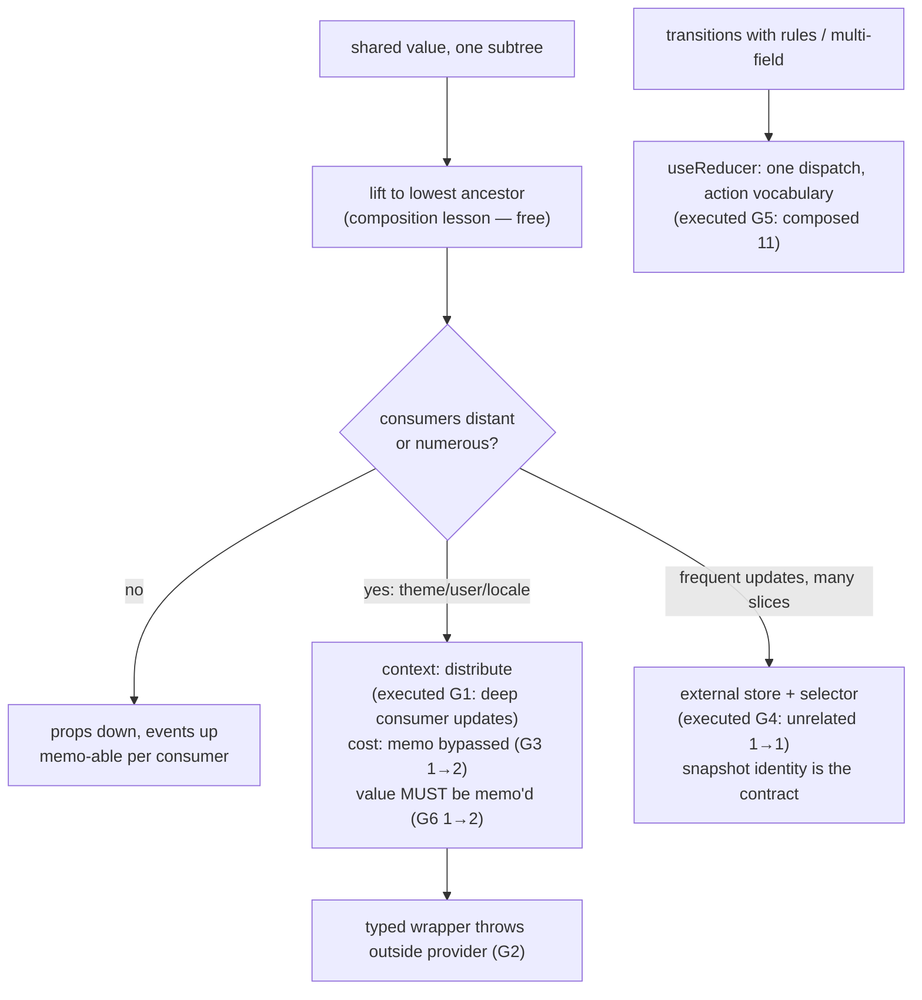

# State Management

## 1. Learning Objectives

After this lesson you can:

- [ ] Place shared state on the **cost ladder** deliberately: lifting → context → external
      store — and cite executed evidence for each rung's cost (context re-rendered a
      `memo`'d consumer: `1 → 2`; the selector store left its unrelated consumer at `1 → 1`)
- [ ] Build a context correctly: provider + typed `useContext` wrapper that throws outside
      its boundary (executed), `useMemo`-stabilized value (executed the failure mode without
      it: `1 → 2`)
- [ ] Explain why context is a *distribution* mechanism, not a state manager — the two
      executed probes (memo bypass, unstable value churn) are its honest limits
- [ ] Subscribe to an external store with `useSyncExternalStore` (executed: selector-scoped
      update left the unrelated component untouched) and say why the raw API is rarely
      written by hand
- [ ] Choose `useReducer` for multi-field or rule-heavy state (executed: composed dispatches
      `11`) and argue when action objects beat setter sprawl

## 2. Prerequisites

- [State and Hooks](state-and-hooks.md) — `useState` semantics, effects, refs (the store
  subscription is the C3 effect contract)
- [Component Composition](component-composition.md) — lifting to the lowest common ancestor
  (this lesson is what happens when that ancestor is too far up)
- [08 — Generics](../08-JAVASCRIPT-AND-TYPESCRIPT/generics.md) — typed context values and
  store snapshots

## 3. Introduction

Shared state is a **placement** problem, not a syntax problem. Within a subtree, the
composition lesson's rule suffices: lift to the lowest common ancestor. But when the
consumers are distant — a theme read by the header, a sidebar, and a modal; a session read
by every page; a cart read by the header *and* the checkout — the ancestor becomes the app
root, and passing props through every intermediate component (the drill) turns
*arrangement* into *plumbing*. This lesson is the honest ladder up from there: context
(which distributes values with a measured cost), reducer state (which structures *how* the
value changes), and external stores (which let non-React state participate in rendering
with selector-scoped updates). Every rung is executed in the lab, including the two failure
modes teams hit first: context re-rendering `memo`'d consumers, and unstable provider
values churning identity every render.

## 4. The Problem It Solves

The naive answer to "many components need one value" is a module-level variable — which
dies immediately because React never learns the value changed (no state, no re-render:
the fundamentals lesson's trigger rule). The second answer, lifting to the root, survives
but *scales badly*: intermediate components gain pass-through props they don't use, types
grow a channel per shared value, and every consumer's re-render profile is now the root's.
What teams actually need is a way to say "any component below here can read this" *without*
naming the path — that is context's job — plus, past a certain size, a way for state to
live *outside* the component tree entirely and still drive rendering correctly (the store
pattern every library — Redux, Zustand, Jotai — implements over `useSyncExternalStore`).
The trade is that these tools buy placement with **update granularity**: context updates
the whole subtree below it (executed), stores update only what subscribed to the changed
slice (also executed). The lesson's spine is knowing which granularity you're paying for.

## 5. Core Concepts

### Context: distribution with a measured cost

```console
G1 before: theme:light | after toggle: theme:dark
G3 memoized consumer renders: 1 → 2 (context bypasses memo)
```

**G1** is the mechanism working: a value set at the provider changed, and a consumer
**three divs deep** — with zero pass-through props — re-rendered with the new value. That's
the entire value proposition: distance-insensitive delivery. **G3** is the price, executed
honestly: the same consumer wrapped in `memo` *still* re-rendered on the context change
(`1 → 2`), because `memo` compares **props** and context is not a prop — it's a separate
subscription channel React reads during render. The rule this pair installs: **context is
for values whose changes should re-render the subtree** — theme, locale, current user,
feature flags (all change rarely, all genuinely needed everywhere) — and *not* for
high-frequency state (a drag position, a live counter): every consumer pays for every
update, and `memo` won't save you.

### Build it right: typed wrapper, throwing boundary, stabilized value

```console
G2 outside provider: Error thrown (boundary worked)
G6 unstable provider value: consumer renders 1 → 2
```

Three executed patterns compose the professional context shape. **G2**: a
`useTheme()` wrapper that `useContext`s and **throws on `null`** converts the worst debug
experience ("context is undefined, why?") into a crash with a message naming the missing
provider — a boundary in the subject-08 sense: fail loudly at the door. **The `useMemo`
value**: `G6` executed what happens when the provider's `value` object is rebuilt inline
every render (`{ version: String(n) }` fresh each time) — the consumer re-rendered even
though its *content* was equal, because identity is what context compares. Stabilizing with
`useMemo(() => ({ theme, toggle }), [theme])` (the G1 provider) means the value's identity
changes **only when its inputs do**, so consumers re-render on real changes. And the type:
`createContext<T | null>(null)` plus the wrapper's throw gives every consumer a non-nullable
type *and* the G2 guard — the `null` default and the throw are one mechanism.

### Reducers: state with a vocabulary

```console
G5 after two dispatches: 11 | after reset: 0
```

`useReducer` replaces N setters with **one dispatch of action objects** — and the executed
pair shows why that matters. Two dispatches in one handler (`{type:"inc"}`, `{type:"add",
by:10}`) composed to `11`, exactly like the `setState` updaters in the C1/C2 probes: same
batching, same functional semantics, now expressed as a **vocabulary of intents** instead
of imperative steps. The wins are structural: related fields update together (a `status`
union can't be half-changed — subject 08's discriminated shape), transitions are
*enumerable* (the `switch` is a readable state machine; exhaustiveness-checkable with the
`never` trick), and tests become "dispatch action, assert next state" with no rendering at
all. The honest cost: ceremony. A boolean toggle does not need a reducer; the threshold is
roughly "more than two related pieces of state, or transitions with rules" — a login flow
(`idle → submitting → done | error`) is reducer-shaped; a modal's open flag is not.

### External stores: non-React state, rendered correctly

```console
G4 store value after inc: 1 | unrelated component renders: 1 → 1
```

The G4 probe is the important one, because it's the shape underneath *every* state library.
A plain object with `get`/`set`/`subscribe` (no React anywhere in it) became renderable
through `useSyncExternalStore(subscribe, get)` — and on `set`, the component whose
**snapshot changed** re-rendered (`v: "0" → "1"`) while the component subscribed to an
unchanged slice stayed at **`1 → 1`** renders. That's selector-scoped granularity context
cannot offer: updates reach only components whose data actually moved. Why you rarely
write the raw API: `useSyncExternalStore`'s contract is subtly demanding (the `get`
snapshot must return a **cached** value — a fresh object per call causes infinite
loops; that's why the store holds `state` and returns it, not a derived rebuild), and the
libraries exist precisely to manage snapshot identity for you. The lesson to keep: when a
third-party store's docs say "selector," G4 is the mechanism being described.

## 6. How It Works



The executed placement decision: props are the default, context distributes slow-changing
values subtree-wide, stores serve frequent sliced updates, reducers structure the
transition logic wherever they live.

## 7. Practical Examples

**Example 1 — the executed cluster, condensed (minimal case)**

```tsx
// probe-g.test.tsx — npx vitest run (executed: 6 passed)
const ThemeCtx = createContext<{ theme: Theme; toggle: () => void } | null>(null);
function ThemeProvider({ children }: { children: ReactNode }) {
  const [theme, setTheme] = useState<Theme>("light");
  const value = useMemo(
    () => ({ theme, toggle: () => setTheme((t) => (t === "light" ? "dark" : "light")) }),
    [theme],                                       // identity changes ONLY on real change
  );
  return <ThemeCtx.Provider value={value}>{children}</ThemeCtx.Provider>;
}
function useTheme() {                              // typed + boundary in one wrapper
  const ctx = useContext(ThemeCtx);
  if (ctx === null) throw new Error("useTheme must be used within ThemeProvider");
  return ctx;
}
// G1: deep consumer updated · G2: outside provider throws · G3: memo'd consumer still updates
```

- What the important lines do: `T | null` default + throw = the G2 boundary; `useMemo` = the
  G6 fix; the wrapper is the *only* import consumers need (they never touch `createContext`).
- **Expected output:** `6 passed`, exit 0; the G1–G6 lines quoted in section 5.
- **How to run it:** `npx vitest run src/probe-g.test.tsx` (executed: React 19.3.1, Vitest
  5.0.5).
- **Assumptions:** dev build; the `memo` bypass (G3) is React semantics, not version noise.

**Example 2 — a cart store: context + reducer + external slice (realistic use case)**

```tsx
// The full ladder in one feature: reducer inside context, selectors at the leaves
type CartItem = { id: string; qty: number };
type CartAction =
  | { type: "add"; id: string }
  | { type: "remove"; id: string }
  | { type: "clear" };

function cartReducer(state: CartItem[], action: CartAction): CartItem[] {
  switch (action.type) {
    case "add": {
      const found = state.find((i) => i.id === action.id);
      return found
        ? state.map((i) => (i.id === action.id ? { ...i, qty: i.qty + 1 } : i))
        : [...state, { id: action.id, qty: 1 }];
    }
    case "remove": return state.filter((i) => i.id !== action.id);
    case "clear":  return [];
    default: {
      const _exhaustive: never = action;            // subject 08: a new action = compile error
      return _exhaustive;
    }
  }
}

const CartCtx = createContext<ReturnType<typeof useCartValue> | null>(null);

function useCartValue() {
  const [items, dispatch] = useReducer(cartReducer, []);
  return useMemo(() => ({
    items,
    add: (id: string) => dispatch({ type: "add", id }),
    remove: (id: string) => dispatch({ type: "remove", id }),
    clear: () => dispatch({ type: "clear" }),
    count: items.reduce((n, i) => n + i.qty, 0),    // derived in the provider
  }), [items]);
}
```

- What the important lines do: the reducer's `never` check makes an unhandled action a
  *compile* error (the subject-08 exhaustiveness contract, now guarding a store's
  vocabulary); derived `count` computed once in the provider (the forms lesson's derive
  rule — header badges read `count`, not the raw array); `useMemo` on the whole returned
  object keeps the G6 identity contract. Note the granularity statement honestly: this is
  context, so *any* cart change re-renders every cart consumer — fine for a cart (changes
  on click, consumers are few); a chat app's message stream would be the G4 store instead.
- **Expected output:** compiles clean; behaviors: add twice → `qty: 2` (one item), remove
  filters, clear empties — all through one action vocabulary.
- **How to run it:** `npx tsc --noEmit`; behavioral proofs in the exercises' RTL harness
  (G5 is the dispatch-composition shape).
- **Assumptions:** items keyed by stable product id (routing lesson's param discipline);
  persistence/API sync deliberately absent — the api lesson owns it.

## 8. Real-World Applications

- **Session/user context is the canonical context**: every screen reads "who is logged in";
  it changes once per login/logout; the auth lesson builds it with the executed G2 boundary
  and the G6 stabilization.
- **Theme/locale/feature-flags** are context's home turf — rare changes, subtree-wide
  reads, and the memo-bypass cost (G3) is acceptable because updates are rare by
  definition.
- **Zustand/Jotai/Redux Toolkit are the G4 store, generalized**: their "selector" API is
  `useSyncExternalStore(subscribe, () => slice)` — which is why their docs warn about
  returning fresh objects from selectors (the snapshot-identity contract G4's simple
  `get` obeyed); knowing the mechanism makes any of them readable in an afternoon.
- **Reducer-shaped state appears everywhere with rules**: wizards (forms lesson),
  media players, checkout flows — anywhere "the next state depends on the current state and
  an intent" and the transitions deserve a name.
- **The ladder is revisited under load**: the performance lesson measures context churn in
  real trees and shows the migration path (selector store) *after* measurement — the same
  measurement-first policy as `memo`.

## 9. Common Mistakes

| Mistake | Why it happens | How to recognize it | How to prevent it |
|---|---|---|---|
| Module-level shared state | bypassing React's trigger entirely | mutation, no re-render (fundamentals rule) | state in the tree, or a subscribed store (G4's contract) |
| Context for high-frequency values | ignoring G3's granularity cost | typing/dragging re-renders whole subtrees | context for slow values; store/props for fast ones |
| Inline provider `value={{…}}` | the object literal looks harmless | consumers re-render every provider render (executed G6: 1→2) | `useMemo` the value with its real deps |
| `createContext(default)` with no wrapper | no boundary, silent wrong values | `undefined` deep in a tree, no clue where | `T | null` + throwing wrapper (executed G2) |
| Drilling 6+ levels "temporarily" | ladder avoidance | pass-through props nobody uses | context at the true boundary; store if it's frequent |
| Deriving in render *and* storing | double sources of truth (forms lesson rule) | count disagrees with items | derive in the provider/getter (`count` above) |
| Reducer for one boolean | ceremony for its own sake | `dispatch({type:"TOGGLE"})` for a modal | reducers at ~2+ related fields or rule-ful transitions |
| Selector returning a fresh object | the G4 snapshot contract | infinite render loop with `useSyncExternalStore` | return cached state, or memoize the derived slice |

## 10. Best Practices

- **Climb the ladder lazily**: props → lift → context → store, and *write down* why you
  jumped a rung — the executed costs make the argument concrete in review.
- **One context per independent concern** (auth, theme, cart) — a single mega-context
  re-renders every consumer of anything on every change (G3's cost, maximized).
- **The wrapper pattern always**: `createContext<T | null>(null)` + `useThing()` that throws
  (G2) — consumers get non-null types and a boundary message; nobody imports the raw context.
- **Stabilize provider values with `useMemo`** (G6's executed churn is the tax for skipping
  it) — deps are the value's real inputs, not "everything."
- **Reducers with action unions + `never` exhaustiveness** (Example 2) — the compiler
  enforces the vocabulary; a new intent without a branch is a build failure, not a silent
  no-op.
- **Treat store snapshots as immutable** (G4's contract) — new slice, new identity; equal
  slices, same identity, and nothing re-renders.

## 11. Limitations and Trade-Offs

- **Context has no selector granularity**: G3's memo bypass means *every* consumer of a
  context re-renders on *any* value change — by design (React must re-read the context
  during render). Past a few dozen consumers or any frequency above "user clicked
  something," that cost is real, and the store rung exists for exactly that measured case.
- **The provider tree is a render structure**: nesting 8 providers (auth, theme, cart,
  i18n, toast, feature-flags, router, query) at the root costs layout nesting and makes
  "which provider wraps what" a genuine ordering question; teams compose a single
  `<AppProviders>` and accept the coupling, or move to a store to shrink the stack.
- **`useSyncExternalStore` is demanding by contract**: the snapshot getter must be
  reference-stable across calls when nothing changed (G4's `get` returns the stored object;
  a `get: () => ({ ...state })` would loop forever) — this is the single sharpest edge of
  hand-rolled stores and the best reason libraries exist.
- **Reducers trade ceremony for auditability**: every transition is an action object, which
  is wonderful for debugging (log the vocabulary) and heavy for a checkbox; the honest
  threshold is subjective, and the cost of a needless reducer is mostly noise in review.
- **DevTools/tooling differs per rung**: context has no action log (you changed a value —
  *how* is your reducer's business, or nobody's), reducers log naturally, stores vary — if
  "how did we get here?" matters (checkout, permissions), prefer the rungs with vocabulary.

## 12. Practical Exercises

### Introductory

1. **Exercise 8.1** — Reproduce G1–G3: a deep consumer reading context (capture the update),
   the same consumer outside its provider (capture the thrown boundary message), and the
   `memo`'d consumer's re-render count across one context change.
   **Completion criteria:** three transcripts; the memo-bypass explained in one sentence
   citing G3's numbers; the boundary message quoted.
2. **Exercise 8.2** — Reproduce G6 and its fix: an inline provider `value={{…}}` with a
   render-counting consumer, then the `useMemo` version; capture both counts across one
   unrelated provider state change.
   **Completion criteria:** both counts (expect churn vs no-churn); one line naming what
   identity comparison context performs.

### Intermediate

3. **Exercise 8.3** — Build a `useCounterReducer` with actions `inc`/`dec`/`set`/`reset`,
   an exhaustive switch with the `never` check, and five tests: initial, each action, and
   the composed-dispatch case (two dispatches in one handler — predict `11`-style
   composition before running, G5's semantics).
   **Completion criteria:** five passing tests; the composed case's prediction; a
   deliberately missing action branch captured as a *compile* error (uncomment to see it).
4. **Exercise 8.4** — The G4 store, extended: a two-slice store (`count` and `name`), three
   components subscribed to different slices with render counters; execute one `set` per
   slice and record who re-rendered; then break the contract (selector returning a fresh
   object) and capture the loop/warning as the failure evidence.
   **Completion criteria:** two update runs with per-component counts; the broken-snapshot
   transcript; one paragraph on why the contract exists (React's equality check).

### Independent problem-solving

5. **Exercise 8.5** — *Problem:* choose and justify the state architecture for a
   notification center: unread count shown in the header (updates on every read/unread
   toggle and on incoming notifications), a notification list page, a "mark all read"
   action, and a theme toggle. Deliver: (a) the ladder analysis — for each piece of state,
   which rung and *why*, citing the executed probes (G3's granularity, G4's slices, G6's
   identity); (b) the implementation — context for theme, a G4-style external store for
   notifications with selectors for `unreadCount` and `recent(5)`, executed with render
   counters proving a read-toggle re-renders the header but *not* the settings page; (c) a
   documented wrong turn — implement notifications-as-context first, capture the whole-tree
   re-render cost with counters, and use *those numbers* to justify the store migration;
   (d) the persistence note (localStorage sync is an effect — C3's cleanup contract —
   sketched, not built).
   **Completion criteria:** per-state placement table with probe citations; both
   implementations executed with counter transcripts; the wrong-turn numbers actually
   captured (not asserted); one honest trade-off (two mechanisms for one feature — what it
   costs a new teammate).

*Solutions: attempt first. This subject's applied work is in [exercises/](exercises/README.md) —
set 7 carries this lesson's practice.*

## 13. Knowledge Check

1. G1 and G3 both changed a context value. Quote both results and explain why `memo`
   helped in neither, naming what `memo` actually compares.
2. G6's unstable provider value cost an extra consumer render (`1 → 2`) without any real
   change. What identity does context compare, and what one annotation prevents it?
3. G4's unrelated component stayed at `1 → 1` renders while the store updated. What does
   `useSyncExternalStore` compare between snapshots, and why must a hand-written `get`
   return a cached value?

## 14. Completion Criteria

Observable evidence that you have understood this lesson:

- [ ] You reproduced G1–G3 (delivery, boundary, memo bypass) (exercise 8.1)
- [ ] You captured the unstable-value churn and its `useMemo` fix (exercise 8.2)
- [ ] You built the exhaustive reducer with the composed-dispatch prediction (exercise 8.3)
- [ ] You executed the two-slice store and the broken-snapshot failure (exercise 8.4)
- [ ] You can diagnose all eight mistakes in section 9

## 15. Summary

- The **ladder** is placement-with-granularity: props (free, explicit) → lift (one subtree)
  → **context** (whole subtree, executed memo bypass) → **store** (selector-scoped, executed
  `1 → 1`).
- Build contexts with the **throwing wrapper** (executed G2) and **`useMemo`-stabilized
  values** (executed G6) — those two patterns are the professional default.
- **Reducers** give state a vocabulary: composed dispatches (executed `11`), enumerable
  transitions, compiler-checked action unions — at the cost of ceremony.
- **`useSyncExternalStore`** is the mechanism under every state library; its
  snapshot-identity contract (G4) is the one sharp edge.
- Measure before climbing down: the executed counter transcripts are how you *know* a
  context became too expensive, instead of guessing.

## 16. Next Steps

- Next: [API Integration](api-integration.md) — state that comes from elsewhere: fetching,
  caching, retries, and cancellation on the C3 effect contract
- Practice: [exercises/](exercises/README.md) — set 7
- Where it is applied: [frontend-authentication](frontend-authentication.md) — session as
  the canonical context (this lesson's wrapper pattern, with tokens and redirects)
