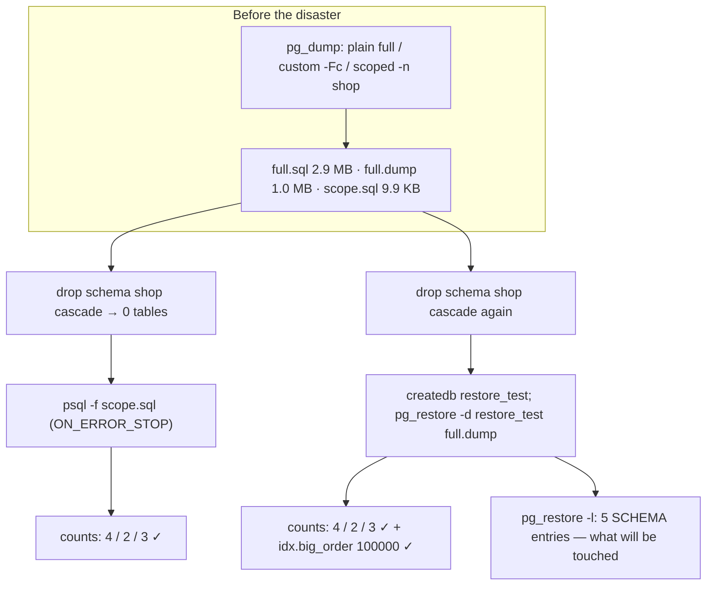

# Backups and Recovery

## 1. Learning Objectives

After this lesson you can:

- [ ] Produce the same database three ways — plain full dump, compressed custom
      archive, schema-scoped dump — and state what each is for (executed: 2,969,654 B
      plain / 1,039,646 B custom / 9,896 B `-n shop` scoped, all exit 0)
- [ ] Run a real disaster drill: destroy a schema and recover it from the scoped dump
      (executed: `drop schema shop cascade` → 0 tables → restore → products=4
      customers=2 lines=3)
- [ ] Recover an *entire database* into a fresh, empty database from a custom archive
      (executed: `pg_restore -d restore_test` → exit 0, all counts back, plus the
      100,000-row `idx.big_order` table intact)
- [ ] Read a custom archive's table of contents with `pg_restore -l` and say what the
      restore will touch before running it (executed: five `SCHEMA` entries — cons,
      idx, norm, shop, txn)
- [ ] Explain why sequences come back correct without any manual fixing (executed: the
      `setval` lines are part of every restore — 3/2/3/4/5 for the five shop tables)
- [ ] Draw the honest line between what this lesson executed (logical dump/restore)
      and what it only cites (WAL-based point-in-time recovery, physical base backups)

## 2. Prerequisites

- [Transactions](transactions.md) — durability (ACID's D) protects *committed* data
  against crashes; this lesson covers the different threat where that guarantee ends.
- [Migrations](migrations.md) — what a restored backup contains depends on which
  migrations had run when the dump was taken.

## 3. Introduction

A **backup** is a copy of the database taken somewhere else, some other way, at some
earlier time — and it only becomes real when it has been **restored**. PostgreSQL's
tooling makes taking one almost trivially easy (`pg_dump` writes plain SQL or a
compressed archive; `pg_restore` reads the archive back), which is exactly why the
hard part is not the command: it is scope, verification, and the discipline of
rehearsing. This lesson executes the full loop twice — a schema destroyed and brought
back from a 9.9 KB scoped dump, then a whole database rebuilt inside a fresh one from
a compressed archive — with every count checked afterward.

## 4. The Problem It Solves

Durability means the server survives a crash with committed data intact. It says
nothing about `drop schema shop cascade` executed against the right database, a deploy
that runs the wrong migration, a corrupt migration that overwrites rows, a lost laptop,
or a ransomware operator with production credentials. Every one of those destroys data
the server was perfectly durable about. The pre-`pg_dump` answer was "copy the data
files while the server is stopped" — downtime required, format tied to the exact
version, and whole-database granularity only. Logical dumps restore a schema into a
running server, compress well, and are portable across machines; that is what this
lesson drills.

## 5. Core Concepts

### Logical dump, three scopes

`pg_dump` exports the database *as SQL* (plus data as `copy` statements), not as raw
files:

| Command shape | What it captures | Executed size here |
|---|---|---|
| `pg_dump -f full.sql` | whole database, plain SQL, readable | 2,969,654 B |
| `pg_dump -Fc -f full.dump` | whole database, compressed custom archive | 1,039,646 B |
| `pg_dump -n shop -f scope.sql` | one schema only | 9,896 B |

The plain full dump is *portable* — any psql can run it, you can grep it, edit it, put
it in a repo. The custom format compresses to ~35% of the plain text and carries a
**table of contents** (an index of every object), which enables selective restore.
The scoped dump's 9,896 bytes are the point of the exercise: recovering five tables
should not mean replaying 3 MB that include someone else's 100,000-row analytics table.

### Two disaster classes, two responses

- **Surgical loss** (one schema/table gone, server healthy): restore *just that
  scope* from a scoped dump — or from a custom archive with `-n shop` passed to
  `pg_restore`. Executed as disaster #1.
- **Total loss** (server/database gone): provision an empty target and `pg_restore`
  the full archive into it. Executed as disaster #2 — the target `restore_test` did
  not exist until `createdb` made it.

### The restore is only done when counts say so

Both drills end with assertions: `products=4 customers=2 lines=3` and
`idx.big_order rows=100000`. Row counts are the minimum verification; the lesson's
exercises add the stronger checks (checksums, spot reads). "Exit 0" is not evidence —
`full restore exit=0` plus matching counts is.

### Sequences come back with the data

Every restore's output includes a block of `setval` calls (executed: `3 2 3 4 5` for
the scoped shop restore). A dump records each sequence's current value, so the next
insert after recovery continues the original numbering — no duplicate-key surprise on
the first row inserted after a restore. Hand-rolled backup scripts that "just copy the
rows" are the classic way to lose this and discover it in production.

## 6. How It Works



The diagram's left side is *preparation* (three files, taken while everything still
worked) and the right is *rehearsal* — two different losses, each answered with the
scope it deserves, each verified with counts rather than exit codes. The `pg_restore -l`
branch points backwards: read the TOC *before* the disaster to know what your backup
actually contains.

## 7. Practical Examples

*Executed on the authoring machine: PostgreSQL 18.6 / pg_dump 18.6, Windows 11 + Git
bash, database `codepath_lab`. Full transcript in the batch's lab notes.*

**Example 1 — three dumps of one database (executed)**

```bash
pg_dump -w -h 127.0.0.1 -p 5433 -U lab -d codepath_lab -f drill-full.sql
pg_dump -w -h 127.0.0.1 -p 5433 -U lab -d codepath_lab -Fc -f drill-full.dump
pg_dump -w -h 127.0.0.1 -p 5433 -U lab -d codepath_lab -n shop -f drill-scope.sql
```

```
pg_dump plain full: exit=0 bytes=2969654
pg_dump custom full (-Fc): exit=0 bytes=1039646
pg_dump scoped (-n shop): exit=0 bytes=9896
```

- The plain/custom pair is a compression lesson: same content, 35% of the size.
- The scoped dump is 0.3% of the full one — scope is the biggest size lever there is.
- **Expected output:** your byte counts will differ; the *ratios* will not.
- **How to run it:** any three commands above against any database.
- **Assumptions:** pg_dump 18.6; server reachable on the given port.

**Example 2 — disaster and surgical restore (executed)**

```sql
drop schema shop cascade;          -- disaster #1
-- restore:
psql -w -h 127.0.0.1 -p 5433 -U lab -d codepath_lab -v ON_ERROR_STOP=1 -f drill-scope.sql
```

```
=== step 2: disaster #1 — drop schema shop cascade
NOTICE:  drop cascades to 5 other objects
DETAIL:  drop cascades to table shop.category
drop cascades to table shop.customer
drop cascades to table shop."order"
drop cascades to table shop.order_line
drop cascades to table shop.product
shop tables left: 0
=== step 3: surgical restore from the scoped dump
scoped restore exit=0
after surgical restore: products=4 customers=2 lines=3
```

- The `DETAIL` list is your recovery checklist for free: five tables went, five must
  come back — and a scoped dump covering exactly the `shop` schema is the right tool.
- The `setval` block that printed during the restore (values `3 2 3 4 5`) is the
  sequence evidence from section 5.
- **Expected output:** identical counts after restore; `shop tables left: 0` before.
- **How to run it:** against a schema you may destroy — the exercises say which.
- **Assumptions:** scoped dump was taken *before* the drop (drill order matters).

**Example 3 — total loss, full recovery into an empty database (executed)**

```bash
dropdb --if-exists restore_test && createdb restore_test
pg_restore -w -h 127.0.0.1 -p 5433 -U lab -d restore_test drill-full.dump
psql -d restore_test -c "select count(*) from shop.product"   # etc.
pg_restore -l drill-full.dump | grep SCHEMA
```

```
restore_test created
full restore exit=0
restored: products=4 customers=2 lines=3
idx.big_order rows=100000
=== TOC excerpt (pg_restore -l)
8; 2615 26261 SCHEMA - cons lab
10; 2615 27068 SCHEMA - idx lab
7; 2615 25331 SCHEMA - norm lab
11; 2615 28560 SCHEMA - shop lab
9; 2615 27052 SCHEMA - txn lab
```

- The target started empty ("`database restore_test does not exist`" in the creation
  step) — total-loss recovery is provisioning + restore, nothing more.
- The 100,000-row table coming back is the strongest evidence in this lesson: a large
  object, not just small counts, survived the round trip.
- The TOC lists five schemas the archive will recreate — read it to know a backup's
  blast radius before you need it.
- **Expected output:** matching counts, five `SCHEMA` lines (adjust `-d` to your env).
- **How to run it:** create `restore_test`, restore, count, then `dropdb restore_test`.
- **Assumptions:** `pg_restore` of a plain-format file must use `psql -f` instead —
  `-l` and the archive TOC exist only for custom format.

## 8. Real-World Applications

Scheduled `pg_dump` (cron, systemd timer, CI) is the backbone of small and medium
deployments: nightly full custom archives, hourly scoped dumps of the tables that
change most, shipped to storage *on another machine* — the drill's third file only
helps if it is not on the dying disk. Managed databases (RDS, Cloud SQL, AlloyDB)
schedule snapshots and offer PITR built on WAL archiving, but the *restore rehearsal*
culture is identical: teams run game days where the newest backup is restored into a
scratch environment and counted. Large systems move beyond logical dumps to physical
base backups plus WAL shipping for second-level recovery points — the same threat
model, different tooling (cited, not executed here).

## 9. Common Mistakes

| Mistake | Why it happens | How to recognize it | How to prevent it |
|---|---|---|---|
| Backups taken, never restored | the copy command exits 0, feels done | first restore is the first real test — and it's in production | rehearse into a scratch database on a schedule; counts or it didn't happen |
| Exit 0 treated as success | tool reporting is trusted | empty tables after a "successful" restore | always assert row counts (and spot data) after every restore |
| Full-database dump for a one-schema mistake | default command, no thought | restoring a dropped `shop` means replaying 3 MB including 100k unrelated rows | keep a scoped dump alongside the full one; `pg_restore -n` for archives |
| Backup stored beside the data | convenience | ransomware/lost-disk takes both | off-machine copy as part of the backup job, not an afterthought |
| Hand-rolled "insert the rows" scripts | avoiding `pg_dump` | sequences restart, ids collide after restore | the dump's `setval` block (executed above) is the feature you didn't know you needed |
| Assuming a dump captures what didn't exist yet | taken before migration 0005 | restore lands an old schema, app crashes | dump *after* migrations in the deploy pipeline, or record the ledger version with the backup |
| Believing pg_dump = point-in-time recovery | terminology blur | "we can only go back to last night" | PITR needs WAL archiving (section 11) — different mechanism, plan it separately |

## 10. Best Practices

- **The restore is the test.** A backup job that doesn't occasionally restore into a
  scratch database produces *files*, not backups. Both drills here end in counts —
  copy that discipline.
- **Keep two scopes.** Full archive for total loss; scoped dump (or `pg_restore -n`)
  for the common case: one schema, one table, one bad migration. The 2.9 MB vs 9.9 KB
  ratio shows why you plan both *before* the incident.
- **Prefer custom format (`-Fc`) for real backups**: compression and the TOC enable
  selective restore; keep plain SQL when portability or greppability matters more.
- **Ship copies off the machine.** A backup on the same disk as the database is a
  staging area, not a backup.
- **Record what the backup *is*:** timestamp, migration/ledger version, and scope
  next to the file — you restore into a database the application must match.
- **Verify beyond counts when it matters** (exercises): checksums of a few rows, a
  business-total query, sequence head values — the assertions you would want in an
  incident.

## 11. Limitations and Trade-Offs

Everything executed here is **logical** backup/restore: fast, scoped, portable, but
export-and-replay — cost grows with data size, and very large databases need
physical base backups (file-level copies with `pg_basebackup`, cited not executed).
**Point-in-time recovery** (restore to *2:14 a.m.*, not just "last dump") requires WAL
archiving configured before the disaster — no post-hoc fix, and it is a server-level
setup this lab never enabled: an honest seam. `pg_dump` also does not capture global
objects — roles, per-database settings, tablespaces — those need `pg_dumpall` or
configuration management (cited). Dumps restore *schema + data as of the dump*: anything
written after the dump and before the disaster is gone unless PITR covers it. And
compression is not encryption: an archive sitting in object storage holds your rows in
readable form until you add encryption at the storage layer (outside this lesson).

## 12. Practical Exercises

### Introductory

1. **Exercise 1.1** — reproduce Example 1 on a database of your own: three dumps with
   byte counts, then open the plain dump and paste the `create table` of one table and
   the first `copy` line for it.
   **Completion criteria:** three size figures; evidence the plain dump is human-readable
   SQL; one sentence stating which file you would keep for a one-schema mistake and why.
2. **Exercise 1.2** — execute Example 2's disaster drill end-to-end: take a scoped
   dump first, drop the schema, restore it, and show the counts matching your pre-drill
   numbers.
   **Completion criteria:** both pre- and post-restore counts in one transcript; the
   `setval` output from the restore identified as the sequence recovery; the `NOTICE`
   detail list used to explain what the scoped dump had to cover.

### Intermediate

3. **Exercise 1.3** — perform Example 3: full custom archive, fresh database, restore,
   verify every schema's row counts plus one index-backed table's count (the drill used
   `idx.big_order` = 100,000).
   **Completion criteria:** `pg_restore -l` TOC pasted and each `SCHEMA` line explained
   (which part of your data it holds); matching counts for at least four tables; the
   target database dropped afterward, with the command shown.
4. **Exercise 1.4** — selective restore: from a custom archive of a multi-schema
   database, restore *one* schema into the original database (it exists — so decide
   first: drop it, or use `-n` on restore into a scratch database) and show that the
   other schemas' counts are untouched.
   **Completion criteria:** counts of a neighboring schema before and after the
   operation proving it was untouched; the command's flags explained; the scenario in
   your own work this technique would serve.

### Independent problem-solving

5. **Exercise 1.5** — write the restore runbook for a real database of yours (or the
   Project Laboratory's schema): from "the database is gone" to "the application is
   talking to it again." Execute the runbook's steps against a scratch server —
   provisioning the target, restoring, verifying with counts *and* two business-level
   assertions, and naming the exact data-loss window between last backup and disaster.
   **Completion criteria:** the runbook as numbered steps with commands; a fully
   executed rehearsal transcript ending in green assertions; the data-loss window
   stated in hours with the backup schedule that produces it; and an explicit list of
   what your runbook cannot recover (from section 11) with the one upgrade you would
   propose first.

*Solutions: attempt first. They live in `solutions/` of this subject.*

## 13. Knowledge Check

1. A teammate says "the restore exited 0, we're fine." Using this lesson's drill,
   name the evidence you checked beyond the exit code, and one failure mode it would
   catch that exit 0 would not.
2. Why does the scoped dump exist *in addition to* the full archive rather than
   instead of it? Use the executed byte counts and the two disaster classes in your
   answer.
3. You restore last night's dump into production after today's migration ran. What
   three kinds of mismatch (schema, sequences, post-dump writes) must you account for,
   and which mechanism in this course's reading addresses each?

## 14. Completion Criteria

Observable evidence that you have understood this lesson:

- [ ] You have taken all three dump variants and can state each one's size and purpose
- [ ] You have destroyed a schema and restored it from a scoped dump with matching
      counts, quoting your own transcript
- [ ] You have restored a full archive into a brand-new database and verified a large
      table (≥100k rows) came back
- [ ] You can read `pg_restore -l` output and say what the archive touches before
      running it
- [ ] You can explain the `setval` block in a restore and what goes wrong without it
- [ ] You can name what is *not* covered (PITR, globals, encryption) and what you
      would set up first

## 15. Summary

- `pg_dump` gives three shapes — plain SQL (portable), custom archive (compressed,
  TOC, selective), scoped (`-n`) — executed at 2.97 MB / 1.04 MB / 9.9 KB.
- Destroy and prove: `drop schema shop cascade` → 0 tables → scoped restore → 4/2/3
  counts back.
- Total loss is routine: empty `restore_test` + `pg_restore` → exit 0, all counts,
  `idx.big_order` = 100,000 rows, five schemas in the TOC.
- Restores bring sequences with them (the `setval` block) — the reason ids don't
  collide afterward.
- A backup is a file; a backup is only *proven* after a counted restore — and PITR,
  globals, and encryption remain named, uncrossed seams.

## 16. Next Steps

- Next lesson: [Database Security](database-security.md) — who may dump, restore, and
  read this data; the roles that make backups a privilege, not an accident
- Practice: [exercises/](exercises/README.md) — set 16
- Where it is applied: [20 — Project Laboratory](../20-PROJECT-LABORATORY/README.md) —
  every project brief's operations checklist includes a scheduled dump and one executed
  restore rehearsal