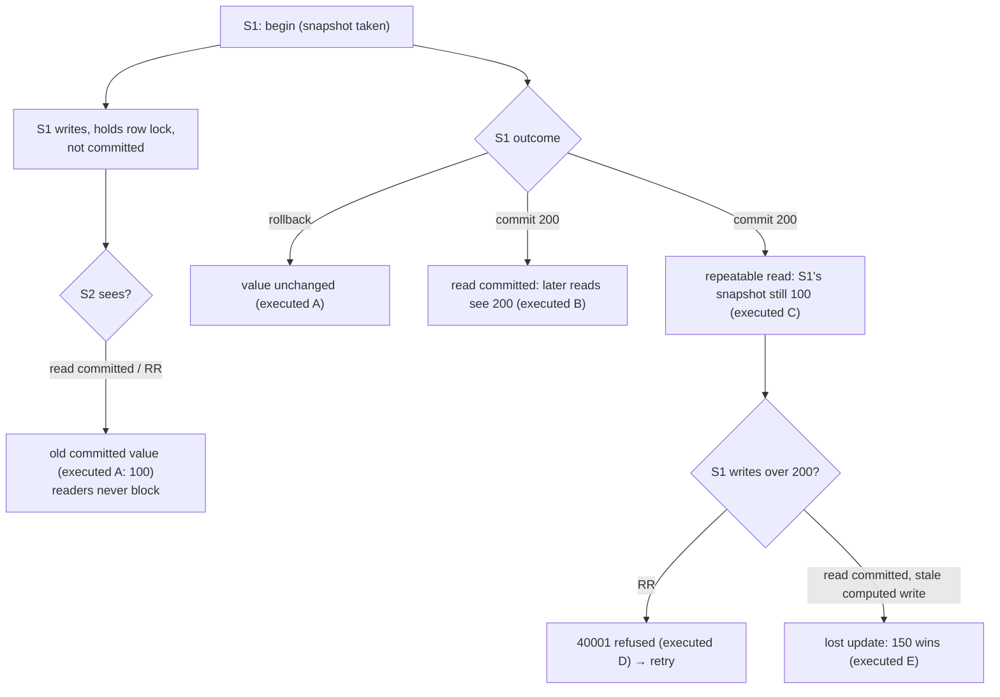

# Concurrency and Isolation

## 1. Learning Objectives

After this lesson you can:

- [ ] Demonstrate that uncommitted work is invisible and that readers never block
      writers (executed: session 2 read `100` while session 1 held `999` uncommitted,
      then still `100` after the rollback — no lock wait either side)
- [ ] Execute the classic anomalies per isolation level (executed: **non-repeatable
      read** under `read committed` — `100` then `200`; **snapshot stability** under
      `repeatable read` — `100` then `100`; **write conflict** — `ERROR: could not
      serialize access due to concurrent update`, SQLSTATE `40001`)
- [ ] Execute an application-level **lost update** and explain why no constraint
      stopped it (executed: session 1's stale-computed `150` overwrote session 2's
      committed `200` — final `150`)
- [ ] Read the SQL-standard level table against PostgreSQL's *actual* behaviour,
      including its documented deviation (PostgreSQL `repeatable read` also prevents
      phantoms — snapshot semantics)
- [ ] Choose a level and a concurrency strategy for a real code path: default
      `read committed` + retry-on-`40001`, `select … for update` for read-modify-write,
      `repeatable read`/`serializable` for report-consistency — each justified from the
      executed transcripts

## 2. Prerequisites

- [Transactions](transactions.md) — the block, commit, and rollback these sessions
  interleave; ACID's "I" is this lesson's subject.

## 3. Introduction

Two sessions, one row: that is the whole problem. **Isolation** is the promise a level
makes about what one transaction can observe of another; the classic anomalies
(non-repeatable read, phantom, lost update) are the *failures* each level permits.
PostgreSQL implements isolation with **MVCC** — writers never block readers (and vice
versa): each transaction reads a snapshot, and conflicting writes negotiate through row
locks. Every transcript below ran as **two real concurrent psql sessions** against the
lab server; the sleeps are just coordination.

## 4. The Problem It Solves

Without isolation, concurrent transactions interleave like two people editing one
document: balances double-charge, counters skip, reports mix pre- and post-state.
Serializing everything (one transaction at a time) would be correct and unusably slow.
Isolation levels are the negotiated middle: name the anomalies you're willing to
 tolerate, get the concurrency you need — and the application covers the rest (retries,
locks). The executed anomalies are how you learn what "willing to tolerate" costs.

## 5. Core Concepts

### MVCC in one paragraph

Each row carries version metadata; each transaction sees a **snapshot** (rows committed
as of its start, under snapshot levels). A writer creating a new row version doesn't
touch readers of the old one — which is why demo A's read never waited and never saw
`999`. When two writers want the same row, the second waits on the row lock; if the
first commits and the second's snapshot predates it, the second gets `40001` (demo D)
instead of silently overwriting.

### The levels, executed where it matters

| Level | Anomalies permitted | Evidence here |
|---|---|---|
| read uncommitted | all | not offered by PostgreSQL (it maps to read committed) — no execution possible, by design |
| **read committed** (default) | non-repeatable read, phantom | **executed B**: `100 → 200`; lost update possible at app level: **executed E** |
| **repeatable read** (PG: snapshot) | write skew (rare) | **executed C**: `100 → 100`; **executed D**: conflict refused `40001` — PG also blocks phantoms here (documented deviation from the SQL standard) |
| serializable | none (true serial order) | not executed in this batch — the `40001` retry pattern you will practice covers its shape |

### The anomalies by name

- **Non-repeatable read** — a value *changes between your reads* of it (executed B).
- **Phantom** — rows *appear/disappear* between equivalent reads (aggregate/count
  version; not executed here — the exercises run it).
- **Lost update** — two transactions computed from the same read; the later write
  clobbers the earlier one **without any error** (executed E: final `150`). This one is
  an *application* shape: the database never knew you derived `150` from `100`.

### The two defenses for lost updates

1. **`select … for update`** — take the row lock at read time; the competing writer
   waits, your read-modify-write becomes atomic.
2. **Retry on `40001`** — let the database refuse the stale write (executed D is exactly
   that refusal), catch `40001` in the application, and retry the whole transaction.
   This is why PostgreSQL's `repeatable read`/`serializable` are usable at all: their
   conflicts *surface* instead of corrupting.

## 6. How It Works



The diagram's fork is the lesson: **the same interleaving** yields a correct refusal
under `repeatable read` and a silent corruption under `read committed` — the level
decides which world you live in.

## 7. Practical Examples

**Example 1 — uncommitted is invisible, and nobody waits (executed, two sessions)**

```console
-- session 1                          -- session 2 (1.5s later)
begin;
update iso set val = 999 …;   -- hold  select val …;
select pg_sleep(4);                  →  val = 100      -- old value, no wait
rollback;
                                       select val …;   →  val = 100   -- still
```

Session 2 read *during* an open write transaction and never blocked — MVCC's headline.
After the rollback the `999` never existed for anyone. (Contrast with a lock-based
database where that read would have waited 4 seconds.)

**Example 2 — non-repeatable read under the default level (executed)**

```console
-- session 1 (read committed)                -- session 2
begin;
select val …;                      → 100
select pg_sleep(3);
                                            update iso set val = 200 …;
                                            -- commits (UPDATE 1)
select val …;                      → 200
commit;
```

One transaction, one row, two different answers — the read-committed guarantee is only
"each *statement* sees a snapshot as of its own start." If your transaction's logic
depends on two reads agreeing, the default level is not enough on its own.

**Example 3 — repeatable read freezes the view (executed)**

Identical orchestration with `begin isolation level repeatable read`: both reads return
**100**, although `200` committed between them. The snapshot was taken at the first
read and held — reports ("sum then detail") stay internally consistent.

**Example 4 — the database refuses a stale write (executed)**

```console
-- session 1 (repeatable read)              -- session 2
begin isolation level repeatable read;
select val …;                      → 100
select pg_sleep(3);
                                            update iso set val = 200 …;  -- commits
update iso set val = val + 1 …;
ERROR:  could not serialize access due to concurrent update
rollback;
```

`40001` is the *good* outcome: session 1's snapshot is stale, so PostgreSQL aborts the
write rather than let a phantom-committed state be built on. The application's response
is fixed and boring: catch `40001`, back off, retry the transaction — which is why
retry loops are part of every serious data-access layer.

**Example 5 — the lost update, silently (executed)**

```console
-- session 1 (read committed)              -- session 2
begin;
select val …;                      → 100
select pg_sleep(3);
                                            update iso set val = 200 …;  -- commits
update iso set val = 150 …;         -- "100 + 50", computed from my earlier read
commit;
select val …;                      → 150     -- final value
```

No error anywhere: session 1 read `100`, did arithmetic, wrote `150` — and session 2's
committed `200` vanished. The row lock didn't help because session 1 didn't *hold* it
while computing; it never asked. **Fixes, from the same schema**: `select val from iso
where id = 1 for update` at read time (lock held through the arithmetic), or `update iso
set val = val + 50` in one statement (the database re-reads under the lock — *relative*
updates beat computed ones), or snapshot levels where a stale read is detectable. Each
of the three converts the silent `150` into either a wait or a `40001`.

## 8. Real-World Applications

Inventory decrement (`val + 1` as one statement, or `for update`), balance transfers
(both demo rows are ledgers), bid placement (last-write-wins is unacceptable →
lock/serializable), dashboards (repeatable read so the numbers add up), and the retry
middleware in every ORM (`40001` handling) — this lesson's transcripts are the
production incidents they prevent. The *choice* is economic: read-committed plus
targeted locking is the default because contention is rare; escalating a whole
workflow's level is reserved for the transactions where a torn read costs more than a
retry.

## 9. Common Mistakes

| Mistake | Why it happens | How to recognize it | How to prevent it |
|---|---|---|---|
| Read-modify-write without a lock | "it's one row, one user" | counters skip; balances drift; demo-E shape | `for update`, single relative `update`, or serializable + retry |
| Choosing serializable everywhere | correctness maximalism | `40001` storms under load | default read committed; escalate per transaction, with retry |
| Long transactions as "consistency" | snapshot held too long | bloat, lock queues, aged snapshots (vacuum) | keep blocks short; re-read after commit if the world moved |
| Retrying non-idempotent transactions | blanket retry on error | duplicate orders after a *successful* first attempt committed late | retry only `40001`-family conflicts, and make the unit re-runnable |
| Assuming non-repeatable read is a bug | standard level misunderstood | "the value changed mid-transaction!" | it's the documented default — compose reads with `for update` or a snapshot level |
| Ignoring lock waits in monitoring | waits invisible in app logs | requests hang with no error | watch `pg_stat_activity`/lock waits; a wait is information |

## 10. Best Practices

- **Make writes relative** (`set val = val + 50`) wherever the math allows — executed E
  is the alternative's receipt; single-statement updates take the row lock internally
  and can't lose the race.
- **`select … for update` whenever you read in order to write**, especially across
  statements.
- **Retry `40001` with backoff** at the transaction boundary — the conflict is a *correct*
  refusal, not an error to hide.
- **Pick the level per transaction**: reports/exports → `repeatable read`; ordinary
  CRUD → default; rare multi-row invariants → `serializable` + retry.
- **Keep transactions short**: every snapshot holds back vacuum, every lock queues a
  peer.

## 11. Limitations and Trade-Offs

Isolation is per-database and per-transaction — two databases or a message broker can't
share it (sagas again). MVCC's freedom costs storage: old row versions exist until
vacuum, so long snapshots have a *physical* price, not just a correctness one.
`select for update` queues work — a hot row becomes a bottleneck (sharding/queueing are
the later answers). Serializable retries can cascade under heavy contention: the level
trades retries for correctness, and only you know if the workload's conflicts are rare.
Finally, client-side patience matters: a locked read that waits 30 s looks identical to
a hang from the user's chair — timeouts and idempotent UX are part of the design.

## 12. Practical Exercises

### Introductory

1. **Exercise 1.1** — reproduce demos A and B with your own table and two terminals,
   quoting both sessions' outputs with enough timing evidence (your own `pg_sleep`
   placement) to prove the interleaving.
   **Completion criteria:** four captured outputs (A: two reads; B: two reads); one
   sentence each for "invisible" and "non-repeatable"; the row-lock question answered
   (did session 2 wait? quote what shows it didn't).
2. **Exercise 1.2** — the phantom, executed: session 1 under `repeatable read` counts
   rows twice while session 2 inserts a new matching row between them. PostgreSQL's
   snapshot keeps both counts equal — capture it, then repeat under `read committed`
   where the counts differ.
   **Completion criteria:** both transcripts (equal counts / changed counts); the
   standard-vs-PostgreSQL deviation stated after seeing it yourself.

### Intermediate

3. **Exercise 1.3** — the lost-update fix-off: reproduce demo E, then fix it *three
   ways* — (a) single relative `update set val = val + 50`, (b) `select … for update`
   before the computed write, (c) `repeatable read` catching the stale write as `40001`.
   Execute all three against the same interleaving.
   **Completion criteria:** three transcripts showing final `250` (S2's 200 + 50) or an
   explicit conflict; the failure each defense converts (silence → lock → error) named;
   your default choice written with the reason.
4. **Exercise 1.4** — timing under contention: run 20 concurrent single-statement
   increments (`val = val + 1`) from a loop of psql processes against one row, and 20
   *computed* read-then-write increments; compare the final value against the expected
   20/40 difference.
   **Completion criteria:** both final values quoted; the lost-update count computed
   from the gap; one sentence on why the relative form couldn't lose any.

### Independent problem-solving

5. **Exercise 1.5** — audit a real write path of yours (form submission, API endpoint):
   list every read that precedes a write, classify each as safe or lost-update-prone,
   and implement the appropriate defense with an executed proof: reproduce the race
   failing (two sessions, your schema), then apply the fix and re-run the identical
   race.
   **Completion criteria:** the read-then-write inventory; a reproduced anomaly with
   captured outputs; the fix's re-run showing correct final state; the chosen level and
   retry policy written as the endpoint's concurrency contract.

*Solutions: attempt first. They live in `solutions/` of this subject.*

## 13. Knowledge Check

1. Under `read committed`, transaction 1 reads a row twice and gets different values —
   is that a bug, a documented feature, or an application error? Justify with the
   executed B transcript and say what the application must do if it needs agreement
   between its reads.
2. Demo E produced no error yet lost data. Why didn't the row lock prevent it, and how
   do the three listed fixes each change what the *database* can see of the race?
3. A team sets `repeatable read` globally "for correctness." Name one cost from this
   lesson (conflicts? retries? snapshot age?) and the workload where you'd predict it
   bites first.

## 14. Completion Criteria

Observable evidence that you have understood this lesson:

- [ ] You have run all five two-session demos (or four + the phantom) with captured
      interleaving evidence
- [ ] You can state each anomaly and which executed demo produced it
- [ ] You can explain MVCC's reader/writer non-blocking property from demo A
- [ ] You have executed all three lost-update defenses and can say which failure each
      converts
- [ ] You can write the concurrency contract (level + lock + retry) for one of your own
      endpoints

## 15. Summary

- MVCC: readers see a committed snapshot and never block writers (executed: `100` read
  during an open `999` write, still `100` after rollback).
- Read committed re-reads per statement (executed `100 → 200`); repeatable read holds
  the snapshot (executed `100 → 100`) and refuses stale writes with `40001` (executed).
- Lost update needs no error at all (executed: stale `150` clobbered `200`) — the
  defenses are relative updates, `for update`, or snapshot-level refusal.
- PostgreSQL's repeatable read is snapshot-based (phantoms included — a documented
  deviation), and read-uncommitted doesn't exist.
- Concurrency contracts are chosen per transaction: default + targeted locks + retry on
  `40001`.

## 16. Next Steps

- Next lesson: [Migrations](migrations.md) — changing the schema these transactions run
  against, versioned and re-runnable
- Practice: [exercises/](exercises/README.md) — set 14
- Where it is applied: [20 — Project Laboratory](../20-PROJECT-LABORATORY/README.md) —
  the project's data layer must ship its level/lock/retry contract with tests
