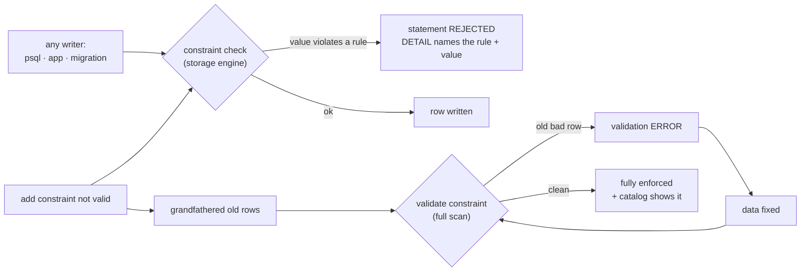

# Constraints and Relationships

## 1. Learning Objectives

After this lesson you can:

- [ ] Classify the constraint toolbox — entity (PK), referential (FK), domain (type),
      uniqueness, `check`, `default`, exclusion — and say which layer each defends
- [ ] Execute one rejection per class and read its message back to the rule (executed:
      `ticket_reporter_check`, a not-null with its failing row,
      `ticket_location_title_key`, an FK orphan on `org_id`, and
      `booking_room_during_excl` quoting both conflicting ranges)
- [ ] Prove a `default` fires on omission (executed: `severity = 3` and `assignee`
      NULL returned by `RETURNING`)
- [ ] Add a constraint to an existing table **and** to a table with bad legacy data —
      the `not valid` → `validate` workflow, executed step by step (new writes rejected
      while old rows are tolerated; validation failing until the data is fixed, then
      passing)
- [ ] Use an exclusion constraint for overlap rules PostgreSQL's other constraints
      can't express (executed: overlapping room booking refused; adjacent bookings
      allowed — and the `btree_gist` seam recorded honestly)

## 2. Prerequisites

- [Database Fundamentals](database-fundamentals.md) — the first three constraint classes
  in daily use.
- [Relational Databases](relational-databases.md) — FK semantics and referential actions;
  this lesson adds management, naming, and the PostgreSQL-specific tools.

## 3. Introduction

Constraints are the database's *constitution*: rules every writer obeys, including the
ones you haven't written yet — tomorrow's scripts, last year's import, the colleague's
one-off fix. This lesson walks the whole toolbox with every rejection executed, then
covers the part production actually needs: **adding** constraints to tables that already
contain data (`not valid`/`validate`), and the one class that expresses rules the others
can't (exclusion — no double-booking, no overlapping ranges).

## 4. The Problem It Solves

Application validation protects one entry point; a database has many (psql, migrations,
replication repair, a forgotten admin script). Any rule enforced only in application
code is enforced only where you remembered. Constraints move the remembering into the
storage engine — one place, every write path. The second problem this lesson solves is
the *arrival* problem: the rule you want was discovered after the data existed, and
enforcing it naively either corrupts legacy rows or blocks the migration entirely.

## 5. Core Concepts

### The taxonomy, by what it defends

| Constraint | Class | Defends | Executed here |
|---|---|---|---|
| `primary key` | entity | row identity, never NULL/duplicate | (prior lessons; the `id` columns) |
| `foreign key` | referential | relationships across tables | orphan `org_id` → rejected |
| data type | domain | value shape | (`numeric` guard, lesson 1) |
| `not null` | domain | presence | `title` NULL → rejected |
| `unique` (+ composite) | entity/uniqueness | at-most-once (pair) | `(location, title)` → rejected |
| `check` | user-defined | any boolean rule | `reporter like '%@%'` → rejected |
| `default` | convenience/consistency | value when omitted | `severity 3` via `RETURNING` |
| `exclusion` | user-defined (PostgreSQL) | no two rows violate a predicate *together* | overlap → rejected |

**Defaults aren't validation** — they fill, not judge; combine `default` + `not null` +
`check` when "omitted" must also be legal *and* bounded (here: default severity 3, and
`check (severity between 1 and 5)`).

### Composite uniqueness is scope

`unique (location, title)` rejects a *repeat of the pair* — same title in another room
executed **fine**. The uniqueness rule's unit is the whole tuple; choosing that tuple is
a design decision (lesson 7's `unique (order_id, product_id)` is the same mechanism).

### `not valid` → `validate`: constraints over existing data

PostgreSQL splits adding a constraint from checking old rows:

1. `add constraint … not valid` — the constraint **exists** (new inserts/updates are
   checked immediately — executed: `score = -1` refused) but old rows are grandfathered.
2. `alter … validate constraint` — scans existing rows; executed **failure** while the
   legacy `-5` existed (`violated by some row`), then **success** after fixing it.
3. Validate takes an `ACCESS EXCLUSIVE`-class lock for its scan — on big tables do it in
   a migration window; the alternative (validate first) blocks *all* writes until done.

### Exclusion: rules `check` can't write

`check` sees one row; "no two bookings overlap" relates *two* rows. Exclusion
constraints (with an index support — GiST here) express exactly that:

```sql
exclude using gist (room WITH =, during WITH &&)
```

— `WITH` pairs each column with its operator: same room **and** ranges overlapping →
conflict. The executed seam: `text` has no default GiST operator class, so
`create extension btree_gist` was required first — recorded here as the real cost of the
feature.

## 6. How It Works



Two enforcement *timelines* (immediate for writes, deferred-for-old-rows via `not
valid`) over one rule — that separation is what makes hardening legacy tables a
controlled migration instead of a gamble.

## 7. Practical Examples

**Example 1 — three rejections from one `create table` (executed)**

```sql
create table ticket (
  id       serial primary key,
  title    text not null,
  reporter text not null check (reporter like '%@%'),
  severity smallint not null default 3 check (severity between 1 and 5),
  assignee text,
  location text not null,
  unique (location, title)
);
```

```console
insert into ticket (title, reporter, location) values ('Broken build', 'no-at-sign', 'room 1');
ERROR:  new row for relation "ticket" violates check constraint "ticket_reporter_check"
DETAIL:  Failing row contains (1, Broken build, no-at-sign, 3, null, room 1).

insert into ticket (title, reporter, location) values (null, 'a@b.c', 'room 1');
ERROR:  null value in column "title" of relation "ticket" violates not-null constraint
DETAIL:  Failing row contains (2, null, a@b.c, 3, null, room 1).

insert into ticket (title, reporter, location) values ('Broken build', 'x@y.z', 'room 1');
insert into ticket (title, reporter, location) values ('Broken build', 'x@y.z', 'room 1');
ERROR:  duplicate key value violates unique constraint "ticket_location_title_key"
DETAIL:  Key (location, title)=(room 1, Broken build) already exists.
```

Three classes, three messages, each `DETAIL` carrying the offending value — the default
`severity = 3` is even visible inside the failing rows (defaults ran before the check).

**Example 2 — default by omission (executed)**

```sql
insert into ticket (title, reporter, location) values ('Seed check', 'a@b.c', 'room 2')
returning id, severity, assignee;
```

```
 id | severity | assignee
----+----------+----------
  5 |        3 |
```

`severity` filled with 3, `assignee` stayed NULL (nullable by design — "unassigned" is
information). Omission ≠ NULL: the column's default and its nullability are separate
decisions.

**Example 3 — composite scope (executed)**

```sql
insert into ticket (title, reporter, location) values ('Broken build', 'q@w.e', 'room 2');  -- ok: same title, other room
insert into ticket (title, reporter, location) values ('Broken build', 'q@w.e', 'room 1');  -- pair repeat
-- ERROR:  duplicate key value violates unique constraint "ticket_location_title_key"
-- DETAIL:  Key (location, title)=(room 1, Broken build) already exists.
```

The rule is the *pair*: identical titles coexist across rooms; the pair may not repeat.

**Example 4 — hardening a legacy table (executed, all four steps)**

```sql
create table legacy (id serial primary key, score integer not null);
insert into legacy (score) values (10), (-5);          -- the bad row predates the rule

alter table legacy add constraint score_positive check (score > 0) not valid;
insert into legacy (score) values (-1);
-- ERROR:  new row for relation "legacy" violates check constraint "score_positive"
-- DETAIL:  Failing row contains (3, -1).

alter table legacy validate constraint score_positive;
-- ERROR:  check constraint "score_positive" of relation "legacy" is violated by some row

update legacy set score = 5 where score < 0;
alter table legacy validate constraint score_positive;   -- passes
select count(*) from legacy where score > 0;             -- 2
```

Read the sequence as a deployment plan: grandfather old data (`not valid` — new writes
already safe), *attempt* validation to find the legacy violations precisely, fix them,
validate for real. After step one, no future bad row can enter — the business risk is
closed before the historical data is.

**Example 5 — exclusion: no double booking (executed)**

```sql
create extension if not exists btree_gist;    -- text needs a GiST operator class (executed seam)
create table booking (
  id     serial primary key,
  room   text not null,
  during tstzrange not null,
  exclude using gist (room WITH =, during WITH &&)
);
insert into booking (room, during) values ('r1', '[2026-11-01 09:00, 2026-11-01 10:00)');
insert into booking (room, during) values ('r1', '[2026-11-01 09:30, 2026-11-01 11:00)');
```

```console
ERROR:  conflicting key value violates exclusion constraint "booking_room_during_excl"
DETAIL:  Key (room, during)=(r1, ["2026-11-01 09:30:00+03","2026-11-01 11:00:00+03"))
         conflicts with existing key (room, during)=(r1, ["2026-11-01 09:00:00+03","2026-11-01 10:00:00+03")).
```

```sql
-- boundary touch (end == start) and a different room are fine:
insert into booking (room, during) values ('r1', '[2026-11-01 10:00, 2026-11-01 11:00)');
insert into booking (room, during) values ('r2', '[2026-11-01 09:30, 2026-11-01 11:00)');
select room, count(*) from booking group by room order by room;
```

```
 room | count
------+-------
 r1   |     2
 r2   |     1
```

The `DETAIL` quotes **both** ranges — the constraint names the exact collision.
`&&` is range-overlap; `[start, end)` being half-open makes back-to-back bookings legal
(r1 has two), and the `room WITH =` term scopes conflicts per room (r2 unaffected).

**Example 6 — a constraint added after the fact (executed)**

```sql
create table org (id serial primary key, name text not null);
insert into org (name) values ('R&D');                        -- id 1 only
alter table ticket add column org_id integer references org(id);
insert into ticket (title, reporter, location, org_id) values ('Orphan try', 'a@b.c', 'room 9', 42);
-- ERROR:  insert or update on table "ticket" violates foreign key constraint "ticket_org_id_fkey"
-- DETAIL:  Key (org_id)=(42) is not present in table "org".
```

`alter table add … references` follows the same legacy-data question as `check`
(`not valid` works for FKs too — validate then checks existing orphans); the executed
rejection proves the FK is live for new writes immediately.

## 8. Real-World Applications

This toolbox is the schema half of every production invariant: unique business codes
(preventing duplicate SKUs/accounts), `check` bounds (non-negative money, legal enums),
FKs keeping referential integrity across services' tables, and exclusion powering
scheduling (rooms, slots, devices), calendar double-booking, and inventory reservation
windows. The `not valid`/`validate` pair is how teams harden years-old tables without
downtime — a standard migration pattern in every serious Postgres codebase.

## 9. Common Mistakes

| Mistake | Why it happens | How to recognize it | How to prevent it |
|---|---|---|---|
| Rules left in application code only | "the app checks it" | orphans from a manual/legacy write path | every invariant the *data* needs lives in the schema |
| `add constraint` without `not valid` on big tables | unaware of the lock | long migration blocking all writes | `not valid` first, `validate` in a window |
| Free-text "enum" columns | flexibility habit | inconsistent values (`new`, `New `, `n`) | `check (col in (…))` — executed in lesson 7 and here |
| Uniqueness declared on the wrong tuple | unit not thought through | either too strict (blocks legal rows) or too loose (duplicates pass) | write the rule as an English sentence first ("one title *per room*") — then pick columns |
| Assuming `check` can span rows | single-row mental model | overlap bugs ship | exclusion (executed) or an application transaction with locking |
| Ignoring constraint names | auto-generated names unreadable in errors | can't map error → rule quickly | name them: `score_positive`, `reporter_looks_like_email` |

## 10. Best Practices

- **Write the rule in English, then pick the constraint** — the mapping is the design
  record; comments beside the DDL are enough.
- **Defaults + `not null` for "usually the same"** fields (severity 3) — one less thing
  every writer must remember, and `RETURNING` makes it visible.
- **Name every constraint you add by hand** — the error message *is* the user-facing
  documentation (the executed messages read like sentences because they're named well).
- **Legacy tables: `not valid` → fix → `validate`**, in that order, with the validation
  scan in a maintenance window; keep the executed steps in the migration file.
- **Reach for exclusion before triggers** for overlap/uniqueness-over-predicate rules —
  it's declarative, indexed, and its error names both conflicting rows.

## 11. Limitations and Trade-Offs

Constraints are row-local or predicate-local: workflows ("approve before ship"), cross-
table arithmetic ("line totals sum to header total") need triggers or application
transactions — and every trigger is untested logic you now own (the testing lessons'
warning applies). Exclusion needs range types and an index method — free-text "no two
similar rows" fuzzy rules are out of scope entirely. Validation scans take exclusive
locks (plan them), and `check` constraints are evaluated per row even when redundant
with an index — measure rather than gold-plate. Finally, constraints cannot express
*time*: "no order in the future" holds at insert but not tomorrow — temporal rules
belong to periodic checks or app logic, stated as such.

## 12. Practical Exercises

### Introductory

1. **Exercise 1.1** — create the `ticket` table from Example 1 from memory and produce
   all three rejections plus the default's `RETURNING` receipt, predicting each message's
   constraint name before running.
   **Completion criteria:** four transcripts; three constraint names predicted correctly
   (or the mismatch explained); the rule sentence written beside each name.
2. **Exercise 1.2** — write one `check` for a table of yours that spans two columns
   (e.g., `end_at > start_at`), seed one good and one bad row, and capture the refusal.
   **Completion criteria:** the executed `DETAIL` with both offending values; one
   sentence on why this rule *is* expressible per-row (both columns on the same row) —
   and an example that wouldn't be.

### Intermediate

3. **Exercise 1.3** — execute the full `not valid` → `validate` dance on a table with
   three legacy violations: add `not valid`, prove a new bad row is already refused,
   validate (fails), count the bad rows with a `select`, fix them, validate (passes).
   **Completion criteria:** seven executed steps including both validation outcomes and
   the bad-row count; the locking implication written down (what each step blocks).
4. **Exercise 1.4** — the scheduling rule for a *shared resource with single slots*:
   build `booking` with the exclusion constraint and probe its boundaries: exact
   back-to-back (allowed), one-second overlap (refused), different resource (allowed),
   and `during` with a NULL column (what happens? execute it — `not null` is your friend).
   **Completion criteria:** four executed outcomes with messages/counts; the half-open
   interval reasoning stated; the `btree_gist` prerequisite recorded in your notes.

### Independent problem-solving

5. **Exercise 1.5** — audit an existing schema (yours or open-source): for each table,
   write the invariant sentence its current constraints enforce, then list **three
   invariants the application assumes but the schema doesn't enforce**. Implement the
   strongest of the three (constraint, exclusion, or `not valid` migration) with executed
   evidence: before — a violating insert that *succeeds* today; after — the same insert
   refused.
   **Completion criteria:** the invariant table (enforced vs assumed); one implemented
   rule with before/after transcripts; the migration steps for the legacy-data case
   chosen and justified (`not valid` vs validate-first).

*Solutions: attempt first. They live in `solutions/` of this subject.*

## 13. Knowledge Check

1. Explain the difference between what `not valid` guarantees and what `validate`
   guarantees — and which of the two stops *new* bad data. Which step is safe to run
   during traffic, and which needs a window?
2. A product owner says "no customer should have two open orders." Is that a `check`, a
   `unique`, an exclusion, or none of them? Explain what each candidate would actually
   enforce (or fail to).
3. Why did the exclusion constraint need `btree_gist`, and what does that tell you about
   the relationship between constraints and index machinery?

## 14. Completion Criteria

Observable evidence that you have understood this lesson:

- [ ] You can name the eight constraint classes with the layer each defends and one
      executed rejection each you have actually produced
- [ ] You have executed the `not valid` → legacy-failure → fix → validate sequence and
      can state what each step locks
- [ ] You have built an exclusion constraint and probed its boundary cases (back-to-back,
      overlap, other key)
- [ ] You can read any constraint error's `DETAIL` and map it to its English rule
- [ ] You can name two rules constraints *cannot* enforce and where those belong

## 15. Summary

- Eight classes defend identity, relationships, presence, shape, bounds, and pairwise
  predicates — every rejection executed with its `DETAIL` naming rule and value.
- Defaults fill, `check` judges: omit-and-land (`severity 3`) and reject-and-name
  (`reporter_check`) are complementary.
- Composite uniqueness is scoped to its tuple — the pair is the rule.
- Legacy hardening: `not valid` (writes checked, old rows grandfathered) → fix →
  `validate` (full scan, needs the window).
- Exclusion expresses cross-row rules `check` can't (`room WITH =, during WITH &&`) —
  at the cost of `btree_gist`, an honest recorded seam.

## 16. Next Steps

- Next lesson: [Transactions](transactions.md) — the unit that makes multi-statement
  rules all-or-nothing (this lesson's constraints already depend on it)
- Practice: [exercises/](exercises/README.md) — set 10
- Where it is applied: [20 — Project Laboratory](../20-PROJECT-LABORATORY/README.md) —
  Project 04's validation layer is app checks *plus* these schema constraints, both with
  tests
