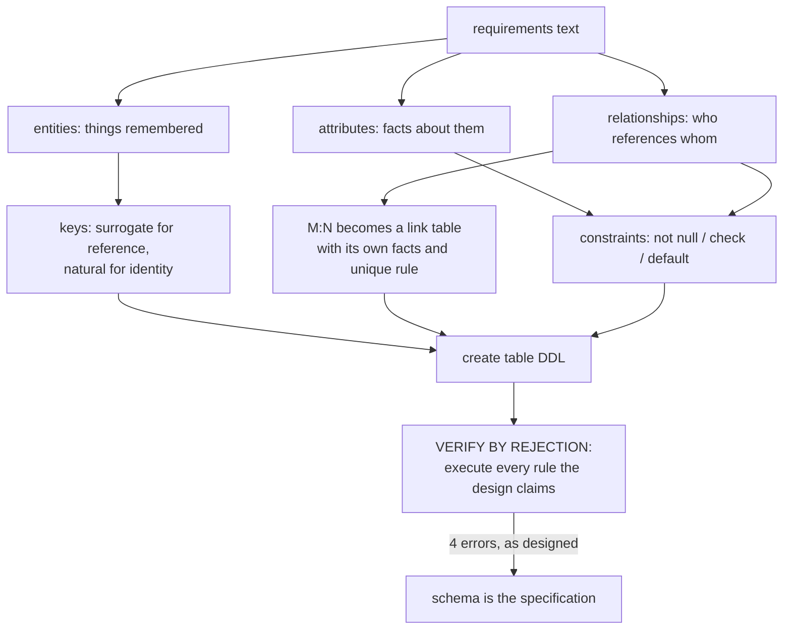

# Database Design

## 1. Learning Objectives

After this lesson you can:

- [ ] Turn a written requirement into entities, attributes, and keys — then execute the
      result as DDL (executed: the five-table `shop` schema, `\d product` reading back
      its PK, unique SKU, check, and FK)
- [ ] Choose surrogate vs natural keys and prove the natural key is still enforced
      (executed: duplicate SKU rejected by `product_sku_key` while `id` assigned by
      sequence)
- [ ] Model an optional relationship with a nullable FK and a mandatory one with
      `not null` (executed: `category_id` accepts `NULL`; unknown customer rejected by
      `order_customer_id_fkey`)
- [ ] Encode closed value sets as `CHECK` (executed: `status = 'refunded'` rejected by
      `order_status_check`, failing row quoted)
- [ ] Resolve many-to-many through a link table with its own uniqueness rule (executed:
      duplicate order line rejected by `order_line_order_id_product_id_key`)
- [ ] Validate a design the way this batch does — by executing every rejection it was
      meant to produce (four executed errors, each traced to a design decision)

## 2. Prerequisites

- [Relational Databases](relational-databases.md) — relationship kinds and referential
  actions: this lesson *chooses* them from requirements.
- [SQL Fundamentals](sql-fundamentals.md) — you need the language to build and probe the
  schema you design.

## 3. Introduction

Design is where database quality is won or lost: constraints added later retrofit poorly,
a missing relationship table becomes duplicated data within weeks, and a wrong key
decision is expensive the day real traffic arrives. This lesson is a method —
requirements → entities → keys → constraints → *executed verification* — demonstrated by
building the `shop` schema that the rest of this subject uses as its shared sample
(postgresql/shop.sql, per DB-20). Nothing here is illustrative: the schema was created,
seeded, and attacked on the lab server, and every rejection you will read is a design
decision firing.

## 4. The Problem It Solves

The alternative to design is drift: tables created by whatever the first feature needed,
columns that mean two things, "we'll add the constraint later" (never), and reports that
disagree because two tables store the same fact differently. Drift is cheap to start and
expensive to unwind — migrations over data with no keys cannot be verified, because
there is no truth to check against. Design front-loads the thinking: every anomaly the
schema refuses *later* is a bug nobody writes code for *now*.

## 5. Core Concepts

### From requirements to entities

Requirements name **things that must be remembered** (customers, products, orders) and
**facts about them** (email, price, status). Things become tables, facts become columns.
A requirement sentence like "a customer places an order containing products" contains
the whole design: three entities and two relationships — plus the one that falls out of
it: an order *contains many* products, a product appears in *many* orders, so a link
table (`order_line`) carries the M:N with its own facts (qty, unit price).

### Keys: surrogate and natural

- A **natural key** is data that already identifies the row (`sku`, `email`). Users know
  it; it can change (a company renames) — which is why you rarely *reference* it.
- A **surrogate key** (`serial id`) is assigned, meaningless, stable — what foreign keys
  point at.
- The executed design keeps **both**: `id` as the reference, `sku unique not null` as
  the enforced business identity — executed rejection (a):
  `duplicate key value violates unique constraint "product_sku_key" DETAIL: Key
  (sku)=(KBD-001)`.

### Optionality is nullability

"An order must have a customer" vs "a product may be unclassified" are the *same* FK
with and without `not null`. The executed catalog probe (DB-08's) reads exactly this:
`order_customer_id_fkey | column_not_null = t → mandatory (1)` and
`product_category_id_fkey | f → optional (0..1)`.

### Closed sets as CHECK

A status that may only be `new/paid/shipped/cancelled` is a business rule; encoding it
as `check (status in (…))` makes every writer obey it — executed (d):
`new row for relation "order" violates check constraint "order_status_check" DETAIL:
Failing row contains (1, 1, …, refunded)`. The application's UI dropdown is a
*convenience*; the check is the guarantee.

### Money and facts you copy deliberately

`order_line.unit_price` **copies** the product price at order time — a deliberate,
narrow denormalization: the price the customer agreed to must not change when the
catalog price changes later. Design's denormalization rule: duplicate a fact only when
you can name *why the copies may legitimately differ*. (Lesson 9 audits this rigorously.)

## 6. How It Works



The last step is the method's heart: a design claim ("a duplicate SKU is impossible")
is *unverified* until a statement proves it. Each executed rejection in section 7 is one
claim checked — the same four checks any reviewer would run against a new schema.

## 7. Practical Examples

**Example 1 — the schema, executed**

```sql
create schema shop;
set search_path to shop;

create table category (
  id   serial primary key,
  name text not null unique
);
create table customer (
  id         serial primary key,
  email      text not null unique,
  full_name  text not null,
  created_at timestamptz not null default now()
);
create table product (
  id          serial primary key,
  sku         text not null unique,
  name        text not null,
  category_id integer references category(id),   -- nullable: unclassified allowed
  price       numeric(10,2) not null check (price >= 0),
  attrs       jsonb not null default '{}'::jsonb
);
create table "order" (
  id          serial primary key,
  customer_id integer not null references customer(id),
  placed_at   timestamptz not null default now(),
  status      text not null default 'new'
              check (status in ('new','paid','shipped','cancelled'))
);
create table order_line (
  id         serial primary key,
  order_id   integer not null references "order"(id) on delete cascade,
  product_id integer not null references product(id),
  qty        integer not null check (qty > 0),
  unit_price numeric(10,2) not null check (unit_price >= 0),
  unique (order_id, product_id)
);
```

`\d product` — the server's reading of the design (executed):

```
   Column    |     Type      | Nullable |                Default
-------------+---------------+----------+---------------------------------------
 id          | integer       | not null | nextval('product_id_seq'::regclass)
 sku         | text          | not null |
 name        | text          | not null |
 category_id | integer       |          |
 price       | numeric(10,2) | not null |
 attrs       | jsonb         | not null | '{}'::jsonb
Indexes:
    "product_pkey" PRIMARY KEY, btree (id)
    "product_sku_key" UNIQUE CONSTRAINT, btree (sku)
Check constraints:
    "product_price_check" CHECK (price >= 0::numeric)
Foreign-key constraints:
    "product_category_id_fkey" FOREIGN KEY (category_id) REFERENCES category(id)
Referenced by:
    TABLE "order_line" CONSTRAINT "order_line_product_id_fkey" FOREIGN KEY (product_id) REFERENCES product(id)
```

Every design decision is visible in one place: surrogate id, enforced natural key, the
optional category FK, non-negative money, a jsonb column for *attributes that vary by
product* (the schema's flexibility valve — used honestly, not as "no schema").

**Example 2 — the design's reward: the money query (executed)**

```sql
select c.full_name, p.sku, ol.qty, ol.qty * ol.unit_price as line_total
  from order_line ol
  join "order" o on o.id = ol.order_id
  join customer c on c.id = o.customer_id
  join product p on p.id = ol.product_id
 order by o.id, ol.id;
```

```
  full_name   |   sku   | qty | line_total 
--------------+---------+-----+------------
 Ada Lovelace | KBD-001 |   2 |     240.00
 Ada Lovelace | STN-001 |   1 |      39.00
 Grace Hopper | MON-271 |   1 |     310.00
(3 rows)
```

Three facts the design made derivable: who ordered (customer→order), what (join through
the link table), and agreed money (`unit_price` as frozen at order time).

**Example 3 — four claims, four executed rejections (verbatim)**

```console
-- (a) natural key enforced beside the surrogate:
ERROR:  duplicate key value violates unique constraint "product_sku_key"
DETAIL:  Key (sku)=(KBD-001) already exists.

-- (b) a mandatory relationship refuses unknown parents:
ERROR:  insert or update on table "order" violates foreign key constraint "order_customer_id_fkey"
DETAIL:  Key (customer_id)=(9999) is not present in table "customer".

-- (c) the M:N link table allows one line per product per order:
ERROR:  duplicate key value violates unique constraint "order_line_order_id_product_id_key"
DETAIL:  Key (order_id, product_id)=(1, 1) already exists.

-- (d) the closed value set refuses an unlisted status:
ERROR:  new row for relation "order" violates check constraint "order_status_check"
DETAIL:  Failing row contains (1, 1, 2026-10-26 15:03:54.600249+03, refunded).
```

Read each as a *requirement sentence*: (a) "SKUs are unique"; (b) "orders name a known
customer"; (c) "one product appears once per order, quantities accumulate on the line";
(d) "status is one of four values". The four errors are the design document, executed.

## 8. Real-World Applications

This five-table shape is the spine of retail, ticketing, booking, and invoicing systems
— anything with *parties, catalogs, and transactions over them*. The method scales up
unchanged: add entities as requirements add nouns, add constraints as they add rules,
re-run the rejection battery. In teams the executed checks double as acceptance tests
for schema migrations: the migration PR is *done* when its rejections still fire.

## 9. Common Mistakes

| Mistake | Why it happens | How to recognize it | How to prevent it |
|---|---|---|---|
| Designing tables from the first screen instead of the nouns | UI-first development | columns named `field2`; a "customer" stored three places | extract nouns/verbs from requirements text before opening DDL |
| Foreign keys referencing natural keys (`email`, `sku`) | natural keys feel meaningful | rows break when a business value changes | reference surrogates; enforce naturals with `unique` |
| Status/type columns as free text | "we might add values" | inconsistent spellings (`paid`, `PAID`, `payment done`) | closed set as `CHECK` (executed d); evolve via migration |
| Quantity/price facts stored on the order header only | simplification drift | can't represent two products in one order | line table is mandatory — M:N *is* data (qty, unit price) |
| Every attribute made a column of one mega-table | avoiding joins | 60-column table, half null | attributes varying per subtype → child table or bounded jsonb |
| Skipping the rejection battery | design feels self-evident | constraint missing until production data violates it | section 6's method: execute every claimed rule once |

## 10. Best Practices

- **Write the requirement sentence next to each constraint** (a comment in the DDL) —
  the mapping between business rule and mechanism is the design's documentation.
- **Surrogate `id` for references, `unique` on the natural key** — executed (a) shows
  both working; this combination is the default, not a trade-off, until you have a
  distributed system's merge problem (name it before breaking it).
- **Default what is usually the same, `not null` what is always required** —
  `status default 'new' not null` beats an application that must remember to send it.
- **Price/money snapshots on the transaction line** — the one sanctioned copy; justify
  every other duplicate the same way ("copies may differ because…").
- **Verify with rejections, not by reading** — the four-error battery is cheap, and each
  error message doubles as proof for review.

## 11. Limitations and Trade-Offs

Design optimizes for the write-consistency you can express in one database: multi-tenant
partitioning, geo-distribution, and event history are *different* design problems with
different answers (later subjects). The `jsonb` valve trades query-time type checking
for schema flexibility — right for genuinely varying product attributes, wrong for
facts you filter and aggregate daily (they become un-indexable-by-default columns; the
index lesson prices this). And no design survives contact with requirements unchanged —
the skill being trained is *revising* the schema through migrations (lesson 15), not
achieving perfection on day one.

## 12. Practical Exercises

### Introductory

1. **Exercise 1.1** — from the sentence "students enrol in courses taught by lecturers,
   and an enrolment carries a grade", list entities, attributes, and relationships;
   write the DDL; then execute one rejection per relationship.
   **Completion criteria:** three tables (plus the enrolment link) created; three error
   transcripts, each with its `DETAIL`, mapped to the requirement sentences they enforce.
2. **Exercise 1.2** — add to `shop`: a `coupon` table where a coupon is identified by its
   code (natural key) *and* must survive code corrections — decide the key structure,
   implement, and execute the duplicate-code rejection.
   **Completion criteria:** DDL with surrogate + unique natural key; the executed
   rejection; one sentence on why referencing the code would be a mistake.

### Intermediate

3. **Exercise 1.3** — the closed-set exercise: extend `order.status` with `refunded`
   *and* add `cancelled_at timestamptz` that must be set exactly when status is
   `cancelled` (encode what SQL can enforce; state what needs an application or trigger
   check). Execute every violation you can construct.
   **Completion criteria:** migration-style `alter table` executed; ≥3 rejections
   captured (bad status, non-negative-time impossibility, etc.); the honest line about
   what `CHECK` cannot express written down.
4. **Exercise 1.4** — audit a schema you wrote before this course (any project):
   list every free-text status column, every FK pointing at a natural key, and every
   fact duplicated without a written reason. **Completion criteria:** the three lists
   with file/table references; for each item, a keep/fix decision with the reason;
   one executed `alter table` fixing the worst offender.

### Independent problem-solving

5. **Exercise 1.5** — design a schema for a small library from this brief: members
   borrow books; a copy is a physical item (a book can have several copies); loans track
   copy, dates, and returns; overdue rules depend on loan dates; reserved items may have
   a queue. **Completion criteria:** DDL created in a scratch schema; the requirement →
   table mapping written as a table; at least six executed rejections covering every
   relationship and closed set you defined; one paragraph on which rule you could *not*
   express in constraints and where it must live; the design reviewed by re-reading your
   own requirement sentences against the errors you got.

*Solutions: attempt first. They live in `solutions/` of this subject.*

## 13. Knowledge Check

1. A teammate models `order` with a `customer_email` column instead of a FK. What four
   executed failures does your design prevent that theirs cannot — and what legitimate
   reason might they give for the copy?
2. Why does `order_line` need `unique (order_id, product_id)` *and* `qty > 0` as separate
   constraints, and what kind of rule would be wrongly expressed by putting a total on
   the order header?
3. "Add a `payment_method` column — it's just one more attribute." Which of this
   lesson's tests do you apply before saying yes (open set? varies per order? needs its
   own facts?)?

## 14. Completion Criteria

Observable evidence that you have understood this lesson:

- [ ] You can produce a schema from a requirements paragraph with the entity/attribute/
      relationship mapping written out
- [ ] You can defend every key choice (surrogate vs natural) in one sentence each
- [ ] You have executed one rejection per design claim and can read each `DETAIL` back
      to its requirement
- [ ] You can name the schema's one deliberate copy and the rule that keeps it honest
- [ ] You can list what your design does *not* enforce, and where those rules live

## 15. Summary

- Requirements → nouns are tables, verbs are relationships, facts are columns; M:N
  becomes a link table that carries its own data.
- Surrogate ids for references, `unique` for business identity — both enforced in the
  executed `product` table.
- Optionality is `nullability`; closed sets are `CHECK`; money snapshots are the one
  sanctioned copy.
- The `shop` schema (5 tables) is this subject's shared sample — built, seeded, and
  attacked here.
- Design is verified by rejection: four executed errors, four requirement sentences.

## 16. Next Steps

- Next lesson: [ER Diagrams](er-diagrams.md) — drawing the model you just built, and
  reading one back from the catalog (executed both ways here)
- Practice: [exercises/](exercises/README.md) — set 7
- Where it is applied: [20 — Project Laboratory](../20-PROJECT-LABORATORY/README.md) —
  Project 03's schema deliverable is this lesson's method with the mapping table attached
