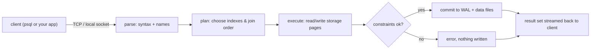

# Database Fundamentals

## 1. Learning Objectives

After this lesson you can:

- [ ] Open a session against a real PostgreSQL server and state who you are, where you are,
      and what the server is (executed: `PostgreSQL 18.6`, user `lab`, database
      `codepath_lab`)
- [ ] Create tables with typed columns, a primary key, a unique constraint, and a foreign
      key — and read back exactly what the server stored in its catalog (executed:
      `\d customers` and an `information_schema` query)
- [ ] Insert rows and read them back (executed: three customers, three orders)
- [ ] Read each executed rejection as information: the type guard, the primary-key
      violation, and the foreign-key violation (executed: `invalid input syntax for type
      numeric`, `duplicate key value violates unique constraint "customers_pkey"`,
      `insert or update on table "orders" violates foreign key constraint`)
- [ ] Predict and explain `NULL` behaviour: arithmetic propagates it, counting skips it
      (executed: `credit + 1` → empty; `count(*)` 3 vs `count(credit)` 2)
- [ ] Run a transaction round trip — `begin`, write, `rollback`, verify (executed: 4 rows
      inside, 3 rows after)

## 2. Prerequisites

- [02 — Programming Fundamentals](../02-PROGRAMMING-FUNDAMENTALS/README.md) — variables,
  data types, and tables; a database column is a typed variable that outlives the program.
- [03 — Developer Tools](../03-DEVELOPER-TOOLS/terminal-fundamentals.md) — you will run
  `psql` commands in a terminal.

## 3. Introduction

A database is shared, durable memory for programs. Your variables die when the program
exits and belong to one process; a database's rows survive restarts and are visible to
every authorized client at once. This lesson uses the **relational model** — data as
*tables* of *rows*, each row a fixed set of *typed columns* — implemented by **PostgreSQL**
(also called Postgres), a mature open-source database server. You will work against a real
server from the first command: everything quoted here was executed, including the errors,
which are the most instructive output a database produces.

## 4. The Problem It Solves

Before databases, programs stored data in their own files. Two programs writing the same
file could interleave writes and corrupt each other; every program re-implemented reading,
searching, and "only valid data goes in" checks; a crash mid-write could leave a half
record with no way to know which half was true. Databases solve this centrally: one
process (the server) owns the data, enforces validity rules for every client, and
recovers from crashes — so each application writes business logic instead of a storage
engine.

## 5. Core Concepts

### The relational model: tables, rows, columns

A **table** is a named collection of **rows**; every row has the same **columns**, each
holding one value of a declared **data type**. The type is checked on write (you will see
the server refuse bad data in section 7). *Relation*, *tuple*, and *attribute* are the
formal words for table, row, and column — you will meet them in database-design lessons;
in practice everyone says table/row/column.

### Data types

PostgreSQL types include `integer`, `numeric(10,2)` (exact decimal with two places),
`text`, `boolean`, `timestamptz` (timestamp with time zone), and many more. Money uses
`numeric`, never floating point: `numeric(10,2)` stores `120.50` exactly, while a float
stores an approximation that stops adding up at scale.

### Keys

- **Primary key (PK)** — the column (or columns) that identify a row uniquely; the server
  rejects a duplicate (executed P5 below). It is also `NOT NULL` implicitly.
- **Unique constraint** — a promise that one column's values don't repeat (here: `email`).
- **Foreign key (FK)** — a column whose value must exist in another table's key (here:
  `orders.customer_id` must be a real `customers.id`); the server rejects orphans
  (executed P6). Keys are how the model keeps data *consistent across tables*.

### NULL

`NULL` means **unknown**, not zero and not empty string. Any arithmetic with `NULL` is
`NULL` (executed P7), and `count(column)` skips `NULL`s while `count(*)` counts rows.
Comparing `NULL = NULL` is not true — it is unknown — which is why SQL has `IS NULL`.

### Schema, data, and the catalog

**Schema** is the structure (tables, columns, keys); **data** is the rows. Both are stored
*in the database itself*: the **catalog** is a set of system tables (exposed through
`information_schema` and `pg_catalog`) that you can query like any other data (executed
P8).

### SQL and sessions

**SQL** (Structured Query Language) is the standard language for talking to a relational
database. A **session** (or connection) is one client's live channel to the server; in
psql you are always inside one, and `current_user`/`current_database` say where (executed
P1). SQL is **declarative**: you state *what* result you want, not how to compute it —
that theme runs through every lesson in this subject.

## 6. How It Works

A statement travels a fixed path through the server:



- **Parse** validates syntax and resolves table/column names against the catalog.
- **Plan** chooses an execution strategy (which index, which join order) — you will read
  these plans with `EXPLAIN` in the performance lessons.
- **Execute** reads and writes **pages** (8 kB disk units) in shared memory.
- **Constraints** are checked *before* a write lands, so a rejected statement changes
  nothing — that atomicity is why P4/P5/P6 left the data exactly as it was.
- **WAL** (write-ahead log) is how a crash mid-write is recoverable: the change is logged
  first, replayed or discarded on recovery.

psql is just a client; your application (via a **driver** such as JDBC) takes the same
path. The server enforces the same rules for both.

## 7. Practical Examples

**Example 1 — identity and structure (executed)**

```console
$ psql -h 127.0.0.1 -p 5433 -U lab -d codepath_lab
                                 version
-------------------------------------------------------------------------
 PostgreSQL 18.6 on x86_64-windows, compiled by msvc-19.44.35228, 64-bit
(1 row)

 current_user | current_database
--------------+------------------
 lab          | codepath_lab
(1 row)
```

- The version banner names the exact server you are on; `current_user`/`current_database`
  are the session's identity — check them before any `DROP`.
- **How to run it:** the lab for this subject is a *scratch* server (see
  [exercises/README.md](exercises/README.md)): `initdb` a throwaway cluster on port 5433
  as user `lab` with trust auth on localhost only — the machine's system-wide PostgreSQL
  service was left untouched.
- **Assumptions:** PostgreSQL 18.6, psql 18.6, Windows 11 + Git Bash (the authoring
  machine); any 13+ server behaves the same for everything here.

**Example 2 — schema with keys (executed)**

```sql
create table customers (
  id         serial primary key,
  email      text not null unique,
  full_name  text not null,
  credit     numeric(10,2) default 0,
  created_at timestamptz not null default now()
);
create table orders (
  id          serial primary key,
  customer_id integer not null references customers(id),
  total       numeric(10,2) not null check (total >= 0)
);
```

`\d customers` — the server's own description, executed:

```
   Column   |           Type           | Nullable |                Default
------------+--------------------------+----------+---------------------------------------
 id         | integer                  | not null | nextval('customers_id_seq'::regclass)
 email      | text                     | not null |
 full_name  | text                     | not null |
 credit     | numeric(10,2)            |          | 0
 created_at | timestamp with time zone | not null | now()
Indexes:
    "customers_pkey" PRIMARY KEY, btree (id)
    "customers_email_key" UNIQUE CONSTRAINT, btree (email)
Referenced by:
    TABLE "orders" CONSTRAINT "orders_customer_id_fkey" FOREIGN KEY (customer_id) REFERENCES customers(id)
```

- `serial` becomes `integer` backed by a **sequence** (the `nextval` default) — ids are
  assigned automatically; `references customers(id)` is the foreign key.
- Note the catalog tells the truth: the PK and UNIQUE are *indexes*, and `orders`' FK is
  listed under "Referenced by" — the relationship is recorded in both directions.

**Example 3 — rows in, rows out (executed)**

```sql
insert into customers (email, full_name, credit) values
  ('ada@example.org', 'Ada Lovelace', 120.50),
  ('grace@example.org', 'Grace Hopper', 80.00),
  ('alan@example.org', 'Alan Turing', null);
insert into orders (customer_id, total) values (1, 20.25), (1, 5.00), (2, 99.99);
select id, email, credit from customers order by id;
```

```
 id |       email       | credit
----+-------------------+--------
  1 | ada@example.org   | 120.50
  2 | grace@example.org |  80.00
  3 | alan@example.org  |
(3 rows)
```

- `numeric` prints two decimals (`120.50`); Alan's missing credit prints as blank — the
  NULL row, visibly different from `0`.
- `order by id` is required for a predictable order; without it the server owes you
  nothing.

**Example 4 — the three rejections (executed, verbatim)**

```console
ERROR:  invalid input syntax for type numeric: "not-a-number"
LINE 1: ...me, credit) values ('bad@example.org', 'Bad Row', 'not-a-num...

ERROR:  duplicate key value violates unique constraint "customers_pkey"
DETAIL:  Key (id)=(1) already exists.

ERROR:  insert or update on table "orders" violates foreign key constraint "orders_customer_id_fkey"
DETAIL:  Key (customer_id)=(999) is not present in table "customers".
```

- Three different guards: **type** (value doesn't parse), **primary key** (id already
  taken), **foreign key** (referenced row doesn't exist). Each `DETAIL` line names the
  exact offending value — read it instead of guessing.
- After all three, `select count(*) from customers` still returns 3: rejected statements
  write nothing.

**Example 5 — NULL arithmetic and counting (executed)**

```sql
select credit, credit + 1 as plus_one from customers where email = 'alan@example.org';
select count(*) as rows_total, count(credit) as rows_with_credit from customers;
```

```
 credit | plus_one
--------+----------
        |
(1 row)

 rows_total | rows_with_credit
------------+------------------
          3 |                2
(1 row)
```

- `NULL + 1` is `NULL` (unknown + anything = unknown) — an arithmetic bug waiting to
  happen if you assumed `0`.
- `count(*)` counts rows; `count(credit)` counts non-NULL values. The difference between
  the two numbers *is* your NULL inventory.

**Example 6 — the catalog is data (executed)**

```sql
select column_name, data_type, is_nullable
from information_schema.columns
where table_name = 'orders' order by ordinal_position;
```

```
 column_name | data_type | is_nullable
-------------+-----------+-------------
 id          | integer   | NO
 customer_id | integer   | NO
 total       | numeric   | NO
(3 rows)
```

Migrations, admin tools, and ORMs all introspect this way — the structure is queryable
like any table.

**Example 7 — a transaction round trip (executed; taste of lesson 11)**

```sql
begin;
insert into customers (email, full_name) values ('temp@example.org', 'Temp');
select count(*) as inside_txn from customers;   -- 4
rollback;
select count(*) as after_rollback from customers; -- 3
```

- Inside the transaction the write is visible; `rollback` erased it completely. A
  transaction is a group of statements that either all happen or none — the unit of
  correctness for anything multi-step.

## 8. Real-World Applications

Every system that remembers anything sits on a database like this: order systems
(customers/orders is literally the schema above), accounting (exact decimals are
non-negotiable), inventory, medical records, and the back half of most web and mobile
apps. The same server serves a `psql` session and fifty application instances at once —
which is exactly why the constraints in this lesson exist: the database is the *last*
place consistency can be enforced, and it enforces it for everyone.

## 9. Common Mistakes

| Mistake | Why it happens | How to recognize it | How to prevent it |
|---|---|---|---|
| Money stored as float/double | float feels "numeric enough" | sums drift by cents at scale; `120.50` prints `120.49999999999999` | `numeric(p,s)` for money, always |
| Treating `NULL` as 0 or "" | most languages' "empty" habit | `NULL` propagates through arithmetic; `count(*)` ≠ `count(col)` | default `not null` where unknown isn't meaningful; test NULL rows explicitly |
| "The app validates this, skip the constraint" | constraints feel redundant | orphan rows appear after a bug or a manual insert | declare PK/FK/NOT NULL in the schema; app checks are UX, database checks are truth |
| Dropping the FK "for load" | FK checks blamed for slowness | the real cost was a missing index on the referencing column | add the index, keep the constraint (lesson: constraints) |
| Relying on row order without `ORDER BY` | default order *looks* stable in small tests | "wrong" rows after a restart or with more data | every query that matters has an explicit `ORDER BY` |
| Hand-editing production tables via psql | quick fix temptation | no record of who/when/why; schema drifts from code | all DDL goes through versioned migration files |

## 10. Best Practices

- **Declare keys and constraints even during prototyping.** They are free to add early
  and dangerous to retrofit; the rejection messages you just read are cheaper than data
  repair later.
- **`NOT NULL` by default**, nullable only where absence is real information (Alan's
  unknown credit).
- **`numeric` for money, never float.** This rule stops applying only when you move to
  scientific/machine-learning values, where floats are the correct tool.
- **Keep DDL in files** (migration scripts) you can re-run on a fresh server — this
  subject's exercises all start from `drop and recreate`, which is only safe because the
  SQL lives in a file.
- **Check `current_user`/`current_database` before destructive statements** — the two
  lines you executed in Example 1 are a two-second accident policy.

## 11. Limitations and Trade-Offs

A relational database gives you consistency and a declarative query language at the cost
of **fixed structure**: adding a field means a schema change, and deeply nested documents
fit awkwardly. One server is also a **single point of scaling** — vertical (bigger
machine) first; horizontal distribution is a different technology with real costs
(introduced honestly in later subjects). And SQL over a network is *latency*: ten cheap
queries in a loop are slower than one query that returns ten rows — the N+1 pattern the
backend lessons will price. None of these invalidate the model; they tell you where its
excellent fit ends.

## 12. Practical Exercises

### Introductory

1. **Exercise 1.1** — on your own scratch server, recreate Example 2's two tables and
   reproduce all three rejections from Example 4 by hand (no peeking: predict the error
   message first, then compare).
   **Completion criteria:** three error messages captured, each with its `DETAIL` line,
   and a final `count(*)` proving no rejected row landed.
2. **Exercise 1.2** — add a `phone text unique` column to `customers`, insert four
   customers (two with phones, two without), and select them ordered by name.
   **Completion criteria:** the `\d` output shows the new column; the query returns four
   rows; you can state why two NULL phones don't violate `unique`.

### Intermediate

3. **Exercise 1.3** — write the insert from Example 3 as a single transaction
   (`begin; … commit;`) and prove atomicity: make one statement fail on purpose (duplicate
   email) and show that *no* customer from the batch survived.
   **Completion criteria:** `count(*)` unchanged after the failed batch, with the
   transcript; one sentence on why the app you'll build later needs this.
4. **Exercise 1.4** — query `information_schema.columns` for `customers` and produce a
   table of column name → type → nullable → default, then predict `\d customers` from
   *your* query output before running it.
   **Completion criteria:** prediction written first; mismatches explained by reading the
   catalog's own answer.

### Independent problem-solving

5. **Exercise 1.5** — design and create a schema for a library: books, members, and
   loans (a member borrows a book on a date, returns it on a date). Choose the keys
   yourself; the server must reject a loan for an unknown member and a double-borrowed
   book that is still out.
   **Completion criteria:** `\d` for each table shows the keys you chose; two rejection
   transcripts (unknown member, book still out); one written paragraph on which rules you
   put in the schema versus which belong in application logic and why.

*Solutions: attempt first. They live in `solutions/` of this subject.*

## 13. Knowledge Check

1. A colleague says "the app already validates email uniqueness, so the `unique`
   constraint is redundant." What can the constraint catch that the app cannot, and what
   does it cost to keep it?
2. `select sum(amount) from payments;` returns `NULL` for an empty table. Explain why,
   and write the query that returns `0` instead — then say when `NULL` is the *better*
   answer.
3. When would you deliberately store a number as `double precision` instead of
   `numeric(…)`? Name one domain and the trade-off you accept.

## 14. Completion Criteria

Observable evidence that you have understood this lesson:

- [ ] You can connect to a PostgreSQL server and state the session's user, database, and
      server version from memory of the commands
- [ ] You can create a two-table schema with PK/UNIQUE/FK from a blank editor and read
      `\d` output back correctly
- [ ] You can quote the three rejection messages from this lesson and say which guard
      produced each
- [ ] You can predict `NULL`'s behaviour in arithmetic, comparison, and `count`
- [ ] You can run `begin`/`rollback` and prove what did and did not persist

## 15. Summary

- A database is shared durable memory with one enforcing owner: the server.
- Tables hold typed rows; keys (PK, UNIQUE, FK) make the server reject inconsistent data
  *before* it is written — executed three times, with the `DETAIL` lines quoted.
- `NULL` is unknown: it propagates through arithmetic and is skipped by `count(column)`.
- Structure lives in the catalog and is itself queryable.
- A transaction is the unit of "all or nothing" — `rollback` left the table at 3 rows.

## 16. Next Steps

- Next lesson: [Relational Databases](relational-databases.md) — relationship kinds,
  referential actions, and how tables compose into a model
- Practice: [exercises/](exercises/README.md) — set 1 (this lesson's ladder)
- Where it is applied: [20 — Project Laboratory](../20-PROJECT-LABORATORY/README.md) —
  Project 03 (database application) and Project 04 (REST API) both start from a schema
  like the one you just executed
