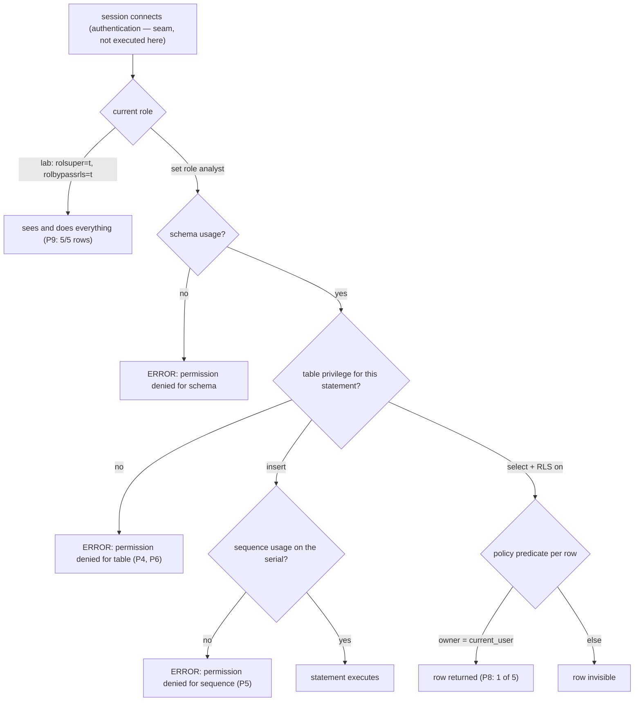

# Database Security

## 1. Learning Objectives

After this lesson you can:

- [ ] Create a login-less role and read its attributes straight from the catalog
      (executed: `analyst`, `reader` all `f` for `rolsuper`/`rolcreatedb`/`rolbypassrls`
      against `lab`'s `t t t`)
- [ ] Prove the deny-by-default rule with `has_table_privilege` before and after a
      grant (executed: `f f` → `grant select` → `t`)
- [ ] Produce and read the two permission failures an application actually hits —
      table-level and **sequence**-level (executed: `permission denied for table note`,
      then after granting INSERT, `permission denied for sequence note_id_seq`)
- [ ] Revoke access and show it is truly gone (executed: `count(*)` denied again,
      `can_select_after_revoke` back to `f`)
- [ ] Apply column-level privileges as a narrower grant (executed: `body` readable,
      `id` refused with `permission denied for table note`)
- [ ] Enable row-level security, write a policy, and demonstrate its two-sidedness
      (executed: `reader` sees 1 of 5 rows; the superuser sees all 5 — bypass is an
      attribute, not magic)

## 2. Prerequisites

- [Constraints and Relationships](constraints-and-relationships.md) — the database's
  data-owning rules; this lesson is the same idea one level up: *who* may invoke them.
- [Backups and Recovery](backups-and-recovery.md) — a dump contains your data in
  readable form, which is why the restore drill ended by naming privileges as the next
  seam.

## 3. Introduction

Database security answers one question for every statement: **may this session, acting
as this identity, do this?** PostgreSQL implements it as layered, deny-by-default
privileges — roles, grants on schemas/tables/columns, and row-level security policies
that filter rows *inside* a granted query. The lab executes all three layers, including
four deliberate failures: each `permission denied` error in this lesson was produced on
purpose and is quoted, because the error message is the feature working.

## 4. The Problem It Solves

Application code that connects as a superuser turns any SQL injection, leaked query, or
curious contractor into full data ownership — reads, writes, `drop`, even the ability
to hide its own tracks. The pre-privilege world ran everything as one account and
protected data by convention ("only the app touches that table"), which fails the day
someone writes a `psql` command by hand. Column- and row-level needs exist for the
second problem: an app that legitimately reads `notes` must still not read *everyone's*
notes — table grants can't say "their rows only," policies can.

## 5. Core Concepts

### Roles are identities, not users

`create role analyst nologin` makes an identity with no password — usable by
`set role analyst` from a session that already connected. That shape is deliberate
here: the *authorization* layer is exercised independently of the *authentication*
layer (passwords, TLS — section 11's honest seam). Attributes live in the catalog and
are queried, not assumed (executed P1):

```
 rolname | rolsuper | rolcreatedb | rolbypassrls
---------+----------+-------------+--------------
 analyst | f        | f           | f
 lab     | t        | t           | t
 reader  | f        | f           | f
```

### Deny by default

A new role owns nothing and reads nothing (executed P2: `f f`). Every capability is an
explicit `grant`, and `has_table_privilege()` is the executable question "what does
this role currently hold?" — use it in reviews instead of reading grant statements and
hoping you saw all the follow-ups.

### Privileges nest: schema → table → column → sequence

`usage` on a schema lets you *name* objects in it; it does not let you read them. Table
grants cover the table. Column grants are narrower — `grant select (body)` gives one
column while `id` stays refused (executed P7). And a `serial` primary key hides a
fourth object: the sequence. **Granting INSERT on the table does not grant usage on its
sequence** — executed P5 is exactly that failure, and it is one of the most common
"it works in dev" bugs in PostgreSQL, because the dev role usually owns the table.

### Row-level security: a filter the query cannot see past

`alter table ... enable row level security` plus a policy `using (owner = current_user)`
makes the *engine* add the predicate to every query that role runs — application SQL
cannot omit it, because it isn't in the SQL. Executed P8/P9: `reader` sees 1 row of 5,
superuser sees all 5. Bypass belongs to the `rolbypassrls` attribute (P1's `t` for
`lab`), which is why superusers are treated as a separate threat class in reviews.

## 6. How It Works



Read the graph as a ladder the statement must descend: identity → schema → table →
sequence, with the policy filter attached to the select branch. Every `ERROR` box in
it is one this lesson executed.

## 7. Practical Examples

*All executed on the authoring machine: PostgreSQL 18.6, psql 18.6, Windows 11 +
Git Bash, database `codepath_lab`, schema `sec`. The probe file drops and recreates
`sec` each run, so it is re-runnable.*

**Example 1 — deny by default, then grant (executed)**

```sql
create role analyst nologin;
create table sec.note (id serial primary key, owner text not null, body text not null);
-- P2: no grants yet
select has_table_privilege('analyst', 'sec.note', 'select') as can_select,
       has_table_privilege('analyst', 'sec.note', 'insert')  as can_insert;
-- P3: grant and prove
grant select on sec.note to analyst;
set role analyst;
select count(*) as readable_rows from sec.note;
reset role;
select has_table_privilege('analyst', 'sec.note', 'select') as can_select_after_grant;
```

```
 can_select | can_insert
------------+------------
 f          | f

 readable_rows
---------------
             4

 can_select_after_grant
------------------------
 t
```

- `f f` before, `t` after: authorization changes are *observable facts*, not intentions.
- **How to run it:** the P2–P3 block of the probe file, in order.
- **Assumptions:** PostgreSQL 18; you are connected as a superuser to run `set role`.

**Example 2 — the two permission failures (executed)**

```sql
set role analyst;
insert into sec.note (owner, body) values ('analyst', 'sneaky');   -- P4
reset role;
grant insert on sec.note to analyst;
set role analyst;
insert into sec.note (owner, body) values ('analyst', 'allowed row');  -- P5
reset role;
grant usage, select on sequence sec.note_id_seq to analyst;
```

```
--- P4 table INSERT still denied (executed failure)
ERROR:  permission denied for table note
--- P5 insert granted, but the SERIAL sequence is a second permission (executed failure), then granted too
ERROR:  permission denied for sequence note_id_seq
 rows_now
----------
        5
```

- The second failure is the lesson's sharpest edge: **the table grant succeeded and the
  statement still failed**, because `serial` is sugar for `integer default
  nextval(...)` and `nextval` needs its own privilege.
- After the sequence grant, the same statement lands (`rows_now` 5; the row was then
  deleted to keep the probe idempotent).
- **Expected output:** exactly those two errors, then `5`.
- **How to run it:** P4–P5 of the probe file.

**Example 3 — revoke, column grant, and row-level security (executed)**

```sql
revoke select on sec.note from analyst;            -- P6
set role analyst; select count(*) from sec.note; reset role;
grant select (body) on sec.note to analyst;         -- P7
set role analyst;
select body from sec.note limit 1;
select id from sec.note limit 1;
reset role;

alter table sec.note enable row level security;     -- P8
create policy own_rows on sec.note for select to reader
  using (owner = current_user);
grant select on sec.note to reader;
set role reader;
select owner, body from sec.note order by id;
reset role;
select count(*) as superuser_sees from sec.note;    -- P9
```

```
--- P6: ERROR: permission denied for table note ; can_select_after_revoke = f
--- P7: body → "first note" ; id → ERROR: permission denied for table note
--- P8 (as reader):
  owner  |       body
---------+--------------
 reader | reader-owned row
--- P9 (as lab):
 superuser_sees
----------------
              5
```

- P7 shows grants composing: table-level revoked, column-level granted — one column
  readable, the other still refused.
- P8 vs P9 is the whole RLS contract: the *same* table, same `select`, different
  identity, different row set — and the reader's SQL never mentioned the policy.
- **How to run it:** P6–P10 of the probe file; P10 prints the policy from the catalog:
  `own_rows | SELECT | (owner = CURRENT_USER)`.
- **Assumptions:** none beyond the lab superuser to `set role`.

## 8. Real-World Applications

Application databases run as *least-privilege roles*: one role per service, `usage` on
only the schemas that service touches, table grants limited to the statements its code
emits — so a compromised web tier cannot `drop` or read the payroll schema. Column
grants protect shared tables (everyone may read `email`'s *shape*, one service reads
the column). RLS is how multi-tenant SaaS enforces `tenant_id = current_setting('app.tenant')`
at the engine layer: forgetting a `where` clause in one endpoint cannot leak another
tenant's rows. Analytical access is granted as read-only roles on replicas — the
`analyst` pattern. All of this is audited through the same catalogs exercised here
(`pg_roles`, `has_table_privilege`, `pg_policies`).

## 9. Common Mistakes

| Mistake | Why it happens | How to recognize it | How to prevent it |
|---|---|---|---|
| App connects as superuser | setup convenience | `rolsuper = t` for the service role | one role per service, granted only what its SQL needs |
| `permission denied for sequence` in production only | dev owns the table | INSERT works locally, fails deployed | grant `usage, select` on sequences with the table grant (executed P5) |
| Assuming `usage` on a schema = readable tables | layer confusion | denied at the table, not the schema | the ladder in section 6: usage → table → column/sequence |
| Revoking table SELECT and thinking columns are gone too | grant scoping misunderstood | column grant still lets one column read | revoke column grants explicitly; verify with `has_table_privilege` per column |
| RLS added but role has `bypassrls` or is owner | policy silently bypassed | "RLS on, but they see everything" | check `rolbypassrls` (P1) and table ownership; test as a non-owner |
| Policy tested only as its creator | `current_user` equals owner in dev | works in dev, empty in prod | execute the policy as a *different* role — P8's `set role reader` is the template |
| Security by hidden SQL | no policy, just `where` in app code | any direct connection reads all rows | enforcement belongs where the data is (constraints lesson's argument, one level up) |

## 10. Best Practices

- **Deny by default is the product**: create roles empty, grant deliberately, and
  verify with `has_table_privilege()` — an executable audit rather than a reviewed
  `grant` list.
- **Grant the narrowest thing that works**: column grants over table grants, `select`
  over `all`, per-schema `usage` over blanket access. The ladder costs one extra line
  per object and removes entire classes of blast radius.
- **Always grant sequences alongside serial inserts** (executed failure above) — make
  it a habit in migration files: table *and* sequence in the same block.
- **Put multi-tenant and per-user filters in RLS**, not in application `where` clauses:
  one policy, every query, including the ones a future developer writes at 2 a.m.
- **Test every policy as a non-owner with `set role`** — the executed P8 is exactly
  this: policies evaluated with `current_user` ≠ owner.
- **Read the catalogs in reviews**: `pg_roles`, `pg_policies` (P10), table ACLs —
  what the database *will* enforce, not what the migration intended.

## 11. Limitations and Trade-Offs

This lesson executed **authorization** only. **Authentication** — how a session proves
who it is — was bypassed with `nologin` roles and a local superuser: real deployments
add password/SCRAM authentication via `pg_hba.conf`, certificate auth, and TLS on the
wire, all cited from PostgreSQL's docs and not executed in this lab (honest seam).
Connection-level controls (`connect` privilege, `login` roles, connection limits,
`statement_timeout`) are likewise cited. RLS has real costs: every query pays the
policy predicate, policies interact with views and `security_barrier` options, and
bypass attributes (`rolbypassrls`, superuser, table owner) mean RLS is a guard against
*honest mistakes and compromised apps*, not against database owners — the catalog
evidence for that is P1 and P9. Finally, encryption at rest and audit logging are
deployment concerns outside psql's reach here; and note the drill's standing
observation — anyone who can `pg_dump` reads the data regardless of row filters, so
backup storage is part of the security boundary too.

## 12. Practical Exercises

### Introductory

1. **Exercise 1.1** — reproduce Examples 1–2 from memory on a scratch schema: two roles,
   the `has_table_privilege` before/after pair, and both permission failures with their
   exact messages quoted.
   **Completion criteria:** the four states (`f` → `t` for select; `f` → `t` for insert
   gated by the sequence error); one sentence on why the sequence is a separate
   privilege; the `grant usage, select on sequence` line written from memory.
2. **Exercise 1.2** — execute the revoke-and-column path (Example 3, P6–P7): show
   table-level denial, then column-level access to `body` while `id` is refused, then
   revoke the column grant and show both denied.
   **Completion criteria:** five output blocks in sequence; `has_table_privilege`
   results after each change; a one-paragraph explanation of where column grants live
   relative to table grants.

### Intermediate

3. **Exercise 1.3** — RLS drill: enable RLS on a table containing rows for three
   different owners, write a `using (owner = current_user)` policy, create one role per
   owner, and execute the same `select` as each role plus as the superuser.
   **Completion criteria:** four transcripts of identical SQL with different row sets;
   the policy printed from `pg_policies`; a written statement of which attribute would
   make the policy moot and how you would detect that in a review.
4. **Exercise 1.4** — audit a role you create: `nologin`, grant it `usage` on a schema,
   `select` on one table, `insert` on another, and its sequence. Then use
   `has_table_privilege()` to predict the outcome of eight statements (two per
   privilege type, including one deliberately ungranted) *before* executing them as
   that role, and compare prediction to reality.
   **Completion criteria:** the eight-prediction table; the eight executed results;
   every mismatch explained by the exact catalog state, not by guessing.

### Independent problem-solving

5. **Exercise 1.5** — design the privilege model for a real system of yours: enumerate
   its services and users as roles, map every table/column/sequence each one needs,
   decide which filters belong in RLS policies, and write the whole thing as a
   re-runnable migration (using the migrations lesson's ledger discipline). Execute it:
   create the roles, apply the grants, then run a hostile probe from each role —
   attempting one statement beyond its rights — and capture every refusal.
   **Completion criteria:** the role/privilege matrix; the executed migration with
   ledger evidence; at least three captured `permission denied` transcripts from three
   different roles; the RLS policy (if any) tested as a non-owner; and a written
   boundary statement covering what this model does *not* protect against, using
   section 11's seams (authentication, bypass attributes, dump holders).

*Solutions: attempt first. They live in `solutions/` of this subject.*

## 13. Knowledge Check

1. An application role gets `permission denied for sequence note_id_seq` on INSERT even
   though its table grant includes `insert`. Explain the mechanism (`serial` →
   `nextval`), then give the exact grant that fixes it — and say why dev environments
   often never surface this bug.
2. In the executed drill, `reader` saw one row and `lab` saw five from the identical
   `select`. Which mechanism produced the difference, which attribute exempts `lab`,
   and what would you check on a *third* role that unexpectedly saw all five?
3. `usage` on the schema, `select` on the table, column grant on `body` — after P6's
   revoke, which of these three does `analyst` still hold, and how would you prove it
   in one query rather than by re-running statements?

## 14. Completion Criteria

Observable evidence that you have understood this lesson:

- [ ] You have executed deny → grant → revoke with `has_table_privilege` evidence at
      each step
- [ ] You have produced both permission failures (table and sequence) and fixed the
      sequence one with the correct grant
- [ ] You have demonstrated a column grant reading one column while another is refused
- [ ] You have enabled RLS and captured the same query returning different row sets
      for two identities, plus the policy row from `pg_policies`
- [ ] You can state, without notes, the four-layer ladder and where each `permission
      denied` message sits on it
- [ ] You can name two security seams this lesson did *not* execute and how each is
      handled in production

## 15. Summary

- Roles start empty: P2's `f f` is deny-by-default, and every capability is an
  explicit grant verified with `has_table_privilege()`.
- Privileges nest — schema usage → table → column → sequence — and each layer produces
  its own denial message (executed at table, sequence, and column levels).
- Granting INSERT on a `serial` table is incomplete without the sequence grant
  (executed: `permission denied for sequence note_id_seq`, then success).
- RLS turns a per-table filter into engine-enforced reality: `reader` saw 1 of 5 rows
  from the same SQL the superuser saw 5 from.
- Bypass (`rolbypassrls`, superuser, owner) and authentication/TLS are named seams —
  authorization executed here, transport security cited.

## 16. Next Steps

- Next lesson: [NoSQL Fundamentals](nosql-fundamentals.md) — the document model and
  what changes when the *shape* of data stops being fixed — enforced here, flexible
  there
- Practice: [exercises/](exercises/README.md) — set 17
- Where it is applied: [20 — Project Laboratory](../20-PROJECT-LABORATORY/README.md) —
  each project brief's roles: one per service, granted only what its endpoints emit