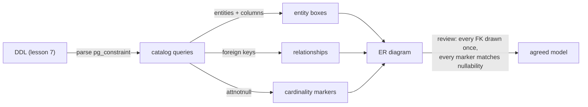
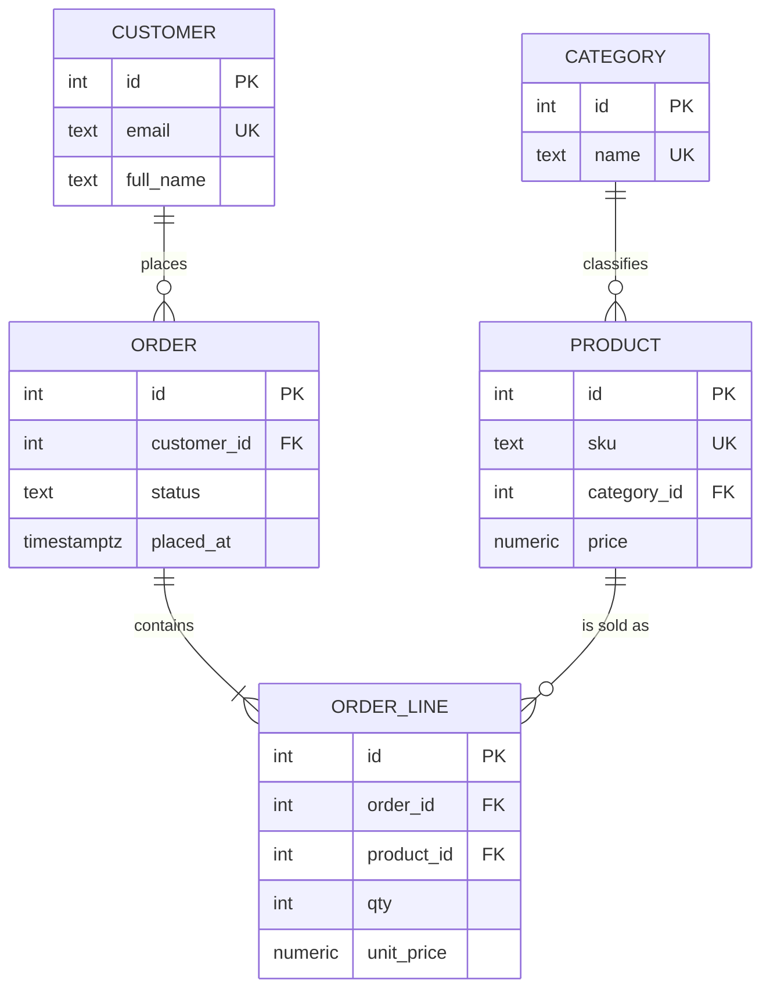

# ER Diagrams

## 1. Learning Objectives

After this lesson you can:

- [ ] Read and write ER notation: entities, attributes, keys, and the
      cardinality/optionality combinations — applied to the `shop` schema executed in
      lesson 7
- [ ] Derive a diagram **from the live database** with catalog queries (executed:
      5 entities with column counts, the 4 foreign keys with their delete actions, and
      optionality read from `attnotnull`)
- [ ] Round-trip a model: diagram → DDL → catalog → diagram, and name where each
      conversion is lossy (executed the catalog direction; DDL direction executed in
      lesson 7)
- [ ] State what `||--o{`, `||--|{`, and `o|--o|` claim — and which claim is checked
      against nullability, not against the drawing
- [ ] Use a diagram as the review artifact: every FK in the executed catalog appears
      exactly once in the drawing, and every relationship in the drawing has a constraint
      behind it (checklist executed both ways)

## 2. Prerequisites

- [Database Design](database-design.md) — the `shop` schema built here is the diagram's
  subject; relationships and keys are already decided.
- [Relational Databases](relational-databases.md) — cardinality kinds; this lesson gives
  them notation.

## 3. Introduction

An **entity-relationship (ER) diagram** is the model's picture: entities as boxes,
relationships as labelled links with cardinality markers, attributes listed under each
entity. Its value is *conversation*: a diagram gets disagreed with in a meeting, DDL gets
bypassed in production. This lesson treats the diagram as a **claim about the database**
— and then executes the queries that check those claims against `pg_catalog`, so the
drawing and the schema cannot drift apart silently.

## 4. The Problem It Solves

Schemas are read far more often than they are written, and 5 tables of DDL do not fit in
one conversation. Before ER notation, structure lived in prose ("customers have orders,
I think") where optionality and the M*N case get lost — precisely the decisions that
cost the most to change. The diagram makes one-to-one vs one-to-many vs many-to-many
*visible*, and it is the artifact stakeholders can actually confirm. The failure mode it
introduces — a pretty picture that lies — is exactly what this lesson's catalog queries
catch.

## 5. Core Concepts

### The vocabulary

- **Entity** — a table: a noun you remember rows of (`customer`, `product`).
- **Attribute** — a column; keys marked PK (primary) or UK (unique).
- **Relationship** — a foreign key connecting two entities, drawn once per constraint.
- **Cardinality** — how many on each side: exactly one (`1`), zero or one (`0..1`),
  one or many (`1..*`), zero or many (`0..*`).

### The four markers you will use (mermaid notation)

| Notation | Reads as | Backed by |
|---|---|---|
| `||--o{` | one parent, zero-or-many children | the everyday FK: `order_line 0..*` |
| `||--\|{` | one parent, one-or-many children | `not null` child FK *plus* the rule "every parent must have children" (rare — usually a business rule, not a constraint) |
| `o\|--o\|` | optional on both ends | nullable FK, child table without a mandatory back-link |
| `\|\|--o\|` | one-to-one | FK column that is also `unique` (lesson 2 executed this) |

**The diagram is the claim; the constraint is the truth.** Optionality is *checked* in
the catalog: `attnotnull = t` → the child side is mandatory (`1`), `f` → optional
(`0..1`). Executed in the probe below — three mandatory FKs, one optional — and a
drawing that says otherwise is a bug in the drawing.

### Round-tripping, and where it loses

DDL → diagram is mechanical (every FK becomes a link). Diagram → DDL is a *decision*
(each marker picks a constraint; the `1..*` "must have children" claim needs an app rule
or a trigger — SQL can't express it). Catalog → diagram (executed here) is mechanical
again. The lossy step is always drawing → schema: that's where review belongs.

## 6. How It Works



The three catalog queries below are the pipeline: entities from `information_schema`,
relationships from `pg_constraint` (foreign-key rows only), optionality from the
referencing column's nullability. Together they regenerate the drawing's *structure* —
what remains human is naming and layout.

## 7. Practical Examples

**Example 1 — the diagram of the executed schema (the target)**



Each link corresponds to exactly one `FOREIGN KEY` clause from lesson 7's DDL, in order:
`order.customer_id`, `order_line.order_id`, `order_line.product_id`,
`product.category_id`. Note `product` is drawn `o{` (many order lines) — and the
`category` link is the one *optional* relationship, which the catalog query in Example 3
confirms.

**Example 2 — entities from the live database (executed)**

```sql
select table_name, count(*) as columns
  from information_schema.columns
 where table_schema = 'shop'
 group by table_name order by table_name;
```

```
 table_name | columns
------------+---------
 category   |       2
 customer   |       4
 order      |       4
 order_line |       5
 product    |       6
(5 rows)
```

Five entities, attribute counts as written — the diagram's boxes with their attribute
list lengths, for free.

**Example 3 — relationships and their delete actions (executed)**

```sql
select c.conrelid::regclass::text as from_table, a.attname as from_column,
       c.confrelid::regclass::text as to_table,   b.attname as to_column,
       c.confdeltype as on_delete
  from pg_constraint c
  cross join lateral unnest(c.conkey) with ordinality as k(attnum, ord)
  join pg_attribute a on a.attrelid = c.conrelid and a.attnum = k.attnum
  join pg_attribute b on b.attrelid = c.confrelid and b.attnum = c.confkey[k.ord]
 where c.contype = 'f' and c.connamespace = 'shop'::regnamespace
 order by from_table, from_column;
```

```
   from_table    | from_column |   to_table    | to_column | on_delete
-----------------+-------------+---------------+-----------+-----------
 shop."order"    | customer_id | shop.customer | id        | a
 shop.order_line | order_id    | shop."order"  | id        | c
 shop.order_line | product_id  | shop.product  | id        | a
 shop.product    | category_id | shop.category | id        | a
(4 rows)
```

- Exactly four rows for four links in the drawing — the one-to-one check *by count*: a
  fifth row would be an undrawn relationship, a missing row an imaginary one.
- `on_delete` is a single letter: `c` = cascade (the `order_line.order_id` link from the
  design), `a` = no action (the default). A diagram review that reads this column reads
  the delete rules too — usually omitted from drawings, usually the thing that surprises
  someone.
- The unfiltered version of this query (executed first) also returned 7 rows of `public`
  tables from lessons 2–3 — a reminder the catalog holds *every* schema; filter
  `connamespace` or you are reviewing the wrong model.

**Example 4 — optionality is a catalog fact, not a drawing choice (executed)**

```sql
select c.conname as fk_constraint, a.attnotnull as column_not_null,
       case when a.attnotnull then 'mandatory (1)' else 'optional (0..1)' end as on_this_side
  from pg_constraint c
  join pg_attribute a on a.attrelid = c.conrelid and a.attnum = c.conkey[1]
 where c.contype = 'f' and c.connamespace = 'shop'::regnamespace
 order by fk_constraint;
```

```
       fk_constraint        | column_not_null |  on_this_side
----------------------------+-----------------+-----------------
 order_customer_id_fkey     | t               | mandatory (1)
 order_line_order_id_fkey   | t               | mandatory (1)
 order_line_product_id_fkey | t               | mandatory (1)
 product_category_id_fkey   | f               | optional (0..1)
(4 rows)
```

This is the drawing's marker column, executed: three `1` sides (the `not null` FKs) and
one `0..1` (`category_id` — the "unclassified product allowed" decision from lesson 7).
Draw from this output and the diagram cannot overstate a constraint; draw from memory
and `product_category_id_fkey` becomes the classic "the picture said required" defect.

**Example 5 — the review checklist, both directions**

1. Catalog → diagram: take Example 3's four rows; each appears **once** as a link in the
   drawing → yes (count 4 = 4).
2. Diagram → catalog: each drawn link resolves to a `FOREIGN KEY` in the DDL → yes (the
   four clauses in Example 1).
3. Markers vs nullability: each drawn `1`/`0..1` matches Example 4's column → yes.
4. Delete rules: drawn or documented from `on_delete` (`order_line` cascades with its
   order; the rest refuse) → stated here because most diagrams omit them.

Any row of this checklist failing means the picture and the database disagree — and only
one of them is being used at 3 a.m.

## 8. Real-World Applications

ER diagrams are the review artifact in schema design reviews, the onboarding picture in
every backend team's docs, and the thing product managers can actually answer questions
against ("if a product changes category, what happens?"). Reverse-engineering one from
`pg_catalog` (executed here) is how you recover the model of a legacy database nobody
documented — the queries are the tool, the drawing is the deliverable.

## 9. Common Mistakes

| Mistake | Why it happens | How to recognize it | How to prevent it |
|---|---|---|---|
| Drawing relationships that have no constraint | model vs implementation drift | catalog query returns fewer rows than drawn links | regenerate from `pg_constraint` (executed) before review |
| Every link drawn as mandatory | notation default in the head | nullable FK shown as `1`; readers assume orphan-free | check `attnotnull` — Example 4 is the source of truth |
| M*N drawn as direct link without a box | the meeting skipped the hard case | qty/price nowhere to live | the link table is an entity — draw it (`ORDER_LINE`) |
| Diagram drawn once, never re-derived | document rot | picture 2 schemas old | make Examples 2–4 the review's first step; they are three queries |
| Forgetting `on_delete` entirely | notation doesn't force it | cascade surprise later | document the `confdeltype` letter per link in review notes |
| One diagram for a 60-table database | no scoping | unreadable, ignored | slice by module; one picture, one conversation |

## 10. Best Practices

- **Derive, then draw**: run the three executed queries first; layout and naming are the
  only creative parts left — and the only parts that can't be wrong about structure.
- **Draw the link tables** with their attributes (`ORDER_LINE` in the diagram) — they
  hold the relationship's *data*, and hiding them hides qty/price.
- **Keep cardinality markers honest** (`o` vs `|`): if you can't prove `1..*`, draw
  `o{` — an overstated constraint misleads migration and validation work.
- **Scope per module** and state the schema name (`shop`) on the picture — the executed
  unfiltered query showed why (11 FKs across two schemas otherwise).
- **Treat the checklist as the PR template** for any schema change: three queries plus a
  re-look at the drawing.

## 11. Limitations and Trade-Offs

ER notation captures structure, not behaviour: no triggers, no validation rules beyond
keys, no temporal facts ("status changes over time" is an entity too — draw it or lose
it). Business-rule cardinality (`1..*`) has no constraint behind it, so the drawing
carries a claim the database won't keep. And diagrams of document-heavy schemas (`jsonb`
columns like `product.attrs`) show one attribute hiding an inner model — the ER box is
honest only down to the column; decide explicitly what the JSON's shape is (a documented
example, or a schema-validation layer) rather than leaving it to whoever queries it.

## 12. Practical Exercises

### Introductory

1. **Exercise 1.1** — without looking at this lesson's drawing, sketch the `shop` ER from
   your own memory of lesson 7's DDL, then run Examples 2–4 and diff your sketch against
   the output.
   **Completion criteria:** sketch kept (paper or file); the three executed outputs; a
   diff list of every mismatch (missing link, wrong marker, imaginary attribute) —
   mismatches are the point, list them honestly.
2. **Exercise 1.2** — write the mermaid `erDiagram` block for `shop` from the catalog
   output alone (not from the DDL) and validate it renders.
   **Completion criteria:** block parses (paste the renderer's result or the parse
   check); every FK row appears exactly once; PK/UK markers taken from `\d`, not memory.

### Intermediate

3. **Exercise 1.3** — reverse-engineer the ER of lesson 2's `public` schema (`app_users`,
   `profiles`, `books`, `tags`, `book_tags`, `customers`, `orders`, `line_orders`,
   `order_notes`): run the filtered catalog queries per table, draw the diagram, then
   write DDL from your drawing and compare with what lesson 2 actually created.
   **Completion criteria:** the executed FK/optionality outputs; a diagram; the DDL
   comparison listing any difference between your written DDL and the original — each
   difference explained (hint: `on delete` clauses and nullability are where drawings
   lose information).
4. **Exercise 1.4** — take a teammate's (or your own older) diagram with no database
   behind it, and write the three queries that would falsify each of its claims. Run them
   against whatever schema exists.
   **Completion criteria:** one query per claim type (structure, relationship,
   optionality); at least one discrepancy found or an explicit "schema absent — claims
   unverifiable" verdict; the practice stated: which comes first in review, picture or
   queries.

### Independent problem-solving

5. **Exercise 1.5** — for your library design (design lesson's independent task),
   produce the review package: the ER diagram, the three executed catalog queries, and a
   checklist page stating, per link: constraint name, optionality with its `attnotnull`
   receipt, and `on_delete` behaviour with the business sentence it encodes.
   **Completion criteria:** diagram + three executed outputs; the per-link table
   complete for every relationship; one paragraph on claims SQL *cannot* back (e.g.
   "every book has at least one copy") naming where they will be enforced instead.

*Solutions: attempt first. They live in `solutions/` of this subject.*

## 13. Knowledge Check

1. A diagram shows `CUSTOMER ||--|{ ORDER` (orders mandatory for a customer), but
   `order_customer_id_fkey` sits on a `not null` column. Is the database enforcing the
   drawn claim? Explain what each side actually guarantees.
2. Why must the review query filter `connamespace`, and what happened in the executed
   unfiltered run? What kind of mistake would ship without that filter?
3. Diagram → DDL: which two kinds of information does the drawing *not* specify that
   your `create table` had to choose anyway? Name two (e.g., data types, delete rules)
   and say where each decision is recorded.

## 14. Completion Criteria

Observable evidence that you have understood this lesson:

- [ ] You can read any ER drawing and name each link's constraint, optionality source,
      and delete rule (or say "not stated — must be checked")
- [ ] You have executed the three catalog queries against `shop` and matched all four
      relationships both directions
- [ ] You can produce a mermaid `erDiagram` from catalog output that renders
- [ ] You can list what round-tripping loses in each direction
- [ ] You have run the four-row review checklist against a schema of your own

## 15. Summary

- An ER diagram is claims about constraints: entities from `information_schema`,
  links from `pg_constraint`, markers from `attnotnull` — all three executed.
- Four FK rows for four drawn links is the one-to-one structural check; optionality is
  a catalog fact, never a drawing convention.
- `on_delete` letters (`c`, `a`) belong in review even though notation omits them.
- Diagram → DDL is where interpretation enters (types, actions, business cardinality);
  that's the direction worth reviewing hardest.
- Regenerate before every review: three queries, then the picture is current.

## 16. Next Steps

- Next lesson: [Normalization](normalization.md) — restructuring attributes *inside* the
  entities this lesson draws
- Practice: [exercises/](exercises/README.md) — set 8
- Where it is applied: [20 — Project Laboratory](../20-PROJECT-LABORATORY/README.md) —
  Project 03's design document ships this lesson's diagram + catalog receipts together
