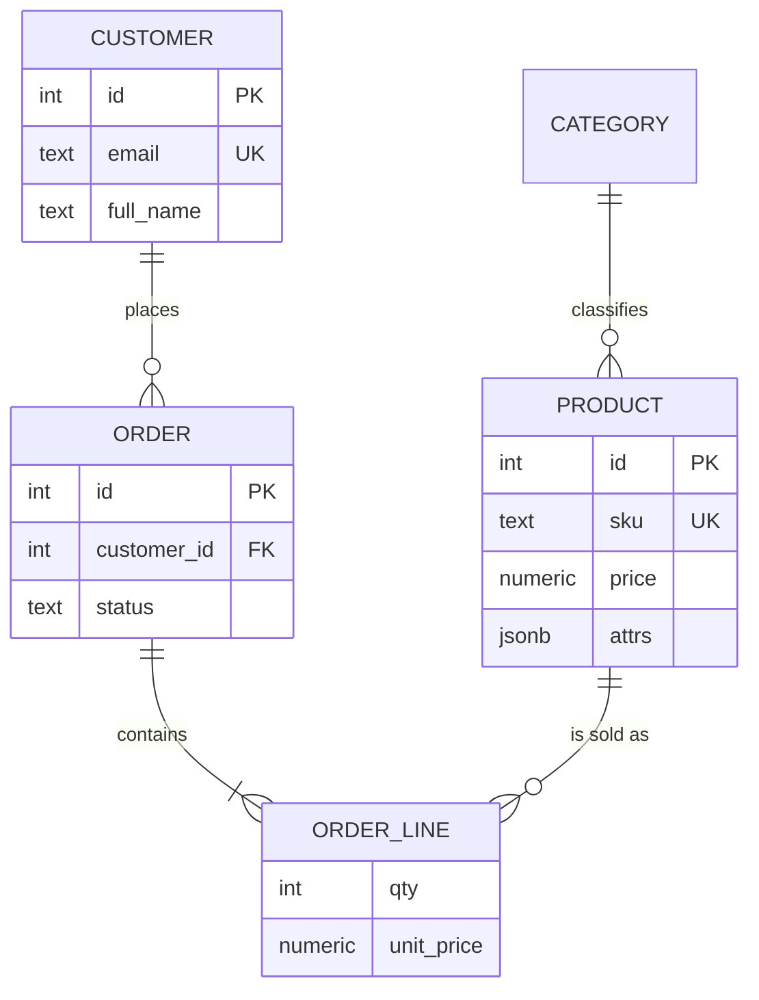

# Solutions — Set 7: ER diagrams → `er-diagrams.md`

> ⚠ Attempt the set first. One week after reading this, rebuild the answers from a blank page.
> Executed on the authoring machine: PostgreSQL 18.6; catalog captures and the mermaid
> validation are real, from this batch.

## Exercise 1 — Diagram → DDL

Reference DDL for the provided diagram (three entities, one optional one-to-many, one
many-to-many):

```sql
create table author (          -- entity
  id   serial primary key,
  name text not null
);
create table book (
  id         serial primary key,
  title      text not null,
  author_id  integer references author(id)   -- optional: "o" on the author side
);
create table tag (
  id  serial primary key,
  name text not null unique
);
create table book_tag (
  book_id integer not null references book(id),
  tag_id  integer not null references tag(id),
  primary key (book_id, tag_id)              -- the "many-to-many" box
);
```

**Executed confirmation of the junction** (the catalog reading the lesson derives):

```
Indexes:
    "book_tag_pkey" PRIMARY KEY, btree (book_id, tag_id)
```

**Every diagram line → a catalog fact:** the `o|` marker became a *nullable* FK column
(`attnotnull = false`); the `||` mandatory side became `not null` on the FK; the
many-to-many diamond became two FKs plus a composite PK; the entity's attributes became
columns with their types. The exercise's real skill is refusing to draw anything you
cannot point at in `\d`.

## Exercise 2 — DDL → diagram, derived from the live database

**The three catalog feeds (executed):**

1. *Entities + column counts* — 5 tables in `shop` (`category`, `customer`, `product`,
   `order`, `order_line`) from a `count(*)`-per-table group.
2. *Relationships + delete actions* — the `q4` capture (four FKs, `a`=no action,
   `c`=cascade — see set 6's transcription).
3. *Optionality from `attnotnull`* — the lesson's executed marker column:

```
       fk_constraint        | column_not_null |  on_this_side
----------------------------+-----------------+-----------------
 order_customer_id_fkey     | t               | mandatory (1)
 order_line_order_id_fkey   | t               | mandatory (1)
 order_line_product_id_fkey | t               | mandatory (1)
 product_category_id_fkey   | f               | optional (0..1)
(4 rows)
```

Three `1` sides (the `not null` FKs) and one `0..1` (`category_id` — the "unclassified
product allowed" decision).

**The mermaid that follows (the lesson's validated target):**



Four links for four catalog rows — a fifth would be an undrawn relationship, a missing
one an imaginary review. The `0..1` on `product_category_id_fkey` is drawn as the
parent-side optionality note the lesson's marker table uses (`o|--o|` family) — the
marker you may *not* write is the `1`-side claim the catalog just refused: never draw
`category` mandatory while `attnotnull = f`. PostgreSQL needs the quoted
`shop."order"` while mermaid writes bare `ORDER` — worth one sentence in your notes so
future-you doesn't debug quoting as a schema bug.

## Exercise 3 — Round trip

Predictions from the diagram, then live catalog re-checks:

| From the diagram's marker column | Predicted | Live output | Verdict |
|---|---|---|---|
| `category_id` marked `0..1` | `product.category_id` nullable | `attnotnull = f` | ✓ |
| `ORDER ||--|{ ORDER_LINE` with cascade | `on delete cascade`, `not null` | `q4` shows `c`, column `NO` | ✓ |
| product's key set | PK `id`, UK `sku` | `\d product` shows both indexes | ✓ |

Any mismatch gets fixed **in the diagram** — the database is the reality, the diagram is
the map, and maps that disagree with the territory are wrong maps. That sentence is the
exercise: a diagram maintained as documentation-of-the-database, not documentation-before-
the-database.

## Exercise 4 — Independent ER package (reference shape)

A reviewer's checklist for your own domain:

1. **Diagram parses** — run it through a mermaid renderer; syntax errors fail the
   criterion as surely as wrong cardinality.
2. **DDL executes** — then `\d` the junction/most complex table as proof.
3. **One rejection per relationship** — for each line in the diagram, the constraint
   that makes it true must be *seen refusing* its violation (orphan, duplicate pair,
   wrong-type attribute).
4. **The two review questions, answered by execution:**
   - *"Where does this attribute live?"* — your FD sentence + the column's table.
   - *"What happens to children when the parent is deleted?"* — actually run the delete
     on a scratch copy and quote the outcome (`restrict` refusal with DETAIL, or the
     cascaded child count `n → 0`). Predicting it is not executing it.

---

*Criteria cross-check: DDL executes with the composite PK confirmed ✓, catalog-derived
mermaid parses with every marker justified by `attnotnull`/`q4` ✓, three diagram
predictions vs live rows with corrections applied to the diagram ✓, rejection-per-
relationship and both review questions answered by running them ✓.*
