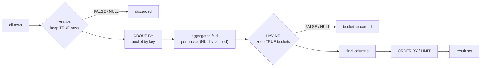

# Filtering and Aggregation

## 1. Learning Objectives

After this lesson you can:

- [ ] Use the full comparison surface — `between`, `in`, `like`, chained ranges — and
      predict each result set's size (executed: 3 / 5 / 1 / 3 rows on the same 8-row
      table)
- [ ] Reason in **three-valued logic**: prove that `price = null` matches nothing, that
      `not (price >= 120)` silently drops `NULL` rows (executed: 4 rows, `NULL` gone),
      and that `is null` is the only correct NULL test
- [ ] Use aggregates knowing exactly what they skip: `count(*)` 8 vs `count(price)` 7,
      `sum` 1076.75 and `avg` 153.82… over only the known values (executed)
- [ ] Group rows into buckets with `GROUP BY`, including grouping on an **expression**
      (executed: `price is null` → `f: 7, t: 1`)
- [ ] Separate row filters from group filters: execute the same query with and without a
      `where` and read the changed `having` input (executed: `2/2/2` vs `3/2/3`)
- [ ] Diagnose the classic grouping error from its exact message (executed:
      `column "products.price" must appear in the GROUP BY clause or be used in an
      aggregate function`)

## 2. Prerequisites

- [SQL Fundamentals](sql-fundamentals.md) — `select`/`where`/`order by` and the clause
  evaluation order this lesson extends with `group by`/`having`.

## 3. Introduction

Selecting rows is half of reading data; the other half is **summarizing** them: totals,
averages, counts per category — answers that no single row holds. SQL does this with
**aggregate functions** (which fold many rows into one value) and **`GROUP BY`** (which
decides which rows share a fold). Between the two sits `NULL` with its three-valued
logic, the source of more silent wrong numbers than any other feature. Everything below
was executed on the lab server, including the wrong-number cases — they are the lesson.

## 4. The Problem It Solves

Application code computes reports by looping: `for each row { if … total += … }`. Loops
in every caller, inconsistent NULL handling between them, and the whole dataset shipped
over the network to be summed in one process. `GROUP BY` keeps the fold next to the data:
the server touches each row once, per bucket, and returns one row per group. The new
problem that creates is *precision*: which rows entered the fold, and which values were
skipped — this lesson makes you able to answer both from the query alone.

## 5. Core Concepts

### The operator surface

`=` `<>` `<` `<=` `>` `>=` compare values; `between a and b` is inclusive at both ends;
`in (…)` matches a list; `like` matches a pattern (`%` = any run, `_` = one character —
`ilike` adds case-insensitivity in PostgreSQL). Combine with `and`/`or`/`not`. None of
them ever returns "unknown row" — they return TRUE, FALSE, or NULL, per row.

### Three-valued logic (3VL)

`NULL` means *unknown*, so a comparison with it is unknown, and logic propagates it:

| A | B | A AND B | A OR B | NOT A |
|---|---|---|---|---|
| TRUE | TRUE | TRUE | TRUE | FALSE |
| TRUE | NULL | **NULL** | TRUE | FALSE |
| FALSE | NULL | FALSE | **NULL** | TRUE |
| NULL | NULL | NULL | NULL | **NULL** |

A `where` clause keeps a row **only when the condition is TRUE** — NULL behaves like
FALSE *for inclusion*, which is why unknown rows vanish from filtered results **and from
their negations** (executed: `not (price >= 120)` returned 4 rows, not 5 — the `NULL`
price row disappeared from both). The only correct NULL tests are `is null` /
`is not null`; `= null` asks "equals unknown?" and matches nothing (executed: 0 rows).

### Aggregate functions

`count`, `sum`, `avg`, `min`, `max` (plus `string_agg`, `bool_and`, …) fold many rows
into one. The rule that matters: **every aggregate except `count(*)` skips `NULL`
inputs** — there is no value to add or average. So `count(*)` counts rows,
`count(column)` counts non-NULL values, and the gap between them is a NULL audit.
`count(distinct x)` counts distinct non-NULL values (executed: 3 categories).

### GROUP BY and HAVING

`group by <keys>` buckets rows by equal key values; each output row is one bucket, with
aggregates computed **within** it. Grouping by an expression is legal and useful
(executed: `group by price is null`). `having` then filters *buckets* by their
aggregate — `where` can't do this, because `where` runs before buckets exist. Non-grouped
columns in the select list must be aggregated or grouped, or the server refuses (executed
error below).

## 6. How It Works



Two independent NULL rules live in this pipeline: a row's **group key** NULL is a
legitimate bucket value (`group by price is null` proved it — NULLs bucket together),
while **values inside an aggregate fold** are skipped. Row-in-bucket vs value-in-fold is
the distinction to hold: NULL is data for grouping, absence for aggregation.

## 7. Practical Examples

**Example 1 — the operator ladder (executed)**

```sql
select name, price from products where price between 30 and 130 order by price;
select name, category from products where category in ('displays','furniture') order by name;
select name from products where name like 'W%' order by name;
select name, price from products where price >= 45 and price <= 310 order by price;
```

```
        name         | price          |              between 30..130 → 3 rows
---------------------+--------
 Laptop Stand        |  39.00
 USB-C Hub           |  45.50
 Mechanical Keyboard | 120.00

      name       | category          | in (...) → 5 rows
-----------------+-----------
 27-inch Monitor | displays
 4K Monitor      | displays
 Desk Lamp       | furniture
 Laptop Stand    | furniture
 Monitor Arm     | displays          ← name-sort puts it last

    name                     | like 'W%' → 1 row
-------------
 Wired Mouse

        name         | price          | 45..310 → 3 rows
---------------------+--------
 USB-C Hub           |  45.50
 Mechanical Keyboard | 120.00
 27-inch Monitor     | 310.00
```

- `between` is inclusive (`39` and `45.50` in, `27` and `15.25` out) and `and`-chained
  comparisons are the same predicate written longhand — both executed, both 3 rows.
- The `NULL`-price Monitor Arm matches **none** of these: every comparison with an
  unknown is unknown, never TRUE.

**Example 2 — three-valued logic, executed (including the traps)**

```sql
select name, price from products where price is null;          -- A
select name, price from products where price = null;           -- B: no error, no rows
select name, price from products where not (price >= 120);     -- C
select count(*) as all_rows, count(price) as rows_with_price,
       sum(price) as total_known_price, avg(price) as avg_known_price
from products;                                                  -- D
```

```
    name     | price          -- A: the correct NULL test → 1 row
-------------+-------
 Monitor Arm |

 name | price                 -- B: 0 rows — "= null" is never true
------+-------
(0 rows)

     name     | price          -- C: 4 rows — NULL row silently gone
--------------+-------
 USB-C Hub    | 45.50
 Laptop Stand | 39.00
 Wired Mouse  | 15.25
 Desk Lamp    | 27.00

 all_rows | rows_with_price | total_known_price |   avg_known_price
----------+-----------------+-------------------+----------------------
        8 |               7 |           1076.75 | 153.8214285714285714
```

- **C is the trap in one line**: a developer adding `not (price >= 120)` to *exclude*
  expensive items gets 4 rows and believes there are 4 cheap items — the unknown price
  was excluded from *both* sides of the negation.
- **D is the trap as a number**: `avg` divided by 7, not 8 — `1076.75 / 8 = 134.59…`
  would have been the answer to a different question. The two counts *are* the audit:
  whenever `rows_with_price < all_rows`, every price statistic is over a smaller
  population than the table.

**Example 3 — aggregates over a second table (executed)**

```sql
select min(price) as cheapest, max(price) as priciest from products;
select sum(qty) as units_sold, count(*) as lines, count(cents_off) as discounted_lines
from order_lines;
```

```
 cheapest | priciest
----------+----------
    15.25 |   520.00

 units_sold | lines | discounted_lines
------------+-------+------------------
         16 |     8 |                3
```

`sum(qty)` is over all 8 lines (no NULL `qty`), but `count(cents_off)` = 3 — five lines
have `cents_off` NULL, so the discount statistics cover 3 lines while revenue covers 8.

**Example 4 — GROUP BY buckets (executed)**

```sql
select category, count(*) as n, sum(stock) as units from products group by category order by category;
select category, avg(price)::numeric(10,2) as avg_price from products group by category order by category;
```

```
  category   | n | units          |   category   | avg_price
-------------+---+----------------+--------------+-----------
 displays    | 3 |    17          | displays    |    415.00
 furniture   | 2 |    11          | furniture   |     33.00
 peripherals | 3 |    96          | peripherals |     60.25
```

- Eight rows in, three buckets out — one output row per group, which is the entire
  shape of every report you will ever write.
- **Read `415.00` carefully**: displays' average is `(310 + 520) / 2`, *not* over 3
  rows — the `NULL`-priced Monitor Arm was skipped by `avg`, while `count(*)` in the
  left query counted it. Two aggregates over the same bucket, different populations,
  same query — that is this lesson in one table.

**Example 5 — HAVING sees what WHERE let through (executed, twice)**

```sql
-- (a) row filter first:
select category, count(*) as n from products where price > 20
 group by category having count(*) >= 2 order by category;
-- (b) same query, WHERE removed:
select category, count(*) as n from products
 group by category having count(*) >= 2 order by category;
```

```
  category   | n        (a): WHERE price > 20 first → buckets of 2
-------------+---
 displays    | 2
 furniture   | 2
 peripherals | 3 → no: peripherals shows 2 (15.25 excluded)

  category   | n        (b): no WHERE → full buckets
-------------+---
 displays    | 3
 furniture   | 2
 peripherals | 3
```

- Identical `having`, different results: `having` evaluates the `count` **of the rows
  that survived `where`**. The executed difference (`2/2/2` vs `3/2/3`) is the pipeline
  from section 6 running in the right order.
- Both are correct answers to *different questions* — "categories with ≥2 products over
  20" vs "categories with ≥2 products". Name the question, then pick the clause.

**Example 6 — grouping on expressions (executed)**

```sql
select price is null as price_unknown, count(*) from products group by price is null;
select count(distinct category) as distinct_categories from products;
```

```
 price_unknown | count
---------------+-------
 f             |     7
 t             |     1

 distinct_categories
--------------------
                   3
```

- The boolean expression is the group key: two buckets, `f` and `t` — a NULL *value*
  grouping problem solved without joins.
- `count(distinct …)` needs no `group by` to answer across the whole table (3
  categories); inside a group it would count distinct values per bucket.

**Example 7 — the grouping refusal (executed)**

```sql
select category, price from products group by category;
```

```
ERROR:  column "products.price" must appear in the GROUP BY clause or be used in an aggregate function
LINE 1: select category, price from products group by category;
                         ^
EXIT=1
```

- The server refuses to pick *which* of the 3 display prices represents the bucket —
  you must say: add `price` to the `group by`, or wrap it (`max(price)`, `avg(price)`).
  The message names the exact column; it is a design question, not a syntax complaint.

## 8. Real-World Applications

Dashboards are this lesson end to end: revenue per category (`group by` + `sum`), orders
per day (`group by date(created_at)` — an expression key), top-N products (`group by` …
`order by sum desc limit 10`), conversion funnels (`having` on counts), and data-quality
panels (`count(*) - count(column)` per column — the executed D query as a monitoring
query). Every one of them ships decisions about `NULL`: is an unknown price revenue of
zero, or not revenue at all? The query can't decide that for you — but it can show you
both counts so the decision is visible.

## 9. Common Mistakes

| Mistake | Why it happens | How to recognize it | How to prevent it |
|---|---|---|---|
| `where x = null` | SQL looks like other languages' `==` | 0 rows, no error (executed B) | `is null` / `is not null` only |
| `not (cond)` hiding NULLs | negation read as "everything else" | row counts lower than expected (executed C: 4, not 5) | write `where not (cond) or x is null` — or decide NULLs' fate explicitly |
| Average over a nullable column | population never questioned | `avg` differs from `sum/count(*)` — different denominators | pair every aggregate with its `count(col)`; report both |
| `having` on a raw column | clause roles confused | "must appear in GROUP BY" error (executed Example 7) | raw columns → `where`; aggregates → `having` |
| Expecting `sum` of all-NULL to be 0 | `sum` skips, doesn't seed | empty result row with NULL `sum` | `coalesce(sum(x), 0)` when the answer must be numeric |
| Alias used in `where`/`having` wrongly | top-to-bottom reading | "column does not exist" | `where` never sees select aliases; `having` may repeat an aggregate expression |

## 10. Best Practices

- **Report `count(*)` beside every conditional aggregate** — it costs nothing and makes
  the denominator explicit (this is the executed `8 | 7` pattern, turned into a habit).
- **Decide NULL's business meaning in writing** ("unknown price is not revenue"), then
  encode it with `where`/`coalesce` — the decision belongs in review, not in whoever
  writes the next query.
- **Use `where` whenever the condition doesn't involve an aggregate** — filtering rows
  first is cheaper (fewer rows to bucket) and the executed Example 5 shows it also
  changes answers, so it must be a deliberate choice.
- **Group by expressions deliberately** (`date_trunc('day', ts)`, `price is null`) and
  alias them for readability — grouping logic that lives in the query stays visible.
- **`order by` every grouped result** you show a human — `group by` order is as
  unspecified as bare `select` order.

## 11. Limitations and Trade-Offs

Aggregation reads every qualifying row (or every index entry it can cover) — no bucket
is free, and wide `group by` results cost memory; the indexes/`EXPLAIN` lessons price
this properly. `avg` silently choosing the non-NULL population is a *feature with a
default opinion* — for medians and percentiles you need `percentile_cont`, which is a
different (sort-based) cost. And SQL has no per-group procedural step in this pipeline:
sequence-dependent logic (running totals, sessionization) belongs to window functions or
application code — knowing where the declarative pipeline ends is part of using it well.

## 12. Practical Exercises

### Introductory

1. **Exercise 1.1** — write four filters on `products`: price in 20..50, category in
   `('displays')`, name like `%Monitor%`, stock > 10 and price < 100. Predict each row
   count first.
   **Completion criteria:** four counts predicted then matched; one sentence on which
   filter the `NULL`-price row passes and why (it passes none — say which rule blocks
   each).
2. **Exercise 1.2** — reproduce the three executed 3VL probes (`is null`, `= null`,
   `not (price >= 120)`) from memory, then write the *correct* "not too expensive OR
   unknown" filter and show it returns 5 rows.
   **Completion criteria:** three re-executed transcripts; the corrected filter with its
   row count; the 3VL rule for `not` quoted in your own words.

### Intermediate

3. **Exercise 1.3** — over `order_lines`, produce one row: total units, total lines,
   lines with a discount, total discount cents, and `avg(cents_off)`. Then compute
   `total_discount_cents / lines` and `total_discount_cents / lines_with_discount` and
   state which question each answers.
   **Completion criteria:** the single-row result executed; both quotients computed with
   the two denominators named; the report format you'd ship (with `count(*)` visible)
   argued in one line.
4. **Exercise 1.4** — write the same business question three ways: `where stock > 0
   group by category having count(*) >= 2`, the same without `where`, and the same with
   `where price is not null and price > 20`. Capture all three and tabulate the groups.
   **Completion criteria:** three executed outputs; a table of bucket counts per variant;
   one sentence stating exactly which population each query counts.

### Independent problem-solving

5. **Exercise 1.5** — a manager asks: "how many products are *missing* a price, per
   category, and what's the average of the ones that have one?" Build the query over the
   section's table (or your own seed), showing both numbers side by side per category,
   with categories that are fully priced included (zero missing).
   **Completion criteria:** one executed result with columns `(category, total,
   missing, avg_known)`; `missing` derived from counts, not from eyeballing; a written
   note on how you'd present the fully-priced vs partially-priced categories so no
   reader mistakes the average's population; the `avg`'s denominator stated per row.

*Solutions: attempt first. They live in `solutions/` of this subject.*

## 13. Knowledge Check

1. `select count(*), count(price), count(distinct price) from products;` returns three
   different numbers. Say what each counts and predict the ordering — then run it.
2. A report shows `avg_order_value` for the "premium" segment as higher than the
   overall average, and someone concludes premium customers spend more. What NULL-related
   alternative explanation must be ruled out first, and which two counts would rule it
   out?
3. Why does `where category = 'displays' group by category having count(*) > 100`
   return no rows *without error*, while `select category, price group by category`
   errors? Explain both behaviours from the evaluation order.

## 14. Completion Criteria

Observable evidence that you have understood this lesson:

- [ ] You can write `between`/`in`/`like`/compound filters and predict each row count
- [ ] You can demonstrate all three executed 3VL traps from memory and state the rule
      that makes each happen
- [ ] You can quote the `count(*)` vs `count(col)` gap for a table you built and say
      what the gap means
- [ ] You can produce grouped totals with a correct `where`/`having` split and explain
      the executed `2/2/2` vs `3/2/3` difference
- [ ] You can read the "must appear in the GROUP BY clause" error and name both fixes

## 15. Summary

- Filters evaluate in three-valued logic; only TRUE keeps a row, so `NULL` vanishes
  from conditions **and their negations** — `is null` is the only NULL test (executed:
  `= null` → 0 rows; `not (price >= 120)` → 4 rows).
- Aggregates skip `NULL`: `count(*)` 8 vs `count(price)` 7, `avg` over 7 values — always
  pair a conditional aggregate with its denominator.
- `group by` buckets rows (NULL keys bucket fine); `having` filters buckets after
  aggregation; raw columns in both → the executed "must appear in GROUP BY" refusal.
- The same `having` with and without a `where` produced `2/2/2` vs `3/2/3` — clause
  order is business meaning.
- `count(distinct …)` and expression grouping (`price is null`) answer population
  questions without extra queries.

## 16. Next Steps

- Next lesson: [Joins and Subqueries](joins-and-subqueries.md) — combining tables, and
  queries that feed themselves
- Practice: [exercises/](exercises/README.md) — set 4
- Where it is applied: [20 — Project Laboratory](../20-PROJECT-LABORATORY/README.md) —
  dashboard endpoints are exactly these aggregates behind an authenticated route
