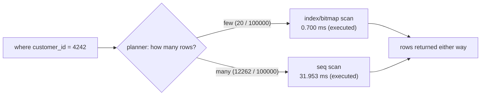

# Indexes

## 1. Learning Objectives

After this lesson you can:

- [ ] Explain what an index *is* — an ordered side structure with pointers back to rows —
      and what it costs (executed: a 776 kB index beside a 5096 kB table)
- [ ] Measure a lookup before and after indexing with `explain analyze` (executed:
      13.164 ms seq scan with `Rows Removed by Filter: 99980` → **0.700 ms** bitmap/index
      scan returning the same 20 rows)
- [ ] Predict when the planner will **decline** your index and read its reasoning from
      the plan (executed: `amount > 800` chose a seq scan — 12,262 matching rows is a
      quarter of the table)
- [ ] Name the write-side costs of an index (extra storage, every insert/update/delete
      maintains it) and say which columns deserve one
- [ ] Recognize the index family — btree (default), unique (constraint + index),
      composite (leftmost-prefix rule), partial, GIN (the lesson-10 exclusion and the
      lesson-18 jsonb containment both ride on indexes) — and pick by workload, not habit

## 2. Prerequisites

- [Transactions](transactions.md) — commits produce the rows indexes must find; the
  table/index pair is maintained inside the same transactions.
- [SQL Fundamentals](sql-fundamentals.md) — the `where` clauses whose speed this lesson
  changes.

## 3. Introduction

An **index** is a sorted side structure (a B-tree by default) mapping key values to row
locations, so the engine can *seek* instead of *scan*. Without one, "find customer 4242"
reads all 100,000 rows (executed: `Rows Removed by Filter: 99980`); with one, it reads a
couple of index pages and the 20 matching heap pages (executed: 0.700 ms vs 13.164 ms).
Indexes are the single highest-leverage performance tool in the relational toolkit — and
they are not free, which is why this lesson executes the decline case too.

## 4. The Problem It Solves

A table is stored as rows, ordered by insertion — nothing about "where customer 4242's
rows live" is visible without reading them all. As tables grow past memory, a seq scan
becomes disk work and every query pays the full table's cost, no matter how selective it
is. The index inverts that: pay a maintenance tax on every write so reads can jump
directly to matching rows. The database can't know your hot queries in advance — you
declare the access paths your workload needs.

## 5. Core Concepts

### What the engine does with it

`create index on big_order (customer_id)` builds a B-tree: sorted keys, ~log-time seeks.
On a lookup the planner has two choices — **seq scan** (read every row, filter) or
**index scan** (seek, then fetch matching rows). It picks by estimated *cost*: an index
only wins when the matching fraction is small enough that seek + random heap fetch
< full sequential read. Executed both ways on the identical predicate:



The **bitmap heap scan** (executed) is the middle path: gather matching row pointers
from the index in bulk, then visit the heap in physical order — the default for
mid-selectivity lookups.

### What an index costs

- **Storage**: 776 kB next to a 5096 kB table (executed) — ~15% here; multi-column and
  write-heavy tables add up.
- **Write maintenance**: every insert/update/delete on the column rewrites index entries
  inside the same transaction; a table with five indexes writes six structures.
- **Planner surface**: more indexes = more choices = more planning (planning time in the
  executed plans: 0.2–6 ms — usually negligible, but not free).

### The composite leftmost rule

`index (a, b)` serves `where a = …`, `where a = … and b = …` — **not** `where b = …`.
The tree is sorted by `a` first; `b` alone is unsorted. This single rule decides most
index-design mistakes.

### The family (pick by workload)

| Kind | Serves | Seen here |
|---|---|---|
| btree (default) | equality, ranges, order-by, joins | this lesson's probes |
| unique | identity rule *and* its own seek path | lessons 7/10 (`product_sku_key`) |
| partial | hot subset (`where status = 'new'`) — smaller, cheaper | shape only |
| GIN | containment/array/jsonb | lesson 10's exclusion; lesson 18's `@>` |
| hash (rare) | equality only | — |

## 6. How It Works

The executed pair, read as the mechanism:

```console
-- no index: every row visited, then filtered
Seq Scan on big_order (actual time=0.844..13.116 rows=20 loops=1)
  Filter: (customer_id = 4242)
  Rows Removed by Filter: 99980
  Buffers: shared hit=637
  Execution Time: 13.164 ms

-- with big_order_customer_id_idx: seek, then fetch only matches
Bitmap Heap Scan on big_order (actual time=0.167..0.220 rows=20 loops=1)
  Recheck Cond: (customer_id = 4242)
  ->  Bitmap Index Scan on big_order_customer_id_idx (actual time=0.125..0.125 rows=20)
        Index Cond: (customer_id = 4242)
  Buffers: shared hit=20 read=2
  Execution Time: 0.700 ms
```

637 buffers → 22; 99,980 rows discarded → 0; 13.164 ms → 0.700 ms (~19×). The
`Index Cond` line is the seek predicate; `Rows Removed by Filter` disappearing is the
index doing the filtering *before* rows are read. Indexes don't make the server faster —
they make it read less.

## 7. Practical Examples

**Example 1 — the executed before/after (the pair above)**

Same query, same 20 rows, `create index` in between. Predict for a fresh predicate
before running: `select … where customer_id = 7` → also ~20 rows → seek; executed
after `analyze`: **0.143 ms** with estimate `rows=20` vs actual `rows=20` (the stats are
precise for this evenly-distributed column).

**Example 2 — the planner declining (executed)**

```sql
explain analyze select id from big_order where amount > 800;
```

```console
Seq Scan on big_order (actual time=0.047..31.000 rows=12262 loops=1)
  Filter: (amount > '800'::numeric)
  Rows Removed by Filter: 87738
  Execution Time: 31.953 ms
```

No index exists on `amount` here — but even with one the seq scan would likely win:
12,262 of 100,000 rows match (~12%), so seeking would touch a large fraction of the
heap anyway. **The index's value tracks selectivity**: equality on a unique-ish column
(0.02% here) is the ideal; wide ranges are not. Note also the estimate
(`rows=33333`) vs actual (`12262`) — statistics imprecision on a `random()`-generated
column; that gap is DB-13's subject.

**Example 3 — what an index costs (executed)**

```sql
select pg_size_pretty(pg_relation_size('big_order')) as table_bytes,
       pg_size_pretty(pg_relation_size('big_order_customer_id_idx')) as index_bytes;
```

```
 table_bytes | index_bytes
-------------+-------------
 5096 kB     | 776 kB
```

776 kB that every `insert into big_order` maintains, that backups copy, and that
bloats alongside the table when rows churn (vacuum reclaims dead index entries too).
One btree on a selective column: cheap. Twenty indexes "just in case": a write
benchmark's worst enemy — measure the write side (`\timing` around an insert batch
before/after adding an index) rather than assuming.

**Example 4 — FK columns want indexes (plan shape)**

Lesson 6's joins match `order_line.product_id = product.id`. Without an index on the
referencing column, every parent-row delete/lookup scans the child table, and the join
can't seek from the child side. The executed join plan in DB-13 shows the planner free
to choose the hash route *because* both sides were readable — on large child tables the
FK index is what turns cascade checks and reverse lookups from scans into seeks. Rule:
**index every foreign key column** until a measured plan says otherwise.

## 8. Real-World Applications

Every hot path is an index decision: `where email = …` (login), `where order_id = …`
(lines of an order), `order by created_at desc limit 20` (feeds — btree on `created_at`
serves both the filter and the sort), `where status = 'new' and …` (partial index keeps
the queue small), containment search over jsonb (GIN, lesson 18), and exclusion
constraints (GiST, lesson 10 — an index *is* the mechanism, not an optimization).
Index reviews are a routine part of performance work because they're cheap to change and
their effect is measurable in the plan.

## 9. Common Mistakes

| Mistake | Why it happens | How to recognize it | How to prevent it |
|---|---|---|---|
| Indexing everything | anxiety-driven design | slow writes, 776 kB × N, plans still seq-scanning | start from slow queries (`auto_explain`/`explain analyze`); index what's used |
| Composite index in the wrong order | columns listed by "importance" | leftmost rule never matches queries | write the query's equality columns first, then range/sort column |
| Index on a low-selectivity column (`boolean`, `status` with 2 values) | "it's filtered" | planner ignores it (executed decline pattern) | partial index on the hot value, or accept the seq scan |
| Forgetting FK columns | cascade/join slowness blamed on "the query" | child scans during parent deletes | index FKs by default (lesson's rule) |
| Index never dropped | schema archaeology | indexes with zero scans in `pg_stat_user_indexes` | quarterly review: drop what the stats say is unused |
| Believing an index changes results | mental model slip | same rows, different time | plans choose *access paths*, never semantics |

## 10. Best Practices

- **Index from evidence**: run `explain analyze` on the slow query, add the index for
  its predicate, re-run the *same* plan — the before/after pair (13.164 → 0.700) is your
  proof and your review artifact.
- **Equality columns first in composites**, range/sort last — and remember the leftmost
  prefix when reviewing old ones.
- **FKs indexed** (stated reason above), **unique keys indexed** (constraint implies it),
  **sort columns indexed** when `order by … limit N` is hot (the top-N path in DB-13).
- **Measure the write tax**: time an insert batch before/after on tables you're about to
  index heavily.
- **Re-run `analyze` after bulk loads** — statistics drive the decline decision (executed
  estimates only sharpen after `analyze`, as P4's exact `rows=20` shows).

## 11. Limitations and Trade-Offs

An index only helps predicates and sorts its key order can serve — function
expressions need expression indexes (`lower(email)`), and `like '%x%'` can't seek a
btree (that's trigram/GIN territory). Every index taxes writes and storage, and *too
many* choices can even mislead the planner (rare, plan-flip bugs — DB-13's territory).
Composite indexes are a workload contract: change the query shape and the "optimal"
index order changes with it. And indexes never fix a query that reads too much *by
design* (selecting 50 columns for 3 — the lesson's coverage ends at access paths; the
`select` list is still yours to right-size).

## 12. Practical Exercises

### Introductory

1. **Exercise 1.1** — reproduce the executed pair on your own 50k-row table: measure
   the lookup with `explain analyze` before, create the index, measure after.
   **Completion criteria:** both plans captured with execution times and buffer counts;
   the row counts identical; one sentence explaining what got cheaper (rows *read*, not
   rows *matched*).
2. **Exercise 1.2** — predict, then execute: which of these three predicates would a
   btree index on `amount` actually help — `= 250.00`, `> 800`, `order by amount desc
   limit 5`? Run all three with an index present and read the chosen access path.
   **Completion criteria:** three predictions written first; three plans quoted; the
   selectivity argument stated in your words with the executed numbers.

### Intermediate

3. **Exercise 1.3** — the leftmost rule, executed: create `(a, b)`, then `explain
   analyze` four queries (`a=`, `a= and b=`, `b=`, `order by a, b`) and classify which
   used the index.
   **Completion criteria:** four plans; the rule written from the evidence; the one
   query shape that needs a *second* index named.
4. **Exercise 1.4** — the write-tax measurement: time 1,000 inserts with `\timing` on a
   bare table, add two indexes, repeat, and compute the per-insert overhead. Then drop
   one index (with a stated reason) and re-measure.
   **Completion criteria:** three timed transcripts with totals; the per-write overhead
   computed; the drop decision argued from a *plan*, not from the timing alone.

### Independent problem-solving

5. **Exercise 1.5** — given a real workload of yours (log lines, messages, whatever your
   app stores): list its five hottest queries, derive the index set from their
   predicates (composite order included), implement it, and produce before/after
   `explain analyze` for each query plus the total index footprint from
   `pg_relation_size`.
   **Completion criteria:** the five before/after plan pairs with times; each composite
   index's column order justified by its query; total size vs table size stated; the
   write-side cost measured once; one query you decided *not* to index, with the
   selectivity reasoning.

*Solutions: attempt first. They live in `solutions/` of this subject.*

## 13. Knowledge Check

1. Your team mates `(user_id, created_at)` in a two-column index but the query is
   `where created_at > …` with no `user_id`. Using the leftmost rule, explain the plan
   you expect, and give two fixes.
2. Why did `amount > 800` seq-scan even though a hypothetical index would exist in your
   head? What executed number decides it — and what changes that decision (hint:
   `analyze`, different threshold, partial index)?
3. "Indexes make reads faster" — complete the sentence with the two costs this lesson
   executed or measured, and say which workload makes an index a net loss.

## 14. Completion Criteria

Observable evidence that you have understood this lesson:

- [ ] You have executed a before/after index pair and can read both plans line by line
      (including `Rows Removed by Filter` and the buffer counts)
- [ ] You can predict seq vs index from selectivity and check yourself against the
      executed decline case
- [ ] You can state the leftmost rule and demonstrate its four query shapes
- [ ] You have measured an index's size and (ideally) its write overhead on your own table
- [ ] You can name the right index kind for equality, sort, containment, and overlap
      predicates

## 15. Summary

- An index is an ordered seek structure: executed 13.164 ms → 0.700 ms on 20/100,000
  rows, 637 → 22 buffers — reads got cheaper because fewer rows were *read*.
- The planner declines indexes when the match fraction is large (executed: ~12% → seq
  scan) — selectivity is the whole game; `analyze` feeds it.
- Costs are real: 776 kB beside 5096 kB, plus every write maintaining it — index from
  evidence, measure the tax.
- Composite keys serve from the leftmost column; FKs and sort columns earn indexes by
  default; unique constraints already are indexes.
- The family (btree/unique/partial/GIN/GiST) maps to predicate shape — containment and
  overlap lessons already leaned on it.

## 16. Next Steps

- Next lesson: [Query Plans and Optimization](query-plans-and-optimization.md) — reading
  `explain` like a sentence, beyond the index decision
- Practice: [exercises/](exercises/README.md) — set 12
- Where it is applied: [20 — Project Laboratory](../20-PROJECT-LABORATORY/README.md) —
  Project 03/04 acceptance includes one before/after plan pair for the hottest query
