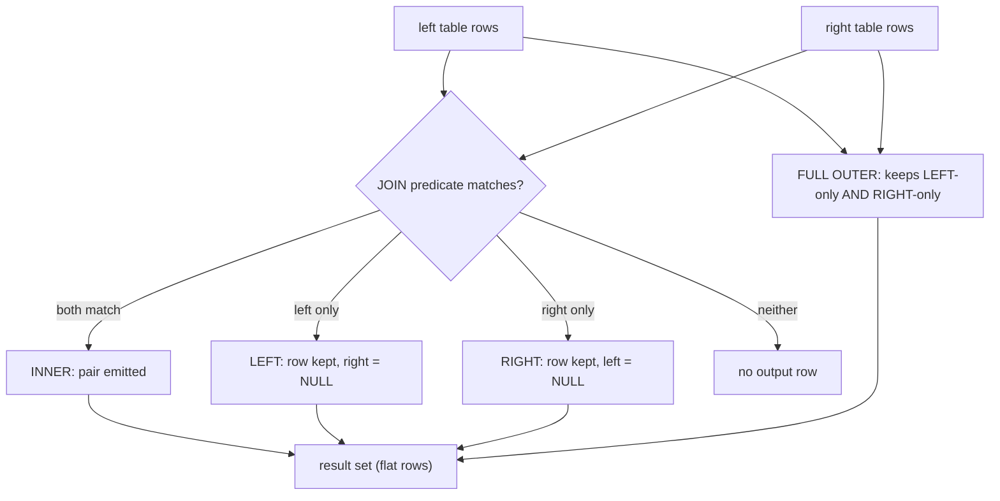

# Joins and Subqueries

## 1. Learning Objectives

After this lesson you can:

- [ ] Write an inner join and predict its row count from both sides' cardinality
      (executed: 8 order lines → 8 joined rows; 6 distinct products)
- [ ] Use `left join` to keep rows with no match and read the `NULL`s it produces
      (executed: 8 products listed, the two never-ordered ones showing `0` units via
      `coalesce`)
- [ ] State what `right join` and `cross join` do, with executed receipts: side-swap
      equivalence (10 = 10 rows) and the full pair count (executed: `32` pairs = 8 × 4)
- [ ] Run a `full outer join` that keeps unmatched rows from **both** sides (executed:
      5 rows — 3 catalog-only categories, 2 target-only categories)
- [ ] Feed a query from itself: scalar subquery in `where` (executed: 2 products above
      the 153.82 average), `in`/`exists` set membership (executed: the same 6 names from
      two formulations), and a derived table (executed), plus a `with` CTE (executed in
      the full-join probe)
- [ ] Diagnose the `not in` NULL trap from its output (executed: 2 rows become **0**
      rows once one `NULL` enters the subquery) and both classic join errors (executed:
      `column reference "id" is ambiguous`)

## 2. Prerequisites

- [Relational Databases](relational-databases.md) — keys and relationships: the `on`
  clause is that relationship, in query form.
- [Filtering and Aggregation](filtering-and-aggregation.md) — `group by`: two of the
  executed queries bucket rows *before* joining.

## 3. Introduction

Normalization (lessons 2–3) deliberately splits data across tables; every interesting
answer spans several of them. A **join** combines rows from two tables where a condition
holds, producing a flat result you can filter and aggregate. A **subquery** is a query
inside a query — used to build a value, a set, or a temporary table for its outer
statement. Together they are the whole composition layer of SQL, and every formulation
below was executed on the lab server.

## 4. The Problem It Solves

Without joins, answering "which products sold, and how many units?" means fetching both
tables into the application and matching them in a loop: two full transfers, O(rows)
code, and a second implementation for every variation of the question. With a join the
server matches sets where the data lives, uses the keys' indexes, and returns only the
answer. Subqueries additionally let one question *reference another question's answer*
("above average") — written once, evaluated consistently, impossible to drift out of sync
with the data.

## 5. Core Concepts

### The join predicate

`join B on A.key = B.key` says which pairs of rows match. **Inner join** emits a result
row per matching pair; pairs with no match produce nothing. Row count comes from
*pairing*, not from either table's size: 8 order lines each matched exactly one product
→ 8 rows (executed P1), while a product with two lines appears twice.

### Preserving rows: left / right / full

- **`left join`** — every row of the left table appears at least once; unmatched rows
  get `NULL` for the right side's columns. This is "all products, even un-ordered ones"
  (executed: 8 rows including the two with no lines — their `units` came out `NULL` and
  `coalesce(sum(...), 0)` rendered `0`).
- **`right join`** — the same with sides swapped: executed, both formulations returned
  **10 rows** (one per matched product-line pair, plus one per product with no lines —
  8 matched lines + 2 unmatched products).
- **`full outer join`** — unmatched rows survive on *both* sides (executed: 5 rows —
  categories only in the catalog, only in the targets table, and matched ones).
- **`cross join`** — every pair, no predicate: 8 products × 4 targets = **32** rows
  (executed). It is the honest cartesian product; accidental cross joins are the
  classic missing-`on` bug.

### Subqueries by role

| Role | Shape | Executed here |
|---|---|---|
| **Scalar** (one value) | `where price > (select avg(price) …)` | 2 rows above 153.82 |
| **Set** (`in`) | `where id in (select product_id …)` | 6 names |
| **Correlated** (`exists`) | `where exists (select 1 … where ol.product_id = p.id)` | same 6 names |
| **Derived table** (in `from`) | `(select … group by …) d` joined on | 6 rows with units |
| **CTE** (`with`) | `with per_cat as (…) select … full join …` | the 5-row full join |

`in` and `exists` answered with the **same six names** — the equivalence is the point:
pick by readability (`exists` for correlated "has any", `in` for a plain set), the
planner makes them perform alike.

### The NOT IN trap

`not in` means "not equal to every member". If the subquery contains a `NULL`, every
comparison becomes unknown, and *no row qualifies* — executed: `not in (products'
lines)` returned **2 rows** (Desk Lamp, Monitor Arm); adding `union all select null`
returned **0 rows**, with no error. `not exists` or `left join … where b.key is null`
are the NULL-proof rewrites.

## 6. How It Works



To evaluate, the server chooses a **join strategy** — nested loop (small/ indexed),
hash join (build a hash of one side), merge join (both sides sorted) — using table
statistics and available indexes; you will read that choice in `EXPLAIN` in the
performance lesson. A subquery in `where` may be executed once (uncorrelated: one
average, reused) or per outer row (correlated `exists`, which the planner stops early
the moment a match is found — that early exit is why `exists` reads "has any?" well).

## 7. Practical Examples

**Example 1 — inner join, then join over an aggregate (executed)**

```sql
select p.name, ol.qty from order_lines ol
  join products p on p.id = ol.product_id
 order by ol.id;
```

```
        name         | qty
---------------------+-----
 Mechanical Keyboard |   2
 Mechanical Keyboard |   1
 USB-C Hub           |   3
 27-inch Monitor     |   1
 Laptop Stand        |   1
 Wired Mouse         |   5
 Wired Mouse         |   2
 4K Monitor          |   1
(8 rows)
```

- Predict: every line names exactly one product (FK!) → 8 lines, 8 result rows;
  products sold twice show twice. The FK from lesson 2 *is* the join's guarantee that no
  line is dropped here.
- The reporting shape — bucket, then join names:

```sql
select p.name, sum(ol.qty) as units
  from order_lines ol join products p on p.id = ol.product_id
 group by p.name
 order by units desc, p.name;
```

```
        name         | units
---------------------+-------
 Wired Mouse         |     7
 Mechanical Keyboard |     3
 USB-C Hub           |     3
 27-inch Monitor     |     1
 4K Monitor          |     1
 Laptop Stand        |     1
(6 rows)
```

Six rows — *inner* join semantics: only products that sold. The two that didn't are
invisible, which is correct for "sales by product" and **wrong** for "all products and
their sales" — the next example.

**Example 2 — left join keeps the unsold (executed)**

```sql
select p.name, coalesce(sum(ol.qty), 0) as units
  from products p
  left join order_lines ol on ol.product_id = p.id
 group by p.name
 order by units desc, p.name;
```

```
        name         | units
---------------------+-------
 Wired Mouse         |     7
 Mechanical Keyboard |     3
 USB-C Hub           |     3
 27-inch Monitor     |     1
 4K Monitor          |     1
 Laptop Stand        |     1
 Desk Lamp           |     0
 Monitor Arm         |     0
(8 rows)                      -- products_total also executed: 8
```

- Eight rows — every product, with `Desk Lamp` and `Monitor Arm` at `0`. The `NULL`s
  the left join produced are *aggregated* (sum of no rows = `NULL`) and then rendered
  (`coalesce(..., 0)`): the two NULL-handling moves are distinct and both belong here.
- Filter **after** the join with care: `where ol.qty > 0` after a left join would drop
  the unmatched rows and silently turn it back into an inner join — put match-agnostic
  filters on the left table (`where p.stock > 0`), or use a subquery.

**Example 3 — right join is the same join, swapped (executed)**

```sql
select count(*) from (select p.name from products p left join order_lines ol on ol.product_id = p.id) a;
select count(*) from (select p.name from order_lines ol right join products p on p.id = ol.product_id) b;
```

```
 left_join_rows  →  10
 right_join_rows →  10
```

Both **10**: 8 matched pairs + 2 unmatched products. `a right join b` preserves b's rows;
`b left join a` preserves b's rows — identical semantics. Teams standardize on `left
join` + table order for readability; the executed equality is why that's safe.

**Example 4 — cross join and full outer join (executed)**

```sql
select count(*) as pairs from products cross join category_targets;   -- 32 = 8 × 4
```

```sql
with per_cat as (select category, count(*) as n from products group by category)
select coalesce(pc.category, t.category) as category, pc.n as products_in_catalog, t.quota
  from per_cat pc
  full join category_targets t on t.category = pc.category
 order by category;
```

```
  category   | products_in_catalog | quota
-------------+---------------------+-------
 audio       |                     |    10      -- target only: nothing built yet
 displays    |                   3 |     5      -- matched
 furniture   |                   2 |     4      -- matched
 lighting    |                     |     6      -- target only
 peripherals |                   3 |           -- catalog only: no target set
(5 rows)
```

- The full join is the "reconciliation report" shape: matched, left-only, right-only in
  one result — here: two categories with quotas but no products, one category with
  products but no quota, two matched.
- The `with` clause (CTE) names the grouped subquery once; it ran before the join and
  is exactly a derived table hoisted for readability.

**Example 5 — scalar subquery: "above average" (executed)**

```sql
select avg(price) from products;                                  -- 153.8214285714285714
select name, price from products where price > (select avg(price) from products) order by price;
```

```
      name       | price
-----------------+--------
 27-inch Monitor | 310.00
 4K Monitor      | 520.00
```

The subquery is computed once and used as a literal — and because `avg` skipped the
NULL price (lesson 5), "above average" means above the 7 known prices. The population
question follows you into every subquery.

**Example 6 — IN, derived table, EXISTS: one set, three shapes (executed)**

```sql
select name from products where id in (select product_id from order_lines) order by name;
select p.name from products p
 where exists (select 1 from order_lines ol where ol.product_id = p.id) order by p.name;
```

Both execute to the **same six names**:

```
 27-inch Monitor / 4K Monitor / Laptop Stand / Mechanical Keyboard / USB-C Hub / Wired Mouse
```

- `in` with an uncorrelated set, `exists` with a correlated probe — same answer, and the
  derived-table version of the units query (executed, 6 rows) shows the third role:
  *a subquery as a table in `from`*, joinable and filterable like any other.

**Example 7 — the NOT IN NULL trap (executed)**

```sql
select name from products where id not in (select product_id from order_lines) order by name;
--  Desk Lamp / Monitor Arm  → 2 rows

select name from products
 where id not in (select product_id from order_lines union all select null) order by name;
--  0 rows, no error
```

- One `NULL` in the subquery and *every* comparison became unknown — the second query's
  "no product is not-in-the-set" is three-valued logic applied to the whole set. This is
  not an edge case to remember fondly: any nullable column in a `not in` subquery
  triggers it. Rewrite as `not exists (...)` or the anti-join
  (`left join … where b.key is null`) and the trap cannot occur.

**Example 8 — both classic join errors (executed)**

```sql
select id from products join order_lines on product_id = products.id limit 1;
-- ERROR:  column reference "id" is ambiguous
-- LINE 1: select id from products join order_lines on product_id = products.id limit 1;
```

Ambiguous columns need qualification (`p.id`) the moment two joined tables share a name
(both have `id`). The message names the column; the fix is an alias discipline —
alias every table in your `from` clause, always.

## 8. Real-World Applications

Order history pages are a left join (customers with zero orders still list); sales
reports are inner joins over aggregates (Example 1); targets-vs-actual and
reconciliation dashboards are full joins (Example 4's `with`/`full join` is the
template); permission checks ("does this user have that role?") are `exists`; dashboards'
"top N with at least X" are grouped joins with `having`. Once you can name the *shape*
of the question — preserved side, bucketing, membership — the query writes itself.

## 9. Common Mistakes

| Mistake | Why it happens | How to recognize it | How to prevent it |
|---|---|---|---|
| Comma-join / forgotten `on` | old SQL style, or a partial edit | result is the cross product (executed 32 pairs — or a much larger number) | explicit `join … on` only; count rows against a prediction |
| Inner join where the question implies all | matching reads as natural | products with no sales vanish from a "product sales" list | ask "can a row of either side be absent?" → left/full |
| `where` on the right table after a left join | filter written last, mechanically | NULLs disappear; answer equals the inner join | filter the left table before/without conditions on the preserved side; `having`/subquery for the rest |
| `not in` over a nullable subquery | shape learned from `in` | *zero* rows, no error (executed) | `not exists` or anti-join by default |
| Unqualified column in a join | shared column names | `column reference "id" is ambiguous` (executed) | alias every table (`p.`, `ol.`) |
| Subquery re-written per row by hand | performance intuition gone wrong | N+1 round trips from application code | move membership/correlation into one statement — the server executes it as one plan |

## 10. Best Practices

- **Join on keys**, ideally indexed ones (the FK columns from lesson 2) — the predicate
  is where the planner's index choices pay off.
- **Standardize on `left join`** and write tables in reading order; reserve `right` for
  the rare query where the preserved side is clearer on the right (both executed equal —
  it's style, not semantics).
- **Default to `not exists` / `left join … is null`** for negative membership; `not in`
  only over subqueries proven NOT NULL — and say so in a comment.
- **Name intermediate results with `with`** when a subquery is read more than once or
  the statement passes three levels of nesting: CTEs are documentation the planner reads
  too.
- **Alias every table from the first line** — it kills the ambiguity error and makes
  multi-table `where` clauses readable.

## 11. Limitations and Trade-Offs

Joins are set operations: the server must materialize/hash/sort enough of each side to
match it, so a query joining three wide tables can cost far more than its row counts
suggest — this lesson's tables make everything free, and the indexes/`EXPLAIN` lessons
give you the instruments to see when that stops being true. Correlated subqueries that
the planner *cannot* push down (certain aggregate-inside-subquery shapes) execute per
row — recognizably slow, correct but expensive; rewriting them as joins or lateral
derived tables is the standard fix, and knowing the rewrite exists is enough for now.
Finally, `full outer join` on large tables both sides is the priciest of the family —
use it for reconciliation of summaries (as executed), not over raw fact tables.

## 12. Practical Exercises

### Introductory

1. **Exercise 1.1** — reproduce Example 1 from memory: the 8-row inner join and the
   grouped units query. Predict both row counts before running.
   **Completion criteria:** both transcripts captured; counts predicted and matched; one
   sentence explaining why Mechanical Keyboard appears twice in the first result and
   once in the second.
2. **Exercise 1.2** — write the left-join version of the units report two ways (sum with
   `coalesce` as executed; and without `coalesce`, reading the raw `NULL`), then state
   which you'd ship and why.
   **Completion criteria:** two executed outputs; the choice argued with the consumer of
   the number named (UI vs CSV export).

### Intermediate

3. **Exercise 1.3** — the reconciliation query: `category_targets` vs actual products
   per category, full outer join, showing three kinds of rows (matched, target-only,
   catalog-only). Then add a fourth column that flags each kind.
   **Completion criteria:** the 5-row result executed; the flag column produced with
   `case` or `coalesce`-logic; each of the three kinds circled in your output.
4. **Exercise 1.4** — answer "products never ordered" three ways: `not in`, `not exists`,
   and the anti-join (`left join … where … is null`). All three must return the same two
   products. Then add one `NULL` `product_id` row to `order_lines` *in a transaction*
   (inserting NULL needs the FK column made nullable — do it in a scratch copy of the
   table instead, then `rollback`) and show `not in` returning zero rows while the other
   two hold.
   **Completion criteria:** four executed outputs (3 agreeing + 1 trap); the trap
   transcript showing no error but wrong results; your written default ("negative
   membership is written as …").

### Independent problem-solving

5. **Exercise 1.5** — a support question: "which customers have spent more than the
   average customer?" — you have `customers(id, name)` and `orders(id, customer_id,
   total)` (create them; seed ≥5 customers and ≥10 orders, some customers with zero
   orders). **Completion criteria:** one query using a derived table or CTE for the
   per-customer totals, a scalar subquery for the average, and the outer comparison —
   executed; a written note on why customers with no orders are (or aren't) in the
   result; and a second variant with a left join proving the zero-spend customers'
   absence is a *semantic* choice, not an accident of formulation.

*Solutions: attempt first. They live in `solutions/` of this subject.*

## 13. Knowledge Check

1. A query "lists all products and their sales" is written with an inner join and a
   product is missing from the output. The developer adds `left join` but still sees 8
   rows where 9 expected — wait, they see fewer: name the two *independent* things that
   must both be right (join type and what's on the "one" side of the pairing) for the
   missing product to appear.
2. `in`, `exists`, and a derived-table join produced identical output in the executed
   probes. Under what circumstance does `in` behave differently — and what does the
   executed `not in` probe prove about the *negative* forms?
3. Rewrite the executed ambiguous-column error two different ways, and say which fix you
   would apply in a ten-table query.

## 14. Completion Criteria

Observable evidence that you have understood this lesson:

- [ ] You can predict inner-join row counts from FK cardinality and verify against the
      executed result
- [ ] You have produced a left-join report with `coalesce` and can point at the NULLs
      the join created
- [ ] You can state what each join type preserves, citing your executed counts (8, 10,
      32, 5)
- [ ] You have written the same membership question as `in` and `exists` with matching
      output, and the negative form in the NULL-proof way
- [ ] You can reproduce the `not in` trap and both join errors from memory, with their
      exact messages

## 15. Summary

- Inner join = pairs that match (8 rows from 8 lines); left join = all of one side plus
  NULLs (`coalesce` turns "no rows" into a number); right is left with sides swapped
  (10 = 10 executed); cross is every pair (32); full keeps unmatched on both sides (5-row
  reconciliation executed).
- Subqueries come in five roles — scalar, `in`, correlated `exists`, derived table, CTE
  — and `in`/`exists` executed to the same six names.
- `not in` + one `NULL` → zero rows, no error; `not exists`/anti-join are the rewrites.
- Ambiguous columns are errors, not warnings: alias every table.
- Join strategy is the planner's choice over indexed keys — the cost question belongs to
  the performance lessons, the semantics question to this one.

## 16. Next Steps

- Next lesson: [Database Design](database-design.md) — deriving the schema itself from
  requirements, where these queries' shapes come from
- Practice: [exercises/](exercises/README.md) — set 5
- Where it is applied: [20 — Project Laboratory](../20-PROJECT-LABORATORY/README.md) —
  Project 03 and Project 04's read endpoints are this lesson's joins behind HTTP
