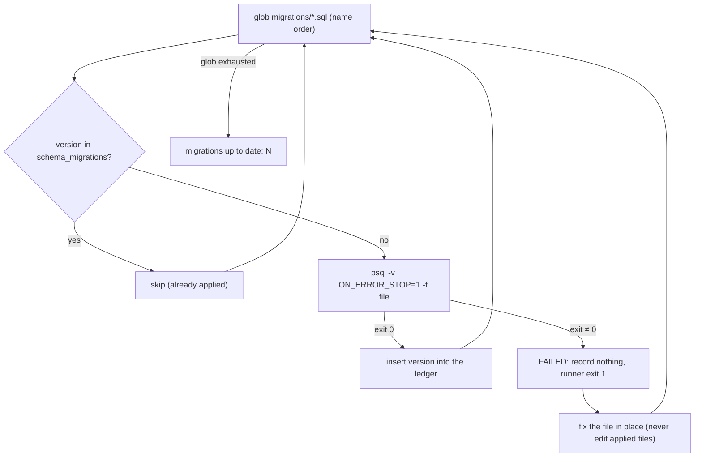

# Migrations

## 1. Learning Objectives

After this lesson you can:

- [ ] Version a schema change as an immutable numbered file and apply it through a
      runner that records each version in a ledger table (executed: `schema_migrations`
      holding exactly `0001_init`, `0002_email_unique`, `0003_fixed` with `applied_at`
      timestamps)
- [ ] Demonstrate apply-once semantics: a second run skips every applied version and
      reports the count (executed: run 3 prints `skip` three times and
      `migrations up to date: 3`, exit 0)
- [ ] Handle a failed migration correctly — stop, roll the statement back, record
      nothing — then fix the file in place and re-run (executed: run 1 applies 0001 and
      0002, `FAILED 0003_fixed … not recorded`, exit 1; run 2 skips the first two and
      applies the fixed 0003)
- [ ] Order a data fix *before* the constraint it makes possible (executed: 0002 seeds
      two rows, then creates the unique index — the index succeeds because the backfill
      ran first)
- [ ] Diagnose partial application in a multi-statement migration and fix it with
      psql's single-transaction flag (executed: without `-1` the failed file left
      `mig_note` with 1 of 2 inserts; with `-1` the whole file rolled back and the
      table never existed)
- [ ] State what this runner deliberately does *not* give you — locking for concurrent
      deploys, rollback files, lock-free DDL — and where each is covered

## 2. Prerequisites

- [Transactions](transactions.md) — a migration's atomicity *is* this lesson's block,
  applied to schema; the aborted-state and rollback semantics assumed here are executed
  there.
- [Constraints and Relationships](constraints-and-relationships.md) — the unique index
  0002 creates, and the rejection it exists to prevent.

## 3. Introduction

A **migration** is a versioned, numbered SQL file that moves the schema from the state
it was in to the next state, once, on every environment. The idea is trivial to state
and hard to keep: the schema in production, the schema in staging, and the schema in
your teammate's head must be the same sequence of applied changes, in the same order,
with a record. This lesson builds the smallest honest runner that does that — a shell
loop, a ledger table, and `ON_ERROR_STOP` — and executes all three of its interesting
paths: success, re-run, and failure.

## 4. The Problem It Solves

Without migrations, schema changes travel as emailed SQL, as "run this before you
deploy" comments in pull requests, or as Hibernate's auto-DDL that quietly differs per
environment. Three failures follow: **drift** (production has a column staging lacks,
so the same code behaves differently), **no record** (nobody can say which databases
are current), and **irreproducible setup** (a new developer reconstructs the schema by
running old scripts in a guessed order and hoping). Migrations replace memory with an
ordered file sequence and a ledger — the database itself answers "what has been
applied?"

## 5. Core Concepts

### The numbered, immutable file

Each change is one file named `NNNN_description.sql`. The name is the version; the
directory glob order is the apply order. **Immutable** means: once any environment has
applied a file, you never edit it — you add a new file. Run 2 below demonstrates why
this rule is safe to rely on: applied versions are skipped by name, so the ledger and
the files can never disagree about *which* version ran.

### The ledger table

```sql
create table if not exists schema_migrations (
  version     text primary key,
  applied_at  timestamptz not null default now()
);
```

`version` as a primary key makes double-application a constraint violation, not a
silent surprise. The ledger is the database's own answer to "what state am I in?" —
queried, auditable, and per-database (executed: three rows with timestamps three
seconds apart, matching the three runs).

### Apply once, skip forever

The runner looks up each filename in the ledger before running it. Applied → `skip`,
not applied → execute, record. This is what makes migrations **re-runnable**: every
deploy runs the same command, and idempotency comes from the ledger rather than from
peppering every statement with `if not exists` (though 0001 and 0002 also use those —
belt and braces with different failure modes: the ledger prevents re-running a file,
`if not exists` softens the statements themselves).

### Backfill before the rule

0002 does two things in one file, in this order:

```sql
insert into mig_member (email) values ('a@example.org'), ('b@example.org');
create unique index if not exists mig_member_email_key on mig_member (email);
```

The data fix comes first because a constraint is validated against existing rows the
moment it is created. Reverse the order on any table that already contains a duplicate
and the index creation fails. This *expand → backfill → constrain* ordering is the
single most transferable pattern in the lesson.

### Stop on the first error

`-v ON_ERROR_STOP=1` makes psql exit non-zero on the first failed statement instead of
plowing through the rest of the file. Without it, a failed `create table` followed by
five statements referencing that table produces five more errors and a half-applied
file. The runner branches on that exit code: success → record and continue; failure →
`exit 1`, record nothing.

## 6. How It Works



The loop is deliberately boring: check, run, record. All the design lives in the two
decisions the diagram shows — a failure **stops the line** rather than continuing, and
it leaves **no ledger row**, so the next run retries exactly the file that failed.

## 7. Practical Examples

*All transcripts below executed on the authoring machine: PostgreSQL 18.6 / psql 18.6,
Windows 11 + Git Bash, database `mig` dropped and recreated before the capture.*

**Example 1 — the runner, then its three runs (executed)**

The runner (`migrate.sh`), verbatim:

```bash
#!/usr/bin/env bash
# Tiny migration runner: applies untracked files in name order, records them, stops on error.
set -u
B="/c/Program Files/PostgreSQL/18/bin"
PQ=("$B/psql.exe" -w -h 127.0.0.1 -p 5433 -U lab -d mig)
"$B/createdb.exe" -h 127.0.0.1 -p 5433 -U lab mig 2>/dev/null || true
"${PQ[@]}" -q -c "create table if not exists schema_migrations (version text primary key, applied_at timestamptz not null default now());"
for f in /c/Users/PC/AppData/Local/Temp/b12/migrations/*.sql; do
  v=$(basename "$f" .sql)
  done=$("${PQ[@]}" -tAc "select count(*) from schema_migrations where version = '$v'")
  if [ "$done" = "1" ]; then echo "skip     $v (already applied)"; continue; fi
  if "${PQ[@]}" -q -v ON_ERROR_STOP=1 -f "$f"; then
    "${PQ[@]}" -q -c "insert into schema_migrations (version) values ('$v');"
    echo "applied  $v"
  else
    echo "FAILED   $v - transaction rolled back, not recorded"; exit 1
  fi
done
echo "migrations up to date: $("${PQ[@]}" -tAc 'select count(*) from schema_migrations')"
```

Executed output — run 1 has 0003 broken on purpose, run 2 fixes the file, run 3 has
nothing to do:

```
=== run 1: fresh database, 0003 is broken
applied  0001_init
applied  0002_email_unique
psql:C:/Users/PC/AppData/Local/Temp/b12/migrations/0003_fixed.sql:2: ERROR:  relation "no_such_table" does not exist
FAILED   0003_fixed - transaction rolled back, not recorded
exit=1
=== run 2: 0003 fixed in place, no ledger record of the failure
NOTICE:  relation "schema_migrations" already exists, skipping
skip     0001_init (already applied)
skip     0002_email_unique (already applied)
applied  0003_fixed
migrations up to date: 3
exit=0
=== run 3: nothing to do
NOTICE:  relation "schema_migrations" already exists, skipping
skip     0001_init (already applied)
skip     0002_email_unique (already applied)
skip     0003_fixed (already applied)
migrations up to date: 3
exit=0
=== ledger
      version      |          applied_at
-------------------+-------------------------------
 0001_init         | 2026-10-26 17:45:34.084808+03
 0002_email_unique | 2026-10-26 17:45:34.619322+03
 0003_fixed        | 2026-10-26 17:45:36.62494+03
(3 rows)
```

- The failure in run 1 stopped the loop — 0003 was the last file here, but on a longer
  line nothing after it would have run either.
- The ledger in run 2 proves "no record of the failure": only successful versions
  appear, so retry semantics are automatic.
- **Expected output** for your own run: same shape, your timestamps.
- **How to run it:** create the three files (0001 and 0002 as shown below, any failing
  0003), then `bash migrate.sh` three times.
- **Assumptions:** PostgreSQL 18, psql on `PATH` or the `B=` path edited, Git Bash or
  any POSIX shell.

**Example 2 — backfill before the rule (executed inside run 1)**

```sql
-- 0002: a real data fix first (two rows would break the new rule), then the rule
insert into mig_member (email) values ('a@example.org'), ('b@example.org');
create unique index if not exists mig_member_email_key on mig_member (email);
```

- The `insert` is the **backfill**: it establishes the state the constraint requires.
- The `create unique index` is the **rule**: it succeeds only because the backfill ran
  first.
- **Expected output:** `applied 0002_email_unique`, no error.
- **How to run it:** part of run 1 above.
- **Assumptions:** `mig_member` from 0001 is empty or already duplicate-free — the
  pattern is: clean the data, then enforce.

**Example 3 — one failed file, two transactional answers (executed)**

A three-statement file whose last statement fails:

```sql
-- 0004: multi-statement file where the LAST statement fails
create table mig_note (id serial primary key, body text not null);
insert into mig_note (body) values ('written first');
insert into nope (x) values (1);
```

Without single-transaction mode (plain `psql -v ON_ERROR_STOP=1 -f`):

```
=== multi-statement migration WITHOUT single-transaction (autocommit per statement)
EXIT=3
mig_note rows surviving (table exists, first insert stuck): 1
-- stderr: psql:...0004_multi.sql:4: ERROR:  relation "nope" does not exist
```

The same file with `psql -1` (single transaction):

```
=== clean run WITH -1 (single transaction)
EXIT=3
t
-- stderr: psql:...0004_multi.sql:4: ERROR:  relation "nope" does not exist
-- stdout line `t` = to_regclass('mig_note') is null → table_absent_after_failed_txn
```

- **The seam this proves:** `ON_ERROR_STOP` stops the run, but only `-1` makes the
  *file* atomic. Autocommit mode committed statements 1 and 2 individually, leaving a
  table with one row — a half-migrated schema that the ledger would happily record as
  complete if you only checked the exit path.
- **Expected output:** first run leaves `mig_note` with 1 row; with `-1`, the table
  does not exist afterward (`t`).
- **How to run it:** the two psql invocations above against a scratch database.
- **Assumptions:** psql 18; exit code 3 is psql's script-error code under
  `ON_ERROR_STOP`.

## 8. Real-World Applications

Every framework ecosystem ships this pattern as a tool — Flyway and Liquibase in the
Java/Spring world, Rails' `db/migrate`, Django's numbered apps, EF Core migrations, Alembic
for Python — and all of them are Example 1 with more features: checksums to detect an
edited applied file, an advisory lock so two concurrent deploys can't interleave, and a
`down` file per version. In CI the migration job runs before the deploy job against a
scratch database, which is exactly what run 1 does; in production the same command runs
once, and the ledger row is the deploy's evidence. Schema changes inside rolling
deploys use *expand → backfill → constrain* (Example 2) so old and new application
versions both work against the schema during the window.

## 9. Common Mistakes

| Mistake | Why it happens | How to recognize it | How to prevent it |
|---|---|---|---|
| Editing an already-applied file | "quick fix" to a shipped migration | environments disagree on what `0002` contains | treat applied files as immutable; fix-forward with `0004`, never rewrite `0002` |
| Assuming `ON_ERROR_STOP` rolls the whole file back | the phrase *rolled back* in runner output | half-applied schema after a mid-file failure (executed: `mig_note` = 1 row) | run every migration with `psql -1` (executed contrast: table absent) |
| Constraint before backfill | order not thought through | `create unique index` fails on real data that test data never had | expand → backfill → constrain, one file or three — order is the discipline |
| Hand-running DDL on production | emergency fix, no migration written | ledger has fewer rows than the schema has objects | every change is a file first; the hotfix becomes `0005` before you go home |
| Migrating while the old app version still serves traffic | deploy = migrate + roll out as one step | old code inserting into a not-yet-expanded table | expand first, deploy code, contract later — the split deploy |
| Skipping the ledger ("I'll just run them all") | runner seen as overhead | no way to answer "what is applied here?" | the ledger *is* the product; the loop is 10 lines |

## 10. Best Practices

- **Never edit an applied migration.** The skip-by-name logic in Example 1 only works
  if a version means one thing forever; the moment environments can disagree about a
  file's content, the ledger lies. Add a new numbered file instead.
- **Wrap each file in one transaction** (`psql -1`). Example 3 shows the cost of not
  doing it: the ledger and reality can diverge within a single file. The runner here
  stops at the exit code but relies on autocommit — that is the honest seam, and `-1`
  is the fix.
- **Data before constraints, always.** 0002's ordering is cheap insurance: backfill,
  verify, then enforce. Verification is a `select count()` of the rows that would
  violate the new rule — return zero, then constrain.
- **Run migrations in CI against a scratch database on every merge.** Run 1 *is* that
  job: fresh database, full sequence, non-zero exit fails the build.
- **Keep migrations small and single-purpose** so a failure names the change, not a
  40-statement file's line 37.
- **Record the run, not just the schema:** `applied_at` timestamps (the ledger above)
  tell you *when* each environment crossed each version — the first question in any
  incident that touches data.

## 11. Limitations and Trade-Offs

This runner is forward-only: there are no `down` migrations, so undoing `0003` means
writing `0004` that reverses it. That is a deliberate trade — down files are the part
of a migration tool nobody tests until they desperately need it, and schema reversals
often can't restore dropped data anyway. What you give up versus Flyway/Liquibase and
framework tools: **checksums** (detecting an edited applied file), **advisory locking**
(two simultaneous deploys can interleave — PostgreSQL's `pg_advisory_lock` is the
standard fix, cited from the docs, not executed here), and **dry runs**. Long-running
DDL is also outside this lesson: `alter type ... add value` and large index builds hold
locks or take time proportional to the table — the online-index and lock-timeout
techniques belong to the operations reading after DB-16. Finally, migrations version
*schema*, not *data*: once 0002's insert committed, no ledger operation undoes it.

## 12. Practical Exercises

### Introductory

1. **Exercise 1.1** — rebuild Example 1 from memory: three SQL files, the runner, and
   three executed runs (fail → fix → no-op), each run's full output captured.
   **Completion criteria:** run 1 exits non-zero with `FAILED` and no ledger row for the
   broken version; run 2 shows two `skip` lines and one `applied`; run 3 shows three
   `skip` lines; the ledger query output pasted after each run.
2. **Exercise 1.2** — execute Example 3's contrast yourself: the same three-statement
   failing file without `-1` and with `-1`, querying the table's existence after each.
   **Completion criteria:** both transcripts; one sentence naming exactly which
   statements survived in the autocommit run and why (`mig_note` counted 1 row here);
   the psql exit code in both runs explained.

### Intermediate

3. **Exercise 1.3** — add `0004_add_phone.sql` to a live sequence: a nullable column
   (expand), a backfill that sets a default value for existing rows, then a `not null`
   constraint — all in one file, executed end-to-end, with a row count selected before
   the backfill and after it.
   **Completion criteria:** one executed transcript showing `applied 0004_add_phone`;
   proof the backfill touched exactly the pre-existing rows; the ordering argument
   written ("what error would the reverse order produce?").
4. **Exercise 1.4** — break the ledger's trust: after a successful run, edit an
   applied file and run again (observe: it skips), then create a *new* version whose
   content duplicates the edited one (observe the constraint-level consequences).
   **Completion criteria:** both transcripts; the immutability rule justified with what
   you saw rather than asserted; the checksum feature named as the tool that would
   catch your edit (not executed here).

### Independent problem-solving

5. **Exercise 1.5** — take a real application of yours (or the Project Laboratory's
   schema) and produce its migration history from scratch: every schema change as a
   numbered file, ordered so each one is valid against the state the previous left,
   with data fixes placed before the constraints that depend on them. Execute the whole
   sequence against a freshly created database and then against a second, empty one to
   prove reproducibility.
   **Completion criteria:** the file list with a one-line rationale each; two clean
   full-sequence runs from zero, both ending `migrations up to date: N` with matching
   N; at least one file containing a backfill-before-constraint pair; a written
   statement of what your runner still lacks from section 11 and which of those gaps
   matters first for your deployment setup.

*Solutions: attempt first. They live in `solutions/` of this subject.*

## 13. Knowledge Check

1. Run 1 fails on 0003 and the runner prints `not recorded`. Why is leaving the ledger
   unchanged — rather than writing a `failed` row — the correct retry semantics, and
   what would break if failures were recorded?
2. Example 3's autocommit run left `mig_note` holding one row while `ON_ERROR_STOP`
   was set. Which guarantee did `ON_ERROR_STOP` provide, which did it *not*, and what
   single flag closes the gap?
3. A teammate proposes fixing production directly and adding the migration "tomorrow."
   Using the skip-by-name mechanism from run 2, describe the exact divergence that
   tomorrow's `0002` would produce and how you would detect it.

## 14. Completion Criteria

Observable evidence that you have understood this lesson:

- [ ] You have executed a fail → fix → no-op runner sequence and can quote each run's
      output and exit code from memory
- [ ] The ledger query after your runs shows exactly the applied versions with
      timestamps, and you can explain why a failed version is absent
- [ ] You have produced the partial-application state (table present, row stuck) and
      the `-1` rollback state (table absent) on your own machine
- [ ] You can write a backfill-then-constraint migration and state the error the
      reversed order would raise
- [ ] You can name three things this runner lacks (section 11) and the tool or feature
      that supplies each

## 15. Summary

- A migration is an immutable numbered file; the ledger table, not memory, records
  what each database has applied (executed: 3 rows, 3 runs).
- The runner's loop is check → run → record; failure stops the line and records
  nothing, which is exactly the retry contract (executed: `FAILED 0003_fixed`, then a
  clean `applied 0003_fixed` after the fix).
- `ON_ERROR_STOP` stops the run; only `psql -1` makes the file atomic (executed:
  autocommit left 1 row of a 3-statement file; `-1` left no table at all).
- Constraints are created after their data fix: 0002 backfilled, then indexed.
- Forward-only and unlocked is a starting point, not a production tool — checksums,
  advisory locks, and online DDL are the named next gaps.

## 16. Next Steps

- Next lesson: [Backups and Recovery](backups-and-recovery.md) — migrations keep the
  schema correct going forward; backups are what you have when everything above is
  applied to the wrong database
- Practice: [exercises/](exercises/README.md) — set 15
- Where it is applied: [20 — Project Laboratory](../20-PROJECT-LABORATORY/README.md) —
  the project briefs' schema evolves as numbered migrations, never as hand-run DDL
