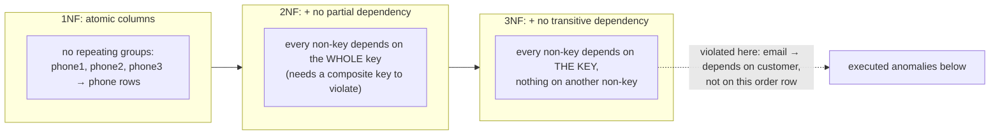
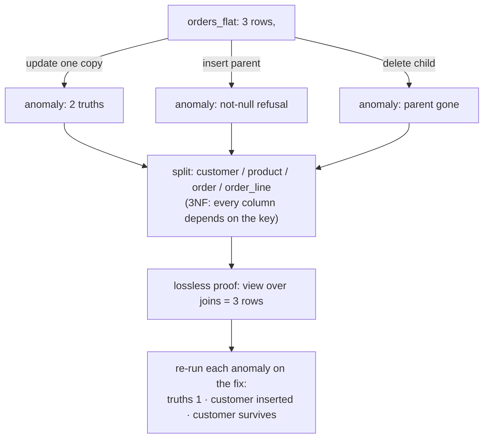

# Normalization

## 1. Learning Objectives

After this lesson you can:

- [ ] Name the three normal forms as *dependency rules*, not slogans (1NF: atomic
      columns; 2NF: no partial dependency on part of a composite key; 3NF: no dependency
      on a non-key column)
- [ ] Execute all three anomalies a denormalized table produces (executed: **update** →
      one customer with 2 email "truths"; **insert** → a customer without an order
      rejected by not-null; **delete** → deleting one row deletes the customer entirely)
- [ ] Repair the table into 3NF and prove the repair is *lossless* (executed: the
      join-view returns exactly the original 3 rows)
- [ ] Re-execute each anomaly against the repaired schema and watch it disappear
      (executed: truths `2 → 1`, customer-without-order inserted, orders deleted with the
      customer surviving)
- [ ] Say when breaking a normal form is correct — and justify the copy in one sentence
      (the design lesson's `unit_price` snapshot is the running example)

## 2. Prerequisites

- [Database Design](database-design.md) — entities, keys, and the one sanctioned copy;
  this lesson audits exactly that question rigorously.
- [Joins and Subqueries](joins-and-subqueries.md) — the repair is proven by joining the
  parts back together.

## 3. Introduction

**Normalization** is the set of rules that removes duplicated facts from a schema. It is
not aesthetic: every duplicated copy of a fact is a place where copies can disagree, and
the three classic **anomalies** (update, insert, delete) are how disagreement arrives.
This lesson executes each anomaly on a deliberately flat table, repairs the schema into
third normal form, proves nothing was lost in the repair, and then re-runs the anomalies
against the fixed schema to watch them fail.

## 4. The Problem It Solves

The flat `orders_flat` table — every fact on every row — is how application developers
*start* when the database is treated as a spreadsheet. It reads easily and dies badly:
one `update` writes a new email into one of two rows and the customer now has two
addresses (executed: `truths = 2`); a customer who hasn't ordered cannot be represented
at all; deleting their single order erases them. Normalization replaces the copies with
references, and the anomalies with joins — which the database executes for you.

## 5. Core Concepts

### The dependency vocabulary

A **functional dependency** `A → B` means: for a given `A`, only one `B` can be true.
Keys determine everything (that's their job); the *interesting* dependencies are the
non-key ones:



- **1NF** — each column holds one atomic value: `phone1/phone2/phone3` violates it (one
  *phone* fact, three columns); the fix is a `phone` table (rows are atomic).
- **2NF** — 1NF plus: no column depends on only *part* of a composite key. In a line
  table keyed `(order_id, product_id)`, a `product_name` depending on `product_id` alone
  is a 2NF violation — `product_name` belongs to `product`.
- **3NF** — 2NF plus: no column depends on a *non-key* column. In `orders_flat`,
  `customer_name` depends on `customer_email` (a non-key), not on the row's identity —
  the executed update anomaly **is** this violation firing.

### The three anomalies (the definition in executable form)

| Anomaly | Question the flat table can't answer | Executed |
|---|---|---|
| update | "change one fact" → copies disagree | `truths = 2` for Ada |
| insert | "record a thing with no children yet" | not-null rejection, failing row quoted |
| delete | "remove one child" → parent vanishes | `grace_rows_left = 0` |

A schema in 3NF has no update/insert/delete anomalies for its key-determined data —
that claim is exactly what the repair phase re-tests.

### Losslessness

Splitting a table is only correct if the data can be put back: the **lossless-join**
property means `join(parts) = original`. Executed: the repaired schema re-derives the
flat shape through `orders_flat_v`, returning the **same 3 rows** the flat table started
with. If the view returned 2 or 4 rows, the split lost or invented data.

### When to break a rule

`order_line.unit_price` duplicates `product.price` — deliberately (lesson 7): the two
copies represent *different facts* (agreed-at-order-time vs current-catalog), so they
may legitimately differ. The normalization test for any copy: **name the two facts and
why they may disagree.** "No reason, just convenient" is the smell.

## 6. How It Works

Anomaly → repair → proof → re-test, executed end to end:



## 7. Practical Examples

**Example 1 — the flat table and its update anomaly (executed)**

```sql
create table orders_flat (
  id serial primary key, customer_email text not null, customer_name text not null,
  product_sku text not null, product_name text not null,
  qty integer not null, unit_price numeric(10,2) not null
);
-- three rows: Ada ×2, Grace ×1 → flat_rows = 3
update orders_flat set customer_email = 'ada2@example.org' where id = 1;
select customer_name, count(distinct customer_email) as truths
  from orders_flat group by customer_name order by customer_name;
```

```
 customer_name | truths
---------------+--------
 Ada Lovelace  |      2
 Grace Hopper  |      1
(2 rows)
```

One `update`, one business fact changed — and Ada now has **two** addresses stored as
equal-looking rows. Every report answering "what's Ada's email?" now has two valid
sources. This is the 3NF violation made visible: `email` depended on the *customer*, and
the flat table had nowhere customer-shaped to put it.

**Example 2 — insert and delete anomalies (executed)**

```sql
insert into orders_flat (customer_email, customer_name) values ('alan@example.org', 'Alan Turing');
```

```
ERROR:  null value in column "product_sku" of relation "orders_flat" violates not-null constraint
DETAIL:  Failing row contains (4, alan@example.org, Alan Turing, null, null, null, null).
```

```sql
delete from orders_flat where customer_email = 'grace@example.org';
select count(*) as grace_rows_left from orders_flat where customer_name = 'Grace Hopper';
```

```
 grace_rows_left
-----------------
               0
```

The insert proves a customer *exists only through an order* here (the parent fact is
stuck inside child rows); the delete proves the reverse — removing one order removed
the customer. Two anomalies, one cause: the customer has no table.

**Example 3 — the repair, and the lossless proof (executed)**

```sql
create table customer (id serial primary key, email text not null unique, name text not null);
create table product  (id serial primary key, sku  text not null unique, name text not null);
create table "order" (id serial primary key, customer_id integer not null references customer(id));
create table order_line (
  id serial primary key, order_id integer not null references "order"(id),
  product_id integer not null references product(id),
  qty integer not null, unit_price numeric(10,2) not null
);
-- same three facts: 2 customers, 3 products, 3 orders, 3 lines
create view orders_flat_v as
  select c.email as customer_email, c.name as customer_name,
         p.sku as product_sku, p.name as product_name, ol.qty, ol.unit_price
    from order_line ol
    join "order" o on o.id = ol.order_id
    join customer c on c.id = o.customer_id
    join product p on p.id = ol.product_id;
select count(*) as view_rows from orders_flat_v;
```

```
 view_rows
-----------
         3
(1 row)
```

The flat shape is *re-derived*, not retained: 3 rows out of the join, matching the 3 the
flat table began with — nothing lost, nothing invented. Each non-key column now depends
on exactly the key that determines it (`product_name` → `product`, `customer_name` →
`customer`), which is 3NF stated mechanically.

**Example 4 — re-run every anomaly against the repair (executed)**

```sql
update customer set email = 'ada2@example.org' where name = 'Ada Lovelace';
select customer_name, count(distinct customer_email) as truths
  from orders_flat_v group by customer_name order by customer_name;

insert into customer (email, name) values ('alan@example.org', 'Alan Turing');

delete from order_line where order_id = 3;
delete from "order"   where customer_id = 2;
select count(*) as grace_orders   from "order"   where customer_id = 2;
select count(*) as grace_customer from customer  where email = 'grace@example.org';
```

```
 customer_name | truths          -- one write → both derived rows agree
---------------+--------
 Ada Lovelace  |      1
 Grace Hopper  |      1

 customers_total = 3             -- Alan exists with zero orders

 grace_orders   | 0              -- orders gone
 grace_customer | 1              -- Grace remains
```

All three anomalies, re-executed on the fixed schema: **1 truth** (the view reads both
rows from the one stored value), the parent **inserts** without children, and deleting
children **keeps** the parent — because the customer row's existence no longer hangs on
an order row. (Note the executed order of deletes: `order_line` had to go before
`order`, or the FK from lesson 2 refuses — child-first is the delete order the schema
itself dictates.)

## 8. Real-World Applications

Normalization is why a billing system can change a customer's address once, why
inventory counts survive product renames, and why "update user" is one `update`
statement instead of a scan over every historical row. Denormalization *also* appears in
practice — data warehouses, reporting tables, caching layers — and it is correct there
because the copy's reason is written down ("this warehouse trades update anomalies for
read speed on 10-year reports"). The skill is the justification, not the dogma.

## 9. Common Mistakes

| Mistake | Why it happens | How to recognize it | How to prevent it |
|---|---|---|---|
| Normalizing by rote ("always 3NF!") | rules memorized without reasons | join count explodes for a fixed read path | normalize by default; denormalize with a written reason + measurement |
| "It's just one copy" | copy added for convenience | two columns/tables hold the same fact, no reason stated | the design lesson's test: name the two facts and why they may differ |
| Skipping 2NF because keys are single-column | 2NF needs a composite key to violate | fine — 2NF is vacuous with single-column keys | know *why* it's satisfied, don't assume |
| Views used to *hide* non-3NF storage | convenience | anomalies still execute underneath; the view just reroutes them | fix storage; use views for presentation only |
| jsonb blob holding customer facts | "schema flexibility" | email updates require jsonb surgery; no unique | facts you filter/update/query → columns and tables (the DB-18 lesson prices the valve) |
| Deleting children without reading FKs | order of operations ignored | `violates foreign key constraint` (executed) | children first, or `on delete cascade` where ownership justifies it |

## 10. Best Practices

- **Default to 3NF for transactional data**, then denormalize per case with the reason
  in a comment — the executed repair shows how cheap correctness is to build.
- **Unique on every natural key you reference** (`email`, `sku`) — the repair's
  `unique` columns are what make "one stored truth" enforceable.
- **Prove losslessness with a view** after any split: the `count` (or an `except`
  against a snapshot) is a two-line test that catches a wrong join forever.
- **Re-run the anomaly battery after schema changes** — update one fact, insert a
  childless parent, delete one child; three queries, the whole property tested.
- **Keep the one sanctioned copy explicit**: `unit_price` on the line, with its
  sentence.

## 11. Limitations and Trade-Offs

Normalization optimizes for write consistency and storage economy; it costs joins at
read time — at warehouse scale (billions of rows, mostly read) the trade flips and
star/snowflake *denormalization* becomes correct — which is why BI schemas look "wrong"
through this lesson's lens. 3NF says nothing about performance, history (an `order_line`
row is already an event), or temporal facts ("current discount" needs time columns, not
more forms). And higher forms (BCNF, 4NF) exist for edge cases where two candidate keys
interact; you should recognize the phrase, not fear it.

## 12. Practical Exercises

### Introductory

1. **Exercise 1.1** — reproduce Example 1 from memory on your own flat table (any data
   you like, ≥4 rows, one fact stored twice): execute the update anomaly, quote the
   `truths` count, then state which normal form it violates and why in dependency terms.
   **Completion criteria:** the executed anomaly; the dependency written as `column →
   column`; the violated form named with its rule.
2. **Exercise 1.2** — take a table with `phone1, phone2, phone3` columns (create it,
   seed one person with two phones): show it violates 1NF's atomicity, split it into
   rows, and query all phones with one `select`.
   **Completion criteria:** before/after DDL; the query returning 2 rows for 1 person;
   one sentence on what the split made *expressible* (a third phone = a row, not an
   `alter table`).

### Intermediate

3. **Exercise 1.3** — execute the full repair cycle on a table of yours: anomalies
   (update/insert/delete), the normalized split, a lossless-view row-count proof, and
   the anomaly re-runs.
   **Completion criteria:** six executed transcripts (3 anomalies, 3 repairs' receipts);
   the lossless count matching; a written note on any anomaly that *still* exists after
   3NF (hint: one of them may be a business rule, not a dependency problem).
4. **Exercise 1.4** — the partial-dependency hunt: given line rows keyed
   `(order_id, product_id)` containing `product_name`, `product_category`, `customer_email`
   — list every dependency, mark which are partial (2NF) vs transitive (3NF), then write
   the DDL that removes each.
   **Completion criteria:** the dependency list with classifications; the new DDL
   executed; one `select` proving the original row is re-derivable (lossless).

### Independent problem-solving

5. **Exercise 1.5** — a teammate insists their `report` table (one row per sale,
   containing `customer_city`, `customer_zip`, `product_category`, `salesperson_region`)
   is fine because "reads are fast; it's small." Produce the audit: every dependency,
   the anomalies with executed receipts, and a cost/benefit paragraph — then either
   normalize it or *defend* keeping it, with the written reason and the anomaly you're
   accepting. **Completion criteria:** dependency map; at least one executed anomaly on
   their table; the keep/fix verdict argued with the copies named; if keeping, the
   monitoring/repair plan stated (who fixes the drift, when).

*Solutions: attempt first. They live in `solutions/` of this subject.*

## 13. Knowledge Check

1. Classify each as 1NF, 2NF, or 3NF violation — or none: (a) `order_line.customer_email`
   in a table keyed `(order_id, product_id)`; (b) three `allergy1..3` columns on a
   patient row; (c) a `discount_percent` column on `product` that depends on the
   product's `category`?
2. The lossless-join view returned 4 rows instead of 3. What class of mistake in the
   split does that indicate (lost vs duplicated fact), and what's the first thing to
   check in the joins?
3. Give one reason denormalizing `unit_price` onto the order line is correct and one
   reason copying `customer_email` onto the order would not be — and say what makes the
   difference.

## 14. Completion Criteria

Observable evidence that you have understood this lesson:

- [ ] You can state all three normal forms as dependency rules with an example of each
      violation
- [ ] You have executed the update/insert/delete anomalies on a flat table and quoted
      the outputs
- [ ] You have rebuilt the data in 3NF and proven losslessness with a row count
- [ ] You have re-run the anomaly battery on the repaired schema and captured the
      "disappeared" results
- [ ] You can defend a deliberate copy by naming the two facts it represents

## 15. Summary

- Normal forms are dependency rules: atomic columns → whole-key dependencies →
  key-only dependencies; violating them produces the three executed anomalies.
- The flat table showed all three: `truths = 2`, a not-null refusal for a childless
  customer, and a customer deleted by deleting her order.
- The repair splits facts to their determining key and is proven by a lossless join
  (3 rows re-derived).
- Re-running the anomalies on the fix: `truths = 1`, customer inserted, customer
  survives deletion.
- Denormalize only with a written reason; `unit_price` is a different fact than the
  catalog price, and that sentence is the whole test.

## 16. Next Steps

- Next lesson: [Constraints and Relationships](constraints-and-relationships.md) — the
  full constraint toolbox (including two PostgreSQL tools this lesson leaned on: `check`
  and `exclusion`)
- Practice: [exercises/](exercises/README.md) — set 9
- Where it is applied: [20 — Project Laboratory](../20-PROJECT-LABORATORY/README.md) —
  Project 03's schema review includes this anomaly battery as evidence
