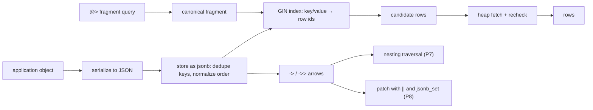

# NoSQL Fundamentals

## 1. Learning Objectives

After this lesson you can:

- [ ] Name the four non-relational families (document, key-value, column-family,
      graph), what each optimizes for, and when a relational engine still wins
- [ ] Read and write document data with the `jsonb` arrow operators and state the
      type split precisely (executed: `->` returns jsonb `12`, `->>` returns text
      `keyboard`)
- [ ] Distinguish the three nulls that confuse every document beginner
      (executed: `jsonb_typeof` of an explicit JSON null is `'null'`, of a missing key
      is SQL `NULL`; `->>` of a JSON null gives SQL `NULL` while `->` does not)
- [ ] Predict how a document store canonicalizes input before storing it
      (executed: duplicate keys collapse to the last value in `jsonb` but both survive
      in `json`; key order is normalized to `{"b": 1, "aa": 2, "zzz": 3}`)
- [ ] Query documents by content with containment and measure the index that makes it
      scale (executed: `@>` selection of 12,501 of 50,004 rows — 13.549 ms seq scan
      with `Rows Removed by Filter: 37503` → **10.736 ms** bitmap scan via a GIN index
      whose index build was 2.611 ms)
- [ ] Traverse, merge, and patch nested data with executed operators
      (executed: `jsonb_array_elements_text` exploded 1 row into 3, `||` merged with
      left-side conflict wins, `jsonb_set` patched `stock` to 0)
- [ ] State honestly which document engine was executed here and which claims are
      mapped from the general model (the MongoDB-shaped seam in section 11)

## 2. Prerequisites

- [SQL Fundamentals](sql-fundamentals.md) — the relational baseline this lesson
  contrasts against; every `select` here assumes that ladder.
- [Indexes](indexes.md) — the GIN explain output in section 7 reads like the seq-vs-
  index decision you already executed there, with a different access method.
- [Normalization](normalization.md) — *why* documents exist: repeated structure the
  update anomalies made painful.

## 3. Introduction

**NoSQL** ("Not only SQL") names the storage models that stopped requiring a fixed,
pre-joined schema: documents, key-value pairs, wide columns, graphs. The heart of the
movement is the **document** — a self-describing blob (JSON-shaped) whose fields can
differ from record to record, so the shape of data becomes something the application
decides per row rather than something a `create table` decided once. PostgreSQL has an
excellent document type, `jsonb`, which is what this lesson executes: the document
model's semantics — typing, canonicalization, containment queries, document indexes —
against the same server you've used all along, with a mapping table to the dedicated
engines in section 11.

## 4. The Problem It Solves

The relational model answers "what is the shape of this data?" once, in DDL, and every
row conforms. That is a gift until the shape keeps moving: product catalogs where
keyboards have switches and desks have materials; profiles where some users have two
addresses and others none; event payloads from twenty producers who each invented
their own fields. The pre-document workaround was EAV (entity-attribute-value: one
table of name/value rows), `text` columns stuffed with ad-hoc formats, or a `jsonb`-less
era of ALTER TABLE churn — all slow to write, painful to read, and hostile to indexes.
Documents invert the default: store the shape with the data, index what you query, and
let each record speak for itself.

## 5. Core Concepts

### The four families

| Family | What it stores | Optimizes for | Typical use |
|---|---|---|---|
| **Document** | JSON/BSON records, schema-per-document | flexible shape, nested reads | catalogs, profiles, event payloads |
| **Key-value** | opaque value per key | extreme simplicity and speed | caches, sessions, feature flags |
| **Column-family** | sparse wide rows grouped by column | scans over time-series/histories | analytics, logging at scale |
| **Graph** | nodes + edges as first-class | relationship traversal | social, fraud, recommendation |

They are not opposites of SQL — PostgreSQL *is* SQL with a document type, and the
widely-deployed document engines (MongoDB, Couchbase, Firestore) still offer querying,
indexing, and transactions. The real axis is **fixed vs. negotiated shape**.

### Arrows: two operators, two types

`->` keeps JSON (returns `jsonb`), `->>` converts to text (returns `text`). Executed
P1: from one document, `-> 'stock'` → `12` (a jsonb number), `->> 'name'` → `keyboard`
(text). Every subsequent choice follows from this split: chain `->` while the value is
still structure, switch to `->>` at the leaf when you want text for SQL.

### Three nulls (executed P2)

```
 explicit_null_typeof | missing_key_typeof
 null                 |                      ← typeof: 'null' vs SQL NULL
 text_arrow_gives_sql_null | json_arrow_gives_sql_null
 t                           f
```

A stored JSON `null` is a *value* (`jsonb -> ...` returns it — not SQL `NULL`); a
missing key returns SQL `NULL`; and `->>` of a JSON null collapses to SQL `NULL`.
`jsonb_typeof()` is the disambiguator because output display cannot be trusted: both
nulls print as `null`. Get this wrong and `coalesce` logic silently misreads "field
present but null" as "field absent."

### Canonicalization: you don't store what you typed (executed P3, P4)

```
 as_jsonb |    as_json
 {"a": 2} | {"a":1,"a":2}

 reordered: {"b": 1, "aa": 2, "zzz": 3}
```

`jsonb` keeps the *last* duplicate key and reorders keys canonically (length, then
bytes) — the stored value is a normalized form, which is exactly what makes equality
and containment well-defined. The `json` type preserves input text instead. Consequence
for applications: two producers sending `{"a":1,"a":2}` and `{"a":2}` produce the same
`jsonb` — good for deduplication, a surprise if you expected the raw bytes.

### Containment is the query model

`@>` asks "does this document contain that fragment?" (executed P5): `attrs @>
'{"category":"keyboard"}'` returned ids 1–2 out of four documents; `attrs @> '{"stock":0}'`
returned id 4. Equality-by-fragment, not pattern-matching text — it works on nested
structure because `jsonb` comparison is defined on the canonical form.

### GIN: the index that indexes inside documents

A **GIN** (inverted) index maps each *component* of a document (keys, values, array
elements) back to the rows containing it — the same idea as a book index. Executed P6
on 50,004 rows:

```
before: Seq Scan ... (actual time=0.028..13.080 rows=12501) Filter: attrs @> ...
        Rows Removed by Filter: 37503          → Execution Time: 13.549 ms
after:  Bitmap Heap Scan ... → Bitmap Index Scan on product_attrs_gin
        (actual ... rows=12501)                → Execution Time: 10.736 ms
```

The victory here is *structural*, not the 3 ms: without the index the engine touched
all 50,004 rows to discard 37,503; with it, the index answered 12,501 ids directly.
(See section 11 for when the planner would decline the index — the estimate was
`rows=795` against a true 12,501.)

## 6. How It Works



Read left-to-right as the write path (serialize → canonicalize → index) and the query
path (fragment → index → recheck). The arrows branch off the stored canonical form —
which is why identical logical documents compare equal regardless of how each producer
formatted them. The `recheck` step in the diagram is the same GIN discipline the
[Indexes](indexes.md) lesson showed for btree: the index narrows, the heap confirms.

## 7. Practical Examples

*Executed on the authoring machine: PostgreSQL 18.6, psql 18.6, Windows 11 + Git Bash,
database `codepath_lab`, schema `doc`. Probe file is re-runnable (drops and recreates
`doc` each run).*

**Example 1 — arrows, nulls, canonical form (executed)**

```sql
select '{"name":"keyboard","tags":["input","mech"],"stock":12}'::jsonb ->  'stock' as arrow_jsonb,
       '{"name":"keyboard","tags":["input","mech"],"stock":12}'::jsonb ->> 'name'  as arrow_text;

select jsonb_typeof('{"m":null}'::jsonb -> 'm') as explicit_null_typeof,
       jsonb_typeof('{}'::jsonb       -> 'm') as missing_key_typeof;
select ('{"m":null}'::jsonb ->> 'm') is null as text_arrow_gives_sql_null,
       ('{"m":null}'::jsonb ->  'm') is null as json_arrow_gives_sql_null;

select '{"a":1,"a":2}'::jsonb as as_jsonb, '{"a":1,"a":2}'::json as as_json;
select '{"zzz":3,"b":1,"aa":2}'::jsonb as reordered;
```

```
 arrow_jsonb | arrow_text
 12          | keyboard

 explicit_null_typeof | missing_key_typeof
 null                 |            (SQL NULL)

 text_arrow_gives_sql_null | json_arrow_gives_sql_null
 t                         | f

 as_jsonb |    as_json
 {"a": 2} | {"a":1,"a":2}

 reordered: {"b": 1, "aa": 2, "zzz": 3}
```

- The four results are four contracts: type split, null semantics, duplicate policy,
  key-order normalization.
- **How to run it:** P1–P4 of `db18-probes.sql`.
- **Expected output:** identical on any PostgreSQL 18 server.
- **Assumptions:** PostgreSQL 18 (`jsonb` behavior has been stable across 9.4+).

**Example 2 — insert documents, query by containment (executed)**

```sql
insert into doc.product (attrs) values
  ('{"category":"keyboard","switches":"mech","stock":12,"tags":["input","quiet"]}'),
  ('{"category":"keyboard","switches":"membrane","stock":3}'),
  ('{"category":"mouse","buttons":6,"stock":8,"tags":["input"]}'),
  ('{"category":"desk","material":"oak","stock":0}');

select id, attrs ->> 'category' from doc.product
 where attrs @> '{"category":"keyboard"}' order by id;   -- → 1, 2
select id from doc.product where attrs @> '{"stock":0}'; -- → 4
```

- One table, four different attribute sets — no `alter table`, no nullable-column
  lattice: keyboards carry `switches`, desks carry `material`.
- **How to run it:** P5 of the probe file.

**Example 3 — the index decision on 50,004 rows (executed)**

```sql
insert into doc.product (attrs)
select jsonb_build_object(
         'category', (array['keyboard','mouse','desk','monitor'])[1 + i % 4],
         'stock',    i % 97, 'sku', 'sku-' || (i % 500))
  from generate_series(1, 50000) i;

explain analyze select id from doc.product where attrs @> '{"category":"mouse"}';
create index product_attrs_gin on doc.product using gin (attrs);
explain analyze select id from doc.product where attrs @> '{"category":"mouse"}';
```

```
Seq Scan on product (cost=0.00..1619.78 rows=795 ... actual ... rows=12501.00)
  Filter: (attrs @> '{"category": "mouse"}'::jsonb)
  Rows Removed by Filter: 37503
  Execution Time: 13.549 ms

Bitmap Heap Scan on product ... → Bitmap Index Scan on product_attrs_gin
  Index Cond: (attrs @> '{"category": "mouse"}'::jsonb)
  Execution Time: 10.736 ms
```

- Same query, same 12,501 answers; the difference is *work per row*: 37,503 discarded
  rows vs an index lookup returning ids directly.
- The planner's guess (`rows=795`, `rows=500`) versus reality (12,501) is the selectivity
  lesson from [Query Plans](query-plans-and-optimization.md) reappearing for GIN.
- **How to run it:** P6 of the probe file.

**Example 4 — traverse and patch (executed)**

```sql
select p.id, elem as tag
  from doc.product p, jsonb_array_elements_text(p.attrs -> 'tags') elem
 where p.id <= 3 order by p.id;

select '{"a":1,"b":2}'::jsonb || '{"b":3,"c":4}'::jsonb as left_wins_on_conflict;
select jsonb_set('{"name":"kb","stock":12}', '{stock}', '0'::jsonb) as patched;
```

```
 id |  tag
  1 | input
  1 | quiet
  3 | input

 left_wins_on_conflict: {"a": 1, "b": 3, "c": 4}
 patched: {"name": "kb", "stock": 0}
```

- The set-returning function turns nested arrays into rows — the bridge between
  documents and SQL's relational machinery (row 1's two tags are two output rows).
- `||` merges objects with **left** precedence (the opposite of the `jsonb_set` shape:
  explicit is for changing one path; `||` is for adding many).
- **How to run it:** P7–P8 of the probe file.

## 8. Real-World Applications

Flexible-shape records dominate where producers differ: product catalogs (specs are
category-dependent), user profiles and preferences, event/analytics payloads, CMS
content blocks, IoT device telemetry, and game state. The production pattern is
usually hybrid: a relational spine (orders, money, users — the lessons before this
one) with a `jsonb` column for the per-entity attributes that change too often to
migrate over. Dedicated document engines appear when the whole domain is documents and
the team wants their horizontal-scaling and tuning model; the query vocabulary maps
nearly one-to-one — `@>` ≈ MongoDB's `find({field: value})`/embedded matches, `->>`
≈ projection, `||`/`jsonb_set` ≈ update operators, GIN ≈ single-field and multikey
indexes (mapping executed-to-cited in section 11).

## 9. Common Mistakes

| Mistake | Why it happens | How to recognize it | How to prevent it |
|---|---|---|---|
| Treating missing key and JSON null alike | `->>` collapses them to SQL `NULL` | `coalesce` answers wrong question; "field exists" checks broken | use `jsonb_typeof` / `?` key-existence tests (executed P2) |
| Comparing documents as text | stored as `text` instead of `jsonb` | key order and spacing change results | cast to `jsonb`; rely on canonical form (executed P4) |
| Storing arrays of one thing in two shapes | no schema discipline in documents | some rows `"tags":"x"`, others `"tags":["x"]` | agree the shape per field, validate on write — schemaless ≠ shapeless |
| `jsonb` containment without a GIN index | query works on dev-sized data | seq scan discarding most rows (executed: 37,503 removed) | GIN for containment; measure with `explain analyze` as here |
| Duplicating relational entities in documents | embedding everything | updated in one document, stale in the others | embed what is read together; reference what changes independently (normalization lesson, applied to documents) |
| Assuming `json` and `jsonb` are interchangeable | names suggest variants | `json` has no `@>` semantics, no GIN containment, keeps duplicates | `jsonb` for querying, `json` only to preserve exact input |
| Expecting transactions/indexes "like SQL" from every store | NoSQL marketing | surprise when the engine lacks joins or multi-doc ACID | check what the engine actually guarantees — section 11 |

## 10. Best Practices

- **Pick one canonical shape per document type and write it down** — the engine won't
  enforce it (that's the flexibility), so the contract moves to the application's
  write path, exactly where the migrations lesson put schema discipline for tables.
- **Store `jsonb`, not text**: canonicalization (executed P3–P4) is what makes
  containment, equality, and indexing well-defined.
- **Use `->` while navigating, `->>` at the leaf** — and always know which null you're
  holding (`jsonb_typeof`, executed P2).
- **Index what you query by containment** with GIN, and re-measure after significant
  data growth — the executed 37,503-row discard is the size-independent argument, the
  milliseconds are not.
- **Hybridize deliberately**: keys that participate in referential integrity, money,
  or uniqueness belong in relational columns; per-record attributes belong in the
  document. Joining both lessons' disciplines is the adult version of the debate.
- **Merge with intent**: `||` for bulk additions (left wins), `jsonb_set` for targeted
  changes — and test conflicts explicitly.

## 11. Limitations and Trade-Offs

**The executed seam:** every transcript here ran on **PostgreSQL 18 `jsonb`** — a
document type *inside* a relational engine. Claims about dedicated document stores
(section 5's table, section 8's vocabulary mapping, transaction/index behavior across
engines) are drawn from the general model and vendor documentation, **cited, not
executed** — the lab has no MongoDB server, and this lesson pretends no screenshot it
didn't take. What you genuinely proved applies to any engine with `jsonb`-style
semantics. Costs of the document path itself: no cross-document joins (the query path
in section 6 fetches and the *application* assembles — scale that means over-fetching
or second round trips); containment is not pattern matching (`@>` has no wildcards);
canonicalization means you cannot recover the original bytes (use `json` if you must);
GIN indexes are large and slower to write than btree, and the planner may *decline*
them when the fragment matches most rows (executed estimate `rows=795` → the planner's
selectivity guess is its usual weak point — see [Query Plans](query-plans-and-optimization.md));
and schemalessness relocates, rather than removes, schema work: validation now lives
in application code, versioned by deploys instead of migrations.

## 12. Practical Exercises

### Introductory

1. **Exercise 1.1** — reproduce Example 1 from memory: the arrow type split, the three-
   null demonstration with `jsonb_typeof`, duplicate-key collapse, and key-order
   normalization — four executed outputs.
   **Completion criteria:** all four transcripts; one sentence each on why `->>` hides
   a stored JSON null; a written rule for when you use `->` vs `->>`.
2. **Exercise 1.2** — build a 6-document catalog where every document has a different
   attribute set, insert it in one statement, and write four containment queries
   (one per distinct field, one nested/array match) with predicted results first.
   **Completion criteria:** predictions before executions, all matching; the two query
   forms you used (`@>` and arrow-based) compared in one paragraph.

### Intermediate

3. **Exercise 1.3** — execute the GIN drill (Example 3) on your own ≥50,000-row table:
   `explain analyze` before and after the index, capturing both plans and both execution
   times, plus the `Rows Removed by Filter` figure.
   **Completion criteria:** both plans pasted; the before/after work-per-row argument
   written using your own numbers; one sentence on why the planner's `rows=` estimate
   differed from reality.
4. **Exercise 1.4** — three-nulls trap hunt: write a query using `->>` and `coalesce`
   that *incorrectly* treats a stored JSON null as a missing key, demonstrate the wrong
   answer on real data, then fix it using `jsonb_typeof` or key-existence (`?`) and
   show the right one.
   **Completion criteria:** wrong and right transcripts side by side; the rule you are
   now applying written down; a second, different field checked the same way.

### Independent problem-solving

5. **Exercise 1.5** — model a real flexible-shape domain of yours (products, profiles,
   events) as documents: write the per-type shape contract (which fields, which types,
   which are always present), create the table with a `jsonb` column, insert at least
   50 mixed documents, and build the read path — three containment queries with a GIN
   index measured by `explain analyze`, one array-traversal query that produces one row
   per element, and one patch operation using both `||` and `jsonb_set`. Then argue,
   with reference to the normalization lesson, which parts of your data should *not*
   live in the document.
   **Completion criteria:** the written shape contract; executed GIN before/after plans;
   the traversal output; the patch results; the relational-vs-document boundary argued
   per field with the update-anomaly reasoning named; and a statement of what was
   executed versus cited in your work (section 11's discipline).

*Solutions: attempt first. They live in `solutions/` of this subject.*

## 13. Knowledge Check

1. `'{"m":null}'::jsonb -> 'm'` and `'{}'::jsonb -> 'm'` both *display* as `null`.
   Using the executed `jsonb_typeof` output, state what each actually is, how `->>`
   differs, and one business bug this distinction causes.
2. Two producers send the same logical document with different key order and a
   duplicated key. What does `jsonb` store (executed), what would `json` store, and
   which one can you use for containment queries — why?
3. The executed GIN drill "only" improved 13.549 ms → 10.736 ms. Make the real
   argument for the index using `Rows Removed by Filter: 37503`, and name one data
   distribution where you would expect the planner to skip the index anyway.

## 14. Completion Criteria

Observable evidence that you have understood this lesson:

- [ ] You can execute the four canonicalization/null probes from memory and explain
      each result without notes
- [ ] You have written containment queries against mixed-shape documents with
      predicted results before execution
- [ ] You have executed a GIN before/after `explain analyze` with both plans captured
      and the row-work argument written from your own numbers
- [ ] You have used `jsonb_array_elements_text` to explode a nested array into rows and
      both merge operators to patch a document
- [ ] You can name the four NoSQL families with one use case each, and one situation
      where the relational model is still the right answer
- [ ] You can state which parts of this lesson were executed on PostgreSQL and which
      were cited from other engines' documentation

## 15. Summary

- NoSQL's axis is fixed vs. negotiated shape; documents are its most common family
  (executed here as `jsonb` inside PostgreSQL).
- `->`/`->>` split the types, and three distinct nulls exist — `jsonb_typeof` is the
  only honest disambiguator (executed).
- Input is canonicalized: duplicates collapse to last-wins, key order is normalized
  (executed), which is what makes containment well-defined.
- `@>` queries content, GIN indexes it: 12,501 of 50,004 rows found in 10.736 ms after
  the index versus a 37,503-row discard pass (executed).
- Nested arrays become rows and patches are `||`/`jsonb_set` (executed); dedicated
  engines' behaviors are cited, and the seam is stated, not hidden.

## 16. Next Steps

- Practice: [exercises/](exercises/README.md) — set 18
- Where it is applied: [20 — Project Laboratory](../20-PROJECT-LABORATORY/README.md) —
  project briefs that carry per-entity attributes in `jsonb` beside a relational spine
- Next subject: [11 — Backend Engineering](../11-BACKEND-ENGINEERING/README.md) — the
  server that reads and writes these documents over HTTP, where the shape contract
  moves into application code