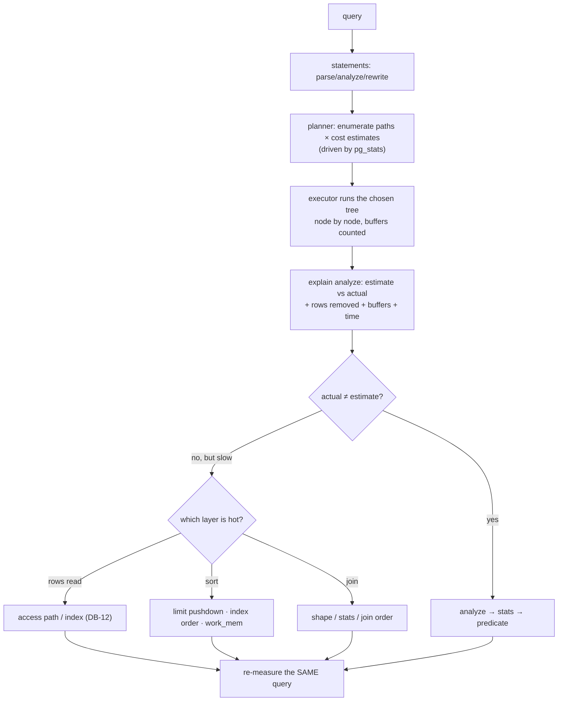

# Query Plans and Optimization

## 1. Learning Objectives

After this lesson you can:

- [ ] Read an `explain (analyze, buffers)` output as a sentence: node, order of
      operations, rows estimated vs actual, and what each buffer count means
      (executed four plans quoted line by line below)
- [ ] Diagnose estimate-vs-actual gaps and name the fix — `analyze`, better statistics,
      or a more honest predicate (executed: estimate `33333` vs actual `2189`; after
      `analyze`, `20` vs `20`)
- [ ] Recognize the three cost layers in a plan: **rows read** (seq vs index),
      **sort method** (top-N heapsort `Memory: 25kB` vs `external merge Disk: 2064kB`),
      and **join strategy** (executed: hash join hashing a 5,000-row dimension)
- [ ] Explain why `limit 5` was 57.862 ms and the same query without limit was
      223.199 ms — early termination and sort materialization, with the executed pair
- [ ] Apply the optimization loop: measure → one hypothesis → one change → re-measure
      the *same* query — and say what you refuse to change without a number

## 2. Prerequisites

- [Indexes](indexes.md) — seq vs index access is the plan's first branch; this lesson
  reads everything past it.

## 3. Introduction

Every statement gets a **plan** before it runs: a tree of nodes (scans, joins, sorts,
aggregates) chosen by the planner from statistics and cost estimates. `explain analyze`
executes the plan and reports both the *estimate* and the *reality* per node — making it
the database's own account of what happened. This lesson treats four executed plans as
texts to be read aloud, then formalizes the loop that turns reading into optimization.

## 4. The Problem It Solves

"Add an index" is not a methodology: queries get slow for many independent reasons —
reading too many rows, sorting too much on disk, hashing the wrong side, statistics
lying, limits applied after full materialization. Without plan-reading, every slowdown
becomes cargo-cult schema edits. With it, the plan names the bottleneck
(`Rows Removed by Filter: 97811`, `external merge Disk: 2064kB`) and the fix becomes a
testable hypothesis instead of a hope.

## 5. Core Concepts

### Anatomy of an `analyze` plan

```console
Seq Scan on big_order (cost=0.00..1887.00 rows=33333) (actual … rows=2189 loops=1)
  Filter: (amount > '890'::numeric)
  Rows Removed by Filter: 97811
  Buffers: shared hit=637
  Execution Time: 23.692 ms
```

- **cost=a..b** — planner's *relative* units: startup cost (a) then total (b). Compare
  only within one plan; they are not milliseconds.
- **rows=** — the *estimate*; `actual … rows=` — the truth; `loops=` — how many times
  the node ran (a seq scan under a nested loop runs many times — multiply its rows!).
- **Rows Removed by Filter** — rows read and discarded: the direct measure of
  selectivity waste (executed: 97,811 of 100,000).
- **Buffers: shared hit/read** — pages touched from cache vs disk; `read` is the I/O you
  feel. The goal of every optimization is fewer buffers, ideally all `hit`.

### Statistics and the estimate gap

Planners work from `pg_stats` (sampled histograms, carried in `analyze`), not from
clairvoyance. Executed gaps: `amount > 890` estimated 33,333 vs actual 2,189 (15× off —
a uniform-`random()` column with no useful histogram shape), while after `analyze`, the
equi-key lookup estimated `rows=20` vs actual `20`. A big gap doesn't mean *wrong* — it
means the plan's shape was chosen on bad information; the fix order is `analyze` →
better stats (extended stats, more frequent analyze on loaded tables) → rewrite
misleading predicates (`now() - interval` staleness tricks etc.).

### The three cost layers (all executed here)

| Layer | Question | Executed evidence |
|---|---|---|
| rows read | seq or seek? | DB-12 pair: 637 buffers vs 22 |
| sort | in memory or on disk? | top-N heapsort `Memory: 25kB` vs `external merge Disk: 2064kB` (+ `temp read=258 written=259`) |
| join | nested loop / hash / merge? | hash join, dimension hashed at `Memory Usage: 299kB` |

### LIMIT changes the *work*, not just the output

`order by amount desc limit 5`: `top-N heapsort`, 57.862 ms. Same sort without limit:
`external merge`, **223.199 ms**, spilling 2064 kB to disk. Top-N keeps only 5
candidates while scanning; a full sort materializes all 100,000. The executed pair is
the argument for pushing `limit` (and any filter) as deep as correctness allows.

## 6. How It Works



The loop is the discipline: **one change per iteration**, same query text, compare
execution time *and* buffer counts. Two changes at once and you've learned nothing when
it gets faster.

## 7. Practical Examples

**Example 1 — a filter plan read aloud (executed)**

```sql
explain (analyze, buffers) select id from big_order where amount > 890;
```

```console
Seq Scan on big_order (cost=0.00..1887.00 rows=33333 width=4)
                      (actual time=0.046..23.514 rows=2189 loops=1)
  Filter: (amount > '890'::numeric)
  Rows Removed by Filter: 97811
  Buffers: shared hit=637
  Execution Time: 23.692 ms
```

Reading: *one sequential scan of `big_order`; 637 pages, all cached; the filter
discarded 97,811 rows and kept 2,189; the planner expected 33,333 — it over-estimated
15×, but a seq scan was right anyway for a match rate the estimate put at a third and
reality put at 2%.* Note what you'd try next: an index on `amount` would serve 2% —
predict before you build (DB-12's discipline), then re-measure.

**Example 2 — the LIMIT pair (executed)**

```console
-- with limit 5:
Limit (actual time=57.803..57.807 rows=5 loops=1)
  ->  Sort (Sort Method: top-N heapsort  Memory: 25kB)
        ->  Seq Scan on big_order (rows=100000)
  Execution Time: 57.862 ms

-- same sort, no limit:
Sort (Sort Method: external merge  Disk: 2064kB) (actual … rows=100000)
  Buffers: shared hit=637, temp read=258 written=259
  Execution Time: 223.199 ms
```

4× slower and **on disk** (`temp read=258`) once every row must be ordered. The
`top-N heapsort` node kept five candidates in 25 kB of memory. Two optimizations fall
out, both executed-arguable: push `limit` whenever the business question is "top N";
index `amount desc` and the sort disappears entirely (a btree is already ordered —
DB-12's order-by index shape).

**Example 3 — a join plan (executed)**

```sql
explain (analyze, buffers)
select c.segment, count(*) from big_order b
  join customer_dim c on c.id = b.customer_id
 where b.amount > 800 group by c.segment;
```

```console
HashAggregate (actual time=43.112..43.132 rows=2 loops=1)
  ->  Hash Join (actual time=3.455..37.891 rows=12261 loops=1)
        Hash Cond: (b.customer_id = c.id)
        ->  Seq Scan on big_order b (rows=12262) Rows Removed by Filter: 87738
        ->  Hash (Memory Usage: 299kB) (rows=5000)
              ->  Seq Scan on customer_dim c (rows=5000)
  Execution Time: 43.335 ms
```

Read the tree bottom-up: hash the 5,000-row dimension once (299 kB, all cached), scan
the fact table once, filtering 12,262 matches out of 100,000, probe the hash, aggregate
two groups. Estimates (12,470 / 5000) were close to actuals (12,261 / 5000) — good
stats, trusted plan. Why hash, not nested loop? The filtered fact side has 12k rows:
looping a seek per row would touch 12k index probes; hashing 5k dimension rows once is
cheaper — that trade *is* the planner's job, and `work_mem` caps decide how much
hashing/sorting stays in memory.

**Example 4 — estimate vs actual, fixed (executed)**

```console
-- before analyze on the loaded table (DB-12, same column): estimate rows=462/500 vs actual 20
-- after create index + analyze customer_id:
Bitmap Heap Scan (cost=4.45..74.07 rows=20) (actual … rows=20)
  Execution Time: 0.143 ms
```

`rows=20` matched reality. Same query family, better information: `analyze` after bulk
loads is not optional maintenance — it is the input to every plan decision (DB-12's
decline case included).

## 8. Real-World Applications

Plan reading is the daily instrument of backend performance work: the slow endpoint's
`auto_explain` capture, the migration review that checks a new query's plan, the
post-deploy spot-check after statistics refresh, and the honest conversation with a
developer whose query is "slow because the database is slow" — 97,811 discarded rows
later, it usually isn't. Index reviews, `work_mem` tuning for reporting, and limit-
pushdown refactors all start from the same four lines of output.

## 9. Common Mistakes

| Mistake | Why it happens | How to recognize it | How to prevent it |
|---|---|---|---|
| Optimizing by intuition | plan never opened | changes with no before/after | `explain analyze` first; quote the number that motivated the change |
| Reading `cost` as time | units misunderstood | "cost dropped 10%" claims | cost is relative within one plan; `actual`/`Execution Time` is time |
| Ignoring `loops=` | node rows read raw | "it says 3 rows" while 90 were processed | node rows × loops |
| Two changes in one iteration | impatience | can't attribute the win/loss | one hypothesis per re-measure |
| Forgetting `analyze` after bulk load | load scripts skip it | wild estimate gaps (executed: 15×) | migrations end with `analyze` |
| Adding `work_mem` blindly | disk-sort pain | big sorts spill (`external merge Disk`) | push limits, index the order, *then* tune memory — with a re-measure |

## 10. Best Practices

- **Capture plans for the queries that matter** (slow log / `auto_explain`) so the day a
  regression appears, you have the *before* picture.
- **Judge by buffers first, milliseconds second** — buffers are stable and explain
  *why*; time fluctuates with load.
- **Close the estimate gap before changing structure**: `analyze`, then re-explain; a
  plan chosen on bad stats often self-corrects.
- **Push filters and limits toward the data** — the executed top-N pair is the template
  for every list endpoint you write.
- **Keep one query, one change, one measurement** — and record negative results (what
  you tried that didn't help) so the team stops re-trying it.

## 11. Limitations and Trade-Offs

`explain analyze` runs the query — never paste it on a production write statement (the
lesson's probes are all reads; for writes use `explain` without `analyze`, or
`explain (analyze, buffers)` inside a `rollback`-able transaction). Estimates depend on
statistics that decay between analyzes. Plan shape can flip between environments
(different `work_mem`, data volume, `random_page_cost`) — a plan read on the lab is a
hypothesis on production until checked. And some slowness isn't in the plan at all:
lock waits, network round trips, and N+1 application loops show up as *empty* plan time —
knowing that the plan explained everything except the wait is part of reading it
honestly.

## 12. Practical Exercises

### Introductory

1. **Exercise 1.1** — take Example 1's query and annotate every plan line with what it
   means in one short sentence (cost, estimate, actual, rows removed, buffers, time),
   then run the same `explain` on a table of yours and repeat the annotation from memory.
   **Completion criteria:** both annotated plans; the sentences written without looking
   at this lesson; one line where your table's plan differs from the lab's, explained.
2. **Exercise 1.2** — reproduce the LIMIT pair (with/without `limit 5`) on any table ≥50k
   rows and quote both sort methods and times.
   **Completion criteria:** two plans captured; the disk-spill lines quoted
   (`external merge Disk`, `temp read`); one sentence on which business question each
   query shape answers.

### Intermediate

3. **Exercise 1.3** — the estimate-gap drill: find or create a predicate where estimate
   and actual differ by ≥5×, capture it, run `analyze`, re-capture. Then force the gap
   back (insert skewed data without analyze) and show it return.
   **Completion criteria:** before/after-analyze plans with both row numbers; the gap
   mechanism explained (sampling vs distribution); your standing practice for bulk-load
   scripts written down.
4. **Exercise 1.4** — join-strategy reading: execute a three-table join plan, label
   every node (which side was hashed/sorted/looped, rows × loops for each), and state
   why the planner chose that shape over the alternative — using the row counts in the
   plan, not vibes.
   **Completion criteria:** the plan with node labels; the alternative strategy argued
   with numbers (what it would have cost to loop the other side); one `analyze` you ran
   to make the estimates trustworthy.

### Independent problem-solving

5. **Exercise 1.5** — the optimization loop on one real slow query of yours: (1) capture
   `explain (analyze, buffers)` as the baseline; (2) write the hypothesis *before*
   touching anything; (3) apply exactly one change; (4) re-measure the same query;
   (5) keep, revert, or iterate — with the numbers deciding. Do at least two iterations
   (a reverted one counts and must be reported).
   **Completion criteria:** ≥2 baseline/after plan pairs; hypotheses written before each
   change; total improvement quoted in time *and* buffers; the reverted attempt kept in
   the write-up with its result; a final paragraph on what the loop would have missed if
   you'd only looked at wall-clock time.

*Solutions: attempt first. They live in `solutions/` of this subject.*

## 13. Knowledge Check

1. A plan node reads `rows=5000 loops=120`. How many row-visits is that, and why does
   mistaking it for 5,000 lead to a wrong conclusion?
2. `Execution Time: 2 ms` but users say the endpoint is slow. Name three things the plan
   *cannot* be guilty of — and the first place you'd look instead.
3. Estimate 33,333 vs actual 2,189: is the plan necessarily wrong? What is the correct
   first response, and what evidence would tell you the response worked?

## 14. Completion Criteria

Observable evidence that you have understood this lesson:

- [ ] You can read any `explain analyze` line of this lesson's outputs aloud, correctly,
      without notes
- [ ] You have executed the LIMIT pair and can quote both sort methods and times
- [ ] You have produced an estimate gap, closed it with `analyze`, and shown it return
- [ ] You can label a join plan's nodes and justify the chosen strategy from row counts
- [ ] You have run a documented optimization loop with at least one reverted change

## 15. Summary

- Plans are trees of nodes read bottom-up; `cost` is relative, `actual rows × loops` is
  reality, buffers say how much was touched.
- Estimate gaps are statistics problems: `analyze` first (executed: 15× gap → exact 20).
- Three cost layers: rows read (access path), sort materialization (executed 57.862 ms
  top-N vs 223.199 ms external merge), join strategy (executed hash join, 299 kB).
- Push `limit`/filters deep — top-N keeps five candidates, a full sort keeps 100,000.
- Optimize in a loop: baseline → hypothesis → one change → re-measure buffers and time.

## 16. Next Steps

- Next lesson: [Concurrency and Isolation](concurrency-and-isolation.md) — what happens
  when *two* of these plans run against the same rows at the same time
- Practice: [exercises/](exercises/README.md) — set 13
- Where it is applied: [20 — Project Laboratory](../20-PROJECT-LABORATORY/README.md) —
  the project's performance gate is one optimization-loop write-up, plans included
