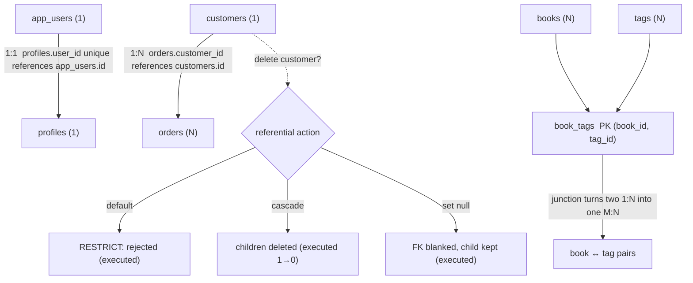

# Relational Databases

## 1. Learning Objectives

After this lesson you can:

- [ ] Model each of the three relationship kinds with real tables (executed: one-to-one
      enforced by a unique foreign key, many-to-many through a junction table with a
      composite primary key)
- [ ] State what a foreign key *is* mechanically — and read the server's proof in the
      catalog (executed in lesson 1, repeated here)
- [ ] Choose and justify a **referential action** per relationship, then execute all three
      outcomes: the default rejection (executed: `update or delete on table "customers"
      violates foreign key constraint … Key (id)=(1) is still referenced`), `on delete
      cascade` (executed: child count 1 → 0), and `on delete set null` (executed: FK
      column blanked, row kept)
- [ ] Compose a three-table join across a junction table and predict its rows before
      running it (executed: 3 rows)
- [ ] Reject a duplicate pair in a junction table with a composite primary key (executed:
      `duplicate key value violates unique constraint "book_tags_pkey" DETAIL: Key
      (book_id, tag_id)=(1, 1)`)

## 2. Prerequisites

- [Database Fundamentals](database-fundamentals.md) — tables, keys, `NULL`, and the
  executed rejections this lesson builds on directly.

## 3. Introduction

A single table is rarely the shape of real data: a customer *has* orders, an order *has*
many products, a user *has* one profile. The relational model connects tables with
**foreign keys** and keeps those connections true no matter which program writes. This
lesson is about those connections: the three relationship shapes, the junction table that
makes many-to-many honest, and the *referential actions* that decide what happens to
children when a parent disappears.

## 4. The Problem It Solves

Without enforced relationships, every application re-implements the same guards and every
one of them has a bug: an order saved for a customer id that was deleted last week; the
same book tagged "reference" twice because two requests raced; a profile duplicated for
one user because nothing said "at most one". Reports then lie — totals that include
orphaned rows — and cleanup becomes archaeology. Foreign keys move these guarantees into
the one component that sees every write.

## 5. Core Concepts

### Cardinality: the three shapes

- **One-to-one (1:1)** — each row of A has at most one row of B. Implemented as a foreign
  key in B that is also `unique` (executed: a second profile for the same user was
  rejected by `profiles_user_id_key`). Typical: user ↔ profile, person ↔ passport.
- **One-to-many (1:N)** — each row of A has many rows of B; each B points at one A. A
  plain foreign key in B is the whole implementation (lesson 1's `orders.customer_id`).
  The relationship is *read* from A's side as "one", from B's side as "many".
- **Many-to-many (M:N)** — rows of A pair freely with rows of B. Neither table can hold
  the other's key, so a third table — the **junction** (join/link) table — holds a
  foreign key to each, plus a primary key over both columns (executed: `book_tags` with
  `primary key (book_id, tag_id)`). Typical: books ↔ tags, students ↔ courses.

### The foreign key, mechanically

A foreign key is a constraint: "every value of this column must exist in that table's
key, or the statement fails." The server checks it on every insert and update — and on
parent deletes, according to the relationship's **referential action**. The check reads
the parent through the parent's key (which is indexed), which is why foreign keys are
cheap on write and why the referencing column wants an index of its own (executed proof
and the performance pricing come in the indexes lesson).

### Referential actions

What happens to children when the parent row is deleted or its key updated:

| Action | Child rows on parent delete | Executed here |
|---|---|---|
| `restrict` / `no action` (the default) | statement rejected | P3 |
| `cascade` | children deleted too | P4 (1 → 0) |
| `set null` | FK column set to `NULL` | P5 (3 → blank) |
| `set default` | FK set to its column default | — (rare; needs a meaningful default) |
| `no action` vs `restrict` | same in the simple case; `no action` is checked at end of statement, `restrict` immediately — a deferrable constraint can pass one and fail the other | — |

`on update` variants exist for key changes; with `serial` identity keys you almost never
update them, which is one reason identities are immutable by convention.

### Composite keys

A primary key over two or more columns (`primary key (book_id, tag_id)`) asserts the
*pair* is unique — exactly the many-to-many rule "one tag per book, once" (executed P6:
the duplicate pair `(1, 1)` was rejected by `book_tags_pkey`). Single-column uniqueness
would be wrong here: each book_id alone *must* repeat across tags.

## 6. How It Works



The arrows into `book_tags` are two one-to-many relationships; *read together* they
produce the many-to-many. Note there is no "M:N" primitive in the database — the junction
table is the model, which is why it carries the composite primary key.

The action decision is enforced inside the same write path as every other constraint
(lesson 1's diagram): the delete is checked against children *before* it lands, so a
`restrict` rejection leaves the parent intact — executed: after the failed delete,
customer 1 still had its order.

## 7. Practical Examples

**Example 1 — one-to-one with a unique foreign key (executed)**

```sql
create table app_users (
  id    serial primary key,
  email text not null unique
);
create table profiles (
  id      serial primary key,
  user_id integer not null unique references app_users(id),
  bio     text
);
insert into app_users (email) values ('ada@example.org');
insert into profiles (user_id, bio) values (1, 'first programmer');
insert into profiles (user_id, bio) values (1, 'impossible twin');  -- must fail
```

```
ERROR:  duplicate key value violates unique constraint "profiles_user_id_key"
DETAIL:  Key (user_id)=(1) already exists.
```

- Without `unique` this would be a plain one-to-many — the *same* FK syntax, a different
  cardinality. The constraint, not the syntax, is the model.
- The join proves the pair: `select u.email, p.bio from app_users u join profiles p on
  p.user_id = u.id;` → one row, `ada@example.org | first programmer`.

**Example 2 — many-to-many with a junction table (executed)**

```sql
create table books (id serial primary key, title text not null);
create table tags  (id serial primary key, name  text not null unique);
create table book_tags (
  book_id integer not null references books(id) on delete cascade,
  tag_id  integer not null references tags(id)  on delete cascade,
  primary key (book_id, tag_id)
);
insert into books (title) values ('Database Internals'), ('The Art of SQL');
insert into tags (name) values ('reference'), ('practice');
insert into book_tags (book_id, tag_id) values (1, 1), (1, 2), (2, 2);
```

```sql
select b.title, t.name from book_tags bt
  join books b on b.id = bt.book_id
  join tags  t on t.id = bt.tag_id
 order by b.title, t.name;
```

```
       title        |   name
--------------------+-----------
 Database Internals | practice
 Database Internals | reference
 The Art of SQL     | practice
(3 rows)
```

- Predict before you run: book 1 has two tags, book 2 has one → three rows; ordered by
  title then name. The junction table *is* the data of the relationship.
- The junction's own FKs use `on delete cascade` deliberately: deleting a tag should
  remove its pairings, not orphan them or block the delete.

**Example 3 — the default action is rejection (executed)**

```sql
create table orders (
  id          serial primary key,
  customer_id integer not null references customers(id)   -- no action clause
);
insert into customers (email) values ('ada@example.org');
insert into orders (customer_id) values (1);
delete from customers where id = 1;
```

```
ERROR:  update or delete on table "customers" violates foreign key constraint "orders_customer_id_fkey" on table "orders"
DETAIL:  Key (id)=(1) is still referenced from table "orders".
```

- You did not write `restrict` — *not writing an action is writing `no action`*. The
  `DETAIL` names both sides of the violation; read it and you know which child blocks
  you.

**Example 4 — `on delete cascade` (executed)**

```sql
create table line_orders (
  id          serial primary key,
  customer_id integer not null references customers(id) on delete cascade
);
insert into customers (email) values ('grace@example.org');   -- id 2
insert into line_orders (customer_id) values (2);
-- before: 1 row; then:
delete from customers where id = 2;
```

```
 line_orders_before
--------------------
                  1

 line_orders_after
-------------------
                 0
```

- One delete statement removed the parent **and** its children — inside the same
  transaction, so a failure midway would have rolled back both.

**Example 5 — `on delete set null` (executed)**

```sql
create table order_notes (
  id          serial primary key,
  customer_id integer references customers(id) on delete set null,
  note        text not null
);
insert into customers (email) values ('alan@example.org');   -- id 3
insert into order_notes (customer_id, note) values (3, 'vip');
delete from customers where id = 3;
select id, customer_id, note from order_notes;
```

```
 id | customer_id | note
----+-------------+------
  1 |           3 | vip      -- before the delete

 id | customer_id | note
----+-------------+------
  1 |             | vip      -- after: the note survives, the link is gone
```

- `set null` requires a nullable column — the schema's nullability *is* part of the
  relationship's meaning: "the note outlives the customer" was decided at `create table`
  time, and this transcript is the receipt.

**Example 6 — composite key rejects the duplicate pair (executed)**

```sql
insert into book_tags (book_id, tag_id) values (1, 1);   -- already paired
```

```
ERROR:  duplicate key value violates unique constraint "book_tags_pkey"
DETAIL:  Key (book_id, tag_id)=(1, 1) already exists.
```

## 8. Real-World Applications

E-commerce is the canonical case (customers → orders → line items, products ↔ categories
via junctions), but the same shapes run through nearly every domain: staff ↔ roles
(junction), a person ↔ their single passport (one-to-one), tickets ↔ agents (many, with
`restrict` on delete so history can't be silently erased). Choosing the action is a
*business* decision translated into schema: "when a customer closes their account, do
their orders vanish, anonymize, or block the closure?" — answer that question in
`create table`, not in application code that some caller will bypass.

## 9. Common Mistakes

| Mistake | Why it happens | How to recognize it | How to prevent it |
|---|---|---|---|
| Junction table without a primary key | "two FKs are enough" | duplicate pairs accumulate; counts inflate | `primary key (left_id, right_id)` — executed rejection in Example 6 |
| `cascade` on tables holding history | deletion feels like cleanup | orders vanish when a test customer is deleted | cascade only for owned children (pairings, drafts); use `restrict` or anonymize for records |
| Nullable FK where the relation is required | built the join lazily | rows that join to nothing in reports | `not null` for required relations; nullable only when "no parent" is meaningful |
| No action clause written anywhere | defaults are invisible | a delete in production fails and nobody knows why | write the action explicitly per relationship; it documents the business rule |
| FK column left unindexed | nobody told you deletes/parents-joins read it | parent-side deletes get slow as children grow | index every FK column (measured in the indexes lesson) |
| Re-declaring relationships in app code as "checks" | distrust of the database | orphans after the one code path you forgot | the database enforces; the application *also* checks only to give better errors |

## 10. Best Practices

- **Write the action explicitly** even when it equals the default — the DDL is the
  business rule's record (`on delete restrict` says "history is not deletable").
- **Composite key on every junction table**; leave room in it for a payload column later
  (a rating on book↔tag, an enrolment date on student↔course) — the pair stays unique,
  the payload rides along.
- **Cascade only true ownership** (a draft's sections, a tag's pairings). Everything else
  gets `restrict` and an application-level archive step.
- **Nullability carries meaning**: a required relationship is `not null`; if you allow
  `null`, be able to say in one sentence what "no parent" means.
- **Name relationships in your head from both sides** ("a customer's orders", "an order's
  customer") — modelling mistakes show up as one side that reads awkwardly.

## 11. Limitations and Trade-Offs

Referential actions encode *deletion* semantics, not lifecycle ones: "close account"
usually means anonymize-and-keep, which no action provides — you implement it as an
explicit multi-statement transaction (lesson 11) instead. Foreign keys also require the
parent to be in the same database, so **polymorphic associations** ("commentable on any
of three tables") can't be expressed as a real FK — pick a constrained set of nullable
FKs or a single parent table, and know which trade you made. And every action is checked
on write: under heavy child volume, cascades and restricts are real cost, which is why
the indexing lesson prices FK columns explicitly.

## 12. Practical Exercises

### Introductory

1. **Exercise 1.1** — recreate Examples 1–2 from memory, then prove each relationship
   kind with one query: the 1:1 join's single row, the M:N join's three rows.
   **Completion criteria:** six objects created (two tables + junction), both queries
   executed with results matching your prediction written first.
2. **Exercise 1.2** — extend the library schema from lesson 1: members ↔ loans is 1:N,
   books ↔ loans is 1:N, and a "genres" relationship is M:N. Draw the three
   relationships as tables and FKs on paper, then create them.
   **Completion criteria:** every FK column named `<parent>_id`, `not null` where
   required, one written sentence per relationship stating its action choice.

### Intermediate

3. **Exercise 1.3** — execute all three actions on the same relationship shape: build
   `customers` + child table three times (default, `cascade`, `set null`), delete the
   parent in each, and capture the three outcomes.
   **Completion criteria:** three transcripts — rejection with `DETAIL`, child count 1 →
   0, FK column blanked — and a table mapping each action to the business rule it
   encodes.
4. **Exercise 1.4** — add a payload column to `book_tags` (`added_at timestamptz not
   null default now()`), re-run the Example 2 join selecting it, and confirm the
   composite primary key still rejects duplicate pairs.
   **Completion criteria:** join returns three rows with timestamps; duplicate-pair
   rejection re-captured; one sentence on why the payload didn't need its own uniqueness.

### Independent problem-solving

5. **Exercise 1.5** — a support team says: "deleting a test customer must never remove
   real orders, but closing an account should keep orders and drop the personal data."
   Design the schema that makes both true (you may need a nullable FK and an explicit
   anonymization step). **Completion criteria:** schema created; a `restrict` rejection
   transcript for the delete case; the anonymize-as-transaction written (it executes in
   lesson 11) with the SQL you would run; one paragraph naming exactly what the database
   guarantees versus what the application must do.

*Solutions: attempt first. They live in `solutions/` of this subject.*

## 13. Knowledge Check

1. A designer says "we need a many-to-many between customers and coupons, so I'll add a
   `customer_id` column to `coupons`." What breaks, and what is the correct shape?
2. `on delete cascade` and `on delete restrict` both "handle" deletion. Give one domain
   where each is the *wrong* choice, with the failure each would produce.
3. Why must a junction table's primary key cover both foreign keys, and what would a
   single-column uniqueness constraint on `book_id` do to a book with two tags?

## 14. Completion Criteria

Observable evidence that you have understood this lesson:

- [ ] You can build all three relationship shapes from a blank editor and say which
      constraint makes each one what it is
- [ ] You can quote the `restrict` rejection's `DETAIL` line and explain both sides it
      names
- [ ] You have executed `cascade` (child count change) and `set null` (column change)
      and can say which business rule each encodes
- [ ] You can predict the row count and contents of a junction join before running it
- [ ] You can name one relationship in your own life/project and state its cardinality
      and action in one sentence each

## 15. Summary

- Three shapes: 1:1 (unique FK), 1:N (plain FK), M:N (junction table with a composite
  PK) — the constraint, not the syntax, defines the shape.
- Referential actions decide parent deletion: default rejection (executed), `cascade`
  (executed 1 → 0), `set null` (executed blanking).
- Not writing an action *is* writing `no action`.
- Junction tables are first-class: they carry the relationship's data and can carry
  payload.
- Actions are business rules in DDL; lifecycle semantics beyond deletion belong to
  explicit transactions.

## 16. Next Steps

- Next lesson: [SQL Fundamentals](sql-fundamentals.md) — the language for reading and
  writing the rows these relationships connect
- Practice: [exercises/](exercises/README.md) — set 2
- Where it is applied: [20 — Project Laboratory](../20-PROJECT-LABORATORY/README.md) —
  Project 03's schema is relationship modelling with the actions justified in writing
