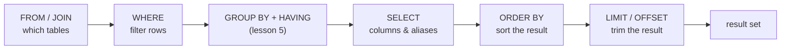

# SQL Fundamentals

## 1. Learning Objectives

After this lesson you can:

- [ ] Read rows with `SELECT`: projection, aliases, and computed columns (executed:
      `price * 2 as double_price` → `30.50`)
- [ ] Eliminate duplicates with `DISTINCT` (executed: 8 rows → 3 categories)
- [ ] Filter with `WHERE` and predict which rows qualify before running (executed:
      equality and `>` sets quoted)
- [ ] Order results deterministically — multiple keys, both directions, and **`NULL`
      placement** (executed: ASC puts `NULL`s last, DESC puts them first, and the explicit
      `nulls last` clause overrides that)
- [ ] Page through results with `LIMIT`/`OFFSET` (executed: 3/3/2-row pages over 8 rows)
- [ ] Write rows: `INSERT … RETURNING`, `UPDATE`/`DELETE` **with** `WHERE`, and read the
      psql command tag as the affected-row count (executed: `UPDATE 3`, `UPDATE 2`,
      `DELETE 1`)
- [ ] Demonstrate why an unguarded `UPDATE` is dangerous and contain it in a transaction
      (executed: `UPDATE 8`, 8 rows zeroed, `ROLLBACK` → 0)

## 2. Prerequisites

- [Database Fundamentals](database-fundamentals.md) — sessions, tables, keys, and the
  executed rejections; this lesson assumes you can create a table and insert rows.

## 3. Introduction

SQL is how you ask a relational database for data. The language looks like English
because it is **declarative**: you describe *what* rows you want, never how to fetch
them — the server's planner decides the how. This lesson covers the statements you will
type every day: `SELECT` (read), `INSERT` (create), `UPDATE` (change), `DELETE` (remove),
plus the clauses that shape reads: `WHERE`, `ORDER BY`, `LIMIT`/`OFFSET`. Every transcript
below was executed against the lab's PostgreSQL 18.6 server.

## 4. The Problem It Solves

Reading data out of files meant writing a program per question: filter this, sort that,
join the other — a week of code per report. SQL collapses every question to a sentence,
and the database answers it better than your loop would (indexes, statistics, decades of
query optimization). The flip side: you must learn to *state* precisely what you want,
because "roughly the expensive items, probably sorted" is not a query. The clause
discipline in this lesson is that precision.

## 5. Core Concepts

### The shape of a read

```sql
select <columns> from <table> where <filter> order by <keys> limit <n> offset <m>;
```

Clauses are evaluated in a **logical order** that is *not* the order you type them:



This order explains two classic surprises: a `where` clause cannot use a **column
alias** (the alias is computed *after* the filter), and `order by` can sort by a column
you did not select (it runs after projection but over the same rows).

### Projection and aliases

`select name, price` returns only those columns (projection); `as` names a result column
or computes one (`price * 2 as double_price`). Aliases are labels for *you* and for
clients — they change output names, never stored data.

### DISTINCT

`select distinct category` collapses duplicate values across the returned rows — it
deduplicates the **result**, not the table.

### WHERE, ORDER BY, LIMIT

- `WHERE` keeps rows matching a condition (`=`, `>`, `<>`, …; the full operator ladder is
  next lesson).
- `ORDER BY` sorts the result. Without it **the order is unspecified** — a guarantee,
  not an oversight. Multiple keys sort left to right; `asc`/`desc` per key; and `NULL`
  placement has its own rule (executed below).
- `LIMIT`/`OFFSET` trim the sorted result — pagination is `limit` + `offset` over a
  stable `order by`.

### Writes and the command tag

`INSERT`, `UPDATE`, `DELETE` return a **command tag** — psql prints e.g. `UPDATE 3`,
meaning *three rows actually changed*. Your application gets the same number from the
driver's update count. It is the cheapest correctness check there is: always look at it.

## 6. How It Works

`SELECT` goes through parse → plan → execute (lesson 1's diagram), but note what the
planner does *before* touching rows: statistics on the tables let it choose indexes and
join orders, and the `where` filter is evaluated per row against the storage pages the
plan visits. `INSERT` writes a new row (checking every constraint), `UPDATE` writes a new
row *version* and marks the old one dead (that is why updates bloat tables until
vacuum), and `DELETE` marks the row dead — it stays until vacuum reclaims it. Nothing a
client does bypasses this path: the same constraints from lessons 1–2 apply to every
statement here.

## 7. Practical Examples

**Example 1 — projection, aliases, DISTINCT (executed)**

```sql
select name, price from products order by id limit 4;
select name, price * 2 as double_price from products where name = 'Wired Mouse';
select distinct category from products order by category;
```

```
        name         | price
---------------------+--------
 Mechanical Keyboard | 120.00
 USB-C Hub           |  45.50
 27-inch Monitor     | 310.00
 Laptop Stand        |  39.00

    name     | double_price
-------------+--------------
 Wired Mouse |        30.50

  category
-------------
 displays
 furniture
 peripherals
```

- The computed column is arithmetic on a stored value — it exists only in this result.
- `distinct` + `order by category` is legal (sorting the deduplicated result) and gives
  the stable three-row list you can rely on in a dropdown.

**Example 2 — WHERE filters rows before anything else (executed)**

```sql
select name, stock from products where category = 'displays' order by price desc;
select name, price from products where price > 100 order by price;
```

```
      name       | stock
-----------------+-------
 4K Monitor      |     3
 27-inch Monitor |     6

        name         | price
---------------------+--------
 Mechanical Keyboard | 120.00
 27-inch Monitor     | 310.00
 4K Monitor          | 520.00
```

- Predict first: 3 displays exist at this point, 3 products cost over 100 — both
  predictions match the executed row counts.
- Note `order by price desc` inside the first query vs `order by price` (ascending, the
  default) in the second: say which you mean.

**Example 3 — ORDER BY: keys, direction, and NULL placement (executed)**

```sql
select name, category, price from products order by category, price desc;
select name, discontinued_at from products order by discontinued_at;            -- ASC
select name, discontinued_at from products order by discontinued_at desc;       -- DESC
select name, discontinued_at from products order by discontinued_at desc nulls last;
```

```
        name         |  category   | price         -- category ASC, price DESC
---------------------+-------------+--------
 4K Monitor          | displays    | 520.00
 27-inch Monitor     | displays    | 310.00
 Laptop Stand        | furniture   |  39.00
 Desk Lamp           | furniture   |  27.00
 Mechanical Keyboard | peripherals | 120.00
 USB-C Hub           | peripherals |  45.50
 Wired Mouse         | peripherals |  15.25
 Old Ball Mouse      | peripherals |   4.99

        name         |    discontinued_at      -- ASC: nulls LAST (default)
---------------------+-------------------------
 Old Ball Mouse      | 2020-05-01 13:00:00+03
 USB-C Hub           |
 … six more NULL rows …

        name         |    discontinued_at      -- DESC: nulls FIRST (default)
---------------------+-------------------------
 Mechanical Keyboard |            (7 NULL rows first)
 …
 Old Ball Mouse      | 2020-05-01 13:00:00+03

        name         |    discontinued_at      -- DESC NULLS LAST (explicit)
---------------------+-------------------------
 Old Ball Mouse      | 2020-05-01 13:00:00+03
 USB-C Hub           |  (7 NULL rows after)
 …
```

- Multi-key sorting groups by the left key (`category`), breaks ties with the right one
  (`price desc`) — the executed output is grouped *and* descending within each group.
- **PostgreSQL's default NULL placement is asymmetric: `NULLS LAST` for `ASC`,
  `NULLS FIRST` for `DESC`.** The spec doesn't promise either — if NULL placement
  matters, write the clause (`nulls last`), don't inherit a default.
- Timestamp honesty: the row stored `2020-05-01 10:00:00+00` (UTC) and prints as
  `2020-05-01 13:00:00+03` — the *instant* is identical; the session's `TimeZone` setting
  chose the rendering. Store instants in UTC; let the session/client localize.

**Example 4 — pagination with LIMIT/OFFSET (executed)**

```sql
select id, name from products order by id limit 3 offset 0;   -- page 1
select id, name from products order by id limit 3 offset 3;   -- page 2
select id, name from products order by id limit 3 offset 6;   -- page 3
```

```
 id |        name            id |     name             id |      name
----+---------------------    ----+---------------       ----+--------------
  1 | Mechanical Keyboard      4 | Laptop Stand           7 | Desk Lamp
  2 | USB-C Hub                5 | Wired Mouse            8 | Old Ball Mouse
  3 | 27-inch Monitor          6 | 4K Monitor
```

- Three pages over 8 rows: 3 + 3 + 2. The `order by id` is what makes the pages stable —
  without it, `offset` skips *unspecified* rows and pages duplicate or lose records.
- `offset` cost grows with the page number (the server walks past every skipped row) —
  deep pagination's real fix, keyset pagination, is priced in the performance lesson.

**Example 5 — INSERT with RETURNING (executed)**

```sql
insert into products (name, category, price, stock)
values ('Monitor Light Bar', 'displays', 49.00, 20)
returning id, name;
```

```
 id |       name
----+--------------------
  9 | Monitor Light Bar
```

- `returning` gives you the inserted row (server-generated `id` included) in **one**
  round trip instead of insert-then-select — the pattern every data layer should use.

**Example 6 — UPDATE and DELETE count their rows (executed)**

```sql
update products set price = price * 1.10 where category = 'displays';
update products set stock = stock + 5 where category = 'furniture';
delete from products where name = 'Old Ball Mouse';
```

```
UPDATE 3
UPDATE 2
DELETE 1
```

- The tags are the affected-row counts: three displays repriced, two furniture items
  restocked, one discontinued product removed.
- Check the tag against your prediction: `UPDATE 3` is only right if you knew there were
  three displays — *that comparison is the test*.

**Example 7 — the unguarded UPDATE, contained (executed)**

```sql
begin;
update products set price = 0;                            -- no WHERE!
select count(*) from products where price = 0;            -- 8
rollback;
select count(*) from products where price = 0;            -- 0
```

```
BEGIN
UPDATE 8
 count
-------
     8

ROLLBACK
 count
-------
     0
```

- Without `WHERE`, `update` touches **every row** — `UPDATE 8` said so immediately, and
  a bare `update … where price = 0`-style typo is the classic way a table gets wiped.
- Wrapped in a transaction, the disaster became a demonstration: `rollback` restored all
  8 prices. Always begin a destructive statement in a transaction first — if the row
  count tag is wrong, `rollback` costs nothing.

## 8. Real-World Applications

The four statements are the entire read/write surface of most applications: list views
are `select` + `where` + `order by` + `limit` (Example 4 *is* a paginated UI), carts and
profiles are `insert`/`update`, account deletion is `delete` (or an `update` to a
deleted-flag — a decision you now have the vocabulary to argue). Reporting queries are
the same statements with more joins; the habits scale directly.

## 9. Common Mistakes

| Mistake | Why it happens | How to recognize it | How to prevent it |
|---|---|---|---|
| `UPDATE`/`DELETE` without `WHERE` | rushing; testing a statement "just to see" | command tag says every row changed | transaction first; read the tag before `commit` |
| Relying on natural row order | small tables *look* stable | pages duplicate/skip rows; results change after vacuum | every meaningful query has `ORDER BY` |
| Using a select alias in `WHERE` | reads top-to-bottom, evaluated not | `column "x" does not exist` | filter on the underlying expression (`where price * 2 > 100`) |
| Assuming NULL sorts "last, always" | one dialect's default learned as a rule | DESC output puts NULLs on top | write `nulls last`/`nulls first` explicitly when it matters |
| Deep `OFFSET` pagination | offset is the obvious tool | page 100 takes visibly longer than page 1 | keyset/seek pagination for deep pages |
| `select *` in application code | convenience | new columns break result mapping silently | name your columns — the projection is a contract |

## 10. Best Practices

- **Read the command tag after every write**, in development especially: it is free and
  it disagrees with your expectation loudly.
- **Wrap destructive writes in `begin`/`rollback` until the tag matches your count.**
  This stops applying the moment the statement is provably scoped (test the tag), not
  before.
- **Always `ORDER BY` anything you page or display.** The rule stops having exceptions
  for unordered bulk operations (`delete … where`), which don't present rows to humans.
- **`INSERT … returning`** whenever you need the row back (ids especially) — one round
  trip, no read-after-write race.
- **Filter early, sort late, limit last** — that is the evaluation order anyway;
  writing queries that way makes them readable *and* lets the planner do its job.

## 11. Limitations and Trade-Offs

`OFFSET` pagination degrades with depth and `DISTINCT`/`ORDER BY` over wide results cost
memory — both are fine at teaching scale and priced honestly in the performance lesson.
`UPDATE` rewrites rows (new row version), so heavy-update tables need vacuum headroom.
And declarative SQL has a ceiling of *expressibility*: per-row procedural logic belongs
in functions or application code — reaching for SQL tricks to do iteration is usually a
sign the logic is in the wrong layer.

## 12. Practical Exercises

### Introductory

1. **Exercise 1.1** — with the `products` table from this lesson's probes, write
   `select` statements for: all names with price above 50, the four columns in a chosen
   order with one computed (`price * stock as stock_value`), and the distinct categories.
   **Completion criteria:** three queries executed; row counts predicted before each run
   and matched; one sentence explaining why the alias cannot appear in a `where`.
2. **Exercise 1.2** — sort products by `category` ascending and `stock` descending,
   then re-run with `stock` ascending; capture both outputs and state which you would
   show a warehouse worker and why.
   **Completion criteria:** both transcripts captured; the choice argued from the data's
   meaning, not taste.

### Intermediate

3. **Exercise 1.3** — page the table three at a time using `limit`/`offset` over a
   *stable* sort, then delete page 2's rows and re-run the paging query. Explain what
   happened to the page contents.
   **Completion criteria:** transcripts before and after; the offset-vs-mutating-data
   problem stated in your own words; the safer paging pattern (keyset) named.
4. **Exercise 1.4** — reproduce Example 7 yourself: guess the damage of an unguarded
   `update`, run it inside a transaction, check the row count and one sample row, then
   `rollback` and prove nothing changed.
   **Completion criteria:** `UPDATE` tag quoted, before/after counts from *selects* (not
   memory), and the one-line habit you are adopting ("always `begin` first") written down.

### Independent problem-solving

5. **Exercise 1.5** — you have been given a table `inventory(id, sku, qty, location,
   last_counted_at)` with 20 rows you insert yourself. Write a "stocktake report": items
   counted longest ago first, NULL `last_counted_at` treated as *never counted* and
   sorted **last**, ten per page, page 2 shown. **Completion criteria:** the seed insert
   executed; the report query's `ORDER BY` written with explicit NULL placement and a
   stable tie-breaker; page 2's rows predicted on paper first, then matched; one sentence
   on why `order by last_counted_at desc` alone would put never-counted items *first*.

*Solutions: attempt first. They live in `solutions/` of this subject.*

## 13. Knowledge Check

1. Why can `where category = 'displays'` use a column but `where double_price > 100`
   (where `double_price` is a select alias) fail — and what is the correct rewrite?
2. Two `select … limit 5 offset 10` runs return different rows, though the table didn't
   change between them. What is missing, and how do you prove your fix works?
3. The tag reads `UPDATE 0` after an `update products set price = price * 1.1 where sku
   = 'X-1'`. Is that a failure? Name two possible causes and how you'd distinguish them.

## 14. Completion Criteria

Observable evidence that you have understood this lesson:

- [ ] You can write a filtered, sorted, paginated query from a blank editor and predict
      its row count before running it
- [ ] You can state PostgreSQL's default NULL sort placement in both directions *and*
      override it deliberately
- [ ] You have executed `UPDATE`/`DELETE` with row-count tags matching a prediction
- [ ] You can demonstrate the unguarded-update disaster inside a transaction and roll it
      back
- [ ] You can explain the clause evaluation order and use it to predict which clauses
      may reference which columns

## 15. Summary

- SQL is declarative: state the result, not the steps; the clause evaluation order
  (FROM → WHERE → SELECT → ORDER BY → LIMIT) explains what may be referenced where.
- `where` filters rows, `order by` defines order (its absence is unspecified), `limit/
  offset` page — all three executed over an 8-row table.
- NULL placement defaults are asymmetric (`ASC` last, `DESC` first) — write the clause
  when it matters; timestamps render in the session's zone while the instant stays UTC.
- Writes print row-count tags: `UPDATE 3`, `DELETE 1` — read them like assertions.
- An unguarded `UPDATE` touches everything; a wrapping transaction turned the worst
  mistake in the lesson into a `rollback`.

## 16. Next Steps

- Next lesson: [Filtering and Aggregation](filtering-and-aggregation.md) — the operator
  ladder, three-valued logic with `NULL`, and `GROUP BY`/`HAVING`
- Practice: [exercises/](exercises/README.md) — set 3
- Where it is applied: [20 — Project Laboratory](../20-PROJECT-LABORATORY/README.md) —
  Project 04's REST endpoints are these four statements behind HTTP validation
