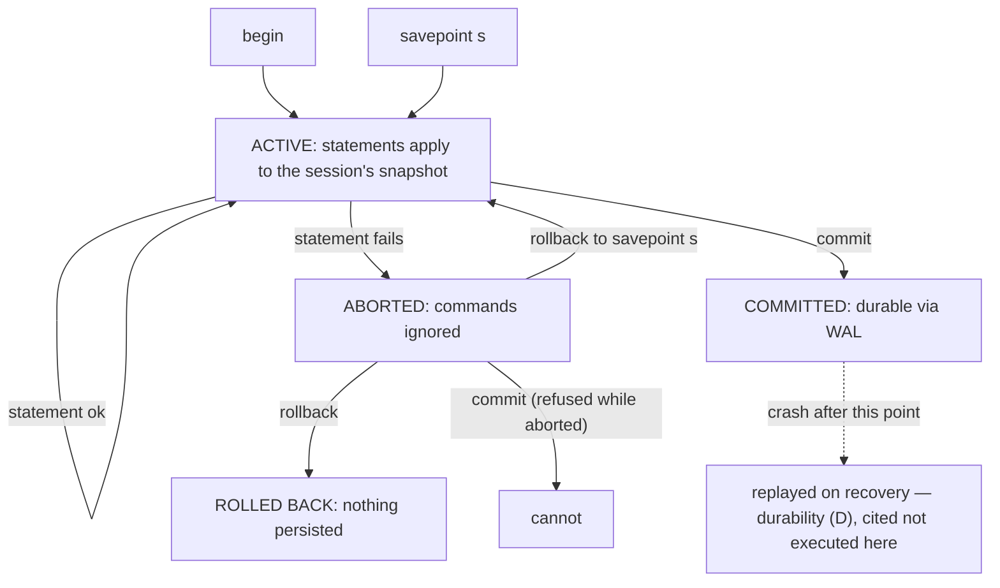

# Transactions

## 1. Learning Objectives

After this lesson you can:

- [ ] Group statements into a transaction and prove both outcomes — the state was real
      in-session and gone after `rollback` (executed: 60/140 inside, 100/100 after);
      kept after `commit` (executed: 90/110)
- [ ] Demonstrate **atomicity** with a failure mid-block: the first, *successful*
      statement is discarded when a later statement fails (executed: the `-50` update
      reported success, the CHECK refusal aborted the block, `rollback` → 90/110 — the
      "good" update never landed)
- [ ] Read the aborted-state guard and act on it (executed: `current transaction is
      aborted, commands ignored until end of transaction block`)
- [ ] Recover *inside* a transaction with a savepoint instead of losing everything
      (executed: error → `rollback to savepoint` → the remaining work committed at
      80/110)
- [ ] Explain autocommit and show its contrast with an explicit block (executed: without
      `begin`, an update sticks even though the next statement failed → 75/110)
- [ ] State ACID's C, I, and D honestly: which two parts this transcript *executed*, and
      which parts belong to the isolation lesson and to WAL (naming the seam)

## 2. Prerequisites

- [Database Fundamentals](database-fundamentals.md) — the lesson-1 `begin`/`rollback`
  taste; this lesson is that taste systematized.
- [Constraints and Relationships](constraints-and-relationships.md) — the CHECK refusal
  used here as the failure injector; constraints are a transaction's collaborators.

## 3. Introduction

A **transaction** is a group of statements that takes effect *all at once or not at all*.
Transfers, orders, registrations — every business action that touches more than one row
needs one, because the world does not pause between your statements. PostgreSQL gives you
explicit blocks (`begin`/`commit`/`rollback`), savepoints for partial recovery, and a
default *autocommit* mode where every single statement is already a transaction. Every
transcript below ran on the lab server; the failures are deliberate and each one is the
lesson.

## 4. The Problem It Solves

Without transactions, a crashed process between "deduct from A" and "add to B" destroys
money; a retry duplicates an order; a report read *during* a write sees a state that
never existed for anyone else. The pre-transaction world handled this with locks held by
convention (and bugs when someone forgot) or with compensating scripts nobody trusts.
Transactions make the *group* the unit of visibility and durability — the database
commits to it, not the developer's memory.

## 5. Core Concepts

### The block and its two exits

`begin;` opens a unit of work; every statement inside runs against a **snapshot** the
session can see (read-your-writes: P1's 60/140 was real *inside* the block). Only
`commit` makes it permanent; `rollback` erases it completely. In-between states are
invisible to other sessions (executed as a two-session contrast in
[Concurrency and Isolation](concurrency-and-isolation.md)).

### ACID, with the executed/not-executed line drawn

| Letter | Meaning | Where this lesson proves it |
|---|---|---|
| **A** — atomicity | all-or-nothing across statements | **executed**: P3 — successful first update discarded after the second failed |
| **C** — consistency | constraints hold at every commit boundary | **executed**: the CHECK refused `-10` and `-914`; a committed state is always constraint-valid |
| **I** — isolation | concurrent transactions don't see each other's uncommitted work | **executed in part** (same-session snapshots); the concurrent-session anomalies belong to DB-14 |
| **D** — durability | committed work survives crashes | **not executed here** — the lab never killed the server; the guarantee rests on the write-ahead log, cited from PostgreSQL's docs, honest seam |

### Autocommit: the mode you live in

Without `begin`, each statement is committed on its own (P5: the first update *stuck*
at 75 even though the next statement failed). Autocommit is right for single statements
and wrong for multi-statement actions — which is why every "and then" in application
code needs an explicit block.

### Savepoints: checkpoints inside a block

`savepoint name` / `rollback to savepoint name` unwinds to a marker *without* ending the
transaction: P4's risky update failed, the savepoint restored the block's health, and
the remaining work **committed** (80/110) — versus P3, where no savepoint meant the
whole block rolled back. Use them for "best-effort optional steps" inside a unit of work.

### The aborted-state rule

After an error inside a block, PostgreSQL refuses further statements until you decide
(executed: `current transaction is aborted, commands ignored until end of transaction
block`). That guard exists because continuing would build on undefined state — the
decision is always `rollback`, or `rollback to savepoint` if you planted one.

## 6. How It Works



Two exits from `ABORTED` — to the savepoint (keep working) or to `rollback` (start
over) — model every recovery decision an application makes; committing out of the
aborted state is not an option, which the diagram shows as a dead edge.

## 7. Practical Examples

**Example 1 — rollback erases a real in-session state (executed)**

```sql
begin;
update account set balance = balance - 40 where owner = 'ada';
update account set balance = balance + 40 where owner = 'grace';
select owner, balance from account order by owner;   -- inside
rollback;
select owner, balance from account order by owner;   -- after
```

```
 owner | balance         -- inside the block
-------+--------
 ada   |   60.00
 grace |  140.00

 owner | balance         -- after rollback
-------+--------
 ada   |  100.00
 grace |  100.00
```

The 60/140 state was genuinely readable (read-your-writes) and then never existed —
`rollback` is not an "undo write", it is a *refusal to have written*.

**Example 2 — commit keeps the same transfer (executed)**

```sql
begin;
update account set balance = balance - 10 where owner = 'ada';
update account set balance = balance + 10 where owner = 'grace';
commit;
-- 90.00 / 110.00
```

**Example 3 — atomicity: the successful statement is discarded too (executed)**

```sql
begin;
update account set balance = balance - 50 where owner = 'ada';   -- OK (would be 40)
update account set balance = balance - 50 where owner = 'ada';   -- CHECK refuses -10
select owner, balance from account order by owner;
rollback;
select owner, balance from account order by owner;
```

```console
ERROR:  new row for relation "account" violates check constraint "account_balance_check"
DETAIL:  Failing row contains (1, ada, -10.00).
ERROR:  current transaction is aborted, commands ignored until end of transaction block

 owner | balance          -- after rollback
-------+--------
 ada   |   90.00
 grace |  110.00
```

Read all three outputs as one story: the first update *reported no error*, yet after
rollback ada is still 90 — atomicity is about the **block**, not the statement. The
aborted-state guard then rejected the `select`, which is PostgreSQL forcing the recovery
decision.

**Example 4 — savepoint escape keeps the good work (executed)**

```sql
begin;
update account set balance = balance - 5 where owner = 'ada';     -- 85: fine
savepoint before_risky;
update account set balance = balance - 999 where owner = 'ada';   -- CHECK error (-914)
rollback to savepoint before_risky;                               -- block healthy again
update account set balance = balance - 5 where owner = 'ada';     -- 80
commit;
-- ada 80.00 / grace 110.00
```

Same failure class as Example 3, opposite outcome: the marker let the block *resume*, so
the pre-error work and the post-recovery work both committed. Savepoints are how you
write "try this optional piece, don't sink the unit of work" without leaving SQL.

**Example 5 — autocommit contrast (executed)**

```sql
update account set balance = balance - 5 where owner = 'ada';    -- no begin
update account set balance = balance - 999 where owner = 'ada';  -- CHECK error
-- final: ada 75.00 / grace 110.00
```

The first statement **stayed** — nothing grouped it with the second. Autocommit made
each one its own tiny transaction. For a transfer this is the bug; for `set
search_path` it's the convenience. Knowing which you're in is the whole skill.

## 8. Real-World Applications

Money movement (the `account` demo is literally ledger engineering), inventory
decrement with order creation, "publish + notify + audit-log" as one unit, seat
reservation with the exclusion constraint from lesson 10 inside the same block — all
require multi-statement atomicity. Application frameworks give you `@Transactional` /
`WithTransaction` decorators precisely because forgetting the boundary is invisible in
testing and catastrophic under failure: your unit test passes, production double-charges.

## 9. Common Mistakes

| Mistake | Why it happens | How to recognize it | How to prevent it |
|---|---|---|---|
| Long transactions "to be safe" | boundary fear | locks pile up, vacuum stalls, timeouts | one business action = one block; commit at the action's end |
| Ignoring the aborted-state error | copying statements into a session | `commands ignored until end of transaction block` in logs | treat it as a hard stop: rollback (or to a savepoint) — never retry-in-place |
| External calls inside a block | "all or nothing" over-extended | HTTP call hangs → connection held open with locks | commit before network I/O, or use outbox/saga patterns (the backend lessons) |
| Autocommit assumed for multi-step logic | default mode invisible | partial application after a mid-sequence failure (executed contrast) | explicit `begin` wherever the code says "and then" |
| Savepoint as flow control | overuse | recovery logic scattered | savepoints for *optional* steps only; failures of core steps → rollback |
| Believing rollback undoes other sessions' view | snapshot model misunderstood | "I rolled back but they saw it" | uncommitted work was never visible — that's the feature (DB-14 executes it) |

## 10. Best Practices

- **Bound the block by the business action**, not by the method: transfer = both updates
  + commit, always.
- **Make the application fail loudly on abort-state errors** — an aborted block that
  silently retries in place is how duplicate work happens.
- **Plant a savepoint before any known-risky optional statement** (data cleansing steps,
  best-effort enrichment) so recovery costs one line.
- **Commit before anything slow and external** (HTTP, file I/O, queues): the transaction
  protects database state, not your connection's patience.
- **Draw ACID honestly in reviews**: atomicity and constraint-consistency executed here,
  isolation executed next lesson, durability cited from WAL — four claims, four evidence
  types.

## 11. Limitations and Trade-Offs

Atomicity is per-database: two databases (or a database and a message broker) cannot
share one transaction — the moment work spans systems, you need sagas/compensation
(backend/architecture subjects). Long blocks hold locks and versions: at scale the
choice is short transactions *plus* idempotent retries, not bigger blocks. Savepoints
don't fix logical errors — a committed wrong value needs a compensating transaction.
And durability's WAL protects committed data against crashes, not against `drop table`
— that's backups (lesson 16), a different guarantee entirely.

## 12. Practical Exercises

### Introductory

1. **Exercise 1.1** — reproduce Examples 1–2 from memory: one rolled-back transfer, one
   committed, quoting the before/inside/after balances each time.
   **Completion criteria:** six `select` outputs captured (3 per example); one sentence
   on why 60/140 was readable inside the block but never observable by anyone else
   afterward.
2. **Exercise 1.2** — execute Example 5's autocommit contrast on your own two-row table,
   then redo the same two statements inside `begin` and show the different outcome.
   **Completion criteria:** both transcripts; the state difference explained as "one
   transaction vs two"; the rule you're adopting written down.

### Intermediate

3. **Exercise 1.3** — build a three-statement business action (e.g., move inventory:
   decrement stock, insert an order line, bump a counter) where the *second* statement
   fails on purpose. Execute it: (a) without a transaction, showing partial application;
   (b) inside one, showing none applied; (c) with a savepoint around the failing step,
   showing the rest committed.
   **Completion criteria:** three transcripts with row counts after each; the failure
   injection named (constraint, not artificial `false`); one paragraph on which pattern
   your real code needs.
4. **Exercise 1.4** — the aborted-state drill: enter the state, attempt three different
   statements (select, insert, commit), capture all three refusals, then recover via
   savepoint and via rollback — one of the two paths must end with committed work.
   **Completion criteria:** the three refusal messages quoted; both recovery paths
   executed; the decision rule ("which failure gets which recovery") written for your
   own project.

### Independent problem-solving

5. **Exercise 1.5** — design the transaction boundary for a real feature of yours
   (payment + reservation + notification row): list every statement in order, mark the
   commit point, decide where any savepoint belongs, and argue why no external call
   sits inside the block. Then implement it against a scratch schema with a failure
   injected at each statement position (at least three), executing all of them.
   **Completion criteria:** the statement map with the commit point marked; three
   executed failure positions each leaving the database constraint-valid and
   business-consistent (state the invariant you checked after each); the external-call
   argument written (what happens to the notification if commit succeeds but the email
   fails — and which lesson's pattern solves it).

*Solutions: attempt first. They live in `solutions/` of this subject.*

## 13. Knowledge Check

1. Inside a block you run two updates: the first succeeds, the second fails with a
   constraint error. A colleague says "at least the first one is safe — it didn't
   error." Using the executed P3 numbers, show what actually happened to it, and name
   the ACID letter involved.
2. Why can't you `commit` after `current transaction is aborted`? What two commands are
   the legal exits, and what does each imply about work done after the failure point?
3. Autocommit is described as "right for single statements." Give one code-level signal
   that your framework is running autocommit when you needed a block, and one signal
   that a block is open far too long.

## 14. Completion Criteria

Observable evidence that you have understood this lesson:

- [ ] You can execute a rolled-back and a committed transfer with correct before/
      inside/after quotes from memory
- [ ] You have produced the aborted-state error and recovered both ways (savepoint and
      rollback), with committed results shown
- [ ] You can explain why the "successful" statement in a failed block did not persist,
      using your own executed numbers
- [ ] You can state ACID with the executed/cited line drawn honestly (A, C here; I next;
      D from WAL docs)
- [ ] You can name the autocommit contrast and when each mode is correct

## 15. Summary

- A transaction is a group with two exits: `commit` makes it real, `rollback` means it
  never was (executed: 60/140 readable inside, 100/100 after).
- Atomicity covers the *block*: a later failure discards earlier successes (executed:
  90/110 unchanged after a "successful" `-50`).
- Errors abort the block (`commands ignored until end of transaction block`); savepoints
  convert abort-into-continue (executed: committed 80/110).
- Autocommit makes every statement its own transaction (executed: the orphaned `-5`
  stuck at 75).
- Isolation and durability are named here with their evidence types — executed next
  lesson and cited from WAL respectively.

## 16. Next Steps

- Next lesson: [Indexes](indexes.md) — what commit makes durable is also what indexes
  have to find quickly
- Practice: [exercises/](exercises/README.md) — set 11
- Where it is applied: [20 — Project Laboratory](../20-PROJECT-LABORATORY/README.md) —
  Project 04's write endpoints each map to exactly one of these blocks
