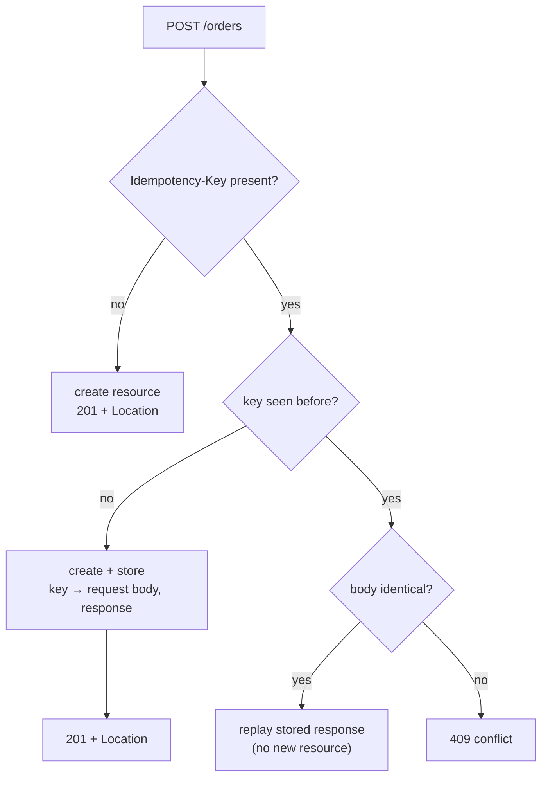

# API Design

## 1. Learning Objectives

After this lesson you can:

- [ ] Specify a collection resource's query contract — parameters, types, defaults,
      bounds — and execute every branch of it (executed: page metadata, first/last/
      beyond-range pages, invalid-value `400`, unknown-parameter policy)
- [ ] Choose and defend a pagination strategy with its edge cases decided in advance
      (executed: `page=9` beyond the data answered **200 with `items:[]`**, never 404)
- [ ] Implement idempotency keys so a retried create cannot duplicate (executed: replay
      of `Idempotency-Key: k-1` returned the identical `201`/`Location: /orders/8` and
      `totalItems` stayed **8**, not 9; a different body under the same key returned
      **409**)
- [ ] Design an error contract clients can branch on: machine-readable `error`, human
      `detail`, stable codes across versions
- [ ] Apply additive-first versioning and name the breaking changes that require a new
      version (and the ones that don't)
- [ ] Catch the classic query-param traps — unbounded `size`, injection-shaped `sort`
      — before review does (executed: `sort=evil` fell to the default order instead of
      reaching any interpreter)

## 2. Prerequisites

- [HTTP and REST APIs](http-and-rest-apis.md) — the method/status contract this lesson
  completes; every probe here reuses that server.
- [Backend Fundamentals](backend-fundamentals.md) — routing, the error envelope, the
  request log this battery's evidence comes from.
- [Database Engineering](../10-DATABASE-ENGINEERING/README.md) — helpful: pagination
  over real rows has a cost the indexes lesson measured; `OFFSET` deep pages are the
  same problem one layer up.

## 3. Introduction

An API's design **is** the product for everyone who consumes it: clients compile against
your parameter names, caches key on your URLs, SDKs and docs generate from your shape.
Code can be refactored cheaply; a shipped contract cannot — rename `qtyMin` and every
client breaks in a way *their* users notice. This lesson covers the decisions that are
nearly free before first release and expensive after: collection shapes, pagination,
filtering, error codes, idempotency, and versioning — each executed on the probe rather
than asserted.

## 4. The Problem It Solves

The un-designed API has predictable failures: a list endpoint that returns **every** row
(one mobile client, 400k records, three timeouts); a typo'd query parameter silently
ignored (the client filters to `colour=red`, gets everything, ships a bug); a flaky
network that retries a `POST` and creates three orders (the client *did* the right
thing — sent the request twice — because the API never said how to deduplicate); and a
"minor" response-field rename that breaks every consumer on a Friday. REST gave us
methods and status codes; this lesson's contract is what goes *around* them — the part
clients actually build on.

## 5. Core Concepts

### The query contract

Query parameters are **selection**, never action: `page`, `size`, `sort`, `qtyMin`
select *which* and *how much* of the collection — `POST /orders?cancel=true` would be an
action hiding in a query string, and it belongs in the method or the path. Every
parameter needs five documented attributes: **type**, **default**, **bounds**, **what
happens when invalid** (400), and **what happens when unknown** (a stated policy).

### Pagination, with the edge cases decided

This lesson executes **offset pagination** (`page`/`size`) with its full metadata
(`page, size, totalItems, totalPages, items`) — the shape that lets a UI draw "page 2 of
3." The edge cases are where designs are won:

| Case | Executed answer | Why |
|---|---|---|
| page beyond the data (`page=9`) | **200** + `items:[]` + true totals | "the page is empty" ≠ "the page doesn't exist"; 404 here makes clients special-case the last swipe |
| invalid value (`size=abc`) | **400** `invalid_parameter` | type errors are the client's bug — say so precisely |
| default (`GET /orders`) | `size=10` page 0, totals present | a default is a contract, document it |
| deep pages | works (`totalPages: 8` with `size=1`) | but `OFFSET` scans skipped rows — cost grows with depth (the indexes lesson's `Rows Removed by Filter` is this same bill) |

**Offset vs cursor:** numbered pages suit admin tables and finite, stable lists;
**cursors** (`?after=8&size=3`, keyed on a stable sort column) suit feeds and infinite
scroll — O(page) instead of O(offset), and stable when rows are inserted mid-scroll.
Offset breaks under concurrent inserts (items shift between pages → duplicates or
skips); cursor can't jump to "page 7." Choose by client shape, write the choice down.

### Filtering and sorting

`qtyMin=3` filtered to 5 of 8 rows; `sort=qty.desc` ordered them — both executed. Two
traps the probe defends against, both visible in its code:

- **Sort values are an allowlist**, not a pass-through: `orderFor()` maps exactly
  `qty.desc`, `qty.asc`, `id.desc`, default `id.asc`. Executed: `?sort=evil` returned
  **200 in default order** rather than reaching any interpreter. Passing user input
  into a SQL `ORDER BY` (you cannot parameterize it) is a classic injection door; an
  allowlist closes it before the database is involved.
- **Unknown parameters have one policy.** Executed: `?colour=red` → **200**, with the
  server logging `IGNORED unknown parameter: colour (policy: ignore, not 400)`.
  Ignoring is friendlier to forward-compatibility (older clients keep working when you
  *add* params) but hides client typos; strict 400s surface typos and break every client
  you haven't thought of yet. Pick one, document it, and log both — the log line is what
  makes "ignore" debuggable.

### The error contract

One envelope everywhere (the previous lesson's shape, now with a code vocabulary):
`{"error":"<machine_code>","detail":"<human sentence>"}` — executed this battery as
`invalid_parameter` (400) and `conflict` (409). Rules: **codes are stable API surface**
(clients branch on them; `detail` is not), **validation errors name the field** (the
full form-level shape `{"errors":[{"field":"size","message":"must be an integer"}]}` is
the same pattern generalized — `validation-and-error-handling.md` builds it), and a code
means one thing across every endpoint (`not_found` is never "no rows matched" on one
path and "bad id" on another).

### Idempotency keys (the executed centerpiece)

`POST` is the one method a retry can duplicate, so the client supplies the dedup key:
`Idempotency-Key: <unique-per-intent>` — a UUID generated **once per logical
operation**, reused on every retry of *that* operation. The server's decision table,
all three rows executed:

| Request | Executed response | Server log |
|---|---|---|
| first POST, key `k-1` | `201` + `Location: /orders/8` | `IDEMPOTENT-STORE key=k-1 -> 201 /orders/8` |
| replay, same key + **same body** | the *identical* `201` + `Location: /orders/8` — no new resource | `IDEMPOTENT-REPLAY … (no new resource)` |
| same key, **different body** | `409 Conflict` + explanation | `IDEMPOTENT-CONFLICT key=k-1 -> 409 (body differs)` |

The proof that nothing was created twice is a **count, not a claim**: after all three,
`totalItems: 8` (7 seeds + 1 create) — `C11`'s capture. Replay returning the *original
response* (not a fresh 200) matters: a client that retried mid-timeout gets the same
`Location` and body it would have gotten on the happy path.

### Versioning and compatibility

**Additive changes are not version bumps:** new optional fields, new endpoints, new
optional parameters are safe; clients ignore what they don't know (your unknown-param
policy in reverse). **Breaking changes** — removing/renaming a field, changing a type,
narrowing what an enum accepts, changing a status code — require a version: URL
(`/v1/orders`, greppable and proxy-friendly) or header (`Accept: application/vnd.x.v2+json`,
keeps URLs clean). Whatever you pick, the *policy* is the deliverable: which changes are
breaking, when old versions sunset, how clients are warned (deprecation headers, docs,
timelines) — because the real failure mode is not choosing a scheme, it's silently
breaking someone's Tuesday.

## 6. How It Works



The three-exit table from section 5 *is* this diagram: store on first sight, replay on
matching retry, refuse on mismatch. Everything else in API design is simpler than this
and should be reasoned about the same way — decide the matrix first, then write the
handler that makes the matrix true.

## 7. Practical Examples

**Example 1 — the pagination contract, executed**

```console
=== C1 GET /orders (default page)
{"page":0,"size":10,"totalItems":7,"totalPages":1,"items":[...7 items...]}

=== C2 GET /orders?page=0&size=3 (first page)
{"page":0,"size":3,"totalItems":7,"totalPages":3,"items":[...ids 1,2,3...]}

=== C3 GET /orders?page=2&size=3 (last page)
{"page":2,"size":3,"totalItems":7,"totalPages":3,"items":[{"id":7,...}]}

=== C4 GET /orders?page=9&size=3 (beyond range)
HTTP/1.1 200 OK
{"page":9,"size":3,"totalItems":7,"totalPages":3,"items":[]}

=== C5 GET /orders?size=abc (invalid parameter)
HTTP/1.1 400 Bad Request
{"error":"invalid_parameter","detail":"page, size and qtyMin must be integers"}
```

- The metadata is identical across C1–C4 — totals are computed from the *whole*
  filtered set, not the page, which is what makes "page 2 of 3" drawable before the
  items arrive.
- **How to run it:** probe v3 (`javac Probe.java && java -cp . Probe`, seeds 7 orders),
  then the five `curl` calls of `transcript3.txt`.
- **Assumptions:** Java 25.0.4.1, curl 8.22.0, loopback, in-memory store.

**Example 2 — filter, sort, and the executed idempotency table**

```console
=== C6 GET /orders?qtyMin=3&sort=qty.desc
{"totalItems":5,"items":[{"id":5,"qty":7},{"id":3,"qty":5},{"id":7,"qty":4},
                          {"id":4,"qty":3},{"id":6,"qty":3}]}

=== C8 POST /orders  Idempotency-Key: k-1  {"item":"BAG-001","qty":9}
HTTP/1.1 201 Created
Location: /orders/8

=== C9 replay k-1, same body
HTTP/1.1 201 Created
Location: /orders/8          ← byte-identical to C8

=== C10 same key, different body
HTTP/1.1 409 Conflict
{"error":"conflict","detail":"Idempotency-Key reused with a different body"}

=== C11 GET /orders?size=1
{"page":0,"size":1,"totalItems":8,"totalPages":8,...}   ← 8, not 9
```

Server-side, the log keeps the receipts (C12):

```console
IDEMPOTENT-STORE key=k-1 -> 201 /orders/8
IDEMPOTENT-REPLAY key=k-1 -> 201 /orders/8 (no new resource)
IDEMPOTENT-CONFLICT key=k-1 -> 409 (body differs)
IGNORED unknown parameter: colour (policy: ignore, not 400)
```

Note C6's tie: both `qty 3` rows come back in id order — `sort` is a *total order* only
when you name a tiebreaker (`qty.desc,id.asc`); undocumented tie order is a pagination
*duplicate/loss* bug waiting for a stable-sort assumption.

## 8. Real-World Applications

Idempotency keys are industry practice — Stripe's payments API popularized the
header-level version; any system where money or inventory moves needs it (your client
generates one UUID per click, not per attempt). Pagination shows up in two costumes:
UI page numbers (offset, with totals — as executed) and cursor feeds (messages,
timelines — as `api-design.md`'s shape shows). The query contract also becomes
generated artifacts: an OpenAPI document describes every parameter, default, and error
code, and `api-documentation.md` turns it into docs and client SDKs — which is exactly
why the contract deserves this much ceremony: it is the part everything downstream
*compiles from*.

## 9. Common Mistakes

| Mistake | Why it happens | How to recognize it | How to prevent it |
|---|---|---|---|
| No pagination on collections | "we don't have that much data" | response time grows until it doesn't respond | `size` with a default **and a cap** from day one |
| 404 for an empty page | conflating resource with view | clients special-case the end of lists | 200 + empty + totals (C4) |
| Unknown params silently shaping nothing | no stated policy | client typos ship as bugs | the stated policy + the `IGNORED` log line |
| Replay creates duplicates | no key mechanism | three orders per flaky click | `Idempotency-Key` with the three-row table |
| Keys never expire | unbounded map | memory creep; stale-key confusion | TTL in the contract (a week is typical) — probe's map is the counter-example (section 11) |
| `sort` passed through to SQL | "it's just ORDER BY" | injection, or a 500 on a bad column | allowlist + default fallback (executed: `sort=evil` → 200 default) |
| Errors as bare strings, no codes | humans-only design | clients parse English | stable `error` codes; `detail` is decoration |
| Breaking change in a "minor" release | field rename "harmless" | Friday outages downstream | additive-first rule + version bump list |

## 10. Best Practices

- **Write the parameter table before the handler** — name, type, default, bounds,
  invalid-behavior, unknown-behavior. The handler then has one job: make the table true.
  The rule bends only for throwaway internal endpoints, which should say `internal` in
  the docs rather than quietly have no contract.
- **Cap `size`** (`size` ≤ 100, say; over → 400 or clamp — choose and document). The
  probe deliberately does *not*, so that section 11 can list it as a seam — a real API
  without a cap lets one request make the server do a week's work.
- **Include a tiebreaker in every sort** and document it (`qty.desc,id.asc`): pagination
  correctness depends on a total order, and "stable in practice" is not one.
- **Generate keys client-side, once per intent** — UUID per button-press, reused across
  retries; server-side keys dedupe *transport*, not *intent*.
- **Log every contract decision that fired**: ignored parameter, replayed key, clamped
  size. The executed battery's log lines are the pattern — a policy you can't observe
  is a policy you can't debug.
- **Version only what you must break**, and publish the break list. Two stable versions
  is a policy; "we'll figure it out" is an outage.

## 11. Limitations and Trade-Offs

The probe's honest gaps, each mapped to where it's closed: **no `size` cap** (executed
nothing stops `size=10000` — add the cap in the exercises); **offset pagination cost** —
in-memory here, but on real rows `OFFSET n` scans and discards n rows (the indexes
lesson's executed `Rows Removed by Filter: 99980` is exactly this bill; cursor pagination
or keyset is the fix at depth); **idempotency store is a process-local map** — a restart
loses the key→response mapping, so a retry after redeploy would create a duplicate;
production stores keys in the database with a TTL index (the durability subject-10
lesson plus a `keys(key PK, request_hash, response, created_at)` table); **no auth on
replay** — anyone who knows a key can replay it, so keys must be unguessable and bound
to the caller (authorization lessons); **no rate limiting** (the quota conversation
belongs to operations); **cursor pagination specified but not implemented** (the shape
is in section 5; implementing `?after=` is an exercise); **no field selection**
(`?fields=id,item` — a real design, deliberately out of scope).

## 12. Practical Exercises

### Introductory

1. **Exercise 4.1** — predict the battery: write the eleven status codes of C1–C11
   before running, including the two that *aren't* `200`-family (`400`, `409`) and C4's
   "empty but not missing."
   **Completion criteria:** eleven predictions vs eleven executed results; C4's
   200-vs-404 choice justified in one sentence from the client's point of view.
2. **Exercise 4.2** — execute the three idempotency rows yourself and prove the "no
   duplicate" claim with a count: `totalItems` before C8, after C9 (replay), after C10
   (conflict).
   **Completion criteria:** three captures + three counts (7 → 8 → 8); the decision
   table from section 5 redrawn from your own log lines.

### Intermediate

3. **Exercise 4.3** — add the missing contracts to the probe: a `size` cap (over 100 →
   `400` or clamp — pick one, document it), an explicit tiebreaker in the default sort,
   and per-field validation errors (`{"errors":[{"field","message"}]}` for `size=abc`).
   **Execution:** three new captures showing cap, tiebreaker, and the field-shaped error.
   **Completion criteria:** the parameter table updated with your choices; old battery
   still green; one sentence on clamp-vs-reject (who fixes a too-large `size` — client
   or server?).
4. **Exercise 4.4** — make the idempotency store survive: persist the key→response map
   (a file is enough for the lab), restart the process, replay `k-1`, and show the same
   `201`/`Location` — then write the TTL design (index, expiry window, cleanup query)
   you'd use instead.
   **Completion criteria:** replay-after-restart transcript; the persisted format
   documented; the TTL design with the SQL for expiry and the reason the window is
   *at least* your client's max retry horizon.

### Independent problem-solving

5. **Exercise 4.5** — the contract document: for a resource set of yours (bookings,
   uploads, messages), produce the API-design page a new consumer should read first —
   URI list; per-collection parameter tables (type, default, bounds, invalid/unknown
   behavior, sort fields + tiebreakers); the pagination strategy *with the choice
   justified by the client's shape* (offset vs cursor); the full error-code table; the
   idempotency policy (which endpoints, key lifetime, conflict semantics); the version/
   deprecation policy; and the additive-vs-breaking checklist applied to three imagined
   changes ("rename a field", "add an optional field", "narrow an enum") with the
   verdict for each.
   **Completion criteria:** every parameter from your tables has all five attributes
   filled; one executed probe result backing the collection endpoint; the three-change
   verdicts cite the breaking rule; a reviewer can implement a client from the document
   without asking you a question.

*Solutions: attempt first. They live in `exercises/solutions/` of this subject.*

## 13. Knowledge Check

1. A client sends `POST /orders` with `Idempotency-Key: a1` and times out before the
   response. What may it safely do, and what response should it expect? … *(Retry the
   exact same request with the same key and body — it gets the original `201` + the same
   `Location` back, and no second resource exists; verified by the total count.)*
2. Your colleague wants unknown query parameters to return `400` "so typos are caught."
   What breaks, and what's the counter-design? … *(Forward compatibility: clients built
   before you added `sort` now fail when your monitoring or an older SDK adds one? No —
   more directly: any client you haven't controlled starts breaking the day you'd have
   been able to add features; counter: ignore + log (`IGNORED …`), and validate known
   params strictly.)*
3. Why does `page=9` deserve `200` while `/orders/999` deserves `404`? … *(Different
   resources: the first is a **view of the collection that happens to be empty** — the
   collection exists; the second addresses an item that **doesn't exist**. Status codes
   describe the addressed resource, not the client's feelings about empty data.)*

## 14. Completion Criteria

Observable evidence that you have understood this lesson:

- [ ] You ran C1–C11 with all eleven statuses predicted correctly beforehand
- [ ] Your parameter table for some real resource has all five attributes per parameter
- [ ] The idempotency count proof (7 → 8 → 8) is in your transcript, not just your memory
- [ ] You can name three breaking changes and three additive ones with verdicts
- [ ] You can state your unknown-parameter and sort-allowlist policies in one sentence
      each, with the executed fallback for `sort=evil`

## 15. Summary

- The contract precedes the handler: parameters with type, default, bounds, invalid
  behavior, and unknown behavior — all five executed here.
- Empty pages are `200` with totals; invalid values are `400`; codes are stable API
  surface, `detail` is for humans.
- `Idempotency-Key` turns `POST` into a safe retry: store once, replay identically,
  `409` on body mismatch — proven by a count that didn't move.
- Sort allowlists and size caps are the two query-param doors that must be closed
  before the database sees user input.
- Version only breaking changes, publish the break list, and keep everything else
  additive — the cheapest compatibility strategy there is.

## 16. Next Steps

- Next lesson: [Java Backend Development](java-backend-development.md) — the project
  structure and layered architecture these contracts get implemented inside.
- Practice: [exercise sets](exercises/README.md) for this subject.
- Where it is applied: [Project 04 — REST API](../20-PROJECT-LABORATORY/project-04-rest-api/README.md)
  — the contract document from exercise 4.5 becomes its API design section.