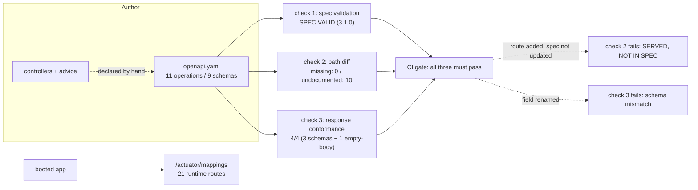

# API Documentation

## 1. Learning Objectives

After this lesson you can:

- [ ] Author an OpenAPI 3.1 contract for a real application and have it **machine-validated**
      (executed: `SPEC VALID: OpenAPI 3.1.0 — paths: 11, operations: 11, schemas: 9`
      via `openapi-spec-validator`)
- [ ] Detect drift between contract and runtime **mechanically** instead of by trust:
      diff the spec's paths against the framework's own route table (executed:
      `IN SPEC, NOT SERVED: none` — all 11 documented routes served with matching
      methods — while 10 live routes were caught **undocumented**)
- [ ] Validate live responses *against the declared schemas* (executed: 4/4 conformance
      checks — `JobAccepted`, `Price`, `Envelope` validated, and the foreign-id `404`
      confirmed as `body bytes=0`)
- [ ] Document what clients actually break on — status codes, error `type` URIs, the
      identical-404 semantics, required headers — not just happy-path shapes
- [ ] Choose a documentation workflow (hand-authored vs generated vs hybrid) for a
      given team and defend where the contract sits in review
- [ ] Classify undocumented endpoints the way the executed diff forced: framework
      noise (`/error`), lesson fixtures (`/hello`, `/config`), and *real API surface*
      (`/session/*`, `/jpa/*`) that the contract is honestly missing

## 2. Prerequisites

- [Validation and Error Handling](validation-and-error-handling.md) — the error
  envelope is schema content: `type/status/detail/fieldErrors` are the contract's
  hardest-working components.
- [Controllers, Services, Repositories](controllers-services-repositories.md) — you
  need a routed application before a contract can be diffed against it.
- [HTTP and REST APIs](http-and-rest-apis.md) — status codes and resource semantics
  are the vocabulary this lesson writes down.

## 3. Introduction

An API is a contract whether or not you write it down: every consumer has *some*
model of your paths, statuses, and payloads, assembled from source reading, blog
posts, and trial and error. API documentation is the act of making that model
**explicit, versioned, and testable** — and this lesson treats it like every other
claim in this subject: executed. The batch's lab app grew one endpoint at a time
across sixteen lessons, which makes it a perfect drift specimen. The lesson authors
the contract for it (`openapi.yaml`, 11 operations), runs a real validator, then
**diffs the document against the running server's own route table** and validates
live responses against the declared schemas. The two numbers from that diff — *11
documented routes all served*, *10 served routes undocumented* — are the lesson in
miniature: documentation rots from the direction you're not looking.

## 4. The Problem It Solves

Undocumented APIs fail in four expensive ways. **Consumers guess**: a mobile team
assumes `200` on duplicate registration (the API says `409`), a partner POSTs where
only `PUT` exists — each guess becomes a bug report against *your* code. **Internally,
drift is invisible**: endpoints get added "just for the demo" (the diff found ten),
statuses change during refactors, and nothing fails — until integration week. **Review
has no artifact**: a PR that changes `409` to `400` for duplicate usernames looks
like a one-line diff in a controller, with no place to ask "did we intend to break
every existing client?" **Generation-after-the-fact lies**: docs written (or
annotation-scraped) after the code encode what the code *did*, not what you agreed
to support, and they re-generate silently on every refactor. The fix is treating the
spec as a **build artifact with CI checks**: validated when authored, diffed against
the runtime when the app boots, and conformance-tested against real responses —
three checks, all executed below, each one catching a class of rot the others miss.

## 5. Core Concepts

### The contract, machine-validated (executed)

The spec for the lab: `openapi: 3.1.0`, 11 paths, every operation with declared
request/response schemas, and — the part that pays for itself — the **components
section where the error envelope lives once**:

```yaml
Envelope:
  type: object
  required: [type, status, detail]
  properties:
    type: { type: string, format: uri }
    status: { type: integer }
    detail: { type: string }
    fieldErrors:
      type: array
      items:
        type: object
        required: [field, message]
        properties: { field: { type: string }, message: { type: string } }
```

```console
$ python -c "from openapi_spec_validator import validate; ... validate(spec)"
SPEC VALID: OpenAPI 3.1.0
paths: 11 operations: 11
schemas: 9
```

Validation is the cheapest layer of the discipline: `$ref` resolution, structural
rules, and schema well-formedness checked in milliseconds — a malformed spec can
never ship to the portal or generator. The `404` entry shows why prose still belongs
in a machine contract: `description: absent OR not yours — byte-identical by design`
— the semantics from lesson 13 recorded where every consumer reads it, while the
*shape* (empty body) remains machine-checkable.

### Drift detection: the spec vs the server's own route table (executed)

The framework already knows its routes (`/actuator/mappings`), so the diff needs no
human inventory:

```console
spec paths:      11
runtime routes:  21
IN SPEC, NOT SERVED: none
SERVED, NOT IN SPEC: ['/cache/stats', '/config', '/error', '/hello',
                      '/jpa/customers/fetch', '/jpa/customers/n1',
                      '/jpa/lazy-outside/{id}', '/session/login',
                      '/session/logout', '/session/me']
matched: 11

  /admin/stats ['GET']        /jobs ['POST']
  /api/orders ['POST']        /jobs/{id} ['GET']
  /api/orders/{id} ['GET']    /upload ['POST']
  /auth/login ['POST']        /cache/doc ['GET']
  /auth/register ['POST']     /cache/invalidate/{sku} ['POST']
  /cache/price/{sku} ['GET']
```

Read both directions — they fail differently:

- **`IN SPEC, NOT SERVED: none`** is the *consumer-breaking* direction: a documented
  route that doesn't exist means someone's client is broken today. Zero is the only
  acceptable number, and it's the check worth putting in CI against a booted app.
- **`SERVED, NOT IN SPEC: 10`** is the *coverage* direction, and it's where rot
  actually accumulated — because nothing failed while it grew. The triage is the
  exercise: `/error` is framework machinery (documented as "not ours" or excluded);
  `/hello`, `/config` are lab fixtures (exclude deliberately); `/session/*` and
  `/jpa/*` are **real routes from lessons 14 and 11 that the contract silently
  lacks** — exactly the kind of "we'll write the docs later" that never arrives.
  Note `/cache/stats` too: an operational endpoint that *should* appear with a
  `private`/monitoring note. The diff doesn't tell you which bucket a route belongs
  in; it forces you to decide, publicly, for all ten.

The method table (`['GET']`/`['POST']` per path) closes the loop on lesson 3's
`405 + Allow` battery: the documented methods and the runtime's allowed methods are
the same fact, now checked from two directions.

### Response conformance: schemas against live bytes (executed)

Validation and diffing still allow the *content* to drift. The third check runs real
responses through the declared schemas:

```console
POST /jobs -> 202                 status=202  OK  schema: JobAccepted valid
GET /cache/price -> 200           status=200  OK  schema: Price valid
POST /api/orders -> 400           status=400  OK  schema: Envelope valid
GET /api/orders/{id} foreign       status=404  OK  schema: body bytes=0
```

Four checks, three payload schemas validated with `jsonschema`, and the fourth
asserting something a payload schema *cannot* express — the foreign-id `404` carries
**zero bytes**, lesson 13's identical-absence rule checked as literal emptiness.
This is where documentation stops being prose: a PR that adds a `debug` field to
`Price`, changes `fieldErrors[].field` to `path`, or starts returning an error body
on foreign-id 404s fails the conformance run *while the spec still validates* — the
three checks catch disjoint failure modes on purpose.

### What clients actually break on

The spec's per-operation response sets encode the decisions from earlier lessons,
which is the real documentation content:

| Declared | The decision it records |
|---|---|
| `201` + `Location` header | creation returns an address, not just an id (lesson 3) |
| `409` on register/orders | state conflicts are their own family (lessons 10/12) |
| `401` shared by both credential failures | one body, no enumeration (lesson 12) |
| `404` "byte-identical by design" | the IDOR rule as consumer-visible semantics (lesson 13) |
| `202` or `200` on `POST /jobs` | `202` fresh accept, `200` duplicate key — the two-status contract (lesson 18) |
| `413` on `/upload` | the container's limit is part of the API (lesson 16) |
| required `X-User` header | the lab's identity seam, marked `required: true` so consumers can't miss it |

An endpoint's documentation is *mostly its unusual choices* — the statuses and
headers a generic tool would never infer from the happy path.

## 6. How It Works



Three checks, three disjoint failure modes: structural rot (check 1), inventory rot
(check 2), content rot (check 3). A documentation workflow that runs only one of
them is blind exactly where the other two see.

## 7. Practical Examples

**Example 1 — one operation, written the way clients need it**

```yaml
/jobs:
  post:
    operationId: submitJob
    summary: Accept a background job (202 + Location), idempotent by key
    requestBody:
      required: true
      content:
        application/json:
          schema:
            type: object
            required: [kind]
            properties:
              kind: { type: string, enum: [echo, fail] }
              key: { type: [string, "null"], description: client idempotency key }
    responses:
      "202":
        description: queued
        headers:
          Location: { schema: { type: string } }
        content:
          application/json:
            schema: { $ref: "#/components/schemas/JobAccepted" }
      "200":
        description: duplicate key — same job id, duplicate=true
        content:
          application/json:
            schema: { $ref: "#/components/schemas/JobAccepted" }
```

- Two success statuses on one operation is the honest shape from lesson 18 — a
  generator producing "200 means success" would erase the distinction clients branch
  on (`duplicate` is in the schema, but the *status* is the cheap signal).
- `operationId` names are the client-generator contract (`submitJob` becomes the SDK
  method), so they're reviewable API surface, not comments.
- **How to run the three checks:** `pip install --target ./pylibs openapi-spec-validator`;
  check 1 — `validate(spec)`; check 2 — start the jar and diff `curl -s
  /actuator/mappings` paths against `spec.paths` (the extraction walks
  `requestMappingConditions.patterns`); check 3 — `jsonschema.validate` live responses
  against `components.schemas`.
- **Expected output:** `SPEC VALID … 11/11/9`; the diff block with `none` missing and
  the 10-route list; the 4/4 conformance lines.
- **Assumptions:** OpenAPI 3.1 (`type: [string, "null"]` syntax needs it); the app
  exposes `management.endpoints.web.exposure.include=…,mappings` for the diff —
  monitoring-only endpoint, noted as such.

**Example 2 — the components section as the single source of error shape**

```yaml
# every $ref below points at ONE definition — change the envelope once, here
BadRequest:   { content: { application/json: { schema: { $ref: ".../Envelope" } } } }
Unauthorized: { ... }   Forbidden: { ... }   Conflict: { ... }
```

- Reusing one `Envelope` schema across `400/401/403/409/413` means the conformance
  check tests **the error contract everywhere at once** — a drift in the advice's
  field names fails every affected operation's check in one run.
- **Expected output:** check 3's `Envelope valid` line (captured from the `400`),
  which by `$ref` is the same definition the other four statuses use.

## 8. Real-World Applications

The three executed checks are the industry shape in miniature: contract validation
in CI (Spectral/Redocly linting rules on top of `openapi-spec-validator`),
differential checks in integration environments (the runtime route table is available
in Spring via `/actuator/mappings`, in most frameworks via their router introspection,
and in service meshes from observed traffic), and contract *tests* (Pact,
Spring Cloud Contract, Schemathesis-style fuzzing) where the spec drives requests and
assertions — lesson 21's Testcontainers suite gains exactly these cases as contract
tests. Teams consume the same file three ways: human portal (Redoc/Swagger UI),
client SDK generation (`operationId` → method names), and server stubs for front-end
parallel development — which is why the spec belongs **in the repository, reviewed in
PRs**, not generated silently from annotations: a change to `409 → 400` should show
up as a diff a human approves. The triage of the ten undocumented routes mirrors
every real adoption: the first drift report is always part noise (framework routes),
part abandoned fixtures, and part genuine surface nobody admitted was public.

## 9. Common Mistakes

| Mistake | Why it happens | How to recognize it | How to prevent it |
|---|---|---|---|
| Docs written after code, never checked | "later" culture | spec validates but paths drift | the check-2 diff in CI against a booted app (executed: caught 10) |
| Annotation-scraping as the only source | generation convenience | spec changes on every refactor with no review gate | hand-author or gate generation; the spec is reviewed *output*, not a build side-effect |
| Documenting only 200s | happy-path habit | clients learn `409`/`404` semantics from prod | declare every status you return, with the decision in `description` (the 404 note) |
| One schema per operation's error | copy-paste | envelope shapes diverge across endpoints | one `Envelope` `$ref` everywhere — conformance then covers all of them |
| Skipping empty-body assertions | schemas can't express them | foreign-404 starts carrying a body unnoticed | assert emptiness explicitly (check 3's fourth line) |
| Undocumented operational endpoints | "not for clients" | `/cache/stats` absent, still callable | document with `private`/monitoring markers, or exclude by explicit rule |
| No `operationId` naming review | tooling default | generated SDK methods named `apiOrdersPost` | treat `operationId` as public API |
| Portal as the source of truth | hosted docs drift | repo spec differs from portal | repo file is canonical; portal publishes *from* it |
| Vague `404` description | generic text | consumers conflate foreign and missing | write the semantics ("byte-identical by design") where consumers read |

## 10. Best Practices

- **Keep the spec in-repo and diffable**; every status/header/semantic change is a
  reviewed line in the same PR as the code change.
- **Run all three checks, in this order of value**: path diff against the booted app
  (catches the rot you can't see), response conformance (catches content drift),
  structural validation (catches malformed commits). One without the others is
  partially blind — the disjoint failure modes are the argument.
- **Document decisions, not shapes**: the identical-404, the two-status job accept,
  the container-enforced 413 — these are the parts no client can infer and no
  generator can derive.
- **Decide inclusion rules publicly**: framework routes excluded by prefix, fixtures
  deleted or marked, real surface documented — the diff output is a worklist, not a
  verdict.
- **Version the contract** (`info.version` at minimum, URL prefix when breaking) so
  consumers can pin expectations.
- **Feed lesson 21's tests from this file**: the same schemas power contract tests,
  so documentation and verification can't disagree silently.

## 11. Limitations and Trade-Offs

The executed checks are **structural and content-level, not behavioral**: the diff
proves routes exist and the conformance run proves sample responses match schemas —
neither proves the API *behaves* as described across its state space (a contract
test suite doing every documented status does; the battery here sampled four). The
route diff required **exposing `/actuator/mappings`** — in production that endpoint
is operational surface (auth-gate it or read the route table from an internal
source); the lesson used the lab's local exposure and says so. OpenAPI itself has
known expressiveness gaps: the byte-identical-404 *relationship* between two
endpoints, the timing-uniformity property of login, and idempotency-key *behavior*
across requests are semantics that fit prose or separate tests, not JSON Schema —
the spec documents each side but can't state the equivalence. Schema-only
conformance also can't catch a **missing** response: if the app stopped returning
`fieldErrors`, only a check that actually *provokes* a validation error would see it
— which is why the response checks were driven by real triggering requests (invalid
body, foreign id), not random sampling. Finally, hand-authoring (this lesson's
choice, for reviewability) costs more per endpoint than annotation scraping; the
hybrid — generate the skeleton, review the result — trades the same decision the
team must make explicitly rather than by default.

## 12. Practical Exercises

### Introductory

1. **Exercise 19.1** — run all three checks verbatim and report your numbers: the
   validator's counts, the diff's two directions, and the 4/4 conformance lines.
   Then classify each of the ten undocumented routes into: framework / fixture /
   real-surface-you-would-document, with one line of reasoning each.
   **Completion criteria:** three outputs pasted; the ten-way classification; the
   exact list you'd add to the spec first.
2. **Exercise 19.2** — break the contract deliberately: rename `fieldErrors` to
   `fields` in the spec only, re-run check 3, capture the schema-validation failure;
   then change the spec's `202` to `201` for `POST /jobs`, re-run the live request,
   and capture the status mismatch. Restore both.
   **Completion criteria:** two failing captures (content drift caught two ways);
   the restore diff; one sentence on why the app didn't care in either case.

### Intermediate

3. **Exercise 19.3** — close the coverage gap: add `/session/login`, `/session/me`,
   `/session/logout`, and `/cache/stats` to the spec (statuses, request/response
   schemas from the lessons' batteries), re-run the diff, and show the undocumented
   list shrink from 10 to the explicitly-excluded remainder — with your exclusion
   rule written as a filter (`/actuator*`, `/error`, …) rather than ad hoc omissions.
   **Completion criteria:** validator green on the extended spec; the before/after
   diff; the exclusion rule stated in one line and enforced in the script.
4. **Exercise 19.4** — provoke, don't sample: extend check 3 to trigger one response
   per documented status family across the app — `201` (upload), `409` (duplicate
   register), `401` (unknown login), `403` (role gate), `413` (oversize upload),
   `404` (empty body) — validating each against its declared schema, and capture a
   full pass.
   **Completion criteria:** six+ provoked checks green (each with its triggering
   request); your script's structure (request → status assert → schema assert); one
   paragraph on why provoked beats sampled.

### Independent problem-solving

5. **Exercise 19.5** — take the contract to the other side: generate a client from
   your spec (any generator — `openapi-generator` or an online one), call two
   endpoints through the generated code, and let the generated types' failures teach
   you what the spec got wrong — every deserialization error or missing field is a
   documentation defect found by *consumption*. Write up each defect, fix the spec
   (not the client), regenerate, and re-run until two calls pass cleanly. Then state
   which of the three checks would have caught each defect *without* a client.
   **Completion criteria:** generated client's failing calls with errors; the defect
   list and spec fixes; the mapping from each defect back to check 1/2/3 coverage —
   including any that none of the three catch (and what fourth check would).

*Solutions: attempt first. They live in `exercises/solutions/` of this subject.*

## 13. Knowledge Check

1. Check 2 reported `IN SPEC, NOT SERVED: none` but still failed overall — on which
   direction, and why is that direction worse? … *(It flagged 10 `SERVED, NOT IN
   SPEC`. That's the worse direction for *this* stage because it's silent: a
   documented-but-missing route breaks clients loudly today (they 404 and call you),
   while an undocumented route rots invisibly — the lab accumulated ten while every
   test passed. Both must be zero/zero; the diff just makes clear that only one of
   them ever announces itself.)*
2. Why does the conformance check include a literal `body bytes=0` assertion when
   `jsonschema` already passed the other three? … *(Because schemas describe JSON
   that exists; the foreign-id 404's contract is *emptiness plus byte-equality with
   the missing-id 404* — lesson 13's IDOR rule. A body appearing there would still
   validate against whatever schema someone lazily attaches, so the emptiness must be
   asserted directly. It's the check that protects a semantic no schema can hold.)*
3. A teammate proposes generating the spec from code annotations on every build so
   it "can never drift." What does the executed evidence say about that? … *(The diff
   proves drift ran the *other* way: 10 routes existed undocumented — generation
   would absorb them silently, making the portal perfectly and wrongly accurate.
   Generated specs describe what exists; contracts are what you've agreed to support
   and reviewed as changes. Generation fixes check 2's inventory and destroys its
   review gate — hence hybrid: generate, then diff-and-review the delta deliberately.)*

## 14. Completion Criteria

Observable evidence that you have understood this lesson:

- [ ] All three checks executed on your machine with numbers reported (validator
      counts, the two-way diff, conformance lines)
- [ ] The ten-undocumented-route triage written with your inclusion rule
- [ ] At least one provoked-per-status conformance run (Exercise 19.4) green
- [ ] One deliberate contract break seen failing in check 2 *and* check 3, restored
- [ ] Your own project's spec: committed to the repo, validating, with the diff
      running somewhere automated

## 15. Summary

- The contract is a **tested artifact**: validated structurally (`SPEC VALID 3.1.0`),
  diffed against the running app (`none` missing / `10` undocumented), and checked
  against live bytes (4/4 including an emptiness assertion) — three disjoint failure
  modes, three checks.
- The runtime's own route table is the drift oracle: documentation rots away from
  the happy path, and the diff converts it into a worklist with a triage
  (framework / fixture / real surface).
- Schema components — especially the shared `Envelope` — make every error response
  checkable with one definition, and `description` carries semantics schemas can't
  (the identical-404, the two-status job accept).
- Provoke responses, don't sample them: each documented status family gets a request
  that forces it.
- Review the spec in the PR that changes the API — the spec is the diff that makes
  breaking changes visible.

## 16. Next Steps

- Next lesson: [Logging](logging.md) — the operational record of the contract being
  exercised, with correlation ids tying requests to lines.
- Practice: [exercise sets](exercises/README.md) for this subject.
- Where it is applied: [Project 04 — REST API](../20-PROJECT-LABORATORY/project-04-rest-api/README.md)
  — the spec and its three checks are graded deliverables of the project.