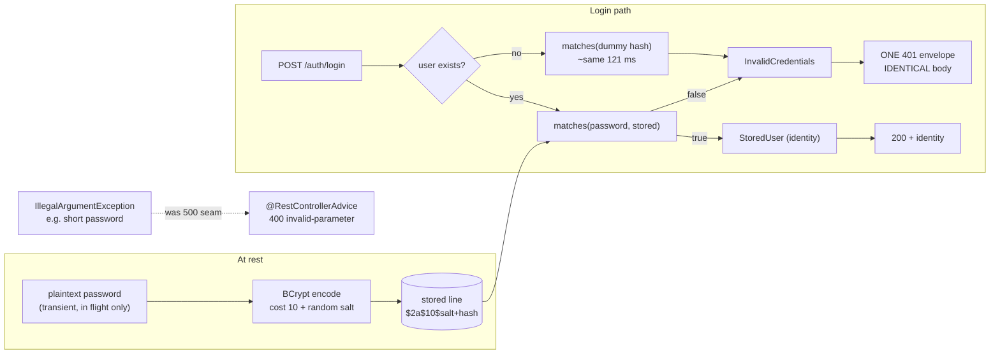

# Authentication

## 1. Learning Objectives

After this lesson you can:

- [ ] Explain what a password hash *is* in bytes — salted, cost-parameterized,
      self-describing — and read one from a capture (executed: two bcrypt hashes of the
      same password `equal? false`, format `$2a$10$...`, algorithm `2a`, cost `10`)
- [ ] Defend a *slow* hash with measured numbers (executed: bcrypt **~121 ms/hash**
      vs SHA-256 **~1.1 µs/hash** — five orders of magnitude, deliberate)
- [ ] Build a login that cannot leak which half failed (executed: wrong-password and
      unknown-user responses diffed byte-for-byte — **IDENTICAL** — with matched
      timings 0.159 s vs 0.160 s because the unknown path burns the same bcrypt work
      on a dummy hash)
- [ ] Classify each authentication failure by family and status: taken username `409`,
      bad credentials `401`, weak password `400` (executed — including the seam where
      the weak-password path first escaped as a `500` and was closed in the advice)
- [ ] Say what authentication does *not* yet give you: identity is established, but
      nothing authenticates the *requests that follow* — the gap the sessions/tokens
      lesson fills
- [ ] Recognize enumeration, credential stuffing, and timing side channels in code
      reviews, and name the countermeasure each requires

## 2. Prerequisites

- [Controllers, Services, Repositories](controllers-services-repositories.md) — the
  login endpoint follows the placement discipline: the service owns the credential
  decision, the controller translates it.
- [Validation and Error Handling](validation-and-error-handling.md) — the single
  envelope, and the fall-through seam this lesson found again (`A6` → `A6r`).
- [Java Backend Development](java-backend-development.md) — hashing is library code;
  `MessageDigest` and friends were introduced there.

## 3. Introduction

Authentication answers one question — *who is presenting this request?* — and the
answer must survive an attacker who has your database. This lesson executes the two
halves of that claim. **At rest**: what you store for a password is not a password but
a salted, cost-tuned bcrypt line, produced and verified by
`spring-security-crypto`'s `BCryptPasswordEncoder`, measured here against a raw
SHA-256 to show why the slow one is the correct one. **In flight**: a login endpoint
whose failure responses are byte-identical whether the username exists or the
password is wrong — proven with a `diff`, not a claim. The captures also include this
batch's recurring character: a genuine seam (an unhandled `IllegalArgumentException`
escaping as the default `500` body) caught and closed the same way the error-contract
lesson taught.

## 4. The Problem It Solves

Before password *hashing*, systems stored passwords — so a single leaked file was a
password list, reusable everywhere humans reuse passwords. The first fixes were
encodings and unsalted digests; executed comparison shows the flaw precisely:
`sha256("correct horse battery staple")` is `c4bbcb1f...` **every time** — one rainbow
table entry covers every user with that password, and identical hashes across accounts
are free confirmation that two people share one. Hashing also has to survive *speed*:
a fast hash is a gift to attackers with GPUs (billions of guesses per second) and a
tax on defenders (a login every few seconds). And verification itself leaks: an
existence check ("no such user") tells an attacker which usernames to stuff, and a
fast-failing path for missing users vs a slow one for real accounts leaks by *timing*.
Authentication is therefore not one feature but three constraints at once —
**irreversible at rest, deliberately expensive to guess, uniform in failure** — which
is exactly the trio this lesson measures.

## 5. Core Concepts

### What is stored: the salted cost line (executed)

```console
--- 1. same password, two hashes (per-hash salt)
  h1 = $2a$10$zhnYBmoHJWxOkNLIbqXtlOfHFm1TQN.MLLAJ/cHLcp59H3vd5pU/G
  h2 = $2a$10$Ny96bd7J5MYH19JbY5Sj/e1NIRWXG1hXlHQ6w030yjtIozew7UwSu
  equal? false
--- 3. hash format: $algo$cost$salt+hash
  algorithm=2a cost=10 salt+hash fields=3
```

Read the line as data: `$2a$` names the algorithm, `10` is the **cost parameter**
(2^10 rounds), the next 22 characters are a random salt, the rest the derived hash —
all self-describing, so a stored line can be verified *and* upgraded in place. The
two identical inputs produced different lines (`equal? false`): every user's hash is
personalized, so rainbow tables and cross-account correlation both die with one
property. Verification re-derives with the embedded salt:

```console
--- 2. verify true / false, and malformed stored hash
  matches(correct): true
  matches(wrong):   false
  Encoded password does not look like BCrypt      ← WARN on malformed stored line
  matches(malformed): false
```

Note the malformed case: a corrupt or attacker-written line **warns and fails closed**
(`false`), never throws into a 500 and never compares equal.

### Why slow: five orders of magnitude (executed)

```console
--- 4. deliberate slowness: bcrypt vs SHA-256
  bcrypt x3: 365 ms  (~121 ms/hash)
  sha256 x100000: 112061 us  (~1.12061 us/hash)
```

121 ms versus 1.1 µs — bcrypt is roughly **110,000× slower**, and that ratio *is* the
design: it caps an attacker's guesses per second at hardware cost, while a human
notices nothing at one login per second (measured end-to-end below: A3's login took
0.193 s total). Cost `10` is a *knob*, not a law: raise it as hardware improves, and
`BCryptPasswordEncoder.matches` verifies old-cost lines anyway — the self-describing
format makes migration gradual. The lesson's counter-image is section 5's own
comparison: `sha256(password)` printed `c4bbcb1f...` — fast, unsalted, and identical
for every account on earth.

### The login endpoint: one failure, no enumeration (executed)

The service's authenticate method has **one** exception type and a dummy-hash burn
for the missing-user path; the controller has **one** `401` branch:

```java
StoredUser user = users.get(username);
if (user == null) {
    encoder.matches(password, DUMMY_HASH);   // same ~121 ms work, then:
    throw new InvalidCredentials();
}
if (!encoder.matches(password, user.hash())) throw new InvalidCredentials();
```

Battery:

```console
=== A1 register ade            status=201  {"type":".../created","detail":"account created"}
=== A2 register duplicate      status=409  {"type":".../taken","detail":"username unavailable"}
=== A3 login correct           status=200  time=0.193094s  {"status":200,"role":"USER","user":"ade"}
=== A4 login wrong password    status=401  time=0.159002s  {"type":".../credentials","detail":"invalid credentials"}
=== A5 login unknown user      status=401  time=0.160390s  {"type":".../credentials","detail":"invalid credentials"}
=== A7 diff A4 vs A5 bodies    IDENTICAL
```

Three separate guarantees, each captured: **one body** (the `diff` says IDENTICAL — a
client cannot distinguish "no such user" from "wrong password"); **one timing class**
(159 vs 160 ms — the dummy hash makes the missing-user path cost the same work, so
`time_total` can't be used as an oracle either); and **one decision point** (the
service throws a single exception type, so the *HTTP layer* also can't leak the
distinction — it never knows). A2's `409` is deliberately *different*: registration
already reveals available usernames by its nature, so it gets an honest status — the
uniformity rule applies to *credential failures*, not to everything.

### Failure families, executed — including the seam

```console
=== A6 register short password  status=500  {"timestamp":...,"status":500,...}   ← BEFORE
=== A6r same request, after     status=400  {"type":".../invalid-parameter",
                                             "detail":"username and password (min 8) required"}
```

The weak-password check threw `IllegalArgumentException` from the service, and — the
error-contract lesson's fall-through, one more family — no handler existed, so Boot's
default body escaped. Closed with one advice method (`400 invalid-parameter`). The
placement now reads cleanly: **format/length → 400, credentials → 401 (uniform),
username taken → 409**, each decided exactly once, each with a captured body. (Lab
honesty: catching bare `IllegalArgumentException` in an advice is broad — a production
codebase registers a *named* exception for this instead; the seam matters more than
the type.)

## 6. How It Works



Read the two edges into `InvalidCredentials`: both paths converge *before* HTTP, which
is why body and timing can't tell them apart — the discipline is placed where the
information still exists, and destroyed there.

## 7. Practical Examples

**Example 1 — the hash probe, in full (executed as quoted above)**

```java
BCryptPasswordEncoder enc = new BCryptPasswordEncoder();
String h1 = enc.encode("correct horse battery staple");
String h2 = enc.encode("correct horse battery staple");
// h1.equals(h2) == false — per-hash salt
enc.matches("correct horse battery staple", h1);   // true
enc.matches("correct horse batterie", h1);         // false
enc.matches("x", "not-a-hash");                    // false + WARN, fails closed
```

- **How to run it:** `mvn dependency:build-classpath -Dmdep.outputFile=cp.txt` then
  `javac -encoding UTF-8 -cp "$(cat cp.txt)" AuthProbe.java && java -cp
  ".;$(cat cp.txt)" AuthProbe`.
- **Expected output:** the five-section transcript quoted across section 5 (hashes
  differ by salt; timing ≈121 ms vs ≈1.1 µs on the authoring machine).
- **Assumptions:** spring-security-crypto (Boot 4.1.1 managed), JDK 25.0.4.1, Windows
  11 + Git Bash; `cost` 10 is the default and timing varies with hardware.

**Example 2 — the anti-enumeration login, in full**

```java
public StoredUser authenticate(String username, String password) {
    StoredUser user = users.get(username);
    if (user == null) {
        encoder.matches(password == null ? "" : password, DUMMY_HASH); // burn the same time
        throw new InvalidCredentials();
    }
    if (!encoder.matches(password == null ? "" : password, user.hash()))
        throw new InvalidCredentials();
    return user;
}
```

- The controller's only credential branch: `catch (InvalidCredentials)` → the single
  `401` envelope (A4/A5, diff IDENTICAL).
- **How to run it:** `java -jar target/spring-smoke-0.0.1-SNAPSHOT.jar`, then the A1–A7
  `curl` battery; `diff` the two failure bodies the way A7 did.
- **Expected output:** `201 / 409 / 200 / 401 / 401 / 400` with timings and bodies as
  quoted; `A7 → IDENTICAL`.
- **Assumptions:** in-memory user store resets per run (ids/timings are lab numbers);
  the DB-backed parts of the app are unaffected.

## 8. Real-World Applications

This is the authentication core every other lesson in the security run builds on:
identity established here is what [Authorization](authorization.md) will *act on*,
what [Sessions and Tokens](sessions-and-tokens.md) will *carry across requests*, and
what [OAuth2/OIDC](oauth2-and-openid-connect.md) will *delegate* when you don't want
to hold passwords at all. The specific practices are production ones: bcrypt (or
Argon2/scrypt) as the password KDF with cost raised over time and old lines verified
by their embedded parameters; uniform `401` + dummy-work against enumeration and
timing oracles; `409` on registration as the one place username existence is
legitimately public; registration length rules enforced as `400` through the single
error envelope; and plaintext passwords handled transiently — never logged (the app's
`show-sql` prints parameterized queries, and nothing prints bodies server-side). The
same battery shape — register, login, wrong-password, unknown-user, `diff` the bodies,
compare the timings — is exactly what a pre-release auth checklist should run.

## 9. Common Mistakes

| Mistake | Why it happens | How to recognize it | How to prevent it |
|---|---|---|---|
| Storing plaintext or reversible "encryption" | shortcut for "we need to recover it" | any decrypt call near passwords; `password` column readable in a dump | you never need the password, only verification — hash with bcrypt/Argon2 |
| Unsalted fast hash (`SHA-256`, MD5) | "it's still a hash" | identical digests for identical passwords across users; µs verification | salted KDF with a cost parameter; executed 110,000× gap is the argument |
| One shared pepper in code + no salt | rainbow-table folklore | one secret in the repo protecting all users | per-hash salt *and* (optionally) a pepper from a secret store — salt first |
| "Username not found" as a distinct 404/400 | honest debugging instinct | two different bodies or statuses for the two failure halves | one exception type for credentials (A7's IDENTICAL is the acceptance test) |
| Timing leak via missing-user fast path | forgot the dummy work | unknown-user logins measurably faster | burn a real `matches` against a dummy hash (executed: 0.159 s vs 0.160 s) |
| Rate limiting only at the login handler | abuse handled downstream | stuffing runs at bcrypt speed per IP rotation | throttle per account and per IP *before* hashing; alert on 401 ratios |
| Errors escaping as default `500` bodies | new exception family, no handler | `timestamp/status/error/path` appears anywhere | re-run the failure battery after every new validation path (A6 seam) |
| Password rules as pure client-side checks | UX-first thinking | no `400` server-side for weak input | server enforces length/compromise rules at register (A6r) |

## 10. Best Practices

- **Hash with a salted KDF (bcrypt default cost, Argon2id where available); raise the
  cost over time** — the self-describing line lets you re-hash on next successful
  login.
- **One credential-failure path**: single exception, single envelope, dummy work for
  the missing user — then *test* it with a `diff` of the bodies and a timing sample.
- **Never log credentials or their hashes**; keep passwords out of DTOs after the
  verify call (the lab's `Credentials` record is request-scoped and never stored).
- **Enforce password rules server-side as `400`**, through the existing envelope
  (A6r), and consider a compromised-password check (Have I Been Pwned-style) at
  registration.
- **Rate-limit before the expensive operation** and instrument `401` rates per
  account/IP — enumeration attempts show up in the *shape* of failures even when
  bodies are uniform.
- **Rotate the plan, not the algorithm, on breach**: password *reset for all users*
  is the response to a leak; algorithm upgrades are routine maintenance.

## 11. Limitations and Trade-Offs

What this lab deliberately does **not** do is as instructive as what it does: it
stores users in memory (restart = all gone), issues no credential for *subsequent*
requests — A3 proves identity at login, but request N+1 arrives unauthenticated,
which is the whole subject of the next two lessons. `BCryptPasswordEncoder`'s
default cost trades 121 ms of server CPU per login: at scale that's a capacity
number, and a login endpoint without rate limiting turns the *defender's* cost into a
DoS lever — the countermeasure is throttling, not a faster hash. The uniform-401 rule
**hides genuinely different diagnostics**: support teams debugging "wrong password"
vs "no such user" need server-side logs distinguishing them (logged safely by the
service, never in the response) — uniformity is a *wire* property, not an internal
one. Dummy-work mitigates timing on average; hard real-time uniformity (constant-time
comparison of everything) is a stronger guarantee than a 1 ms-resolution `diff` can
demonstrate, and network jitter still dwarfs the residual difference — the honest
claim is "no *cheap* oracle", not "information-theoretically silent". Finally, the
advice's `IllegalArgumentException → 400` catch is a lab-grade breadth; production
uses a named exception, as noted.

## 12. Practical Exercises

### Introductory

1. **Exercise 12.1** — run the hash probe and answer from your own captures: what two
   bytes identify the algorithm and cost in `h1`, why do `h1` and `h2` differ, and
   what exactly happens when `matches` gets a malformed stored line (quote the WARN and
   the result)?
   **Completion criteria:** three answers with quoted output; one sentence on why the
   malformed case *fails closed* instead of throwing.
2. **Exercise 12.2** — reproduce the A4/A5 uniformity test: run both failures, `diff`
   the bodies, and capture `time_total` for each five times; compute both averages and
   state whether your measurements could distinguish them *reliably*.
   **Completion criteria:** `IDENTICAL` diff; ten timing numbers with averages; your
   conclusion including what would make the oracle better (removing the dummy burn)
   and how you'd re-measure.

### Intermediate

3. **Exercise 12.3** — break enumeration on purpose: remove the dummy-hash line from
   `authenticate`, rebuild, and repeat Exercise 12.2's timing test; then restore it.
   Write up what an attacker could now do with ~30 samples per target.
   **Completion criteria:** before/after timing tables with averages; the attack
   sketch (threshold classifier, sample count, network-jitter caveat); the restore diff.
4. **Exercise 12.4** — cost migration: register a user, capture their stored line with
   cost `10`, then construct a hash line at a different cost (e.g. `encode` under a
   `BCryptPasswordEncoder(12)`) and verify `matches` still succeeds *across* cost
   lines — then explain where the cost travels in the string.
   **Completion criteria:** two hash lines with costs `10` and `12`; cross-verification
   output; the migration story (re-hash-on-login) in three sentences.

### Independent problem-solving

5. **Exercise 12.5** — write the login failure checklist as an executable script: for
   a given API, register a user, then drive unknown-user / wrong-password / empty /
   malformed-JSON / duplicate-username / short-password and assert for each the
   expected status, envelope `type`, and — for the credential pair — byte equality of
   bodies. Run it against this lab, then run it against any API you use (its public
   docs version) and report which checks it *fails*, without concluding anything about
   causes you can't observe.
   **Completion criteria:** the script; a green run on the lab; a results table for
   the second target with only observable claims (statuses, body equality, timing
   spread); one paragraph separating *evidence* from *inference* about any failure.

*Solutions: attempt first. They live in `exercises/solutions/` of this subject.*

## 13. Knowledge Check

1. Two users share the password `correct123`. Why doesn't their shared SHA-256 hurt
   under bcrypt — and what did the executed capture show about bcrypt's answer? … *(bcrypt
   hashes differ per user: the stored lines embed a random salt, so `equal? false` even
   for identical input. Verification salts each attempt from the stored line, so there
   is no single value an attacker can precompute — the executed `c4bbcb1f...` unsalted
   digest is exactly the value rainbow tables exploit.)*
2. The dummy-hash burn makes unknown-user logins slower. Isn't that a performance
   cost for nothing? … *(It's the price of not being an oracle: without it, A5 would
   answer in microseconds while A4 answers in ~120 ms, and timing alone enumerates
   users. The cost is symmetric — it applies to attackers' guesses too — and rate
   limiting is the tool for the capacity question, not a faster failure path.)*
3. A security review says "the 401 responses are identical, so enumeration is
   impossible." What would you object to? … *(Uniformity covers bodies and mean timing;
   enumeration still runs through registration (`409` is honest there), rate-limit
   asymmetries, password-reset flows, and any side channel outside this endpoint's
   surface. The claim should be scoped to what A7 and the timing samples actually
   tested.)*

## 14. Completion Criteria

Observable evidence that you have understood this lesson:

- [ ] The hash probe ran: two differing hashes, `true/false/malformed` verification,
      format breakdown, and the timing gap — all from your own terminal
- [ ] The A1–A7 battery ran with `IDENTICAL` diff and timing samples you computed
- [ ] The A6 seam was caught on your machine and closed — re-run returns `400` with
      the `invalid-parameter` envelope (as A6r)
- [ ] Your login has one credential exception, one envelope, and a dummy-work path —
      and you can point at the line
- [ ] You can state, for your API, which statuses reveal which facts and why each is
      or isn't acceptable

## 15. Summary

- Authentication is three constraints at once: **irreversible at rest** (salted,
  self-describing `$2a$10$...` lines, per-hash salts making identical inputs differ),
  **deliberately expensive** (executed ~121 ms vs ~1.1 µs — ~110,000× — with cost as
  an upgradeable knob), and **uniform in failure** (A4/A5 bodies `IDENTICAL`, timings
  159/160 ms via dummy-work).
- Failure families map to statuses honestly: credentials `401` (uniform), username
  taken `409` (registration's legitimate reveal), weak input `400` (the `500` seam
  found and closed).
- Malformed stored hashes warn and fail closed; never throw into the response path.
- The wire is uniform, the logs are not: diagnostics stay server-side.
- This establishes *who*; nothing yet authenticates the requests that follow — the
  next lessons' subject.

## 16. Next Steps

- Next lesson: [Authorization](authorization.md) — identity is established; now
  decide what this identity may do, at the service layer, with ownership tests.
- Practice: [exercise sets](exercises/README.md) for this subject.
- Where it is applied: [Project 04 — REST API](../20-PROJECT-LABORATORY/project-04-rest-api/README.md)
  — registration and login are graded requirements of the project's API.