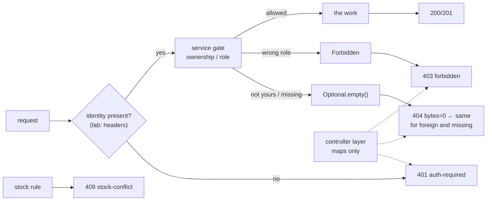

# Authorization

## 1. Learning Objectives

After this lesson you can:

- [ ] Separate the four failure families and say who produces each (executed, one
      battery: no identity → **401 auth-required**, known caller without role → **403
      forbidden**, other's row → **404 empty**, business rule → **409 stock-conflict**)
- [ ] Enforce **ownership** at the service layer and prove there is no existence
      oracle: another user's order and a nonexistent id return byte-equal responses
      (executed: `B3-vs-B4 body diff: IDENTICAL`, both `404 bytes=0`)
- [ ] Name the vulnerability the identical-404 design kills — IDOR/BOLA — and explain
      why "just return 403" would *confirm* the row instead
- [ ] Place role checks where they cannot be bypassed by a careless controller
      (executed: `/admin/stats` refuses inside `platformStats` before any work — the
      controller calls it unconditionally and the `403` still comes out)
- [ ] Demonstrate that authorization doesn't replace authentication or validation:
      `401` for missing identity (B7), `409` for stock regardless of caller (B8)
- [ ] Diagnose *where* a check belongs (URL mapping, service gate, query scope) for a
      given endpoint, and justify it in review terms

## 2. Prerequisites

- [Authentication](authentication.md) — identity is established there; this lesson
  *acts on it*. The lab's `X-User`/`X-Role` headers are a labeled stand-in for the
  verified identity the sessions/tokens lesson will deliver.
- [Controllers, Services, Repositories](controllers-services-repositories.md) — the
  placement discipline this lesson extends from *logic* to *access rules*.

## 3. Introduction

Authentication said who you are; authorization decides **what that identity may do**
— and it is where APIs leak data in practice (the OWASP API Security top list has
broken object-level authorization at #1). This lesson executes all four failure
families in one battery against a two-endpoint app, with the central claim tested the
only way that counts: a scanner iterating ids as user `bea` learns *nothing* — the
response for `ade`'s real order and for an id that never existed is byte-for-byte
identical. The rest of the battery shows placement: the role gate lives in the
service, so the controller's own carelessness can't route around it.

## 4. The Problem It Solves

Authorization bugs share one shape: **the check lives in the wrong layer, or not at
all**. The classic IDOR: `GET /api/orders/123` fetches id 123 and returns it — the
*authentication* was real, the *authorization* absent, and one scripted id sweep
reads the whole table. The reactive fix — "add a 403 when it's not yours" — is worse
than the bug: it confirms the row exists, turning enumeration from guesswork into a
lookup service. The second classic: role checks in the *controller*, where the next
developer adds a method that forgets the check — an entire endpoint ships open
because the gate was bolted to the socket rather than the state. The third: checks
that consult roles but not *ownership*, so any `USER` reaches every user's data. The
fix is a change of habit, not a library: **decide access where the data is read** —
the service, or better, the query's own scope — so that "not yours" and "not there"
are the same code path, and a forgotten controller method inherits the gate for free.

## 5. Core Concepts

### The four families, one battery (executed)

```console
=== B7 create with no identity     status=401 {"type":".../auth-required","detail":"identity required"}
=== B5 admin stats as USER         status=403 {"type":".../forbidden","detail":"role USER may not read platform stats"}
=== B3 bea reads ade order 1       status=404 bytes=0
=== B4 bea reads nonexistent 999   status=404 bytes=0
=== B8 stock conflict (owner)      status=409 {"type":".../stock-conflict","detail":"sku SKU-A has 3 in stock, requested 9"}
=== B6 admin stats as ADMIN        status=200 {"orders":1,"requester":"root","nextId":2}
```

Read the table as a decision tree about **what the caller knows**:

| Family | Status | Meaning | Why not a different one |
|---|---|---|---|
| No identity | 401 | we can't even name you | 403 would imply you were identified and refused |
| Identified, wrong role | 403 | we know you; you may not | 404 would *deny the endpoint's existence*, which is not true — it exists for admins |
| Not yours / not there | 404 (identical) | nothing *you can see* at that id | 403 here is the IDOR confession |
| Rule refused | 409 | your request was well-formed; the state says no | 400 would blame the client for a world fact |

Each status is produced once, at one layer — and B7/B8 show the boundaries: no
identity is caught **before** the service (the controller refuses), while the stock
rule fires **inside** the service regardless of who the caller is. Authorization
sits between them, at the same service boundary.

### Ownership without an oracle (executed — the lesson's core)

```java
// OrderService — the gate
public Optional<OwnedOrder> find(long id, String requester, boolean isAdmin) {
    OwnedOrder row = rows.get(id);
    if (row == null) return Optional.empty();
    if (isAdmin || row.owner().equals(requester)) return Optional.of(row);
    return Optional.empty();                      // deliberately not 403
}
```

```console
$ curl -H 'X-User: bea' .../api/orders/1    → 404  bytes=0
$ curl -H 'X-User: bea' .../api/orders/999  → 404  bytes=0
=== B3-vs-B4 body diff: IDENTICAL
```

One branch, two inputs, one observable outcome — the id-scanning attack loses its
signal. Three details make it hold: the check is **inside the service** (the
controller maps `Optional.empty()` → 404 without knowing *why*); the response is
**empty** (no error envelope whose text could differ); and the ordering is
**existence-then-access** so the deny path returns the *same object* the miss path
would. The alternative designs and their costs: `403` for foreign rows — confirms
existence (enumerable); `404` with a different message — same leak in text; filtering
at the query (`where owner = :me`) — equally oracle-free and scales better, but the
service gate still matters for *mutations*, where you must load-then-verify inside
one transaction.

### Role checks at the state, not the socket (executed)

```java
// AdminController — deliberately careless: no check here at all
@GetMapping("/admin/stats")
public ... stats(...) { return ResponseEntity.ok(service.platformStats(xUser, xRole)); }

// OrderService — the gate
public Map<String, Object> platformStats(String requester, String role) {
    if (!"ADMIN".equals(role)) throw new Forbidden("read platform stats");
    ...  // refuse BEFORE computing anything protected
}
```

```console
=== B5 USER calling it   → 403 forbidden
=== B6 ADMIN calling it  → 200 {"orders":1,...}
```

The controller *is* the counter-example: it would serve anyone, and the refusal still
emerged from the service — which is the property you want under review pressure. The
check also runs **before the protected work** (no stats gathered, nothing logged,
nothing computed for a refused caller — a resource-exhaustion detail, not just a
correctness one). URL-level security (`/admin/**` in a filter chain) is a reasonable
*second* gate — defense in depth — but it's an outer ring that lives far from the
data; the inner ring must be the code that reads the row.

### The lab's identity seam, labeled honestly

`X-User`/`X-Role` are **client-supplied headers** — in this lab only. As written,
they'd be the world's dumbest auth scheme (anyone can send `X-Role: ADMIN`), and the
lesson's own next two subjects exist to fix exactly that: sessions and tokens make
identity *verifiable* by the server, so the same two lines of code read from a
signature-checked claim instead of a header. What matters for *this* lesson: the
authorization logic below the seam is written against an abstract "requester +
role", so replacing the header with a verified principal changes **one line in the
controller** and nothing in the service. Keep the seam visible in review: an
unauthenticated lab stand-in must never reach production, and the battery's meaning
survives the swap — same four families, same identities, real provenance.

## 6. How It Works



Read the dotted arrows: the controller never *decides* — it translates outcomes the
service produced. That's why B3/B4 collapse to one observable and why a new
controller method that forgets to check anything still can't leak the row.

## 7. Practical Examples

**Example 1 — ownership gate with mutation-safe advice**

```java
// reads: Optional + identical empty
public Optional<OwnedOrder> find(long id, String requester, boolean isAdmin) { ... }

// writes (the pattern, even though this lab's create has no target row):
// 1. load the row  2. verify owner inside the SAME transaction  3. then mutate
// Never: mutate first, verify later. Never: trust a client-supplied owner id.
```

- Reads return absence uniformly; mutations verify **before** they change state, in
  the transaction that performs them — the load-verify-mutate order is what prevents
  the check-then-act race your transaction lesson covered.
- **How to run it:** `mvn -q -DskipTests package`, `java -jar target/spring-smoke-0.0.1-SNAPSHOT.jar`,
  then the B1–B8 battery as quoted (plus the `diff` of B3/B4 bodies).
- **Expected output:** the eight responses and `IDENTICAL` diff exactly as in section 5.
- **Assumptions:** in-memory store (fresh ids per run); `X-User`/`X-Role` lab
  stand-in; Boot 4.1.1, JDK 25, Windows 11 + Git Bash.

**Example 2 — where each check goes (the reviewable version)**

```java
// controller: requireUser(xUser)            -> 401 family (identity is edge business)
// service:    owner.equals(requester)       -> 404-family via Optional (ownership)
// service:    "ADMIN".equals(role)          -> 403 family (role, before the work)
// service:    stock rules                   -> 409 family (state, caller-independent)
// advice:     one envelope per family       -> the contract stays uniform
```

- Every line is greppable, and each family has exactly one producer — the property
  the whole error-contract lesson argued for, now applied to access control.
- **Expected output:** B5's `detail` text comes from the service's own message, so a
  refused role can be diagnosed from logs without the response revealing more than
  intended.

## 8. Real-World Applications

The battery is the shape of production API security: object-level checks as the
default (`/api/orders/{id}` gates like B3/B4, `/api/admin/*` gates like B5/B6), each
endpoint's four families enumerated in the API's documentation and asserted in tests —
the natural extension of lesson 10's error battery to *authorization* rows. The IDOR
identical-404 pattern is what OWASP's #1 API risk looks like when fixed, and the same
logic reappears beyond HTTP: queue consumers checking message ownership, GraphQL
resolvers scoping every field fetch, multi-tenant databases where "which tenant"
binds as a query parameter rather than a filter someone can forget. Role checks at
the service are what make audit reviews tractable — one grep
(`grep -rn "Forbidden" src/...`) lists the gates — and "refuse before the work" is
also the rate-limit/DoS posture: a refused caller costs a comparison, not a query.
The lesson's labeled seam is itself a production pattern: identity arrives as a
verified principal (the next two lessons), and everything below it is written
against the *abstraction*, so auth plumbing can change without rewriting access
rules.

## 9. Common Mistakes

| Mistake | Why it happens | How to recognize it | How to prevent it |
|---|---|---|---|
| No object-level check (IDOR/BOLA) | trusted the path param | any `/thing/{id}` endpoint whose service method takes id but no requester | every read/mutate takes `requester` (or query-scoped owner); assert with the foreign-id `diff` |
| `403` for foreign rows | literal reading of "forbidden" | scanners map the whole table by status | identical-404 (or query scoping): deny and miss share one path |
| Role checks in controllers | annotation convenience | a new mapping with no check ships open | gates inside services; controllers may *also* check (defense in depth), never *only* |
| Client-supplied owner/role trusted | lab code in prod | `X-User`-style headers, `owner` field accepted in bodies | identity from verified session/token claims only (next lessons) — the seam flagged in section 5 |
| Checking after mutation | TOCTOU under concurrency | verify-then-write with a race window | load-verify-mutate in one transaction |
| Authorization only at the URL layer | filter-chain habit | business methods callable internally with no checks | outer ring + inner ring; the inner ring is the one that touches data |
| Different 404 texts for foreign vs missing | helpfulness instinct | envelope `detail` differs between B3 and B4 | empty-body absence (executed `bytes=0`); diagnostics go to server logs keyed by requester |
| "Admin" booleans computed client-side | UI-driven API | role from request body/param | role read from the verified principal, never from query params |

## 10. Best Practices

- **Default-deny**: endpoints start refusing; granting is an explicit act, and the
  review question is "who *can* call this?", not "who can't?"
- **Object-level checks in the service** (or the query), on reads *and* mutations,
  with the requester as a required parameter — the compiler then forces every new
  call site to think about it.
- **Identical observable for "foreign" and "missing"** — test it with a `diff` in CI
  (B3/B4 is the whole test).
- **Refuse before the work**: no computation, logging, or queries for denied calls.
- **Enumerate the matrix**: endpoint × {anonymous, user, owner, other, admin} →
  expected status, as executable checks — the lesson's battery, versioned.
- **Defense in depth**: service gate as the source of truth, transport-level rules as
  the outer ring, and rate limits as the third — each layer assuming the others have
  a bug.

## 11. Limitations and Trade-Offs

The identical-404 choice **hurts legitimate clients**: a typo'd id and a forbidden id
are indistinguishable to the *owner's own app*, so support tooling needs
server-side logs that record "row existed, requester foreign" — wire-uniform, log-rich,
as with authentication's uniform-401 rule. **403 vs 404 is genuinely contested** for
*collection* endpoints (`/api/orders` can honestly 403 an unauthorized user because
the collection's existence isn't secret) — the id-level rule above applies to object
paths, and the boundary case deserves a written decision per API. Role checks are
coarse: real systems accumulate `isAdmin` into permission sets (RBAC/ABAC), and each
granularity step adds a matrix to maintain — the placement discipline stays the same,
the *decision function* grows. The header stand-in has an honest cost in the lab:
because identity is fake, this lesson cannot prove *resistance to privilege escalation
by forged headers* — that claim belongs to the sessions/tokens lesson, and the
battery must be re-run there with real identity (the exercise list makes this
re-run mandatory, not optional). Finally, checks-in-service can't see *cross-service*
calls: internal RPC between services needs its own authenticated identity, or the
gate evaporates at the network boundary.

## 12. Practical Exercises

### Introductory

1. **Exercise 13.1** — run the B battery and write the endpoint × identity matrix from
   your own captures: rows = the five request kinds, columns = anonymous / owner /
   other-user / admin, cells = status + body-hash. Every cell must come from a real
   response.
   **Completion criteria:** the filled matrix; the B3/B4 `IDENTICAL` diff reproduced;
   one sentence per family saying which layer produced it.
2. **Exercise 13.2** — break it on purpose: change `find`'s deny path to
   `throw new Forbidden("not your order")`, rebuild, re-run B3, capture the new
   response, then explain what an id-scanner learns from it — and restore.
   **Completion criteria:** the `403` capture with its detail text; the enumeration
   argument (what a script now knows per id); the restore diff.

### Intermediate

3. **Exercise 13.3** — add `PATCH /api/orders/{id}` (change qty) with full
   authorization: anonymous → `401`, other user → `404`, owner → `200`, admin → `200`,
   plus a stock violation → `409`. Prove the mutation path with a state check (GET
   after PATCH shows the new qty) and the foreign-id `diff`.
   **Completion criteria:** five captures + the state proof; your service diff showing
   load-verify-mutate in one method; a note on why PATCH's foreign-id response must
   stay `404` even though a *change* was attempted.
4. **Exercise 13.4** — move the role check from the service to the controller and
   re-run B5/B6 (identical results), then remove it from the controller *and* keep it
   out of the service — capture the leak. Write up what each placement would survive:
   a careless teammate adding `/admin/export` tomorrow?
   **Completion criteria:** three runs (service-gate, controller-gate, no-gate with
   captured `200` leak); the survivability analysis naming which placement protects
   the new endpoint for free.

### Independent problem-solving

5. **Exercise 13.5** — re-run this lesson's entire battery on top of **real identity**:
   implement the login from lesson 12, issue a server-verified credential (the
   [sessions and tokens](sessions-and-tokens.md) lesson's mechanism), and translate
   `X-User`/`X-Role` reads to the verified principal — then attempt a forged-identity
   request (`X-Role: ADMIN` without the credential) and capture its refusal.
   **Completion criteria:** the B matrix reproduced with real identity (cells may
   differ only where the stand-in was forgeable); the forged-header attempt captured
   and refused; a paragraph on which of this lesson's claims *changed* once identity
   became unforgeable — and confirmation that no service-layer gate needed editing.

*Solutions: attempt first. They live in `exercises/solutions/` of this subject.*

## 13. Knowledge Check

1. A teammate "fixes" the IDOR by returning `403` for foreign rows. What did they
   buy, and what did they sell? … *(They enforced access — but every id probe now
   answers "exists, not yours" vs "doesn't exist", so the table's id space maps itself.
   The fix keeps the gate and returns the miss path's response: identical 404s, with
   the distinction only in server logs.)*
2. Why does B5 say `403` but B7 say `401`, when both mean "you didn't get in"? … *(401
   = we don't know who you are (authenticate first); 403 = we know exactly who you
   are and the answer is no. Collapsing them breaks clients' retry logic — a 401
   invites re-authentication, a 403 must not.)*
3. The lab trusts `X-Role` headers. Which claims in this lesson survive if someone
   forges them, and which don't? … *(The placement claims survive: gates live in the
   service, foreign/missing are identical, refusals precede work — those are about
   code structure. The *security* claim — that `bea` can't read `ade`'s order —
   survives only because B3 didn't send a forged admin role; with forgeable headers
   everything falls, which is why Exercise 13.5's re-run on real identity is required,
   not optional.)*

## 14. Completion Criteria

Observable evidence that you have understood this lesson:

- [ ] The B1–B8 battery executed with the matrix filled from your responses and the
      B3/B4 `IDENTICAL` diff reproduced
- [ ] The deliberate break (Exercise 13.2 or 13.4) captured: the leak appearing when
      the gate moved or vanished
- [ ] PATCH (or another mutation) shipped with all four families tested *and* a state
      proof
- [ ] You can grep your project for its gates and list every object-level check in one
      pass
- [ ] The forged-identity re-run (Exercise 13.5) done on real identity — with the
      header stand-in retired from the code path

## 15. Summary

- Four families, four statuses, each produced once: `401` no identity, `403` known
  caller refused role, `404` identical for foreign and missing (executed diff), `409`
  state rule — the battery is the matrix.
- Ownership is decided **in the service**, existence-then-access, returning one empty
  path — that single branch is the IDOR fix, and it's why `403`-for-foreign would be
  a confession.
- Role gates live at the state, refusing *before* any protected work; the lab's
  deliberately careless controller proves placement.
- Authorization sits between authentication (B7: identity first) and validation/rules
  (B8: caller-independent state) — none substitutes for another.
- The identity seam is labeled: `X-User` headers are lab-only, and Exercise 13.5's
  re-run on verified identity is the lesson's own acceptance test.

## 16. Next Steps

- Next lesson: [Sessions and Tokens](sessions-and-tokens.md) — replacing the forgeable
  stand-in with credentials that survive the wire.
- Practice: [exercise sets](exercises/README.md) for this subject.
- Where it is applied: [Project 04 — REST API](../20-PROJECT-LABORATORY/project-04-rest-api/README.md)
  — the authorization matrix is a graded part of the project's API review.