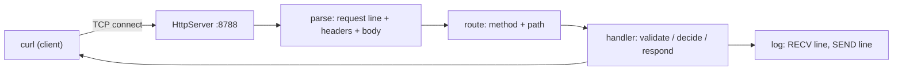

# Backend Fundamentals

## 1. Learning Objectives

After this lesson you can:

- [ ] Execute a real HTTP round trip against a server you started and name every hop the
      request took (executed: `curl -v` against a JDK `HttpServer` on `127.0.0.1:8788`,
      request and response lines captured byte for byte)
- [ ] State what a backend process does all day — accept, parse, route, handle, respond,
      log — and point at each step in a live server's log (executed: server-side `RECV`
      /`SEND` lines for six requests)
- [ ] Produce and read the status-code contract: `200`, `201` + `Location`, `400`, `404`,
      `405` + `Allow` (executed: all five from one handler set, each quoted)
- [ ] Diagnose a wrong answer with `curl -sv`/`-i` alone, without a framework or a GUI
      (executed: the exact outputs below are what you reproduce)
- [ ] Explain statelessness: what the server does *not* remember between requests, and
      why that shapes every design decision that follows
- [ ] Name the layers of a backend (transport → protocol → framework → domain) and say
      which one each line of the probe belongs to

## 2. Prerequisites

- [Java Programming](../04-JAVA-PROGRAMMING/README.md) — classes, exceptions, and
  running a compiled class; the probe is plain Java with no framework.
- [Internet & Web Foundations](../06-INTERNET-AND-WEB-FOUNDATIONS/README.md) — HTTP,
  headers, and the client–server model; this lesson runs them for real.
- [Database Engineering](../10-DATABASE-ENGINEERING/README.md) — helpful: the data a
  backend exists to read and write; this lesson's server keeps its data in memory and
  explains why that is a teaching choice, not a recommendation.

## 3. Introduction

A **backend** is the process that listens on a port and answers HTTP requests with data
it is responsible for. Where a frontend decides how things look, the backend decides
what is *true*: which user may see which row, what a valid order is, what happens when
two people buy the last item. It is the only part of a system that can enforce rules —
browsers are optional, mobile apps are optional, and every one of them is hostile by
default.

This lesson runs the smallest possible honest version of that: a Java server with **no
framework**, started by you, talked to by `curl`. Frameworks (Spring Boot, later in this
subject) add enormous value, but they also hide exactly the mechanics you must be able
to reason about — the request line, the headers, the status code, the log line. You will
see all four raw here, executed, before anything hides them.

## 4. The Problem It Solves

Before application backends, a web server mapped URLs to *files*: request `/index.html`,
server reads the file, sends it. That model dies the moment the answer depends on
*who* is asking, *when*, or *what's in the database* — a price, a balance, a permission
list can never be a file on disk. Early dynamic approaches (CGI: spawn a process per
request) worked but paid process-startup on every hit and had no shared memory of
anything.

The durable answer is a **long-running process**: bind a port once, accept connections
forever, and per request do the same five things — parse, route, handle, respond, log.
The complexity moved from "how do I run code per request" to "how do I keep that
process correct under concurrent, untrusted input" — which is the entire rest of this
subject. The probe in section 7 is that five-step loop with nothing added.

## 5. Core Concepts

### The process and the port

A backend starts once and binds a socket: `127.0.0.1:8788` in this lesson (loopback —
reachable only from this machine; production binds `0.0.0.0` behind TLS). The
`listening on 127.0.0.1:8788` line in the server log is that bind succeeding. Every
request afterwards is one more connection on that same socket.

### The request's life (the five steps)

1. **Accept** — the OS hands the server a connection; HTTP's request arrives as text:
   a *request line* (`GET /health HTTP/1.1`), *headers*, an optional *body*.
2. **Route** — match method + path to a handler (`GET /health` → health handler;
   `POST /orders` → orders handler).
3. **Handle** — your code: validate, decide, touch data, choose a status.
4. **Respond** — status line, response headers, body — then the server waits for the
   next request on the connection.
5. **Log** — one line per request/response pair; this is your only post-mortem eye.

Executed evidence for all five: section 7's `A7` block shows `RECV` (steps 1–2) and
`SEND` (step 4) for each request, printed by the handler itself.

### Status codes as a contract

The status line is the *first* thing a client reads, and it must be honest:

| Code | Meaning | The rule it enforces |
|---|---|---|
| `200 OK` | succeeded, body attached | the only "here it is" |
| `201 Created` | resource created | carries `Location:` of the new thing |
| `400 Bad Request` | *your request was wrong* | validation — fix the payload |
| `404 Not Found` | the path/resource doesn't exist | don't invent 200s for missing data |
| `405 Method Not Allowed` | path exists, verb doesn't | carries `Allow:` so the client can learn |
| `500 Internal Server Error` | *the server* broke | never caused by input; alert on these |

The executed battery in section 7 is these five in action — including the two headers
(`Location`, `Allow`) that make them useful rather than decorative.

### Statelessness

Between requests the server remembers **nothing about the client**: no "currently
editing" flag, no per-connection memory of who you are (session/token lessons reintroduce
that *deliberately*, on top). Stateless means any request can be handled by any
instance, retries are safe to reason about, and scale-out is a load balancer — but it
pushes identity into every request (headers/tokens), which is why authentication gets
its own lessons.

### The error envelope

Every failure answer has the same JSON shape: `{"error":"<machine_code>", …}`. Clients
branch on `error`, humans read `detail`. Executed three ways in section 7 (`bad_request`,
`method_not_allowed`, `not_found`) — one shape, three codes. Consistency here is what
makes client error handling a switch statement instead of archaeology.

### Layers: where a line of code lives

**Transport** (TCP socket) → **protocol** (HTTP: lines and codes) → **framework**
(routing, serialization — *absent here on purpose*) → **domain** (your rules: "qty must
be positive"). The probe is transport + protocol + a sliver of domain. Most backend
bugs are a layer confusion — a domain rule enforced in the controller, an HTTP detail
leaking into the domain — which the next lessons' structure prevents.

## 6. How It Works



The loop is strictly one-way: the client speaks first (HTTP), the server answers, and
the log line is written *by the server* — the client's view (what `curl -v` shows) and
the server's view (the `RECV`/`SEND` lines) are two recordings of the same event. Keep
both: half of backend debugging is discovering they disagree (the client sent something
other than what you think — or the server answered something other than what it meant).

## 7. Practical Examples

**Example 1 — the server, and one request end to end**

```java
// Probe.java — complete, runnable, JDK only (imports at top of file in the repo lab)
HttpServer server = HttpServer.create(new InetSocketAddress("127.0.0.1", 8788), 0);
server.createContext("/health", ex -> {
    log(ex);                                        // step 5 starts early: see what arrived
    if (!"GET".equals(ex.getRequestMethod())) { methodNotAllowed(ex, "GET"); return; }
    send(ex, 200, "{\"status\":\"ok\"}");
});
server.setExecutor(null);                           // one thread, honest about it
server.start();
System.out.println("listening on 127.0.0.1:8788");
```

- The handler *is* steps 3–5: log what arrived, refuse wrong verbs, answer.
- **How to run it:** `javac Probe.java && java -cp . Probe`, then in a second terminal
  `curl -sv http://127.0.0.1:8788/health`.
- **Expected output — the client's side (executed, `curl -sv`, verbatim):**

```console
> GET /health HTTP/1.1\r
> Host: 127.0.0.1:8788\r
> User-Agent: curl/8.22.0\r
> Accept: */*\r
> \r
< HTTP/1.1 200 OK\r
< Date: Tue, 27 Oct 2026 11:23:18 GMT\r
< Content-type: application/json\r
< Content-length: 15\r
< \r
{"status":"ok"}
```

- **The server's side of the same event (executed):**

```console
RECV GET /health | host=127.0.0.1:8788 | content-type=null | content-length=null | user-agent=curl/8.22.0
SEND 200 /health -> 15 bytes
```

- **Assumptions:** Java 25.0.4.1, curl 8.22.0, Windows 11 + Git Bash, loopback only.

**Example 2 — the status battery, one handler set (executed)**

```console
=== A2 POST /orders (valid body)
HTTP/1.1 201 Created
Location: /orders/1
Content-type: application/json

{"id":1,"item":"KBD-001","qty":2}

=== A3 GET /orders (wrong method)
HTTP/1.1 405 Method Not Allowed
Allow: POST

{"error":"method_not_allowed","allow":"POST"}

=== A5 POST /orders (bad body)
HTTP/1.1 400 Bad Request

{"error":"bad_request","detail":"body must be {item, qty}"}

=== A6 GET /nope (unknown path)
HTTP/1.1 404 Not Found

{"error":"not_found","path":"/nope"}
```

- `201` is the only success that *creates*; its `Location` header says where the new
  resource lives — a client that ignores it must re-GET the collection (why waste the
  round trip?).
- `405` + `Allow` is the self-describing error: the client learns the right verb from
  the failure itself.
- The `400` body names the rule; the `404` body echoes the path. Same envelope, machine-
  readable `error`, human `detail`/`path`.
- **How to run it:** the six-command battery from the batch transcript, e.g.
  `curl -si -X POST -H 'Content-Type: application/json' -d '{"item":"KBD-001","qty":2}' http://127.0.0.1:8788/orders`.

## 8. Real-World Applications

Every HTTP-serving system is this loop under load: Spring Boot (this subject's
framework) replaces the two `createContext` lines with annotated handlers, the manual
routing with a dispatcher, and the `RECV` logger with structured logging — *none of the
five steps disappear*. That's why the mechanics transfer: a 500 you can reproduce with
`curl -i` is a backend bug you can fix regardless of stack; a 500 only visible in a
framework's magic is a guess. Pairing: `curl` (or httpie) for the protocol view, the
server's logs for the process view, and the database from subject 10 for the truth view
— three views of one request, which is how this subject debugs throughout.

## 9. Common Mistakes

| Mistake | Why it happens | How to recognize it | How to prevent it |
|---|---|---|---|
| `200 OK` with an error body | wanting clients to "always succeed" | status says success, JSON says `error` | status codes carry the verdict; bodies carry detail |
| `405` without `Allow` | copying the status without the header | client can't recover programmatically | send `Allow` with every 405 (the probe does) |
| Errors without a fixed shape | each handler invents its payload | clients parse per-endpoint | one envelope: `{"error", "detail"?}` |
| Logging bodies/secrets by default | `log everything` habit | tokens/passwords in log files | log the line and metadata; bodies only on debug, never credentials |
| Blocking work in the handler (here: one thread) | not knowing the executor model | all requests stall behind one slow one | know your server's threading model; frameworks default better — and you should know what "better" means |
| Trusting `Host`/`User-Agent` | headers feel authoritative | logic keyed off a spoofable header | client headers are input, validated like any input |

## 10. Best Practices

- **Status first, envelope second.** Decide the code from the *outcome category*, then
  fill the body. The rule stops applying only where a legacy client genuinely requires
  200-everything — and then you document the wart.
- **One log line per request/response pair** with method, path, status, and duration —
  correlation comes later (logging lesson) but the shape starts here. Don't log bodies
  by default; *do* log the status you sent, because what you sent and what you meant
  sometimes differ.
- **Validate at the boundary** (`{item, qty}` regex in the handler): the handler is the
  wall — everything inside may assume well-formed input. The rule bends only when
  validation *is* the domain (a checksum), and even then it lives in domain code called
  by the boundary.
- **Bind loopback while learning.** `127.0.0.1` cannot be reached from the network; a
  demo bound to `0.0.0.0` on open Wi-Fi is a real incident, not a hypothetical one.
- **Statelessness by default.** Reach for server-side state only when you can name the
  requirement (a shopping cart), then choose the mechanism deliberately (sessions/tokens
  lessons) rather than by accident (a global `Map`).

## 11. Limitations and Trade-Offs

The probe is teaching software, and it is honest about what it lacks: **no TLS** (loopback
only — real deployments terminate TLS before your process), **one thread**
(`setExecutor(null)` — every request waits for the previous handler; fine for
transcripts, fatal for traffic), **no keep-alive tuning or timeouts** (defaults only, so
a slow client could hold a connection — the framework lessons add these), **regex "JSON
parsing"** (a demo: real code uses a library and rejects malformed JSON without
exceptions escaping), **in-memory data** (lost on restart — durability is subjects 10 +
11's persistence lessons), and **no concurrency safety** (two POSTs could both claim
`id:1` — transactions and atomicity are the fix, from the database up). Each missing
piece reappears as a named lesson; write down that list — it is this subject's syllabus.

## 12. Practical Exercises

### Introductory

1. **Exercise 2.1** — start the probe, reproduce `A1` (`curl -v`) and quote both sides of
   the event: the client's request/response lines *and* the server's `RECV`/`SEND` lines.
   **Completion criteria:** both captures in one transcript, timestamps agreeing, each of
   the five steps pointed at in your own annotation.
2. **Exercise 2.2** — run the full six-request battery; predict each status code *before*
   sending (paper first), then compare.
   **Completion criteria:** six predicted codes; the executed table; every mismatch
   explained by the routing or validation rule that produced it.

### Intermediate

3. **Exercise 2.3** — extend the server with `GET /orders/1` returning the created order
   and `404` for `/orders/999` with the same envelope; capture all three (found, missing,
   wrong verb on the new path).
   **Completion criteria:** three executed outputs; the envelope identical across all
   error paths; the 404 body naming which id was missing.
4. **Exercise 2.4** — break it on purpose: send a `Content-Length` that disagrees with
   the body, a missing `Content-Type`, and a duplicate header; capture how the server and
   `curl` each report the mess.
   **Completion criteria:** three failing transcripts with the layer named for each
   (transport vs protocol vs handler).

### Independent problem-solving

5. **Exercise 2.5** — build a *mini backend* for a todo list from scratch (JDK only): the
   five-step loop, `201`+`Location` on create, `200` on read, `400` on invalid input,
   `404` on unknown id, `405`+`Allow` on wrong verbs, one log line per request, and a
   written answer to "what does this server remember between two requests?"
   **Completion criteria:** six status/verb combinations executed against your server;
   the log showing every request; your statelessness answer citing what is and isn't in
   memory; the three things you'd add before real traffic (from section 11's list).

*Solutions: attempt first. They live in `exercises/solutions/` of this subject.*

## 13. Knowledge Check

1. Your client shows `HTTP/1.1 200 OK` and a body `{"error":"…"}`. Which layer lied, and
   how do you find out with one more command? … *(The server: `curl -i` shows the status
   the server actually sent; if it really is 200, the handler chose it wrongly — the
   bug is in step 3.)*
2. What would happen if the handler took 30 seconds on this probe's single thread? …
   *(Every other request waits — including `/health`, which now doubles as a liveness
   signal that would fail; that's the executor model showing up as an outage.)*
3. When would you *not* return `404` for a missing resource? … *(When revealing existence
   is itself the leak — a wrong id and a forbidden id can both answer `404` so an
   attacker can't enumerate; the answer depends on the authorization model, not on the
   routing table.)*

## 14. Completion Criteria

Observable evidence that you have understood this lesson:

- [ ] You can reproduce A1–A7 from a blank terminal without consulting the transcript
- [ ] You can point at the accept/parse/route/handle/respond/log step for any log line
- [ ] You chose each status code in the battery *before* running it, and explained a miss
- [ ] You can state what the server remembers between two requests and why that choice
      was made
- [ ] You can diagnose the three section-9 mistakes from their symptoms alone

## 15. Summary

- A backend is one long-running process that loops: parse → route → handle → respond →
  log; frameworks rename the parts, never remove them.
- Status codes are the contract; bodies are the detail — `201` carries `Location`, `405`
  carries `Allow`, errors carry one fixed envelope.
- Statelessness is the default that makes scale-out boring and identity every request's
  problem.
- `curl -v`/`-i` plus the server's log line are two views of one event; debugging starts
  when they agree.
- The probe's gaps (TLS, threads, timeouts, real JSON, persistence) are the subject's
  remaining lessons — the list is the syllabus.

## 16. Next Steps

- Next lesson: [HTTP and REST APIs](http-and-rest-apis.md) — the same wire traffic read
  as *resources and representations*, and why REST's constraints exist.
- Practice: [exercise sets](exercises/README.md) for this subject.
- Where it is applied: [Project 04 — REST API](../20-PROJECT-LABORATORY/project-04-rest-api/README.md)
  — this loop, grown into a service with a database behind it.