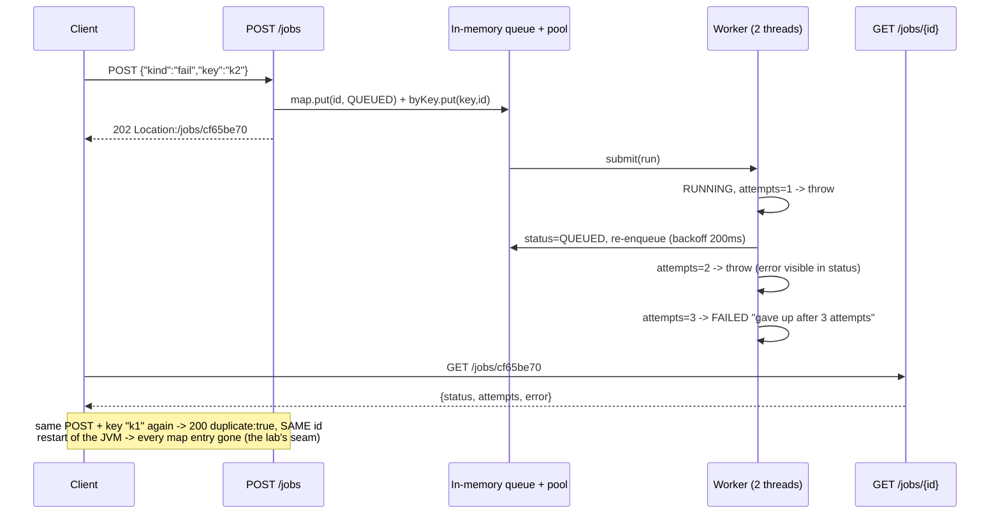

# Background Jobs

## 1. Learning Objectives

After this lesson you can:

- [ ] Explain the accept-then-observe contract and read it off a capture: `202` +
      `Location` immediately, `QUEUED → RUNNING → DONE` on polling (executed: J1
      `202 {"id":"006d260b"}` with `Location: /jobs/006d260b`, J2
      `{"status":"DONE","attempts":1}`)
- [ ] Implement retry with an attempt counter and a give-up policy (executed: a
      `fail` job passing through `attempts:2` with
      `error:"transient backend error (attempt 2)"` and settling at
      `{"status":"FAILED","attempts":3,"error":"gave up after 3 attempts"}`)
- [ ] Make submission idempotent with a client key: the same key returns the *same*
      job instead of a second (executed: J6 `duplicate:true` reusing id `006d260b`,
      `totalJobs` unchanged)
- [ ] State the durability seam plainly: the lab's jobs live in a `Map` — a restart
      loses them (not hidden: see limitations) — and name what a production queue
      adds
- [ ] Classify job failures like API failures: retries for transient, terminal for
      deterministic, and *idempotent handlers* because at-least-once delivery means
      your handler runs more than once eventually

## 2. Prerequisites

- [Sessions and Tokens](sessions-and-tokens.md) — in-memory server state and its
  durability trade (the same `Map` problem, now with retries on top).
- [Validation and Error Handling](validation-and-error-handling.md) — `202` vs `4xx`
  family placement, and the job status as a *machine-readable* contract.
- [Controllers, Services, Repositories](controllers-services-repositories.md) — the
  endpoint accepts; the worker executes; neither does the other's job.

## 3. Introduction

Some work doesn't belong to a request: sending an email, resizing an image,
generating a report, calling three rate-limited APIs. Doing it inline makes the
client wait for your dependencies' worst case; doing it "async" without structure
makes it invisible. This lesson executes the disciplined version in a single
endpoint pair: `POST /jobs` **accepts** (202, `Location`, an id), a small worker
pool **executes** with retries, and `GET /jobs/{id}` **observes** — with every state
transition, the retry trace, and the idempotency refusal captured by curl. The lesson
also names what the lab lacks (durability) the same way every earlier lesson named
its seams, because "where do the jobs live when the JVM dies" is *the* question that
separates a demo from a queue.

## 4. The Problem It Solves

Inline work couples your request latency to your dependencies: a PDF generator that
takes 8 s makes every client hold a connection for 8 s, gates your concurrency on
someone else's throughput, and turns a dependency blip into request failures for work
that *didn't need to fail* — it needed to wait. The naive fix (spawn a thread in the
controller) trades those for three new problems: the client has no idea whether the
work happened (no id, no status), a server restart silently drops it, and a
dependency outage means one attempt, forever. The structured answer is a contract
with three parties: an **endpoint that accepts** and returns a reference (202 +
`Location`), a **worker that executes** with bounded retries and observable status,
and a **client that polls** (or receives a webhook) with an id it can quote. The
remaining problem — surviving restarts — is exactly what a real queue (database
table, Redis stream, broker) solves, and the honest line between lab and production
runs through it.

## 5. Core Concepts

### Accept is not execute: 202 with a reference (executed)

```console
=== J1 POST /jobs {"kind":"echo","key":"k1"}
status=202  {"status":"QUEUED","id":"006d260b","duplicate":false}
Location: /jobs/006d260b
=== J2 GET /jobs/006d260b  (1 s later)
{"id":"006d260b","kind":"echo","status":"DONE","attempts":1,"totalJobs":1}
```

Read the design in the two responses: the `202 Accepted` says *"your request is
valid and queued" — deliberately not* `201`-with-a-resource-that-exists-because-it's-done.
`Location` gives the status resource its address (the same REST discipline as
`201`+`Location` from lesson 3's battery), and `status` is a named state machine —
`QUEUED/RUNNING/DONE/FAILED` — machine-readable so clients branch on it rather than
on prose. The client's contract after J1 is: *"poll this Location until DONE or
FAILED"* — its latency concern ends at the 202; yours begins.

### Retry with a policy, not with hope (executed)

```console
=== J3 POST /jobs {"kind":"fail","key":"k2"}   → 202 {"id":"cf65be70"}
=== J4 poll (mid-flight)
{"status":"QUEUED","attempts":2,"error":"transient backend error (attempt 2)"}
=== J5 poll (settled)
{"status":"FAILED","attempts":3,"error":"gave up after 3 attempts"}
```

The trace shows all three halves of a retry policy:

- **Attempt accounting**: `attempts` is in the *observable* state — a support
  question ("did it retry?") is answerable from the status resource, not from log
  archaeology.
- **Bounded**: three attempts, then `FAILED` with a reason — the give-up line is as
  important as the retry; an unbounded retry loop is a denial-of-service you run on
  yourself when the failure is *deterministic*.
- **Backoff (the lab uses a flat 200 ms)**: real policies wait exponentially
  (`500ms → 1s → 2s` + jitter) because hammering a struggling dependency at
  full speed makes the outage worse — the flat lab delay is a label, not a
  recommendation.

Note *which* state the retry goes through: J4 shows `QUEUED` (not `RUNNING`) with
`attempts:2` — a retry re-enqueues rather than spinning inside one attempt, so a
crash mid-retry leaves a legible state. And the distinction the policy rests on:
**transient vs terminal**. The lab's `fail` kind is deliberately transient-shaped
(three tries then give up); a validation error, a malformed payload, or a
permanently missing resource must be *terminal on attempt one* — retrying those
burns the queue and delays the error the client could have acted on immediately.

### Idempotent submission, executed — and why handlers must be idempotent too

```console
=== J6 POST the same body again {"kind":"echo","key":"k1"}
status=200  {"status":"DONE","id":"006d260b","duplicate":true}
=== J7 GET /jobs/nope
status=404
```

`duplicate:true` with the **same id** and `totalJobs` never reaching a second job:
the client's key (`"k1"`) is a natural idempotency key — a mobile client that
retries after a timeout gets the *original* job back, not a double email. This is
lesson 3's idempotency-key battery (STORE → REPLAY → CONFLICT) reappearing at the
queue boundary, where duplicate *acceptance* costs more than duplicate requests: the
duplicate work actually runs somewhere. The mirror-image rule follows from the
delivery semantics: real queues offer **at-least-once** delivery, so your *handler*
must tolerate running twice (dedupe by business id, upsert instead of insert,
make the effect naturally repeatable). The J4/J5 retry trace already showed a job's
work being *attempted* multiple times within one logical job — the handler's
idempotence is what makes that safe rather than a double-charge waiting to happen.

## 6. How It Works



Three owners, three responsibilities: the **API validates and accepts** (and applies
the idempotency key), the **worker owns transitions and policy** (attempt counts,
backoff, give-up), the **status endpoint is the only story clients get** — no
client ever sees logs, no worker ever speaks HTTP.

## 7. Practical Examples

**Example 1 — the worker's retry core (executed as quoted above)**

```java
private void run(String id) {
    Job j = jobs.get(id);
    if (j == null || j.status.equals("DONE")) return;
    j.status = "RUNNING";
    j.attempts++;
    try {
        Thread.sleep(400);
        if ("fail".equals(j.kind) && j.attempts < 3) throw new IllegalStateException("transient backend error (attempt " + j.attempts + ")");
        if ("fail".equals(j.kind)) { j.error = "gave up after " + j.attempts + " attempts"; j.status = "FAILED"; return; }
        j.status = "DONE";
    } catch (IllegalStateException e) {
        j.error = e.getMessage();
        j.status = "QUEUED";                          // re-enqueue, not spin
        pool.submit(() -> { sleep(200); run(id); });   // backoff (flat in the lab)
    }
}
```

- The `DONE` guard at the top is the handler's idempotence in miniature: a duplicate
  `run` on a finished job is a no-op — the same property real handlers need because
  queues deliver at-least-once.
- **How to run it:** start the jar; `curl -D` for the `Location` on J1/J3; poll
  `GET /jobs/{id}` as J2/J4/J5; resubmit with the same `key` as J6; an unknown id as
  J7.
- **Expected output:** the seven captures as quoted (ids differ per run; the
  attempt/error fields are deterministic for `kind:"fail"`).
- **Assumptions:** 2-thread pool, flat 200 ms retry delay, in-memory maps — all lab
  values, called out as such below.

**Example 2 — the accept endpoint (the contract in six lines)**

```java
String key = req.key();
if (key != null && byKey.containsKey(key)) {
    String id = byKey.get(key);
    return ResponseEntity.status(200).body(Map.of("id", id, "status", jobs.get(id).status, "duplicate", true));
}
String id = UUID.randomUUID()...;
jobs.put(id, new Job(kind));
if (key != null) byKey.put(key, id);
pool.submit(() -> run(id));
return ResponseEntity.status(202).header("Location", "/jobs/" + id)
        .body(Map.of("id", id, "status", "QUEUED", "duplicate", false));
```

- **200 vs 202 by meaning**: a first-time accept is `202` (work pending); a replayed
  key is `200` (nothing new to accept — the *representation* of an existing job). The
  status code difference is the client's cheapest duplicate signal, alongside
  `duplicate:true`.
- **Expected output:** J1 `202/duplicate:false` vs J6 `200/duplicate:true`, same id —
  the acceptance half of lesson 3's idempotency battery, reproduced for jobs.

## 8. Real-World Applications

The lab's shape survives translation: `202 + Location + poll/webhook` is the
contract of payment capture, video transcoding, export jobs, and CI systems; the
retry ladder (bounded attempts, exponential backoff + jitter, terminal-vs-transient
classification, dead-letter after the bound) is what every managed queue and
orchestrator implements, and the idempotency key is what makes client retries safe
across all of them. The production upgrades follow the seams named below: jobs as
**rows in a database table** claimed with `SELECT ... FOR UPDATE SKIP LOCKED`
(the durable, transactional version — jobs committed with your data), or a broker
(Redis/SQS/Rabbit/Kafka) for at-least-once delivery with consumer groups; **visibility
timeouts** so a crashed worker's job gets re-claimed instead of vanishing;
**dead-letter queues** for the FAILED pile, with a human or replay tool; **observability**
(queue depth, age of oldest job, failure rate — the operational counterparts of the
cache's hit-rate counter); and **idempotent handlers** as the standing requirement
behind all of it. The classification instinct transfers directly from earlier
lessons: 5xx-shaped failures retry, 4xx-shaped failures don't — the same family
table, now applied to your own downstream calls.

## 9. Common Mistakes

| Mistake | Why it happens | How to recognize it | How to prevent it |
|---|---|---|---|
| Doing slow work inline | "simpler" | request latency = dependency latency | 202 + worker; client polls the `Location` |
| Fire-and-forget thread | no id, no status | client gets 200 and no way to observe | the J1 contract: id, status resource, `Location` |
| In-memory jobs in production | lab code shipped | jobs vanish on deploy/restart | durable queue (table/broker) — the lab's own seam, below |
| Retrying terminal failures | one policy for everything | 400-class errors queued three times | classify first: transient retries, terminal fails at attempt 1 |
| Unbounded retries | fear of giving up | attempt counts in the thousands, dependency hammered | fixed bound + dead-letter (executed: give up at 3) |
| Flat/instant backoff | simplest code | retry storms during incidents | exponential + jitter; the lab's 200 ms is explicitly a placeholder |
| Non-idempotent handlers under retry | at-least-once ignored | double emails, double charges after J4-style retries | dedupe by business id; upsert; make effects naturally repeatable |
| Duplicate acceptance on client retry | no idempotency key | same logical submit creates N jobs | client `key` → same id (executed J6) |
| Status as prose | "it failed, probably" | clients parse `detail` strings | named state machine + machine-readable `error` code |

## 10. Best Practices

- **Return `202` + `Location` + an id; never make the client guess** — the status
  resource is the API of the job, versioned and tested like any other endpoint.
- **State machine first**: `QUEUED → RUNNING → (DONE | FAILED)`, transitions owned by
  the worker, each observable — J2/J4/J5 are the test cases.
- **Classify before retrying**: transient (timeouts, 5xx, rate limits) with bounded
  exponential backoff + jitter; terminal (validation, not-found, auth) fail fast —
  and *record* which class each failure was (`error` field).
- **Idempotency keys at acceptance, idempotent handlers at execution** — both halves,
  because the duplicate can arrive at either.
- **Bound everything**: attempts (executed: 3), job age, queue depth — with an
  explicit FAILED/dead-letter outcome rather than silent growth.
- **Make durability a decision**: write jobs in the same transaction as the state
  they describe (transactional outbox) or accept and document the loss window —
  never inherit it by default from a `Map`.

## 11. Limitations and Trade-Offs

The lab's queue is **not durable and cannot be**: jobs, statuses, and the
idempotency map live in JVM memory — restart the jar and every job, `DONE` or
`FAILED`, is gone (unlike the database-backed state of lesson 11, nothing here
touches disk). It is also **single-node**: two instances hold two disjoint maps, and
a `Location` sent to instance A can't be polled from instance B — the shared-store
problem the session lesson named, now with retries attached. Concurrency is a
fixed 2-thread pool with **no visibility timeout**: a worker that dies mid-job would
leave the job `RUNNING` forever (the lab's `run` cannot crash, so the bug class is
absent rather than fixed). The retry policy is **flat and in-process** — no real
backoff, no jitter, no dead-letter concept beyond the `FAILED` status, and no
poison-pill handling for a job that fails by *throwing something uncaught*. The
idempotency key map **never expires** (unbounded growth — the cache lesson's trap #3
in a new costume), and duplicate detection is per-restart. None of this is hidden:
the honest summary is that this lab executes the *contract* (accept, observe, retry,
dedupe) completely, and the *infrastructure* (durability, distribution, visibility
timeouts) not at all — which is precisely the division of labor a real queue buys.

## 12. Practical Exercises

### Introductory

1. **Exercise 18.1** — run J1–J7 and write the job's state table from your captures:
   every poll, the exact `status`/`attempts`/`error`, and which state transitioned
   to which. Then quote the two response fields that make the 202-with-reference
   contract work.
   **Completion criteria:** the state table with real values; the transition
   sequence `QUEUED→RUNNING→QUEUED(attempts=2)→…→FAILED`; `id` + `Location` cited.
2. **Exercise 18.2** — idempotency by hand: submit the same `key` three times
   (before, during, and after completion), capture all three responses, and show
   `totalJobs` never grows. Write what a client should do with `duplicate:true`.
   **Completion criteria:** three captures with ids equal and `duplicate:true` twice;
   the client rule (treat as success of *submission*, continue polling the given id).

### Intermediate

3. **Exercise 18.3** — exponential backoff: change the retry delay to
   `200 * 2^(attempts-1)` ms and add a terminal kind (`kind:"invalid"` that fails on
   purpose with a non-retryable error); capture the fail job's pacing (poll
   timestamps) and the terminal kind failing at `attempts:1`. Restore the lab values
   afterwards or document your fork.
   **Completion criteria:** timestamps showing growing gaps; `attempts:1` capture for
   terminal; the classification code; one paragraph on which failures you'd mark
   terminal in your own project.
4. **Exercise 18.4** — durability seam, executed: with a `DONE` job in memory,
   restart the jar and `GET /jobs/{id}` → `404` (capture it); then implement the
   transactional-outbox shape minimally — persist job rows in the existing PostgreSQL
   database on submit, reload `QUEUED` rows at startup — and repeat the restart: the
   job survives and completes.
   **Completion criteria:** the 404 capture; the persistence diff (submit-write +
   startup-load); the post-fix capture showing the job alive across restart; one
   sentence on what still isn't covered (visibility timeout).

### Independent problem-solving

5. **Exercise 18.5** — the failure that matters: make a handler non-idempotent on
   purpose (a job that increments a counter *outside* the job record), run it under
   the existing retry policy, and capture the double-execution effect; then fix it
   with deduplication by job id (or a natural business key) and re-run until the
   effect happens exactly once across all three attempts. Write the review checklist
   you'd enforce on every handler in your codebase, derived from what just broke.
   **Completion criteria:** the double-effect capture with attempt numbers; the fix
   diff; the checklist (five lines max: keys, transitions, dedupe, classification,
   observability) grounded in the failure you observed.

*Solutions: attempt first. They live in `exercises/solutions/` of this subject.*

## 13. Knowledge Check

1. J1 returned `202`, not `201`. What does each claim, and why is the job's id in a
   `Location` header? … *(`201 Created` says the resource exists now — accurate only
   when creation *is* the whole story; `202 Accepted` says "valid, processing will
   follow", which is the truth for queued work. The `Location` gives the client the
   address of the **status resource** — the thing it will actually read — the same
   discipline lesson 3 taught for created orders, applied to a resource whose
   representation keeps changing.)*
2. The lab retries a `fail` job three times. Which failure would you *not* retry,
   and what determines that? … *(Anything deterministic: validation errors, unknown
   resource, permanently bad payload, auth failures — retrying replays the same
   answer while occupying the queue. The classifier is "could a later attempt
   plausibly differ?" — transient/dependency-shaped yes; caller-shaped or
   data-shaped no. Executed contrast: the lab's `fail` is transient-shaped, which is
   why three attempts is a sane policy for it.)*
3. Why must the *handler* be idempotent if submission already has an idempotency
   key? … *(Different duplicate sources. The key stops the client's retry from
   creating a second job; but delivery itself is at-least-once — J4 already showed a
   job's work being attempted repeatedly — and any queue can hand the same message
   to a worker twice (crash after effect, before ack). So the effect must tolerate
   re-running: dedupe by business id, upsert over insert, make the operation
   naturally repeatable.)*

## 14. Completion Criteria

Observable evidence that you have understood this lesson:

- [ ] J1–J7 executed with the state table and duplicate proof filled from your own
      responses
- [ ] The retry trace captured with `attempts` climbing to the bounded give-up
- [ ] A restart proven to destroy jobs (Exercise 18.4's 404) — and, if you did the
      durable fix, the survival capture
- [ ] One idempotency experiment (Exercise 18.5) showing double-execution found and
      eliminated
- [ ] Your own project's slow endpoints classified: which three become jobs, and
      their terminal-vs-transient failure lists written

## 15. Summary

- **Accept, execute, observe** — `202` + `Location` + id, a worker-owned state
  machine (`QUEUED→RUNNING→DONE|FAILED`), and a status resource clients poll; all
  seven captures are the contract's test suite.
- **Retry as policy**: bounded (give up at 3 with an error), classified (transient
  retries, terminal fails at attempt one), observable (`attempts`/`error` in the
  status), and re-enqueued rather than spun.
- **Duplicates at both ends**: client key → same job (`duplicate:true`, `totalJobs`
  stable); handler idempotence because delivery is at-least-once.
- **Durability is the honest seam**: in-memory maps lose everything on restart — the
  contract is executed here, the infrastructure (table/broker, visibility timeout,
  dead-letter) is what a production queue adds.
- The same instincts transfer: family-based failure classification (lessons 10/13),
  measurement counters (lesson 17), and one owner per decision (lesson 9).

## 16. Next Steps

- Next lesson: [API Documentation](api-documentation.md) — the contract you've now
  executed (202/200/404/409…) written down as a machine-readable contract.
- Practice: [exercise sets](exercises/README.md) for this subject.
- Where it is applied: [Project 05 — Full-Stack App](../20-PROJECT-LABORATORY/project-05-full-stack-app/README.md)
  — exports/notifications behind exactly this accept-and-poll pattern.