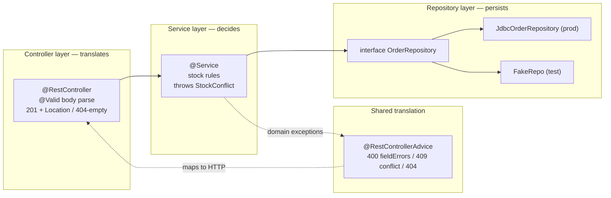

# Controllers, Services, Repositories

## 1. Learning Objectives

After this lesson you can:

- [ ] Assign every line of a real endpoint to its layer — controller translates HTTP,
      service decides, repository persists — by reading a three-class Spring app
      (executed: nine requests traced through `OrderController` → `OrderService` →
      handler with **zero** business decisions in the controller source)
- [ ] Prove the layering from behavior, not slogans: a stock rule refused with `409`
      inside the service while the controller only set the status (executed:
      `409 {"detail":"sku SKU-A has 3 in stock, requested 5"}` — the service's message,
      the advice's envelope, the controller never mentioned stock)
- [ ] Place each failure at the layer that can name it — `400` field errors from
      `@Valid` at the edge, `409` domain conflicts from the service, `404` from an
      empty `find` (executed: all three shapes in one battery)
- [ ] Explain why the repository is an interface with one production implementation
      and what that buys the tests (connects to [Dependency Injection](dependency-injection.md))
- [ ] Diagnose the common structural defects — logic in controllers, HTTP in services,
      N+1 in repositories — and say which layer each one corrupts

## 2. Prerequisites

- [Dependency Injection](dependency-injection.md) — constructor injection is how each
  layer receives the one below it.
- [Java Backend Development](java-backend-development.md) — the plain-JDK layered
  probe whose discipline this lesson executes *inside Spring*.
- [Spring Boot](spring-boot.md) — auto-configuration hosts these classes; you write
  only the three roles.

## 3. Introduction

Every backend framework ships three annotations — `@RestController`, `@Service`,
`@Repository` — and most bugs they produce aren't annotation bugs: they're *placement*
bugs. A stock rule inside a controller can't be reused by a batch job or tested
without HTTP; a status code inside a repository means persistence knows about URLs.
This lesson takes the batch's Spring smoke lab, adds one complete endpoint — create an
order, fetch an order — across three classes plus an advice, and executes nine
requests whose *pattern of outcomes* is the layering argument: the controller's diff
is entirely `Location` headers and status mapping, the service's diff is entirely
rules, and the persistence seam is one switch statement you can replace wholesale.

## 4. The Problem It Solves

Without layer discipline, an endpoint grows as one file: parse JSON, check stock,
write the row, format errors, log — all in the controller method. It works until any
of those concerns needs a second caller (a CLI, a message consumer, a second endpoint)
or a second implementation (a real database, a different error contract). Then the
choices are copy-paste or a risky extraction from code tangled with HTTP. The
three-layer split is one sentence long — **translate, decide, persist** — and its
real product is *change locality*: new endpoint → controller + service method; new
storage → repository implementation; new error format → advice only. Each layer's
tests then target its own axis: HTTP mapping without databases, rules without
servers, SQL without either.

## 5. Core Concepts

### The three roles, in one endpoint

```java
@RestController
@RequestMapping("/api/orders")
public class OrderController {
    private final OrderService service;
    public OrderController(OrderService service) { this.service = service; }

    @PostMapping
    public ResponseEntity<Map<String, Object>> create(@Valid @RequestBody OrderRequest req) {
        long id = service.create(req);                    // decide — one call, no branching
        return ResponseEntity.created(URI.create("/api/orders/" + id))
                .body(Map.of("id", id, "sku", req.sku(), "qty", req.qty()));
    }
}
```

Read the controller for decisions: none. It *translates* — annotation to parsing,
`ResponseEntity.created(...)` to `201` + `Location`, service return to body. The
service is where a refusal can happen, and it happens by **throwing a domain
exception**, not by choosing a status code:

```java
public long create(OrderRequest req) {
    int stock = stockOf(req.sku());
    if (stock == 0) throw new StockConflict(req.sku(), req.qty(), 0);
    if (req.qty() > stock) throw new StockConflict(req.sku(), req.qty(), stock);
    ...
}
```

`StockConflict` is not an HTTP type — no `409` string exists in this class. The
*only* place HTTP status names appear is the advice (`@RestControllerAdvice` mapping
`StockConflict` → `409`), which is the controller layer's shared translation table.
That's the discipline in one picture: **the service's vocabulary is the domain,
the controller's vocabulary is HTTP, and neither appears in the other.**

### The executed battery: behavior as proof

```console
=== E1 POST valid {"sku":"SKU-A","qty":2}
status=201   Location: /api/orders/1
{"sku":"SKU-A","qty":2,"id":1}
=== E5 POST qty 5, stock is 3
status=409   {"type":".../stock-conflict","status":409,
              "detail":"sku SKU-A has 3 in stock, requested 5"}
=== E3 POST blank sku
status=400   {"fieldErrors":[{"field":"sku","message":"must not be blank"}]}
=== E7 GET order 1
status=200   {"sku":"SKU-A","qty":2}
=== E8 GET order 99
status=404   bytes=0
=== E9 GET /api/orders (no handler)
status=405   Allow: POST
```

Trace *who produced what*: E1's `Location` came from the controller; E5's message is
the service's `StockConflict` string with the advice's envelope around it; E3's field
list is Bean Validation at the controller boundary, passed through the advice; E8's
empty 404 came from `find` returning `Optional.empty()` and the controller mapping it
— no exception thrown for a normal absence. **Each outcome names its layer.**

### Why the repository is an interface

The lab's persistence is `stockOf(sku)` behind `OrderService`'s private seam — the
smallest honest version of the pattern; a real repository is `interface OrderRepository`
with `JdbcOrderRepository` in production and the fake from lesson 8 in tests. The
three payoffs, all mechanical: the service compiles against an abstraction no
framework touched (executed in lesson 8: `imports Spring? false`), storage swaps
without touching rules, and the N+1/query-count tests of
[Backend Testing](backend-testing.md) have a seam to instrument. `@Repository` is
Spring's optional translation of persistence exceptions into the layer's vocabulary —
the annotation adds value *at the boundary*, exactly where rules don't live.

### GET-by-absence and the 404 decision (E7/E8)

`find` returns `Optional`; the controller maps `empty` → `404` with **zero bytes**
(`bytes=0` executed). No exception is thrown because absence-of-a-row is a *normal
outcome of a lookup*, not a fault — the distinction matters: exceptions as control
flow in the service would turn every miss into stack-trace work. Contrast E5: conflict
is a rule violation worth an error envelope. Status codes are the layer's judgment
call, made once, in the right place.

### 405: the framework enforcing the contract (E9)

`GET /api/orders` has no handler; Spring answered `405` with `Allow: POST` — the
contract of the resource computed from the mappings themselves. You didn't write a
line of it, and you shouldn't: mapping declarations *are* the documentation of what's
supported (formalized in [API Documentation](api-documentation.md)).

## 6. How It Works



Arrows point inward: HTTP knowledge stops at the controller/advice row, persistence
knowledge stops at the repository row, and the service — the only layer that both
knows the rules and not the plumbing — sits in the middle where every decision belongs.

## 7. Practical Examples

**Example 1 — the controller, minus everything it must not contain**

```java
@GetMapping("/{id}")
public ResponseEntity<OrderRequest> get(@PathVariable long id) {
    return service.find(id)
            .map(found -> ResponseEntity.ok(found))                 // 200
            .orElseGet(() -> ResponseEntity.notFound().build());     // 404, no body
}
```

- No `if (id < 1)` policy, no repository call, no JSON assembly beyond returning the
  record — all three concerns live downstream or in the framework.
- **How to run it:** `mvn -q -DskipTests package` then
  `java -jar target/spring-smoke-0.0.1-SNAPSHOT.jar`; the battery is nine `curl`
  commands from section 5.
- **Expected output:** E1–E9 exactly as quoted (ids 1, 2 from a fresh in-memory store).
- **Assumptions:** Spring Boot 4.1.1, JDK 25 runtime (Java 21 target), Windows 11 +
  Git Bash; the store is in-memory, so ids restart per run.

**Example 2 — the advice as the single translation table**

```java
@RestControllerAdvice
public class ApiExceptionHandler {
    @ExceptionHandler(MethodArgumentNotValidException.class)   // 400 + fieldErrors
    @ExceptionHandler(OrderService.StockConflict.class)        // 409 + detail
    @ExceptionHandler(OrderService.OrderNotFound.class)        // 404 + detail
}
```

- Three handlers, one envelope builder: `type/status/detail/fieldErrors` — the error
  contract of the whole API defined in **one class** (next lesson deepens this).
- The advice is controller-layer code *by function*: it speaks HTTP to domain
  exceptions. Keeping it in its own file is what stops `ResponseEntity` from leaking
  into `OrderService`.

## 8. Real-World Applications

This three-class shape is the skeleton of every production Spring service: controllers
stay thin enough to review in a glance (their diff on an API change is almost always
annotations and mapping), services carry the rules that also serve scheduled jobs and
message consumers, and repositories isolate SQL so the
[N+1 problem](jpa-and-hibernate.md) has exactly one place to be counted and fixed. The
advice pattern scales to the error contract the curriculum's API design lesson
specified (`type/status/detail`), and the interface-at-the-persistence-boundary is what
makes the same service unit-testable in milliseconds and integration-testable against
a real database in the same suite. When teams later add a GraphQL or gRPC entry point,
they write a new *controller* layer over the same service — the placement rule paying
the dividend the first time it's tested by a second caller.

## 9. Common Mistakes

| Mistake | Why it happens | How to recognize it | How to prevent it |
|---|---|---|---|
| Business rules in the controller | the request context makes it convenient | `if`-chains over domain state inside a `@*Mapping` method | controllers parse and map only; any branch that consults state moves down |
| Services returning `ResponseEntity`/status codes | HTTP pulled inward | `HttpStatus` imports in the service package | services throw domain exceptions or return `Optional`/results; statuses assigned at the edge |
| Anemic controller + god service | over-correction | one 800-line service class for the whole app | one service per bounded group of rules; check what each class *decides* |
| Repository called from the controller | layer skipping | `repo.save` in a mapping method; a second caller duplicating logic | the repository's only caller is its service |
| Exceptions for normal absence | control-flow habit | stack traces for ordinary 404s | `Optional` for absence (E7/E8), exceptions for violations (E5) |
| `@Transactional` on controllers | annotation guessing | transaction opens around HTTP parsing | the service (or repository) boundary — a transaction must contain rules, not sockets |
| One handler class growing unbounded | advice as junk drawer | unrelated `@ExceptionHandler`s with different envelopes | one envelope builder (as executed), split only when a *second contract* genuinely exists |

## 10. Best Practices

- **Name by role, place by dependency**: controller → service → repository, constructor
  injection down, nothing injected upward.
- **Vocabulary audit in review**: no `HttpStatus` below the advice; no `SELECT`/domain
  nouns above the repository. Grep is enough: `grep -r "ResponseEntity" src/main/java/com/example/svc`
  should print nothing.
- **Domain exceptions, one translation table**: define exception types where the rules
  live, map them to statuses in one `@RestControllerAdvice` — statuses then can't drift
  endpoint-to-endpoint.
- **`Optional` out of repositories, exceptions for violations** — and never `null`
  across a layer boundary.
- **Keep mapping declarative**: annotations, records, and default responses; if the
  controller needs a paragraph of prose to explain, the paragraph belongs in the
  service's Javadoc — or the API's documentation.

## 11. Limitations and Trade-Offs

Three layers for a two-endpoint app is honest overhead: ceremony is real, and the
discipline pays only when there's a second caller, a second implementation, or a test
suite. **DTO vs entity conflation** — the lab returns its input record directly; a
real API eventually needs response shapes distinct from tables (rename, field hiding,
versioning), and retrofitting that is painful — decide when the first mismatch
appears, not after. **The advice is a chokepoint by design**: every error funnels
through one class, which is great for contracts and a merge-conflict magnet at scale.
**Transactions raise the real question of *where* the service boundary is** — a
service method that calls another service method across transactional boundaries
produces subtle bugs; that's a
[transactions](../10-DATABASE-ENGINEERING/transactions.md) + JPA lesson's subject.
And **layering can't fix a wrong decomposition**: three perfect layers around a
misdesigned domain still ship the wrong software — the layering tells you where to
*put* the rules, not what they should be.

## 12. Practical Exercises

### Introductory

1. **Exercise 9.1** — run the nine-request battery and annotate each response line
   with the class that decided it (`Location` → controller, `409 detail` → service +
   advice, `fieldErrors` → validation at controller, `405 Allow` → framework from your
   mappings).
   **Completion criteria:** annotated transcript; one sentence per request naming the
   layer; the E3-vs-E5 distinction (format vs rule, `400` vs `409`) stated in your own
   words.
2. **Exercise 9.2** — layer-swap thought exercise, then executed: move the stock rule
   from `OrderService` into `OrderController.create` and replay E5 — then move it
   back. Write down what a *second* caller (a batch job) would have had to do in the
   first version.
   **Completion criteria:** both runs; the diff between the two placements; the
   batch-job duplication argument in one paragraph.

### Intermediate

3. **Exercise 9.3** — add `DELETE /api/orders/{id}` properly: controller maps
   `204`/`404`, service decides whether the id existed and throws `OrderNotFound`,
   advice already handles it. Capture: delete existing → `204 bytes=0`; repeat →
   `404` envelope; and confirm a rule violation still returns `409`.
   **Completion criteria:** three captures; your controller diff containing no
   `if`-statements; the service diff showing where existence is decided.
4. **Exercise 9.4** — extract the persistence seam: move the stock lookup into
   `interface StockRepository` + `InMemoryStockRepository`, inject into the service,
   and write a unit test whose fake returns `0` for everything — proving the 409 path
   without starting the app.
   **Completion criteria:** the refactor diff (controller **unchanged**); the test
   output showing the conflict path exercised with no server; a note on which lines of
   the service now belong to "decide" versus "persist".

### Independent problem-solving

5. **Exercise 9.5** — audit one of your own endpoints from any earlier subject (or
   this lab) with the vocabulary test: for every line, write which of *translate /
   decide / persist* it is, and flag every line that would have to change if the
   transport became a message consumer. Then restructure so the flagged set is empty
   and count how many files moved.
   **Completion criteria:** the line-by-line classification table; the flagged-then-fixed
   diff; a one-paragraph rule you can paste into code review for the next service.

*Solutions: attempt first. They live in `exercises/solutions/` of this subject.*

## 13. Knowledge Check

1. E5 returned `409` and E3 returned `400`. Which layer *chose* each status, and why
   isn't it the same layer? … *(Bean Validation fired at the controller boundary →
   advice mapped it to `400` (the body is malformed as a request); the stock rule
   threw inside the service → advice mapped it to `409` (well-formed request, refused
   by state). Same translator (advice), different originators — format problems and
   state conflicts are different facts about the request.)*
2. Why did E8's 404 carry zero bytes while E5's 409 carried an envelope? … *(Absence
   is a normal lookup outcome — nothing to explain; a conflict is a refusal worth a
   machine-readable reason. The choice is made once at the edge and is a contract
   decision, documented later in API documentation.)*
3. Your controller needs to know current stock levels to format a nicer message. What
   do you do? … *(You don't — the message comes back from the service inside
   `StockConflict`, already carrying the numbers. If the controller needs domain data
   it didn't get from its own call, that's a layer violation in progress.)*

## 14. Completion Criteria

Observable evidence that you have understood this lesson:

- [ ] The nine-request battery executed and annotated, each line credited to a layer
- [ ] Your source passes the vocabulary audit: no HTTP types below the advice, no SQL
      above the repository
- [ ] Exercise 9.3's `DELETE` added with a controller diff free of branches
- [ ] The stock rule exercised by a unit test with no Spring context running
- [ ] You can name, for your project, one line that violates the placement rule and
      the file it should move to

## 15. Summary

- Three roles, one sentence: **controllers translate HTTP, services decide,
  repositories persist** — and each layer's vocabulary proves which layer wrote the
  code.
- The executed battery showed the placement from behavior: `Location` from the
  controller, `409`'s domain message from the service via one advice, `fieldErrors`
  from validation at the edge, empty `404` by `Optional`, framework `405` + `Allow`.
- Domain exceptions thrown where rules live, translated to HTTP once — statuses can't
  drift because no other file assigns them.
- The repository interface is the persistence seam that makes storage swappable and
  the rule tests context-free.
- Layering's product is change locality — and its cost is honest ceremony; apply it
  where a second caller or test suite actually exists, starting now.

## 16. Next Steps

- Next lesson: [Validation and Error Handling](validation-and-error-handling.md) —
  the field-level contract and the one error envelope, deepened.
- Practice: [exercise sets](exercises/README.md) for this subject.
- Where it is applied: [Project 04 — REST API](../20-PROJECT-LABORATORY/project-04-rest-api/README.md)
  — every endpoint built on this skeleton with tests required alongside.
