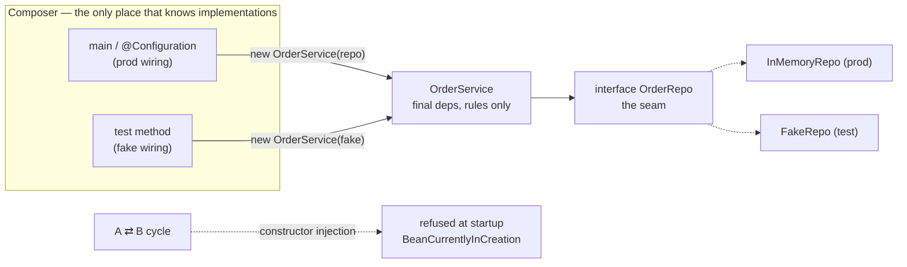

# Dependency Injection

## 1. Learning Objectives

After this lesson you can:

- [ ] Define dependency injection by its mechanism — *the dependency arrives from
      outside at construction time, chosen by someone else* — and show the three
      composers side by side (executed: manual `new OrderService(real)` in a
      composition root, the container's `@Bean` method, and the test's
      `new OrderService(fake)`)
- [ ] Demonstrate the constructor-injection guarantee (executed: `new OrderService(null)`
      **refused at construction** with `repo must not be null`) and the setter-injection
      hazard it replaces (executed: `new SloppyService()` constructed happily, then
      `NullPointerException` at first *use*)
- [ ] Explain why DI is really about **testability**, with the receipt (executed: the
      service exercised against a hostile fake — `fake.save called 2 times, fake rows
      [700, 800]` — with **zero** Spring imports on the class: `imports Spring? false`)
- [ ] Diagnose the one real downside — construction-time cycles — from the container's
      refusal (executed: `BeanCurrentlyInCreationException: ... 'a' ... 'b' ... 'a'`,
      refresh cancelled at startup)
- [ ] Choose between constructor, setter, and field injection for a concrete case and
      defend the choice in review

## 2. Prerequisites

- [Spring Fundamentals](spring-fundamentals.md) — the container builds the graph; this
  lesson is about *why the graph is shaped that way* and what it buys you outside
  Spring.
- [Java Backend Development](java-backend-development.md) — the layered probe whose
  manual wiring (`new OrderService(new InMemoryOrderRepository())`) is this lesson's
  starting point.

## 3. Introduction

Dependency injection has a reputation for being a framework feature. It isn't: the
container probe of lesson 6 and the plain-Java composition root of BACK-05 both do the
same *thing* — one place chooses an implementation and hands it in — and the only
difference is who holds the code. This lesson executes all four composers (manual,
container, test double, and the two refusals) in one lab, then argues the actual point:
**DI is a design constraint that makes every dependency of every object visible,
fixed at construction, and swappable in one line** — and the payoff is a test suite
that never boots Spring.

## 4. The Problem It Solves

An object that constructs its own dependencies cannot be exercised any other way. If
`OrderService` says `new InMemoryRepo()` inside its constructor, then every test of
`OrderService` tests that repository too; a service wanting a slow, fault-injecting, or
deterministic fake must first be *reimplemented*. The same coupling hurts production:
swapping storage means editing service code (the ripple), half-constructed instances
can be observed (the NPE-at-3-a.m. class), and two modules that "know" each other's
internals can't be moved. The pre-DI era's fix — a global **service locator**
(`registry.get(OrderRepo.class)` inside the service) — hid the dependency instead of
removing it: constructors stayed clean, tests still needed the registry, and the full
dependency list of a class became unknowable. DI's move is narrow and mechanical:
**make every dependency a constructor parameter, and forbid the object from choosing
it.** Composition happens elsewhere — a `main`, a config class, a test method — and
the class itself becomes context-free.

## 5. Core Concepts

### The mechanism, three ways (all executed)

The service under test is ordinary Java:

```java
static class OrderService {
    private final OrderRepo repo;
    OrderService(OrderRepo repo) {
        if (repo == null) throw new IllegalArgumentException("repo must not be null");
        this.repo = repo;
    }
    ...
}
```

**Composer 1 — the manual composition root** (BACK-05's style):

```console
--- 1. constructor injection: dependency fixed at construction
  service holds exactly the repo we passed: true
  new OrderService(null) refused: repo must not be null
```

**Composer 2 — the container** (lesson 6's `@Bean` method, here executed in section 3
of the probe):

```console
--- 3. container injection: same constructor, container composes
  wired by container, singleton identity a == b: true
  a.place(3) -> id 1, count 1
```

**Composer 3 — the test itself** (no framework anywhere):

```console
--- 4. testability: fake repo, no container, no framework
  fake.save called 2 times, fake rows [700, 800]
  fake returned id -1, service still counted 2 placements
  OrderService class imports Spring? false
```

The `imports Spring? false` line is the whole design: the class has **one** reason to
change (its rules), and the composer is free to differ per context — app wiring, test
wiring, demo wiring — without touching it.

### Why constructor, not setter: the executed contrast

```console
--- 2. setter injection: an object CAN exist unwired
  new SloppyService() constructed with no repo: OK (nothing refused it)
  place() before setRepo(): NullPointerException at USE, not at construction
```

Two objects, two contracts. With a constructor + `final` field, the unwired state is
**unrepresentable** — the failure moves to the *earliest possible moment* (construction,
usually startup or test setup) and carries a named message. With setters, every
caller inherits a temporal obligation ("must call `setRepo` before `place`") that no
type system checks, and violations surface wherever the object is first used — often
in production. Setter injection survives only for genuinely *optional* dependencies,
where `final` + a required parameter would lie.

### Inversion of control: who decides

IoC names the shift: `OrderService` decides its rules, **someone else decides its
collaborators**. The probe makes "someone else" concrete three times — your `main`,
the `@Configuration` class, your test method. The benefit compounds: DI is what makes
composition a *per-deployment* decision (profiles swapping repos in lesson 7), what
makes tests cheap (section 4's fake), and what makes layer boundaries real — a service
that can only reach what its constructor names has a physically enforced dependency
arrow pointing exactly where the design says it should.

### The one real cost: construction-time relationships

Fixed-at-construction means the graph must be acyclic. The container refuses otherwise,
executed in `CircularLab`:

```console
WARN ... cancelling refresh attempt: UnsatisfiedDependencyException: Error creating bean
with name 'a' ... parameter 0: ... bean 'b' ... parameter 0: ... bean 'a': Requested
bean is currently in creation: Is there an unresolvable circular reference ...
  root cause: BeanCurrentlyInCreationException: Error creating bean with name 'a':
  Requested bean is currently in creation
```

Field/setter injection *could* paper over `A ⇄ B` by deferring the set — at the cost
of every guarantee in the previous section. The right response to the cycle is to
redesign (extract the shared concern into a third bean both depend on), not to
reintroduce unwired states.

## 6. How It Works



The **interface is the seam** DI exploits; the constructor is where the seam is
threaded. Composition points differ per context, the seam is stable, and the class in
the middle stays testable and framework-free.

## 7. Practical Examples

**Example 1 — the probe, in full (executed as quoted above)**

```java
static class SloppyService {
    private OrderRepo repo;                          // not final, no ctor guard
    void setRepo(OrderRepo repo) { this.repo = repo; }
    int place(int qty) { return repo.save(qty); }    // NPE if never set
}

@Configuration
static class DiConfig {
    @Bean OrderRepo repo() { return new InMemoryRepo(); }
    @Bean OrderService svc(OrderRepo repo) { return new OrderService(repo); }  // container composer
}
```

- Sections 1, 3, 4 are three composers for **one** constructor — the point of the lab
  in one file.
- **How to run it:** `javac -encoding UTF-8 -cp "$(cat cp.txt)" DiLab.java && java -cp
  ".;$(cat cp.txt)" DiLab` (classpath from the batch's `mvn dependency:build-classpath`,
  spring-context 6.2.x via Boot 4.1.1's managed versions).
- **Expected output:** the four-section transcript quoted across section 5.
- **Assumptions:** Java 25.0.4.1 runtime, Windows 11 + Git Bash, UTF-8 flags to keep
  the transcript clean on the Windows console.

**Example 2 — fake that lies on purpose, service that still passes**

```console
  fake.save called 2 times, fake rows [700, 800]   ← fake mutates values (×100)
  fake returned id -1, service still counted 2 placements
```

- The fake returns a *wrong* id and mangles rows — because the service never promised
  to care about either; it uses `repo.save` for persistence and counts its own
  placements. A collaborator can be adversarial and the unit test still passes: that
  is isolation, and it only exists because the seam is a constructor parameter.
- **How to run it:** same command; write your own hostile fake next — one that throws
  on `save` — and watch the service's own rule (`qty <= 0` → named exception) stay
  testable independently of repository behavior.

## 8. Real-World Applications

You have already been doing this for two subjects: every controller/service/repository
split in BACK-05 is a constructor parameter, and Spring Boot's `@ConfigurationProperties`
injection in lesson 7 was the container acting as composer at application scale. In
production the pattern shows up as the things teams *pay* for: swapping
`InMemoryOrderRepository` for a JPA implementation behind the same interface without
touching a service line; per-profile wiring (lesson 6's `lab`/`prod` selection) being
merely different composer code; tests that run in milliseconds because they `new`
their own fakes instead of starting a context; and frameworks (Spring, Quarkus,
Guice, Dagger) competing almost entirely on *who the composer is and how declarative
it reads*. The Kotlin/Java industry default — constructor injection with interfaces at
layer boundaries — is this lesson's section 1, nothing more.

## 9. Common Mistakes

| Mistake | Why it happens | How to recognize it | How to prevent it |
|---|---|---|---|
| Setter/field injection as default | XML-era habit; "cleaner" constructors | class constructible in an invalid state; tests calling `init()` | constructor for required deps; setters only for genuinely optional ones |
| God constructors (8+ parameters) | too many roles in one class | constructor parameter list reads like a config file | that's a design smell, not a DI smell — split the class (see the layered discipline) |
| Injecting the container itself (`ApplicationContext`) | wanting services on demand | `ctx.getBean(...)` inside business code | depends-on-what-you-use; retrieve contextual beans only inside framework callbacks |
| Locators/`getInstance()` instead of parameters | convenience | dependencies invisible in signatures; tests needing global setup | parameters only — the dependency list must be readable from the constructor |
| Interfaces extracted per-dependency with one implementation | cargo-culting "the seam" | `FooImpl implements Foo` adds nothing but a file | add the interface where a second implementation is *plausible* (test fake counts — the probe has exactly one, deliberately) |
| `@Lazy` to break a cycle | avoiding the redesign | startup succeeds, wiring still circular | extract the shared third concern; cycles are design errors the constructor just surfaces |
| Fakes that verify nothing | test-writing speed | asserting `fake.calls == 2` without service outcomes | assert service behavior (state, returned values, thrown errors); fake calls are secondary |

## 10. Best Practices

- **Constructor injection everywhere; make dependencies `final`** — the probe's `null`
  refusal is one line of insurance against a framework (or colleague) skipping wiring.
- **Keep constructors small by keeping classes small** — three or four parameters is
  the practical ceiling before the class itself should be re-examined.
- **Put the seam at the layer boundary, not everywhere** — service→repository is the
  load-bearing interface; internal helpers can be plain methods.
- **Write tests without the framework as a rule** — if a unit test needs a Spring
  context, you are integration-testing by accident; the probe's section 4 is the bar.
- **Treat the cycle error as a design review** — the container's refusal in section 5
  is the cheapest time you will ever hear that `A` and `B` know too much about each
  other.
- **Compose once per context** — one config class (or `main`) owns prod wiring, each
  test class owns its own; never let wiring decisions leak back into the composed
  classes.

## 11. Limitations and Trade-Offs

Constructor injection **loses optional/lazy relationships**: sometimes a dependency
genuinely arrives later (event listeners, framework callbacks) — that's what setter
injection and provider/`ObjectProvider` seams are for, used sparingly. **Cycles become
startup failures** — faster and louder, but they do demand a redesign you may not have
budgeted for (the alternative, deferred field injection, quietly reinstates the
undefined-state bug class this lesson's section 2 measured). **Testability isn't free**:
fakes are code you maintain, and a fake that drifts from the real collaborator's
contract makes tests green and production red — the mitigation is the thin
integration-test layer of [Backend Testing](backend-testing.md) with the real thing
in a container. **More ceremony per class** — a constructor and an interface for
`OrderService` feel heavy for a ten-line class; the trade is deliberate, paid once per
class, returned on every test and every swap. And **DI does not fix a bad design**:
injecting seven collaborators into an object with seven responsibilities produces a
well-injected god object; the pattern exposes design problems rather than solving
them.

## 12. Practical Exercises

### Introductory

1. **Exercise 8.1** — reproduce the probe's contrast, then write the rule from memory:
   construct `SloppyService` and trigger its NPE; construct `OrderService` with
   `null` and capture the refusal; in one paragraph, say which failure you would
   rather see at 3 a.m. and why the constructor makes the choice for you.
   **Completion criteria:** two transcripts (NPE at use vs named refusal at
   construction); the paragraph mentions *when* each failure fires and *what it
   carries* (stack context, message).
2. **Exercise 8.2** — take any class you wrote in subject 04 or 08 that news up its
   own collaborator, refactor it to constructor injection, and diff: how many call
   sites changed? Write the composition root that replaces the internal `new`.
   **Completion criteria:** before/after diff; every construction of the class now
   passes its dependency; the class file's own diff limited to constructor + removed
   `new`.

### Intermediate

3. **Exercise 8.3** — hostile-fake drill: write three fakes for `OrderRepo` (throws on
   `save`, returns empty always, mutates values) and drive `OrderService` against each,
   capturing which service behaviors still hold and which of your *own* service
   assumptions each fake exposes as untested.
   **Completion criteria:** three transcripts; a list of service rules each fake
   exercised; at least one new assertion added to the test because a fake revealed a
   hole.
4. **Exercise 8.4** — break it with a cycle on purpose: give `OrderService` a
   dependency that (transitively) needs `OrderService`, run the container, capture the
   `BeanCurrentlyInCreationException` refusal, then fix it by extracting the shared
   concern into a third bean — capture the clean start and justify the extracted
   abstraction in one sentence.
   **Completion criteria:** failure capture naming both beans; the redesign diff; the
   sentence explains what the third bean owns that both sides needed.

### Independent problem-solving

5. **Exercise 8.5** — prove the testability claim as a number: take one service with
   two dependencies, write a unit test with fakes and time it, then write the same
   scenario as a Spring-context test; compare wall-clock times and lines of setup.
   Then argue — for your own codebase — where the integration layer is still required
   despite the gap.
   **Completion criteria:** both runs timed (or both transcripts showing startup),
   setup lines counted; a written boundary: which behaviors *must* run against the
   real collaborators and why (mapping, SQL, serialization — the seams fakes can't
   see).

*Solutions: attempt first. They live in `exercises/solutions/` of this subject.*

## 13. Knowledge Check

1. Is `getBean()` inside a service dependency injection? … *(No — that's the service
   locator anti-pattern: the dependency still arrives at use time, is invisible in the
   signature, and every test needs a container or mock of it. DI's whole content is
   "arrives at construction, named in the constructor.")*
2. The probe's fake returns id `-1` and mangles values, yet the test passes. Why is
   that correct rather than a weak test? … *(The service's contract doesn't include
   ids or value storage — it persists through the interface and counts its own
   placements. The fake is adversarial precisely to prove the service doesn't secretly
   depend on more than its constructor declared. What the fake *can't* model — real
   storage — belongs to the integration layer.)*
3. Your constructor now has eight parameters. Is the fix setter injection? … *(No —
   eight constructor parameters mean the class has eight reasons to change. Split the
   class or group cohesive dependencies into a smaller object; setter injection would
   only convert a visible design problem into an invisible state bug.)*

## 14. Completion Criteria

Observable evidence that you have understood this lesson:

- [ ] The four-section probe runs on your machine, with your predictions written first
- [ ] You refactored one real class to constructor injection and can show the diff
- [ ] You produced both refusals yourself: null-at-construction and the container's
      cycle error, with messages quoted
- [ ] Every unit test you've written since lesson 6 runs without starting Spring
- [ ] You can point at one dependency in your project that should be an interface
      seam and one that shouldn't — with reasons

## 15. Summary

- DI is a mechanism, not a framework: one place chooses implementations and hands them
  in at construction; the container, your `main`, and your test are equally valid
  composers (all three executed against one constructor).
- Constructor + `final` makes the unwired state unrepresentable; setter injection's
  flexibility is exactly the hole (executed: refusal at construction vs NPE at use).
- The payoff is testability: the service ran against a hostile fake with `imports
  Spring? false` — context-free classes, per-context wiring.
- The cost is acyclicity: the container's `BeanCurrentlyInCreationException` refusal is
  a design report, not a framework quirk.
- Inject dependencies, don't retrieve them; keep constructors small by keeping classes
  small; put seams at layer boundaries.

## 16. Next Steps

- Next lesson: [Controllers, Services, Repositories](controllers-services-repositories.md)
  — where each injection lands in the layered discipline, and what belongs at each
  level.
- Practice: [exercise sets](exercises/README.md) for this subject.
- Where it is applied: [Project 04 — REST API](../20-PROJECT-LABORATORY/project-04-rest-api/README.md)
  — every collaborator of every endpoint composed exactly this way.