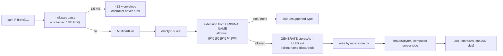

# File Uploads

## 1. Learning Objectives

After this lesson you can:

- [ ] State who enforces each upload rule and prove it: size limit at the container
      (executed: 1.5 MB body → **`413 payload-too-large`**, refused *before* your code
      ran), type and presence in your layer (executed: `.exe` → `400 unsupported file
      type: exe`, empty → `400 empty file`)
- [ ] Demonstrate that the client filename is **data, not a path**: a request sent
      with `filename=../../evil.txt` stored as `d35b8808-6659-4530-ae16-5a49d97a52f8.txt`
      — and the store directory contains exactly the two UUID names (executed)
- [ ] Compute and return a server-side digest as the proof of stored content
      (executed: `sha256:137596d4...aac` — identical for identical bytes regardless of
      the client's declared name or `Content-Type`)
- [ ] Choose what happens after a successful upload — name, location, metadata,
      response status — and defend each choice against traversal, overwrite, and
      content-sniffing attacks
- [ ] Classify multipart failures into the error contract's families (`400` format,
      `413` size) so uploads don't reopen the fall-through seam

## 2. Prerequisites

- [Validation and Error Handling](validation-and-error-handling.md) — the envelope
  every rejection here rides in, including the `413` mapping added for this lesson.
- [Controllers, Services, Repositories](controllers-services-repositories.md) —
  the upload endpoint follows the same placement: multipart parsing at the edge,
  decisions in one place.
- [HTTP and REST APIs](http-and-rest-apis.md) — `multipart/form-data` as the
  transport format.

## 3. Introduction

An upload is the API's most literal trust boundary: bytes from an unknown party
become files on *your* disk. This lesson executes a complete, small upload endpoint
against five hostile-ish inputs — a normal file, a wrong type, an oversized body, a
path-traversal filename, an empty body — and the resulting captures show exactly
which layer answered each one. The endpoint is 30 lines; the discipline it
demonstrates (generated names, server-side digests, allowlists, container-enforced
limits) is what separates a file feature from a file vulnerability.

## 4. The Problem It Solves

Uploads fail in three memorable ways. **Traversal**: `POST /upload` with
`filename=../../../../etc/cron.d/evil` — if the server concatenates the client's name
into a path, the attacker chooses where the bytes land; the historical answer
(`sanitize("../")`) is a losing game of whack-a-mole, and the correct answer is to
**never use the client's name as a path component at all** (executed: the UUID store).
**Type confusion**: the extension and `Content-Type` are client claims — an `evil.exe`
renamed `cute.png` is still executable-by-someone, and browsers sniffing content can
turn an "image" into script; the honest defenses are an extension **allowlist**,
content sniffing where it matters, and serving user content with strict
`Content-Type`/`Content-Disposition` headers at read time. **Resource exhaustion**:
without a limit, multipart parsing happily buffers a 4 GB body into your heap — which
is why the size limit belongs in *configuration enforced by the container* (the
container aborts the parse; your endpoint never sees the body), not in a `if
(bytes.length)` after you've already read it. The endpoint executes all three answers
in one battery.

## 5. Core Concepts

### Who refuses what (the executed battery)

```console
=== U1 upload ok.txt
status=201  {"type":".../uploaded","storedAs":"afd5903d-2d31-40a2-9a27-f49cb1715ee7.txt",
             "sha256":"137596d4ea4e1b2fe049a141a803f1cf716faa737918e178738ed983e7670aac",
             "size":17,"declaredType":"text/plain"}
=== U2 upload .exe
status=400  {"type":".../invalid-parameter","detail":"unsupported file type: exe"}
=== U3 upload 1.5 MB (limit 1 MB)
status=413  {"type":".../payload-too-large","detail":"upload exceeds the configured size limit"}
=== U4 filename=../../evil.txt
status=201  {"storedAs":"d35b8808-6659-4530-ae16-5a49d97a52f8.txt",
             "sha256":"137596d4...aac",  ← same bytes, new name
             "size":17,...}
=== U5 empty file
status=400  {"type":".../invalid-parameter","detail":"empty file"}
```

Read it as a division of labor:

- **U3 is refused by configuration**: `spring.servlet.multipart.max-file-size=1MB`
  (with `max-request-size=2MB`) — Tomcat's multipart parser aborts, Spring surfaces
  `MaxUploadSizeExceededException`, and the advice maps it to `413` with the standard
  envelope. Your controller **never executes** — that's the point: the limit applies
  *before* allocation, so a hostile body can't cost you heap.
- **U2 and U5 are refused by your rules**, as `400`s, because the request was
  well-formed multipart with invalid *content* — the same family as lesson 10's field
  errors.
- **U4 is the headline**: the client sent `../../evil.txt` and the stored name is a
  UUID — the `dir listing` after the battery shows **exactly two files**, both UUID
  names. Traversal isn't *blocked* here, it's **irrelevant**: the client's string is
  used only to extract an extension (allowlist-checked) and never as a path segment.
  The old attack surface didn't get patched; it was deleted.

### The digest is the proof

U1 and U4 carried identical bytes, so their server-computed SHA-256 match
(`137596d4...aac`) while `storedAs` differs. The response's `sha256` therefore says
something the client *couldn't*: what's on disk. Use it for: confirming the upload
round-trip (client re-hashes its own file and compares), deduplicating storage, and
as an immutable reference in later requests — the stored name plus digest together
are the file's identity, and neither came from the client.

### Configuration as enforcement, code as policy

```properties
spring.servlet.multipart.max-file-size=1MB
spring.servlet.multipart.max-request-size=2MB
```

```java
if (file.isEmpty()) throw new IllegalArgumentException("empty file");
if (!ALLOWED.contains(ext)) throw new IllegalArgumentException("unsupported file type: " + ext);
if (bytes.length > 1024 * 1024) throw new IllegalArgumentException("file exceeds 1 MiB");
```

The `bytes.length` check in code is **belt-and-braces after the container's
braces** — it stays because it documents intent and catches config drift (a future
`max-file-size=50MB` wouldn't silently become the app's real policy). Layered
defense, honestly labeled: the container's limit is the *load-bearing* one, the
allowlist is policy your config can't express, and both surface through the one
error contract — no `timestamp/status/error` fall-through in any of U1–U5.

## 6. How It Works



Every box right of `MultipartFile` runs inside your code; the leftmost refusal (413)
runs before it. That ordering — **cheap structural checks before expensive work** —
is the same shape as the JPA lesson's transaction boundaries and lesson 12's dummy
hash: refusal happens as early as the layer that owns the fact.

## 7. Practical Examples

**Example 1 — the endpoint, in full (executed as quoted above)**

```java
@PostMapping("/upload")
public ResponseEntity<Map<String, Object>> upload(@RequestParam("file") MultipartFile file) throws Exception {
    if (file.isEmpty()) throw new IllegalArgumentException("empty file");
    String original = file.getOriginalFilename() == null ? "" : file.getOriginalFilename();
    String ext = original.contains(".")
            ? original.substring(original.lastIndexOf('.') + 1).toLowerCase() : "";
    if (!ALLOWED.contains(ext)) throw new IllegalArgumentException("unsupported file type: " + (ext.isEmpty() ? "(none)" : ext));
    byte[] bytes = file.getBytes();
    if (bytes.length > 1024 * 1024) throw new IllegalArgumentException("file exceeds 1 MiB");
    String storedAs = UUID.randomUUID() + "." + ext;      // the only path segment that matters
    Files.createDirectories(STORE);
    Files.write(STORE.resolve(storedAs), bytes);
    String sha = HexFormat.of().formatHex(MessageDigest.getInstance("SHA-256").digest(bytes));
    return ResponseEntity.status(201).body(Map.of("storedAs", storedAs, "sha256", sha,
            "size", bytes.length, "declaredType", file.getContentType(), "status", 201, "type", ".../uploaded"));
}
```

- `STORE.resolve(storedAs)` where `storedAs` is `UUID + "." + ext` — `ext` came from
  an allowlist, so it is `[a-z0-9]{1,5}` by construction; nothing else can enter the
  path.
- **How to run it:** `mvn -q -DskipTests package`, start the jar (wait for `Started
  SmokeApplication`), then the five `curl -F` calls:
  `-F 'file=@ok.txt'`, `-F 'file=@evil.exe'`, `-F 'file=@big.txt'` (1.5 MB),
  `-F 'file=@ok.txt;filename=../../evil.txt'`, `-F 'file=@empty.txt'`.
- **Expected output:** U1–U5 exactly as quoted; the store directory contains only the
  two UUID `.txt` files.
- **Assumptions:** Boot 4.1.1 multipart defaults overridden by the two properties;
  JDK 25 (Java 21 target); Windows 11 + Git Bash; store under
  `java.io.tmpdir/b13-uploads` (lab) — production uses object storage.

**Example 2 — the 413 mapping (the contract's new family)**

```java
@ExceptionHandler(MaxUploadSizeExceededException.class)
public ResponseEntity<Map<String, Object>> tooLarge(MaxUploadSizeExceededException ex) {
    return envelope(413, "https://errors.example.invalid/payload-too-large",
            "upload exceeds the configured size limit", List.of());
}
```

- Without this handler, U3 would return Boot's default shape — the fall-through seam
  lesson 10 found would reopen at the multipart layer. With it, U3's body has the
  same four fields as every other error in the app.
- **Expected output:** U3's `413` envelope as quoted — run it after any advice edit.

## 8. Real-World Applications

The battery's rules are the baseline of every production upload path: name
generation and allowlists on the *inbound* side; on the *outbound* side, which the lab
doesn't need, the same discipline mirrored — serve user files from a domain that
doesn't share your cookies (or with `Content-Disposition: attachment` and
`X-Content-Type-Options: nosniff`) so stored content can never execute as your app.
Real systems add what size makes necessary: multipart to **object storage** via
presigned URLs (the app stops being a byte-pipe while keeping the policy), streaming
digests for files larger than memory, virus/Content-Disposition scanning as an async
step, and per-user quotas enforced at the same layer as the allowlist. The error
families land where clients expect them — a mobile upload retry logic keys on
`413` vs `400` exactly because this lesson's mapping made them distinguishable — and
the server-side `sha256` is the hook every dedup, integrity check, and support
ticket about "my file didn't upload" is answered with.

## 9. Common Mistakes

| Mistake | Why it happens | How to recognize it | How to prevent it |
|---|---|---|---|
| Using `getOriginalFilename()` in a path | convenience | any `STORE.resolve(original)` | generated name only (executed U4: the traversal string never touches the path) |
| Deny-list extensions (`.exe`, `.bat`) | blocklist habit | new dangerous extension accepted | **allowlist** the known-good set (U2 refused `exe`; an `.scr` would be too) |
| Trusting `Content-Type` for decisions | spec faith | `image/png` header over script bytes | extension allowlist + sniffing where execution risk exists; treat `declaredType` as metadata only (as the response does) |
| Limit checked after `getBytes()` | code-first thinking | heap spikes before the 400 | container property is load-bearing (U3 = 413 before controller) |
| Filename echoed to logs/paths/response | debugging habit | traversal strings in `Location` headers | return the generated name; log the original only escaped/quoted if at all |
| Overwriting by predictable name | sequential ids | second upload destroys first | UUID names make overwrite a non-event |
| `400`/`500` mix for size vs type | unmapped exception | default `timestamp` body on big uploads | the `413` handler above; re-run U1–U5 after every advice change |
| Serving uploads from the app origin | legacy hosting | user `.html` executing same-origin | separate download origin or forced attachment + nosniff (read-time rule) |

## 10. Best Practices

- **Generate every stored path**; use the client's name only for an extension check
  and (carefully) for display metadata.
- **Allowlist types by extension AND sanity-check content** where it matters (magic
  bytes for images); never execute, render inline, or follow links from user content
  on your origin.
- **Enforce size in configuration** (container-level), keep a code-level guard as
  documentation, and map both refusal paths into the standard envelope.
- **Return server-computed facts**: `sha256`, size, generated name, `201` +
  `Location` if the file becomes addressable.
- **Never store in the repo or webroot**; object storage with lifecycle rules, and
  quotas per principal (the upload equivalent of lesson 13's ownership gate).
- **Re-run the five-input battery** after changing limits, handlers, or the allowlist
  — it is the endpoint's regression test.

## 11. Limitations and Trade-Offs

The lab writes to `java.io.tmpdir` with no cleanup — a real system needs retention
policy, orphan cleanup for uploads whose parent record never commits (upload-then-
`500` leaves a file: **compensate**, or store first and reference atomically), and
the reverse orphan problem of DB rows pointing at absent files. The allowlist is
coarse: `.txt` vs `.pdf` differ hugely in parser risk, and the truly safe line for
*rendered* content is a sanitizing pipeline (images re-encoded, PDFs sandboxed) —
outside this lesson's scope but the correct next step for anything displayed to
other users. Size limits trade UX against abuse headroom: 1 MB is right for a lab and
wrong for a photo app; the tuning problem doesn't go away, it just moves to config.
Digests prove content, not *safety* — a SHA-256 over malware is still malware, so
scanning is a separate, asynchronous concern. And multipart at the app server means
**bytes transit your JVM**: presigned direct-to-storage uploads (the production
default for large files) change the trust shape — policy stays at the app, bytes
don't — which is a design this lab's endpoints deliberately predate.

## 12. Practical Exercises

### Introductory

1. **Exercise 16.1** — run the U1–U5 battery and answer from your captures: for each
   status, name the layer that refused (container / controller / advice); list the
   store directory before and after U4 and state precisely why the traversal string
   produced no extra file.
   **Completion criteria:** five annotated responses; both directory listings; one
   sentence distinguishing "blocked" from "irrelevant" for U4.
2. **Exercise 16.2** — prove the digest: `sha256sum ok.txt` locally, compare with
   U1's `sha256`, then upload the same bytes under a *different* filename and confirm
   the response digest is identical while `storedAs` differs.
   **Completion criteria:** three values that match/differ as predicted; one sentence
   on which of the response fields are client-derived vs server-derived.

### Intermediate

3. **Exercise 16.3** — move the limit: change `max-file-size` to `512KB`, rebuild,
   and capture U1 (now `413`? — no: 17 bytes still passes) and a 700 KB file now
   refused; then set it to `10MB` and show U3's 1.5 MB file **accepted** — proving the
   container, not your code, was the original refuser. Restore the property.
   **Completion criteria:** three captures showing the boundary move; the proof that
   the controller's own check never saw U3's body the first time (it can't have:
   which exception proves it?); restore diff.
4. **Exercise 16.4** — add one more policy: reject files whose first bytes aren't a
   known magic number for their extension (`%PDF`, `PNG` signature, plain text for
   `.txt`), capture a renamed PDF-as-txt being refused, and discuss in three sentences
   what this catches that the extension allowlist didn't.
   **Completion criteria:** the refusal capture; your byte-check code; the
   extension-vs-content distinction stated.

### Independent problem-solving

5. **Exercise 16.5** — design and execute the *read* side: serve an uploaded file
   through `GET /files/{storedAs}` with `Content-Disposition: attachment`,
   `X-Content-Type-Options: nosniff`, and the stored `sha256` as a validator header;
   prove with `curl -D` that (a) headers are present, (b) a traversal id
   (`../../ok.txt`) gets `404`, (c) an unknown UUID gets `404` — and then, for the
   write-up, explain where serving *inline* would be acceptable and what your
   origin/isolation choice would be in production.
   **Completion criteria:** three header captures; the read-path code mirroring the
   write-path's "generated id only" rule; the inline-serving paragraph naming the
   exact conditions.

*Solutions: attempt first. They live in `exercises/solutions/` of this subject.*

## 13. Knowledge Check

1. U3 got `413` without your controller printing anything. How do you *know* the
   container refused it rather than your code, and why does that ordering matter?
   *(The controller's own limit throws `IllegalArgumentException` → `400
   invalid-parameter`, and U3 returned `413 payload-too-large` — a different family
   only the `MaxUploadSizeExceededException` mapping produces. Ordering matters
   because container-level refusal aborts parsing before the full body is buffered:
   the abuse cost is capped by configuration, not by code that first has to read the
   bytes.)*
2. The client declares `Content-Type: image/png` on an `.exe`. Which checks in the
   endpoint handle each claim? … *(Neither claim is trusted for the decision: the
   extension allowlist (from the original filename's last segment) refuses `exe`
   regardless of the header — U2 proved that shape; `declaredType` is recorded in the
   response as metadata only. Content sniffing, where needed, is the separate
   defense — Exercise 16.4's byte check.)*
3. Why return the server-side `sha256` instead of trusting the client's? … *(It's
   computed from the bytes actually stored — the only party that can lie about it is
   your own disk. The client can use it to verify its upload survived intact
   (re-hash and compare), the server can dedup and answer support queries, and U1/U4
   demonstrated it's a function of content, not of the client's naming.)*

## 14. Completion Criteria

Observable evidence that you have understood this lesson:

- [ ] The U1–U5 battery executed with each refusal attributed to its layer
- [ ] The traversal input run with a before/after directory listing showing no path
      escape
- [ ] The digest verified against a local `sha256sum`
- [ ] The limit moved once (Exercise 16.3) to prove which layer enforces it
- [ ] Your upload endpoint's response contains only server-derived fields you can
      name

## 15. Summary

- Refusals layer cleanly: **container** for size (`413`, before your code),
  **controller** for content rules (`400` type/empty), **advice** for the envelope —
  executed as five distinct outcomes in one battery.
- The client filename is data: allowlist it, extract an extension, **discard it** —
  `../../evil.txt` stored as a UUID, store listing unchanged.
- `sha256` computed server-side is the response's honest field: same bytes → same
  digest across differently named uploads.
- Limits belong in configuration, enforced where bytes are buffered; code-level
  guards are documentation and drift protection.
- Uploads don't get their own error dialect — they join the existing families
  (`400`/`413`) so the contract stays one contract.

## 16. Next Steps

- Next lesson: [Caching](caching.md) — the same "compute once, serve many, invalidate
  correctly" discipline for reads you already have.
- Practice: [exercise sets](exercises/README.md) for this subject.
- Where it is applied: [Project 05 — Full-Stack App](../20-PROJECT-LABORATORY/project-05-full-stack-app/README.md)
  — avatar/image uploads behind exactly these rules.