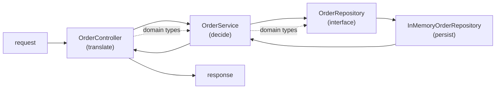

# Java Backend Development

## 1. Learning Objectives

After this lesson you can:

- [ ] Lay out a Java service in the Maven standard structure and say why each directory
      exists (executed: the lab's real tree — `src/main/java`, `src/main/resources`,
      `src/test/java` — and `mvn package` producing `target/spring-smoke-0.0.1-SNAPSHOT.jar`)
- [ ] Separate controller, service, and repository so that one request can be **traced
      through all three** (executed: the layered probe's four requests, each line
      tagged with the layer that produced it)
- [ ] Place any piece of code by asking three questions — is it translating, deciding,
      or persisting? — and defend the placement
- [ ] Distinguish the three shapes of "an order" (input DTO, domain object, persisted
      row) and explain why letting one type play all three roles fails
- [ ] State the dependency direction rule and catch its violations in review
- [ ] Name when layers are overkill — the honest line between a script and a service

## 2. Prerequisites

- [Java Programming](../04-JAVA-PROGRAMMING/README.md) — classes, interfaces, exceptions,
  records; every construct in this lesson's probe is plain Java.
- [Backend Fundamentals](backend-fundamentals.md) ·
  [HTTP and REST APIs](http-and-rest-apis.md) — the request loop these layers serve.
- [API Design](api-design.md) — the contract this structure exists to implement.

## 3. Introduction

A backend outlives its authors. The difference between a service that a team can change
for five years and one that everyone fears to touch is almost never algorithmic — it is
**structure**: where things live, which direction dependencies point, and how few things
you must hold in your head to make a change safely. Structure is also what makes the
later subjects real: you cannot test a service you cannot isolate (14-TESTING), secure
one whose authorization logic is smeared across handlers (15-APPLICATION-SECURITY), or
deploy one whose config is compiled in (16-DEVOPS).

This lesson executes the shape itself — a complete layered service in plain Java, four
requests traced through it — before any framework renames the parts.

## 4. The Problem It Solves

The failure mode has a shape you can smell: one 3,000-line file where an HTTP handler
parses input, validates it, talks SQL, formats JSON, and logs — all interleaved. Every
change needs the whole file; every test needs a running server; a rule change (qty ≥ 1)
might be enforced in two of its five copies. It grew by accretion, exactly how backends
are born: the first endpoint takes twenty lines *anywhere* it lands, and the second
endpoint copies the first's location.

Layering is the discipline that makes the twentieth endpoint cheap: translation,
decision, and persistence each have one home, so each change has one *place*. The
historical swing is worth knowing: JSP-era code mixed HTML, SQL, and business rules
*worse*; the fix wasn't "more layers" for their own sake — it was making each concern
replaceable (a new UI, a new database, a new rule) without touching the others.

## 5. Core Concepts

### The three layers and their verbs

| Layer | Verb | Owns | Must never |
|---|---|---|---|
| **Controller** | *translate* | HTTP ↔ domain: parse request, pick status, shape response | hold business rules, touch storage directly |
| **Service** | *decide* | business rules, use-cases, transactions | know about HTTP (status codes, headers, JSON) |
| **Repository** | *persist* | reading/writing storage, query shape | decide anything, format responses |

The probe makes each verb visible as a log prefix: `CONTROLLER` parses `POST /orders
item=LMP-001 qty=0`, `SVC` applies the rule (`qty must be >= 1`), `REPO` writes the row.
Any line you can't attribute to one verb is a layer leak.

### Dependency direction

Arrows point **inward and never back**: controller → service → repository, and domain
types are known to all three but depend on none of them. A repository calling a service
(a "check business rule before insert") or a controller importing JDBC are the two
classic inversions — both compile, both review-visible with one question: *who called
whom?* The rule also fixes testing: to test the service, substitute the repository
interface (the probe's constructor takes `OrderRepository`) — that seam exists **because
dependencies point the right way**.

### Three shapes of "an order"

The same word names different objects at different boundaries, and conflating them is
how leaks happen:

- **Input DTO** (`NewOrder(item, qty)`) — what the *caller* may send; no id, no server
  fields; validation-friendly.
- **Domain object** (`Order(id, item, qty)`) — what the *rules* operate on; the service
  speaks only this language.
- **Persisted row** — what storage stores; in the probe the domain doubles as the row
  (honest for five columns), but at scale they diverge: audit columns, joins, and
  denormalizations belong to the persistence shape, not the API's.

A JSON body that flows *unparsed* into the repository, or a database row that serializes
directly to the client, are both the same bug: one type forced to serve three masters,
so every change to any master changes all three.

### The Maven standard layout (executed)

The build's directories are a contract tooling depends on:

```
spring-smoke/
├── pom.xml
├── src/main/java/com/example/smoke/SmokeApplication.java     ← production code
├── src/main/resources/application.properties                 ← configuration, outside code
└── src/test/java/com/example/smoke/SmokeApplicationTests.java ← tests, same package
```

`mvn -B package` puts its outputs in `target/` (never edited by hand) — the smoke run
produced `target/spring-smoke-0.0.1-SNAPSHOT.jar` (19,904,500 B). Tests mirror main's
package so they see package-private members — the convention that makes
`src/test/java/...` the *same* code's second home rather than a foreign folder.

### Configuration outside the code

`application.properties` (and profiles, next lesson) hold what differs per environment —
ports, URLs, credentials' *names*. A port baked into Java means a rebuild to change it;
a credential in Java means it ships in the jar (the security subject's lesson on what
never to log starts here: config is data, code is not).

## 6. How It Works



Solid arrows are *calls* (dependencies); dashed arrows are *shared language* (domain
types, which call nobody). Two properties make this diagram the lesson: every call goes
one direction, and only the outermost layer knows what a "request" is. In Spring
(back-09) the classes stay, the plumbing (routing, serialization) arrives as the
framework — nothing in this picture is replaced.

## 7. Practical Examples

**Example 1 — the layered service, four requests executed**

```java
static class OrderService {                        // service: decides
    private final OrderRepository repo;
    OrderService(OrderRepository repo) { this.repo = repo; }

    Order create(NewOrder in) {
        if (in.item() == null || in.item().isBlank())
            throw new InvalidOrderException("item is required");
        if (in.qty() < 1)
            throw new InvalidOrderException("qty must be >= 1, got " + in.qty());
        return repo.save(new Order(0, in.item(), in.qty()));
    }
}
```

**Executed transcript** (`java Layered` — each request, layer by layer):

```console
--- request 1: valid create (layers top-down)
 CONTROLLER  POST /orders item=KBD-001 qty=2
  SVC    validate item=KBD-001 qty=2
  REPO   save -> row #1
  SVC    created order #1
201 Created Location:/orders/1 body={"id":1,"item":"KBD-001","qty":2}

--- request 2: business rule violation (refused in the SERVICE)
 CONTROLLER  POST /orders item=LMP-001 qty=0
  SVC    validate item=LMP-001 qty=0
  SVC    rule refused: qty must be >= 1, got 0
400 Bad Request body={"error":"bad_request","detail":"qty must be >= 1, got 0"}

--- request 3: null handling - controller translates qty null->0; the required-field rule still belongs to the SERVICE
 CONTROLLER  POST /orders item=null qty=3
  SVC    validate item=null qty=3
  SVC    rule refused: item is required
400 Bad Request body={"error":"bad_request","detail":"item is required"}

--- request 4: read path
  SVC    list() -> 1 orders
 CONTROLLER  200 OK body={"id":1,"item":"KBD-001","qty":2}
```

- Read the trace as a proof of ownership: the `400` is *produced* by the controller
  (it owns status codes) but *caused* by the service (it owns the rule) — the exception
  crosses the boundary, the HTTP vocabulary does not.
- Request 3 shows the split honestly: the controller translated `qty=null → 0` (a shape
  decision), and "item is required" still fired in the service because field presence
  was chosen as a domain requirement. Both halves are *decisions someone made*, and the
  transcript names which is which.
- **How to run it:** `javac Layered.java && java Layered` (plain JDK 25, no deps).
- **Assumptions:** Java 25.0.4.1, Windows 11 + Git Bash; in-memory persistence.

**Example 2 — the standard layout, from the working lab**

```console
$ find spring-smoke -path '*/target' -prune -o -type f -print
./pom.xml
./src/main/java/com/example/smoke/SmokeApplication.java
./src/main/resources/application.properties
./src/test/java/com/example/smoke/SmokeApplicationTests.java

$ mvn -B -DskipTests package
[INFO] BUILD SUCCESS
target/spring-smoke-0.0.1-SNAPSHOT.jar        (19,904,500 B)
```

- Main and test share the package `com.example.smoke` — tests reach package-private
  code without making it public (a real testing seam, not an accident).
- `application.properties` sits beside `main/java`, not inside it: configuration is
  *resources*, packaged into the jar but edited as data.
- **How to run it:** the smoke commands above (first full build: 12.420 s).

## 8. Real-World Applications

Every Spring project you'll meet is this picture with annotations: `@RestController` is
the controller layer's marker, `@Service` the decision layer's, `@Repository`/JPA the
persist layer's, and constructor injection (BACK-08) is how the arrows get wired
automatically. Structure also carries organizational meaning — two teams owning two
package trees rarely conflict, two teams editing one 3,000-line file always do — and it
is the substrate for cross-cutting concerns (logging, auth, metrics) that attach *at the
layers* rather than inside them. When you read a unfamiliar codebase, the package tree
plus "who calls whom" answers 80% of "where do I change this?"

## 9. Common Mistakes

| Mistake | Why it happens | How to recognize it | How to prevent it |
|---|---|---|---|
| Rules in the controller | the request *came* with the data | `if (qty < 1)` above a repository call in a handler | the three-verb test: is this translating, deciding, or persisting? |
| Domain/DTO collapse | "it's just four fields" | API change ripples into SQL (or schema change into JSON) | separate types at each boundary; convert explicitly in the controller |
| Repository returns HTTP types | copy-paste from handlers | a repository method taking/returning `ResponseEntity` | repositories speak domain/query types only |
| Inward arrows reversed | convenience ("I need the user's plan here") | service importing controller, repo importing service | dependency direction as a review checklist line |
| `utils`/`helpers` package as dumping ground | no home for cross-cutting code | 40 unrelated static methods | name it by concern (`validation`, `money`) or move it into its layer |
| Package-by-type (`/controllers`, `/services`) in big apps | early templates | one feature's code scattered across five dirs | **package by feature first**, layer as the *package prefix inside* the feature — the probe's single `Layered` file is the extreme version |
| Every layer wrapped in an interface "for the pattern" | ceremony mistaken for rigor | `IXxxServiceImpl` naming, one implementation each | interfaces where a second implementation is *plausible* (test fake, second storage) — the probe's `OrderRepository` earns it; `OrderService` does not have one |

## 10. Best Practices

- **Put rules where the exception that breaks them lives.** The probe throws
  `InvalidOrderException` from the service; that single choice is what lets tests assert
  rules without a server, and controllers map the exception to any status any protocol
  needs.
- **Constructor injection everywhere** (even pre-Spring): dependencies arrive at
  construction, fields stay final, tests pass fakes with one line — `new
  OrderService(new InMemoryOrderRepository())` is the whole test setup.
- **Convert at the boundary.** Parse once at the edge, produce domain types immediately;
  deep inside, nothing knows JSON existed.
- **One package per feature, layers inside it** — until a shared concern (security,
  common errors) genuinely spans features; then it gets its own package with a reason.
- **Keep `target/` and generated code out of version control** — the build regenerates
  them; hand-edits there vanish at midnight.
- **Config names in code, values outside** — the code reads `server.port`; the
  environment decides 8790 vs 8080.

## 11. Limitations and Trade-Offs

The probe's honest gaps: **in-memory persistence** — every restart is data loss (BACK-11
attaches a real database); **one process, no framework** — no routing, serialization, or
lifecycle Spring gives for free, which is why this shape is *teaching* software;
**layers are a cost too** — a one-file script with two endpoints and one author doesn't
need four layers, and pretending otherwise produces ceremony that slows every change.
The line: structure pays when *more than one thing changes independently* — a second
endpoint, a second author, a second storage. Below that line, keep it flat and honest;
above it, retrofits are ten times more expensive than doing it at endpoint three. The
probe also skips cross-cutting concerns (logging, metrics, auth) — they attach at these
seams in Spring, and each later lesson adds one without moving the layers.

## 12. Practical Exercises

### Introductory

1. **Exercise 5.1** — run the probe and re-attribute its output: cover the labels, read
   each line, and write which layer *produced* it and which *caused* it (the request-2
   `400` line is the interesting one).
   **Completion criteria:** all lines tagged produced/caused; one sentence on why
   "produced by controller, caused by service" is the correct split, not an accident.
2. **Exercise 5.2** — build the package tree: split the probe's single file into
   `com.example.shop.controller`, `.service`, `.repository`, `.model` packages, compile,
   and show the identical transcript.
   **Completion criteria:** `javac` over the tree succeeds; the new transcript is
   byte-identical to the original; the dependency arrows written out with the import
   statements as evidence.

### Intermediate

3. **Exercise 5.3** — break the direction on purpose: move the `qty >= 1` check into the
   controller *and* into the repository (two of three layers now enforce it), capture a
   case where the three copies disagree (repository allows 5, controller rejects it),
   then restore single enforcement.
   **Completion criteria:** the disagreement transcript; the failure class named
   ("two sources of truth for one rule"); the restored single-owner version with the
   diff.
4. **Exercise 5.4** — the three-shape split: add `POST`'s input DTO → domain conversion
   explicitly (`NewOrder` → `Order` → persisted row as three types), capture a request
   with a field the API doesn't know (an audit column) proving it can't arrive from the
   client.
   **Completion criteria:** three types with one conversion point; the "field not
   settable from outside" demonstration; one sentence on the cost you just paid (three
   classes for four fields) and when it stops being worth it.

### Independent problem-solving

5. **Exercise 5.5** — structure a real service of yours: take an existing project (or
   the API from exercise 4.5), produce its package tree with one package per feature and
   layers inside, write the dependency-direction statement as a review rule (one
   paragraph), draw where cross-cutting concerns attach (auth, logging, errors), and
   name the *one* place a specific rule — "an account may not be deleted with open
   orders" — lives, with the exception it throws and the test that would catch someone
   moving it.
   **Completion criteria:** a tree someone could scaffold from; the direction rule
   stated as checkable arrows; the rule's home named with its exception type; two
   things you deliberately left flat and why (the anti-ceremony argument).

*Solutions: attempt first. They live in `exercises/solutions/` of this subject.*

## 13. Knowledge Check

1. You need the caller's currency in the persistence layer for a report. What's wrong
   and what are the two legitimate routes? … *(The currency belongs to a request/DTO;
   reaching it from the repository means a reversed arrow. Legitimately: pass it as an
   explicit query parameter to the repository method — dependencies still point inward —
   or recognize it as domain data that belongs on the aggregate object.)*
2. Why does the probe's service take the repository *interface* in its constructor while
   the service itself has no interface? … *(The repository has plausible second
   implementations — test fake today, real database next — so the seam earns itself;
   the service has one behavior, and an interface with one implementor is ceremony.)*
3. At what point does a two-endpoint script need this structure? … *(When the second
   independent change arrives — a second endpoint, author, or storage — because
   retrofitting structure costs far more than starting with it; before that line, flat
   and honest beats layered and ceremonial.)*

## 14. Completion Criteria

Observable evidence that you have understood this lesson:

- [ ] You traced all four probe requests and can justify each produced/caused split
- [ ] You split the file into the package tree with an identical transcript
- [ ] You can classify any snippet as translate/decide/persist (or name which layer it
      wrongly sits in) for five examples of your choosing
- [ ] The dependency-direction statement is written in your own words with two named
      violations you'd reject in review
- [ ] You can state the flat-vs-layered line for a project of yours

## 15. Summary

- Controller translates, service decides, repository persists — one verb per layer, and
  every log line should attribute to one.
- Dependencies point inward and never back; that single rule is what creates testing
  seams and keeps teams out of each other's files.
- Input DTO, domain object, and persisted row are three shapes; convert at the boundary.
- Maven's standard layout is a tooling contract — `main`/`test`/`resources`/`target`
  each mean something to the build and the tests.
- Structure pays when things change independently; below that line, stay flat and honest.

## 16. Next Steps

- Next lesson: [Spring Fundamentals](spring-fundamentals.md) — the container that wires
  these arrows for you, and what it changes (and doesn't).
- Practice: [exercise sets](exercises/README.md) for this subject.
- Where it is applied: [Project 04 — REST API](../20-PROJECT-LABORATORY/project-04-rest-api/README.md)
  — this tree, grown feature by feature.