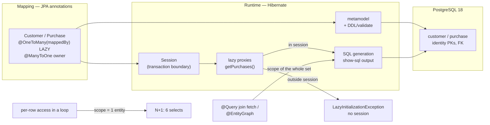

# JPA and Hibernate

## 1. Learning Objectives

After this lesson you can:

- [ ] Say what each layer of the stack owns — JPA the mapping contract (annotations),
      Hibernate the implementation (proxy, session, SQL generation), Spring Data the
      repository interface — with the executed seams to prove it (a JPA annotation
      change producing `Hibernate:` DDL on a live PostgreSQL 18 database)
- [ ] Map a real pair of entities — `Customer 1..* Purchase` — and read the generated
      schema back from the catalog (executed: `create table purchase (... customer_id
      bigint ...)`, identity PKs, final catalog `5 | 20`)
- [ ] Execute, count, and then fix the **N+1 query problem**: identical payload from
      **6 selects** (one `customer` + five `purchase where customer_id=?`) versus
      **1 select** with a declared fetch join (executed both ways, same endpoint family)
- [ ] Predict where a lazy proxy dies: touching a collection outside its session
      (executed: `LazyInitializationException: Cannot lazily initialize collection of
      role '...Customer.purchases' with key '1' (no session)` → 500)
- [ ] Choose `fetch = LAZY/EAGER`, owning side, and `cascade` deliberately — and name
      the two failure modes each choice has
- [ ] Diagnose a derived-query failure from its parse error (executed: a graph-fetch
      method name that Spring Data tried to parse as a property predicate, requiring an
      explicit `@Query`)

## 2. Prerequisites

- [Database Engineering](../10-DATABASE-ENGINEERING/README.md) — tables, keys, joins,
  and transactions; this lesson is where your designed schema gets a client.
- [Controllers, Services, Repositories](controllers-services-repositories.md) — the
  repository layer this lesson fills in for real.
- [Spring Boot](spring-boot.md) — `spring-boot-starter-data-jpa` + a datasource is
  all the wiring; everything else is mapping.

## 3. Introduction

Object-relational mapping is a translation between two systems that disagree: objects
have identity, references, and lazy graphs; tables have rows, foreign keys, and joins.
Hibernate is a *runtime translator* between them, and this lesson reads its output
directly — `spring.jpa.show-sql=true` makes every generated statement visible, so the
mapping's consequences are counted rather than described. The lab adds two entities
and three endpoints to the batch's running app against PostgreSQL 18, and executes the
discipline's three big claims: schemas come from mapping annotations, N+1 is a
*mis-scoped fetch* you can count, and laziness has a hard edge called the session.

## 4. The Problem It Solves

Hand-written JDBC gets the *data* across the wire but re-implements everything around
it: row-to-object loops, manual joins into nested structures, connection and
transaction bookkeeping, and the null-vs-absent mapping of relations — all repeated
per query and subtly wrong in each. Worse, the object model and schema drift: rename
a column and every `rs.getString("name")` becomes a runtime surprise. ORM's
proposals: **annotations on classes are the mapping** (checked at startup when
Hibernate builds the metamodel), **the unit of work is a session/transaction** (one
boundary where reads and writes compose), and **relations are navigable** (`customer.getPurchases()`)
with the *fetch strategy* as an explicit, tunable decision. The costs — proxies,
session lifetime, generated SQL you must read — are exactly what this lesson makes
visible, because they're the source of every famous ORM horror story, including the
one executed below.

## 5. Core Concepts

### The stack, layer by layer

```java
@Entity @Table(name = "customer")                        // JPA: the contract
public class Customer {
    @Id @GeneratedValue(strategy = GenerationType.IDENTITY)
    private Long id;

    @OneToMany(mappedBy = "customer", cascade = CascadeType.ALL)   // default LAZY
    private List<Purchase> purchases = new ArrayList<>();
}

@Entity @Table(name = "purchase")
public class Purchase {
    @Id @GeneratedValue(strategy = GenerationType.IDENTITY)
    private Long id;
    @ManyToOne(fetch = FetchType.LAZY) @JoinColumn(name = "customer_id")
    private Customer customer;                           // FK side owns the column
}
```

- **JPA** = these annotations and interfaces (a spec). **Hibernate** = the engine
  interpreting them (7.4.5.Final in the lab). **Spring Data** = the repository
  interface (`JpaRepository<Customer, Long>`) whose methods are *derived or declared*
  queries — three vendors' worth of names that mean three different things.
- `mappedBy` says the FK side (`Purchase.customer`) owns the column — your earlier
  schema lesson's rule, now expressed as an annotation; the `customer_id` column in
  the DDL below is that decision.

### Schema from mapping (executed)

`spring.jpa.hibernate.ddl-auto=update` and the first boot printed:

```console
Hibernate: create table customer (id bigint generated by default as identity, name varchar(255), primary key (id))
Hibernate: create table purchase (id bigint generated by default as identity, label varchar(255), customer_id bigint, primary key (id))
```

The catalog confirms the finished state after seeding:

```console
 customers | purchases
-----------+-----------
         5 |        20
```

Read the DDL as a translation: `Long id` → `bigint ... as identity`, `String` →
`varchar(255)` (Hibernate's default length — a real production override target),
`@JoinColumn(customer_id)` → the nullable FK column. For a lab this is convenience;
for a production system **the DDL belongs to migrations** (`ddl-auto=validate` in
prod) — the mapping and the migration can then *disagree loudly at startup* instead of
quietly at 2 a.m. The schema lesson's design remains authoritative; Hibernate is a
check on it.

### N+1: the fetch scope, counted

Three endpoints, one `Summary(id, name, purchases)` payload. **Mode 1 — lazy, touched
per row** (a `@Transactional(readOnly=true)` service calling `findAll()` then
`purchases.size()`):

```console
$ curl -s .../jpa/customers/n1
[{"id":1,"name":"ade","purchases":4}, ... {"id":5,"name":"eli","purchases":4}]
--- selects during N+1: 6
```

and the six are literally:

```console
Hibernate: select c1_0.id,c1_0.name from customer c1_0                ← query 1
Hibernate: select p1_0.customer_id,p1_0.id,p1_0.label from purchase p1_0
           where p1_0.customer_id=?                                    ← ×5 customers
```

**Mode 2 — declared join fetch** (one explicit query):

```console
$ curl -s .../jpa/customers/fetch
[{"id":5,...,"purchases":4}, {"id":1,...}, {"id":4,...}, {"id":2,...}, {"id":3,...}]
--- selects during fetch: 1

Hibernate: select distinct c1_0.id,c1_0.name,p1_0.customer_id,p1_0.id,p1_0.label
           from customer c1_0 left join purchase p1_0 on c1_0.id=p1_0.customer_id
```

Same payload (row order differs — **no `ORDER BY`, no contract on order**: a second,
real bug hiding in the demo), **6 queries → 1**. N+1 is not "lazy is bad": it's *the
shape of the loop* — one query per parent because the child's fetch was scoped to the
session's current entity. The fix is to move the fetch scope to **the whole set you
intend to touch**, once: `left join fetch` in `@Query` (executed), `@EntityGraph` on a
repository method, or a batch loader policy. Count queries per request — the numbers
above are the entire review artifact.

### The session's edge: LazyInitializationException (executed)

The third endpoint touches the same collection with **no transaction** (and
`spring.jpa.open-in-view=false`, the honest setting):

```console
$ curl -s .../jpa/lazy-outside/1
status=500  {"timestamp":"...","status":500,"error":"Internal Server Error","path":"/jpa/lazy-outside/1"}

org.hibernate.LazyInitializationException: Cannot lazily initialize collection of
role 'com.example.smoke.Customer.purchases' with key '1' (no session)
```

The proxy was handed out by `findById`, the session closed at method exit, and the
`.size()` had nowhere to query. Three facts worth keeping: the error is *named and
precise* (it tells you the class, property, key, and cause); it appears **at use, far
from the wiring mistake** — the same lesson as lesson 8's NPE, now from the ORM; and
the 500 came back in **Boot's default error shape** — the exact fall-through seam
[Validation and Error Handling](validation-and-error-handling.md) closed for other
families, a live reminder that error contracts need re-running whenever a new
exception path appears. The fix is always one of: fetch inside the transaction
(`@Transactional` service), declare the graph (mode 2), or reload what you need —
never `open-in-view=true` as a band-aid, which just relocates the session's edge to
the response write and hides the query pattern from your transaction boundaries.

### Derived-query parsing: when the method name is the query (executed seam)

The first version of the fix used a graph method named `findAllWithPurchases` — and
Spring Data's **parser** read it as a derived predicate and failed startup:

```console
Unable to parse ... No property 'fi...' found for type Customer   (PartTree, startup)
```

Derived queries are real mini-parsing (`find…By…` → properties and operators), and
they stop where their grammar does: a *fetch graph* isn't expressible in the method
name, so the honest move is an explicit `@Query` with `left join fetch` (what shipped).
The general rule: **the method name is a query language; when your intent exceeds the
language, write the query** — and read the parse error as a report about *where* you
crossed that line.

## 6. How It Works



Read both right-hand paths: the fetch *scope* is the whole design decision — one
entity's worth (N+1), the whole set (single join), or past the session (exception).

## 7. Practical Examples

**Example 1 — the repository, after the parse seam**

```java
public interface CustomerRepository extends JpaRepository<Customer, Long> {
    @Query("select distinct c from Customer c left join fetch c.purchases")
    List<Customer> findAllWithPurchases();
}
```

- `distinct` because a fetch join multiplies rows in the result *list* even though
  Hibernate deduplicates entities — without it the outer list can contain duplicates
  (check it: compare `n1`'s and `fetch`'s five-element payloads — both five, both
  correct).
- **How to run it:** `mvn -q -DskipTests package`, then
  `java -jar target/spring-smoke-0.0.1-SNAPSHOT.jar` with PostgreSQL reachable at
  `jdbc:postgresql://127.0.0.1:5433/backend_lab` (`ddl-auto=update` creates the
  tables; a `CommandLineRunner` seeds 5×4 on first boot).
- **Expected output:** the DDL, the `SEEDED` line, `6 → 1` select counts, and the LIE
  transcript as quoted.
- **Assumptions:** Boot 4.1.1 / Hibernate 7.4.5.Final / Spring Data JPA 4.1.1, JDK 25
  (Java 21 target), PostgreSQL 18.6 scratch cluster on port 5433, Windows 11 + Git
  Bash.

**Example 2 — the transactional service that scopes each mode**

```java
@Transactional(readOnly = true)
public List<Summary> nPlusOne() {
    return customers.findAll().stream()                               // query #1
            .map(c -> new Summary(c.getId(), c.getName(), c.getPurchases().size()))
            // one collection query per row -> 5 more
            .toList();
}
```

- Both modes run **inside a transaction**, so the 6-vs-1 difference is purely fetch
  strategy — not an artifact of session lifetime. That control is what makes the
  measurement trustworthy.
- `readOnly=true` lets Hibernate skip dirty-checking — the cheap default for reads,
  and the annotation that marks where your unit of work begins.

## 8. Real-World Applications

This lab's shape is the curriculum's production path: the `shop` schema from subject
10 mapped by entities like these, repositories answering `findAll`/`findById`/`save`,
and N+1 found the way it's found in real systems — **query counts per request**, not
profiling intuition. The consequences are the ones you'll meet in code review: a
list endpoint that returns N+1 at 5 customers here is N+1 at 10,000 rows in
production; `LazyInitializationException` in production appears as 500 spikes from
whichever code path touched a proxy one method too late; `ddl-auto=update` in
production is the story where a schema change happens *under* your migrations; and
`spring.jpa.open-in-view=false` (the lab's setting) is what keeps query patterns
visible inside declared transaction boundaries instead of smeared across HTTP
handling. Everything downstream — caching layers, read replicas, batch imports —
plugs into the seams this lesson named: repository, session, fetch scope.

## 9. Common Mistakes

| Mistake | Why it happens | How to recognize it | How to prevent it |
|---|---|---|---|
| N+1 in list endpoints | default lazy + per-row access | one parent query + N identical child queries in `show-sql` | count queries per request; `left join fetch`/`@EntityGraph`/batch size — chosen per *fetch scope* |
| `open-in-view=true` as the LIE fix | symptom silenced | queries issued during view rendering; transactions spanning HTTP | keep it **false**; fetch inside `@Transactional` services |
| `EAGER` everywhere to avoid LIEs | fear of the exception | `@ManyToOne(fetch=EAGER)` chains loading whole graphs on every find | lazy as default, eager only for genuinely small, always-needed data |
| `ddl-auto=update` in production | convenience kept | schema changed by a deploy, migrations out of sync | `validate` in prod; DDL lives in migration tooling (subject 10's discipline) |
| Cascade misuse (`cascade=ALL` on everything) | annotation convenience | deleting a customer silently deletes purchases — *or* vice-versa surprise | cascade only where lifecycle truly follows; the lab's `ALL` on `Customer→Purchase` is correct *because* purchases don't exist without customers |
| Trusting result order | no `ORDER BY` | `n1` returned 1-5, `fetch` returned 5,1,4,2,3 — same data, different order | any list that a client sees gets an explicit sort (executed difference above) |
| Derived query name doing too much | method-name DSL abused | `Unable to parse/No property ...` at startup | explicit `@Query` once intent exceeds the grammar |
| Entities as API responses forever | first draft kept | entity change breaks the wire format | DTO/`Summary` at the boundary — the service already returns one |

## 10. Best Practices

- **Lazy by default; declare the fetch for the use-case** — each endpoint that needs
  a graph declares *its* graph in `@Query`/`@EntityGraph`, so loading shape is a
  property of the caller, not the entity.
- **Transactions wrap the whole navigation you intend to do** — if a method touches
  relations, the method owns the transaction; no relation access leaks past it.
- **Measure queries, don't assume them**: `show-sql` in dev, query counts in tests
  (the N+1 test shape: assert `select count == 1` for the fetch endpoint), pgbadger /
  `log_statement` for production.
- **`ddl-auto=validate` in production, `update` only in dev labs** — with the catalog
  as ground truth, mismatches fail at startup where you can see them.
- **Explicit `ORDER BY` on every externally visible list** — the executed 1-5 vs
  5,1,4,2,3 difference is the exact bug clients file.
- **Keep entities off the wire** — return records (`Summary`); mapping concerns stay
  in the repository layer.

## 11. Limitations and Trade-Offs

The mapping is a **leaky translation by nature**: generated SQL (the `left join` above)
is simpler than what a hand-tuned query would be, and complex reports genuinely belong
in explicit SQL — repositories that grow `@Query`-heavy are a sign you're at that
line. **Identity generation (`IDENTITY`) forces a post-insert id** — ids aren't known
before insert, which blocks batch inserts (sequence allocation trades a round-trip for
batches; a real decision for write-heavy paths). **Fetch joins multiply rows**: they
fix N+1 for lists but are wrong for `count` queries and for cartesian product risk
when fetching *two* collections at once — the classic "works with one bag, breaks
with two". **The session model's edge cases** (detached entities, lazy proxies in
`equals`/`hashCode`, `@Transactional` proxy self-invocation silently doing nothing)
are the ongoing tax of the abstraction; each is diagnosable, none is visible until it
bites. And **`show-sql` output is not a performance test** — the lab's 6-vs-1 is a
*shape* result that matters asymptotically; production claims still need measured
timings against real volumes, as subject 10's plan lesson insisted.

## 12. Practical Exercises

### Introductory

1. **Exercise 11.1** — run the three endpoints and build the query-count table from
   your own `show-sql` capture: mode, select count, and the exact SQL of each distinct
   statement. Predict first: what would `n1` return if `Purchase.customer` were
   `EAGER`?
   **Completion criteria:** table with the 6 / 1 / (throws) counts; the two distinct
   SQL shapes quoted; the EAGER prediction written before testing (and the run, if you
   change the annotation).
2. **Exercise 11.2** — read the schema Hibernate generated back into mapping terms:
   `\d customer` and `\d purchase` in `psql`, then annotate each column with the
   annotation that produced it — including what `varchar(255)` came from.
   **Completion criteria:** annotated DDL; one sentence on where the *authoritative*
   schema lives in production and what `ddl-auto` should be set to there.

### Intermediate

3. **Exercise 11.3** — add a second collection to `Customer` (`addresses`) with two
   rows per customer, fetch *both* eagerly in one query, and observe the cartesian
   effect on result row count in SQL. Then fix it with two separate queries (one
   `join fetch` each, or `@EntityGraph` per call) and compare statement counts.
   **Completion criteria:** the multiply-rows capture; the two-query fix; a one-line
   rule for when one query stops being the right answer (two bags).
4. **Exercise 11.4** — turn the N+1 discipline into a test: a `@SpringBootTest` (or a
   curl-based script) that runs `/jpa/customers/fetch` with Hibernate statistics or a
   log filter and **asserts exactly one select**, then breaks the endpoint by removing
   the `join fetch` and watches the test fail.
   **Completion criteria:** green run with `1` select asserted; red run after the
   removal with the count reported; the assertion's method described (how you counted).

### Independent problem-solving

5. **Exercise 11.5** — map your subject-10 `shop` schema: entities for its tables,
   correct owning sides, cascades only where lifecycles follow, `validate` against a
   migrated database — then replay the money query from the schema lesson two ways: as
   a derived/`@Query` repository method and as the original SQL; diff the generated
   statement against your hand-written one and account for every difference.
   **Completion criteria:** entities compile against `ddl-auto=validate` on a migrated
   `shop`; both result sets byte-identical; the SQL diff explained column by column
   (aliasing, nullability, join order) — and one sentence on which one you'd ship and
   why.

*Solutions: attempt first. They live in `exercises/solutions/` of this subject.*

## 13. Knowledge Check

1. `n1` issued 6 selects, `fetch` issued 1 — same payload. Which number is the
   *problem*, and what property of the code produced it? … *(6 is the problem — it
   scales with row count (10k customers → 10,001 queries). The cause is fetch scope:
   each `purchases.size()` triggered a query scoped to one already-loaded parent,
   because the loop read the lazy collection row-by-row inside one transaction.)*
2. The lazy-outside request returned Boot's default 500 body. Which two lessons
   collided, and what do you do about each? … *(Lesson 11: the proxy outlived its
   session — fix by fetching inside a transaction or declaring the graph. Lesson 10:
   the error contract has a fall-through hole — handle the family so the envelope
   stays uniform. Same response, two independent defects.)*
3. Why did `findAllWithPurchases` fail to start the app while
   `findAllWithPurchases()` with `@Query` works? … *(Without `@Query`, the name is
   parsed as a derived query — "find all, then By-predicate on property..." — and the
   grammar couldn't express a fetch graph, so it failed at startup with a property
   error. `@Query` says "this method's intent is the written JPQL," bypassing name
   parsing. The seam is visible proof that method names are code.)*

## 14. Completion Criteria

Observable evidence that you have understood this lesson:

- [ ] The three-endpoint battery executed: `6` vs `1` vs named-exception, from your
      own logs
- [ ] The generated DDL annotated back to the annotations that produced it
- [ ] One list endpoint with an explicit `ORDER BY`, justified against the executed
      order difference
- [ ] Exercise 11.4's one-select assertion green, then red after breaking the fetch
- [ ] You can point at a query in your project's logs and name its fetch scope —
      entity, set, or past-session — without reading the calling code

## 15. Summary

- Three owners: JPA defines the mapping contract, Hibernate executes it (session,
  proxies, SQL), Spring Data turns interfaces into repositories — the lab's seams
  showed all three.
- Mapping annotations produced real DDL on PostgreSQL 18 (`identity` PKs, the
  `customer_id` FK from `mappedBy`) — with migrations authoritative in production and
  `validate` as the check.
- N+1 is fetch **scope**: per-row access = `6` selects; declared `left join fetch` =
  `1` select, same payload — and the unsorted row order reminded you to `ORDER BY`.
- Laziness ends at the session boundary: the `LazyInitializationException` names
  itself, fires at use, and its default 500 body is an error-contract hole.
- Method names are a query language; when intent exceeds the grammar, write `@Query`.

## 16. Next Steps

- Next lesson: [Authentication](authentication.md) — the first security layer over
  this API: passwords, hashes, and login that doesn't leak.
- Practice: [exercise sets](exercises/README.md) for this subject.
- Where it is applied: [Project 04 — REST API](../20-PROJECT-LABORATORY/project-04-rest-api/README.md)
  — the `shop` schema from subject 10, mapped exactly as this lesson maps `customer`.