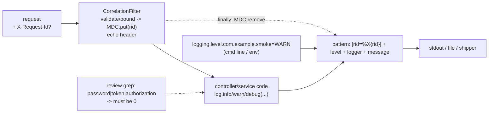

# Logging

## 1. Learning Objectives

After this lesson you can:

- [ ] Give every request an id that ties its log lines together — client-supplied or
      server-generated, echoed back, and bounded (executed: `X-Request-Id: 6572b7dc`
      in the response, `[rid=6572b7dc]` on that request's WARN line, and an
      over-long/absent header replaced by a generated 8-char id)
- [ ] Control verbosity by level as an **operational choice, not a rebuild** — three
      runs of the same jar with different levels (executed: default INFO → `DEBUG`
      count 0; `=DEBUG` → `cache MISS/HIT` lines appear; `=WARN` → `login ok`
      disappears while `login rejected` survives)
- [ ] Explain the level-threshold evidence *including the surprise*: the app's own
      startup banner vanished at `=WARN` because its logger lives in
      `com.example.smoke.SmokeApplication` — package-scoped levels are **broader than
      your intent** (executed: `Started SmokeApplication` count `0`)
- [ ] Prove a logging negative: grep the whole log for the secret and show zero
      (executed: `password` occurrences `0` in **all three** runs)
- [ ] Choose levels for each package of a real service, define what an ERROR line
      must carry, and say where logs go (and for how long) before an incident needs
      them

## 2. Prerequisites

- [Spring Boot](spring-boot.md) — Boot's starter brings Logback with sensible defaults;
  this lesson adds the three knobs it actually needs.
- [Validation and Error Handling](validation-and-error-handling.md) — the error
  contract's server-side twin: responses tell clients what happened, logs tell *you*
  why.
- [Authentication](authentication.md) — why credential values must never reach a log
  line is that lesson's rule; this lesson executes the check.

## 3. Introduction

Logs are the API you talk to yourself at 3 a.m. This lesson's lab adds the two
things production logging is actually about — **correlation** (which lines belong to
this request?) and **control** (what do we write, and what do we never write?) — and
measures both with greps instead of adjectives. The lab wires an MDC-backed
correlation filter (`X-Request-Id` in, `[rid=…]` on every line, echoed in the
response so clients can quote it), then runs the *same jar* three times under three
logging levels. The resulting captures include one genuinely useful accident: setting
`com.example.smoke=WARN` to quiet the app also erased its startup banner — a
package-level threshold does exactly what you asked, including the part you didn't
mean.

## 4. The Problem It Solves

Three failure modes of unexamined logging. **Correlation loss**: one request crosses
controller → service → repository → HTTP client; with a shared appender and no
request id, interleaved lines from ten concurrent requests are an unsolvable jigsaw —
you can see *what* happened but not *whose* problem it was, and the incident review
degenerates into guessing by timestamp proximity. **Verbosity extremes**: no levels
means either everything at `INFO` (the missing detail when debugging is precisely
what you needed) or debug everywhere by default (I/O cost, noise that hides the one
line that matters, and — worse — logs nobody reads because most of it is filler). The
operational answer is levels *settable at runtime* so a field incident turns on
`DEBUG` for one package without a deploy. **Secret leakage**: logging is where
credentials historically escape — request bodies echoed for "traceability", exceptions
printing parameter values, `System.out.println` habits from lesson 4's exercises. The
check is mechanical (executed below): grep the secret, count zero. Together these are
the discipline: **logs are a product surface for operators** — addressed, levelled,
and safe.

## 5. Core Concepts

### Correlation: one id, every line, echoed to the client (executed)

```java
String incoming = request.getHeader("X-Request-Id");
String rid = (incoming == null || incoming.isBlank() || incoming.length() > 64)
        ? UUID.randomUUID().toString().substring(0, 8)   // never trust unbounded input
        : incoming;
MDC.put("rid", rid);
response.setHeader("X-Request-Id", rid);                 // echo so clients can quote it
try { chain.doFilter(request, response); } finally { MDC.remove("rid"); }
```

```console
$ curl -D - .../auth/login        # no request-id header
X-Request-Id: 6572b7dc
...
WARN ... [rid=6572b7dc] com.example.smoke.AuthController : login rejected user=ade
```

The properties file adds the format once:

```properties
logging.pattern.correlation=[rid=%X{rid}]
```

Read the executed behavior line by line: the **response** carries the id (a client's
support ticket can now quote `6572b7dc` and you can `grep` exactly their request);
the **log line** carries it through MDC (put in the filter, cleared in `finally` —
no leaking between requests on a pooled thread); and a missing or oversized header is
*replaced* rather than trusted — correlation ids are attacker-supplied strings too,
so the filter bounds them (64 chars) before they touch the log format. The honest
detail visible in every run: startup lines print `[rid=]` — empty, because MDC only
has a value inside a request scope. That emptiness is correct: the alternative
(a fabricated id for non-request lines) would corrupt the very meaning you built.

### Levels as a runtime dial (three executed runs, one jar)

```console
=== Run A — default (INFO)
login rejected (WARN) present with [rid=...]      DEBUG lines: 0
=== Run B — --logging.level.com.example.smoke=DEBUG
[rid=dbg01] INFO  ... : login ok user=ade role=USER
[rid=dbg01] DEBUG ... : cache MISS sku=SKU-C computing
[rid=dbg01] DEBUG ... : cache HIT sku=SKU-C entries=1
=== Run C — --logging.level.com.example.smoke=WARN
counts: login-ok=0  cache-lines=0  rejected=1
```

Three observations, each operational:

1. **Threshold, not filter**: WARN and above survive C; INFO (`login ok`) and DEBUG
   (`cache MISS/HIT`) do not — the same code path executed all three times in C; the
   lines were *available* and suppressed. Verbosity is a decision made *outside* the
   source, on the command line, per environment.
2. **The cache lines are DEBUG *by design***: HIT/MISS is high-frequency, useful
   while tuning (lesson 17's counters already aggregate it), useless per-request in
   production. The level choice follows the question "would I read this in an
   incident?" — for `login rejected`, yes at WARN: one line per failure family,
   already a signal (alertable).
3. **The surprise, which is the lesson**: at `=WARN`, `grep Started SmokeApplication`
   → **0**. The banner is logged by `com.example.smoke.SmokeApplication`, inside the
   package you throttled — so the threshold silenced your own startup confirmation
   (which is why run C's readiness probe had to key off a framework logger line
   instead — executed in this lab itself). The generalization: **package level
   = every logger under that prefix, including framework loggers registered against
   your classes**. Scope levels to the noisy sub-packages you mean
   (`com.example.smoke.cache=WARN`), verify the banner survived, and remember the
   failure mode shows up exactly when you're least careful — during an incident.

### The negative proof: grep for what must not be there (executed)

```console
=== password occurrences in all three logs:
run-logA.txt:0   run-logB.txt:0   run-logC.txt:0
```

The lesson's answer to "do we log credentials?" is a command, not a claim. It works
because the discipline upstream is visible in the code: the `AuthController` logs
`user=ade role=USER` — identity yes, **password never**; the request body isn't
echoed anywhere; and lesson 12's capture already showed all env values masked
`******` by the actuator. Note *where* the check runs: all three runs, including the
`DEBUG` one — because debug is exactly when careless `log.debug("request {}", body)`
lines get added and then shipped by accident. The greppable negatives that belong in
a review checklist: the password field name, the token values, the cookie header, the
`Authorization` header. If a new line ever matches, it fails review before it fails
production.

## 6. How It Works



Three independent controls, all executed: the filter decides **which request's
context** a line carries, the level decides **whether it's written**, the pattern
decides **what surrounds it** — and the review grep decides **what may never be in
the message at all**.

## 7. Practical Examples

**Example 1 — the filter + pattern (the whole feature, three files)**

```java
@Component
public class CorrelationFilter extends OncePerRequestFilter {
    public static final String HEADER = "X-Request-Id";
    @Override protected void doFilterInternal(HttpServletRequest req, HttpServletResponse res,
                                               FilterChain chain) throws ServletException, IOException {
        String incoming = req.getHeader(HEADER);
        String rid = (incoming == null || incoming.isBlank() || incoming.length() > 64)
                ? UUID.randomUUID().toString().substring(0, 8) : incoming;
        MDC.put("rid", rid);
        res.setHeader(HEADER, rid);
        try { chain.doFilter(req, res); } finally { MDC.remove("rid"); }
    }
}
```

```properties
logging.pattern.correlation=[rid=%X{rid}]
```

- **How to run it:** build, start the jar, and drive three runs — A default;
  B `--logging.level.com.example.smoke=DEBUG`; C `--logging.level.com.example.smoke=WARN`
  — capturing each log to a file and grepping per section.
- **Expected output:** the captures quoted across section 5 (echoed header, rid-tagged
  lines, the B lines, the C counts, `password: 0` ×3).
- **Assumptions:** Boot 4.1.1's default Logback setup (no logback.xml — everything
  here is properties); JDK 25; Windows 11 + Git Bash.

**Example 2 — log statements that earn their lines**

```java
log.info ("login ok user={} role={}", user.username(), user.role());  // identity, never the password
log.warn ("login rejected user={}", creds.username());                // one family, one line, alertable
log.debug("cache MISS sku={} computing", sku);                        // high-frequency: DEBUG by design
```

- Parameterized messages (`{}`) — never string concatenation: the formatting cost is
  paid only if the level is enabled (a `DEBUG` line at WARN level costs a threshold
  check, not an allocation).
- **Expected output:** exactly the lines seen in runs A/B/C, and the levels chosen
  per the "read it in an incident?" test.

## 8. Real-World Applications

The lab's two knobs are production's starting points: correlation ids are what
distributed tracing extends (a `trace_id` that survives HTTP calls to other services,
so one id spans your service *and* its dependencies — the same MDC idea, propagated
in headers), and levels-per-package are what you'll change in a running system during
an incident (env var / config server, no deploy — the executed command-line override
is the same mechanism an ops platform uses). The `login rejected` WARN line is the
shape of alertable signal: counts of it per minute are a credential-stuffing
detector (lesson 12's uniform-401 rule pairs with this line — uniform on the wire,
*counted* in logs, exactly as that lesson prescribed). The `password: 0` grep is the
seed of log hygiene policy: scrubbers at the shipper, deny-lists in code review, and
`DEBUG` bodies banned outright — because the moment logs leave your machine (a
shipper, a support export, a pasted incident channel) they are a data store with
your secrets in it. The banner-at-WARN accident maps to a real operations lesson:
know which loggers your runbook depends on, and never globally throttle them.

## 9. Common Mistakes

| Mistake | Why it happens | How to recognize it | How to prevent it |
|---|---|---|---|
| No request correlation | default pattern only | interleaved lines, incident guessing by timestamp | the filter + `logging.pattern.correlation` (executed: rid echoed and tagged) |
| Logging request/response bodies at DEBUG | "debugging the integration" | secrets in logs exactly during incidents | body logging banned by review; the `password/token/authorization` grep as CI check |
| Package level throttles too much | prefix breadth | banner/framework lines vanish (executed: `Started`=0) | scope to noisy sub-packages; verify your runbook loggers still write |
| `INFO` for high-frequency events | habit | one line per cache hit/row | DEBUG for per-request chatter; aggregate counters instead (lesson 17) |
| String concatenation in log calls | unfamiliar with `{}` | allocations even when level off | parameterized messages only |
| Unbounded client-supplied ids | trusting headers | 10 KB "rid" lines, log-injection payloads | validate/bound (executed: `length > 64` → generate) |
| Synchronized console-only logging in prod | dev defaults | interleaved partial lines under load, lost on restart | structured JSON to stdout *shipped* by a collector, or a file appender with rotation |
| No retention/access policy | logs as afterthought | PII sitting in logs for years | retention window, access control, and scrubbing decided *before* the incident |
| Alerting on ERROR lines only | crude signal | noisy ERRORs desensitize; missing WARN signals | alert on *rates of specific families* (`login rejected`, 5xx ratio) |

## 10. Best Practices

- **Correlate at the edge, clear in `finally`**: one id per request, echoed in the
  response, propagated to outbound calls when you make them.
- **Level by question**: would an on-call engineer read this during an incident?
  ERROR = something needs a human; WARN = a failure with a policy (retry, reject);
  INFO = state transitions worth an audit (`login ok`); DEBUG = temporary
  investigation detail; TRACE almost never.
- **Log the *event*, not the data**: `login ok user=ade role=USER` — enough to
  investigate, never enough to leak; identities and ids yes, credentials/tokens/full
  bodies no (the executed `0/0/0` grep is the acceptance test).
- **Parameterized messages everywhere** (`{}`), so suppressed lines cost nothing.
- **Keep runbook-critical loggers visible**: verify (by grep, after every level
  change) that startup/banner/signal lines still appear — the C-run lesson.
- **Run the negative grep in review/CI** for `password`, `token`, `secret`,
  `authorization`, `cookie` — a logging regression should be caught before it ships,
  not after it's queried.

## 11. Limitations and Trade-Offs

The lab writes to **stdout captured in a file**: fine for one process, wrong for a
fleet — production needs a shipper (or platform logs) with structured JSON, which
adds schema discipline (fields you can query vs prose you can only grep) and its own
cost story: log volume is billed per line, and DEBUG-on during an incident can 10×
that bill in the hour you're least able to watch it. Correlation **stops at the
process**: without propagating `X-Request-Id` on outbound calls, the id covers your
service only — the distributed-tracing extension (trace context headers, sampling)
is real work this lesson names rather than executes. The `password: 0` grep is a
necessary, not sufficient, proof: it covers *that field name in those runs* — a
password logged under an obfuscated key or inside a serialized body wouldn't match;
hence scrubs + review, not grep alone. MDC adds a per-request map allocation and a
`ThreadLocal` — negligible here, but the same mechanism is why reactive/async code
needs care (thread hops lose MDC unless propagated — the lesson's `OncePerRequestFilter`
shape assumes servlet threads, as this app has). Finally, levels via command line
are *this environment's* choice: managed per-instance overrides mean two nodes can
temporarily disagree, which is why any level change in production should be tracked,
time-boxed, and reverted — a debug session nobody closed is a silent cost center.

## 12. Practical Exercises

### Introductory

1. **Exercise 20.1** — run the correlation drill: send one request with your own
   `X-Request-Id: mytrace123` and one without; capture both response headers and the
   tagged log lines; then send `X-Request-Id` with a 300-character value and capture
   the *generated* replacement in both places.
   **Completion criteria:** three captures showing (a) your id reused, (b) an
   8-char generated id, (c) the bound enforced; one sentence on why the filter also
   *echoes* the id.
2. **Exercise 20.2** — the three-run level drill (A/B/C) reproduced with your own
   greps and counts; then explain the `Started SmokeApplication` = 0 result from run
   C by locating which logger prints that line.
   **Completion criteria:** three runs with counts; the banner's logger name
   (`com.example.smoke.SmokeApplication`) identified; the generalization stated
   ("package level covers everything under the prefix").

### Intermediate

3. **Exercise 20.3** — break the negative: add
   `log.debug("login attempt {}", creds)` (the record includes the password field),
   run at DEBUG, and capture `grep -i password` now matching — the exact regression
   the review grep exists for. Then fix it (`creds.username()`), re-run until zero,
   and restore.
   **Completion criteria:** the failing grep capture with the line quoted; the fix
   diff; a one-line review rule that would have blocked it.
4. **Exercise 20.4** — level design for a real package: take any two packages of the
   lab or your own project and write their default level + the one line you'd
   elevate to WARN and why; then execute one of the two changes (annotation or
   property) and capture the new line appearing during its triggering request — and
   confirm nothing *else* in the package got noisier (grep counts before/after).
   **Completion criteria:** the two-package table with reasoning; the elevation diff;
   before/after counts for the package showing the delta is exactly the intended line.

### Independent problem-solving

5. **Exercise 20.5** — make the log answer the incident question: run the login
   battery (lesson 12's A1–A7) against your instrumented app and write the three
   queries an on-call engineer needs — "all lines for rid X", "rejected-login rate in
   the last 5 minutes", "every distinct rid that hit user `ade` in an hour" — and
   run each against your captured log (grep/awk are fine). Time yourself from
   "user reports login problem" to "three answers". Then propose the one additional
   field (structured JSON?) that would make the third query trivial, and note what
   it costs.
   **Completion criteria:** the three queries with outputs; the timing; the
   structured-field proposal with its trade-off — and a statement of what this lab's
   line-oriented log could *not* answer (e.g., p95 latency) and where that answer
   belongs instead.

*Solutions: attempt first. They live in `exercises/solutions/` of this subject.*

## 13. Knowledge Check

1. Run C produced zero `Started SmokeApplication` lines even though the app started
   fine. What happened, and what's the general rule? … *(`=WARN` was scoped to
   `com.example.smoke`, and Boot logs the banner with the main class's logger —
   `com.example.smoke.SmokeApplication` — under that prefix. Rule: a package level
   applies to everything registered under it, framework loggers included; scope
   throttles to the noisy children, and verify the lines your runbook depends on.)*
2. Your teammate logs the full request body at DEBUG "since it's off in prod anyway."
   Using this lesson's evidence, give the two-countering facts. … *(Run B proves
   DEBUG turns on by flag in any environment — including the one where the incident
   happens — so "off in prod" is a config, not a guarantee; and the `0/0/0` grep is
   only zero *if such lines never exist*. Add the line and every DEBUG session
   leaks credentials to the log store — which is why the review grep blocks the line
   itself, not the level.)*
3. Why does the filter echo `X-Request-Id` back in the response instead of only
   tagging logs? … *(So the *client* holds the correlation handle: a support ticket,
   mobile crash report, or browser network log can carry the same id the server's
   lines do — the join works across the incident boundary where you can't reach into
   the user's session. It also confirms to the client which id the server used when
   it generated one.)*

## 14. Completion Criteria

Observable evidence that you have understood this lesson:

- [ ] The three-run drill (A/B/C) executed with your own counts for each level
- [ ] Correlation demonstrated in both directions: echoed header + tagged lines, with
      the generated-id fallback captured
- [ ] The banner suppression explained by naming its logger (Exercise 20.2)
- [ ] The negative grep run across all runs — and re-run after deliberately adding a
      leaking line (Exercise 20.3) to see it catch the regression
- [ ] For your own project: a package-level table with a reasoning sentence each, and
      the review grep wired somewhere automated

## 15. Summary

- Correlation is infrastructure: filter validates and bounds the client id, MDC
  carries it, the pattern prints it, the response echoes it — and empty `[rid=]`
  outside requests is the honest state.
- Levels are an operational dial on a running jar: A/B/C showed the same code
  producing three different amounts of truth — WARN survives, INFO and DEBUG don't.
- **Package levels are broader than intent**: the `Started` banner died with the
  app's own package at WARN — scope narrowly, verify your runbook lines.
- Logging negatives are checked, not asserted: `password` → `0` across every run,
  including DEBUG — and the exercise deliberately breaks it to prove the check works.
- Log the event, never the payload; parameterize; keep the on-call's questions
  (`rid`, rate, who) answerable in one grep.

## 16. Next Steps

- Next lesson: [Backend Testing](backend-testing.md) — the checks from every lesson
  in this subject, turned into a suite that runs on every change.
- Practice: [exercise sets](exercises/README.md) for this subject.
- Where it is applied: [Project 05 — Full-Stack App](../20-PROJECT-LABORATORY/project-05-full-stack-app/README.md)
  — correlation ids wired end-to-end from the frontend's requests into these logs.