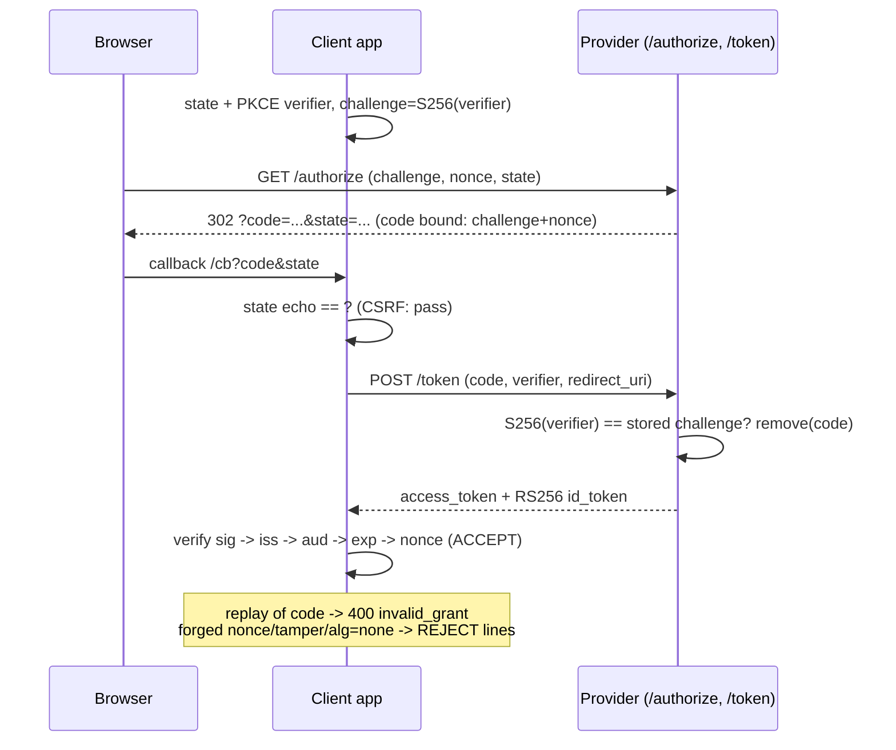

# OAuth2 and OpenID Connect

## 1. Learning Objectives

After this lesson you can:

- [ ] Separate the layers by name and job: **OAuth 2.0 = delegated authorization**
      (a token for *scopes*), **OIDC = identity on top** (a signed `id_token` with
      `sub`), **PKCE = code-interception defense** — each with its executed artifact
      from the flow below
- [ ] Walk the authorization-code flow leg by leg against a running provider
      (executed over loopback HTTP: `GET /authorize` → **302 with `code` + `state`**
      → `POST /token` → **200 with `access_token` + RS256 `id_token`**)
- [ ] Explain what `state` and PKCE actually stop: the state echo check printed
      `CSRF check: pass`, and the token endpoint verified `S256(verifier) ==
      challenge` **server-side** before signing anything
- [ ] Verify an `id_token` as a checklist — signature first, then `iss`, `aud`,
      `exp`, `nonce` (executed: `ACCEPT sub=ade-42 (sig, iss, aud, exp, nonce all pass)`)
- [ ] Execute the three classic attacks and name each defense: wrong nonce → `REJECT:
      nonce`, tampered sub → `REJECT: signature`, `alg=none` → `REJECT: not three
      parts`, plus **code replay → `400 invalid_grant`** (one-time codes)
- [ ] Say what "Login with X" moves — and what your app must still do itself: the
      redirect-URI allowlist, the token's audience check, and account linking

## 2. Prerequisites

- [Sessions and Tokens](sessions-and-tokens.md) — JWT structure, signature
  verification, and `exp` claims are assumed; this lesson *receives* a signed token
  instead of minting its own.
- [Authentication](authentication.md) — password login was the in-house option this
  lesson's delegation replaces.
- [HTTP and REST APIs](http-and-rest-apis.md) — redirects, callbacks, and the
  client-side/browser split the whole flow lives inside.

## 3. Introduction

Delegated auth has a one-sentence shape: **your app never sees the password — it
receives proof someone else verified**. This lesson executes the mechanism instead of
describing it: a real authorization server (a JDK `HttpServer` on
`127.0.0.1:8792`) issuing real 302s and real codes, a client driving the legs with
real HTTP, an RSA key pair signing a real `id_token`, and verification done claim by
claim with `java.security.Signature` — no library, so every line of the checklist is
yours. The lab deliberately runs both the happy path and the attacks (nonce, tamper,
`alg=none`, code replay), because a flow you've only seen succeed is a flow you can't
review.

## 4. The Problem It Solves

Three problems, layered. **Password sharing**: if "Sign in with Google" meant the app
handled Google's password, every integration would be a credential-handling risk —
the fix is a flow where the *provider* authenticates and hands back proof (a code,
then tokens) the app never could have forged. **Third-party API access**: a calendar
app needs your events without your password — OAuth's authorization step lets *you*
grant a scoped, revocable token instead of a secret. **Browser-shaped attacks**: the
authorization-code flow crosses origins (site → provider → site), so it inherits
three classic problems, each with a named countermeasure executed below — CSRF on the
callback (`state`), stolen codes used without the client's secret (PKCE), and code
replay (one-time codes + `invalid_grant`). OIDC then fixes the *identity* gap OAuth
left: an access token says "this app may call the calendar", not "who is this user" —
`id_token` answers that, signed and addressed to *your* client.

## 5. Core Concepts

### The executed flow, leg by leg

```console
--- 1. client prepares state + PKCE (S256)
  state  = 86c40a59afe540458843ca247b412fa9
  verifier len = 86  challenge = kF1ZjKgndbx9yBCDSBcHik7lj8b833YIbvsftvyBEIU
--- 2. GET /authorize (redirect follows, location printed)
  302 Location: http://127.0.0.1:8793/cb?code=c13a9c65285c428db81a3a192c3b247e...&state=86c40a59afe540458843ca247b412fa9
  state echo matches: true   (CSRF check: pass)
--- 3. POST /token with code + verifier (PKCE checked server-side)
  [server] body read: [code, grant_type, redirect_uri, code_verifier]
  [client] POST sent, waiting for response (code=200)
  access_token: {"access_token":"at-aefaa2a7-c58e-4ba7-9e09-4125efb6...
--- 4. client verifies id_token: sig + 4 claims
  ACCEPT sub=ade-42 (sig, iss, aud, exp, nonce all pass)
```

Read the legs as responsibilities:

1. **Client side**: random `state` (CSRF echo token) and a PKCE `verifier` — only the
   client ever holds the verifier; `challenge = BASE64URL(SHA256(verifier))` travels.
2. **Provider side**: issues a **one-time `code` bound to challenge + nonce + redirect
   URI** and 302s it back — the browser carries it, but it's useless without the
   verifier (PKCE: even a code stolen from the redirect can't be exchanged — leg 3
   proves the binding by *succeeding only with the right verifier*).
3. **Token endpoint**: the only place `code_verifier` exists; server recomputes the
   hash, compares to the stored challenge, and only then signs — **`200`** with an
   RS256-signed `id_token` plus access token.
4. **Client verification**: a checklist, in order (below).

### The `id_token` checklist, executed as code

```java
Signature sig = Signature.getInstance("SHA256withRSA");
sig.initVerify(providerKeys.getPublic());
sig.update((header + "." + payload).getBytes(UTF_8));
if (!sig.verify(signatureBytes)) return "REJECT: signature";   // 1. integrity, ALWAYS first
// 2..5 — claims, each its own rejection:
// iss must equal your expected provider;  aud must equal YOUR client_id
// exp must be in the future;  nonce must equal the one you sent at /authorize
```

```console
--- 4. ACCEPT sub=ade-42 (sig, iss, aud, exp, nonce all pass)
```

Order matters: signature first (tampered content never reaches claim logic), then
claims — `iss`/`aud` answer *"was this minted for me, by someone I trust?"* (the
audience check is what stops a token minted for **another** app from being replayed
at yours — a real confusion bug, not a theoretical one), `exp` is the lesson-14 rule,
and `nonce` binds *this response to this authorization request*. Each check produces
its own `REJECT:` line — a verifier is a chain, and a chain reports its broken link.

### The attacks, executed

```console
--- 5. attack lines
  wrong nonce   -> REJECT: nonce
  tampered sub  -> REJECT: signature       (payload changed AFTER signing)
  alg=none      -> REJECT: not three parts (verifier never reads token's alg)
--- 6. code replay: second use of the same code
  [server] invalid: code=c13a9c... known=[]
  {"error":"invalid_grant"}
```

- **Wrong nonce** proves the flow-binding: a *validly signed* token from a
  *different* authorization request is still refused — this is the defense against an
  attacker injecting their own pre-obtained response into your callback.
- **Tampered sub** is lesson 14's rule at OIDC scale: flip `ade-42` → `root-1` after
  signing and the signature dies. Identity claims are integrity-protected, never
  hidden — combined with lesson 14, everything about `sub` is *readable* and
  *tamper-proof*, not secret.
- **`alg=none`** is rejected structurally (the verifier hard-codes RS256 verification
  and expects three parts) — the token's own `alg` field is never consulted for
  *choosing* behavior, the review vocabulary for library config.
- **Replay**: the provider *removed* the code on first use (`CODES.remove`), so the
  second exchange finds `known=[]` → `400 invalid_grant`. One-time credentials again
  — the same property as S5/S6's session delete, at a different layer.

### The layer map (what each piece is for)

| Piece | Job | Executed artifact |
|---|---|---|
| OAuth 2.0 grant (authorization code) | delegating *access* — scopes, not identity | `access_token: at-aefaa2a7-...` |
| OIDC | delegating *identity* — who is this user? | signed `id_token`, `sub=ade-42` |
| `state` | CSRF on the redirect callback | `state echo matches: true` |
| PKCE (S256) | code useless without the client's secret | `challenge` verified at `/token` |
| One-time code | no replay of the exchange | second use → `invalid_grant` |
| `iss`/`aud`/`exp`/`nonce` | token scoped to provider, app, time, request | the four `REJECT:` lines |

A common confusion to kill with this table: **the access token is not an identity
token** — carrying API access (RFC 6749) vs asserting identity (OIDC) are different
claims, and apps that treat a bearer access token as "the user" break the moment a
token for another audience arrives.

## 6. How It Works



Every arrow in this diagram was an executed line of output in section 5 — the probe
is the diagram, driven over loopback HTTP.

## 7. Practical Examples

**Example 1 — the provider's two endpoints (the lab's whole server)**

```java
// /authorize: consent simulated; the CODE binds the PKCE challenge + nonce
server.createContext("/authorize", ex -> {
    Map<String, String> q = parse(ex.getRequestURI().getRawQuery());
    String code = UUID.randomUUID().toString().replace("-", "");
    CODES.put(code, new Code(q.get("code_challenge"), q.get("nonce"), q.get("redirect_uri")));
    ex.getResponseHeaders().add("Location",
        q.get("redirect_uri") + "?code=" + code + "&state=" + q.get("state"));
    ex.sendResponseHeaders(302, -1);
});

// /token: PKCE check BEFORE anything is signed, code consumed on first use
Code c = CODES.remove(f.get("code"));                     // replay dies here (step 6)
if (c == null) { respond(ex, 400, "{\"error\":\"invalid_grant\"}"); return; }
if (!sha256b64(f.get("code_verifier")).equals(c.challenge())) {
    respond(ex, 400, "{\"error\":\"invalid_grant\",\"detail\":\"PKCE mismatch\"}"); return;
}
respond(ex, 200, "{\"access_token\":\"at-...\",\"id_token\":\"" + issueIdToken(c.nonce()) + "\"}");
```

- `remove` before `get` is the one-time-code enforcement in a single line; the
  challenge comparison is PKCE in one line. Both are executed in steps 3 and 6.
- **How to run it:** `javac -encoding UTF-8 OidcLab.java && java OidcLab` — JDK only;
  the provider listens on `127.0.0.1:8792` for the life of the run and stops in a
  `finally`.
- **Expected output:** the six-step transcript quoted across section 5.
- **Assumptions:** JDK 25 (RSA-2048 via `KeyPairGenerator`, `SHA256withRSA`);
  Windows 11 + Git Bash; loopback only, port 8792 free.

**Example 2 — the verifier, exactly as it should be ordered**

```java
static String verifyIdToken(String jwt, String expectNonce) {
    String[] p = jwt.split("\\.");
    if (p.length != 3) return "REJECT: not three parts";       // alg=none dies here
    // 1. signature with OUR keypair and OUR algorithm (never the token's alg)
    if (!sig.verify(decode(p[2]))) return "REJECT: signature"; // tampered payload dies here
    // 2..5 claims: iss -> aud -> exp -> nonce, each a separate line of output
}
```

- The four claim rejections are independent `return`s — the first failure names
  itself, which is what makes a token integration debuggable at 3 a.m.
- **Expected output:** `ACCEPT sub=ade-42 ...` for step 4; one specific `REJECT:`
  line per attack in step 5.

## 8. Real-World Applications

This probe's structure is the integration checklist you'll actually use: pick a
provider (Google, Apple, Auth0, Keycloak, or the curriculum's own), configure the
**exact redirect URI** (the provider's allowlist is a security control — a wildcard
redirect is how code gets stolen), request scopes narrowly, and implement the *same*
verification order the probe prints — libraries (Spring Security's
`oauth2Login()`, OIDC client libs) do it for you, and the reason to have run this
probe is knowing what to confirm in their config: `state` enabled, PKCE required,
issuer and audience pinned, `exp` enforced. On the wire, OIDC is what makes
"Login with X" work across the curriculum's stack: the API subject's endpoints accept
either the session cookie (own users) or a federated identity (delegated users), the
mobile subject's app uses the same flow with a custom-scheme or claimed redirect, and
account linking (`ade`'s local account + `sub` from a provider) is an application
decision the standard deliberately leaves to you. The attacks map onto real CVEs —
nonce/`state` omissions, `alg=none` in old libraries, code replay — which is why
each one is executed here rather than cited.

## 9. Common Mistakes

| Mistake | Why it happens | How to recognize it | How to prevent it |
|---|---|---|---|
| Missing `state` (or not comparing the echo) | flow "works without it" | callback accepts any `?code=` | random `state` in, exact match on return (executed: `CSRF check: pass`) |
| Skipping PKCE | confidential-client habit in a public client | mobile/SPA client with only a client_id | S256 challenge at `/authorize`, verifier at `/token` — the probe's leg 3 |
| No audience check | signature-only verification | any valid provider token accepted | `aud` must equal your client_id — the distinction between *a* token and *your* token |
| Trusting an access token as identity | conflating the layers | `sub` read from a bearer access token | identity comes from `id_token` (or the userinfo endpoint), access tokens call APIs |
| `iss` not pinned | "any provider" config | a token from a sibling deployment accepted | exact issuer string equality (probe: `REJECT: iss=...`) |
| Verifier honors token's `alg` | library defaults | `alg=none`/confusion CVEs | allowlist algorithms in *your* config (probe: structural reject) |
| Redirect URI mismatch handled loosely | trailing-slash leniency | `state` leaks via open redirect | exact-match allowlist at the provider *and* app |
| Long-lived codes / no replay guard | storage omitted | code reusable within its validity | `remove`-on-use + short expiry (probe step 6: `invalid_grant`) |
| Account linking by email alone | convenience | attacker with provider account claiming your users | link by `iss` + `sub` pair; email is a claim, not a key |

## 10. Best Practices

- **Authorization code flow + PKCE everywhere** — including server-side web apps;
  implicit flow is historical.
- **Verify in order: signature (your algorithm, your key) → `iss` → `aud` → `exp`
  → `nonce`/`state`** — the probe's exact output order; short-circuit on failure and
  log the `REJECT` reason server-side.
- **Scope minimally and separately**: OIDC scopes for identity (`openid profile`),
  API scopes for access — don't ask for calendar access to render a login button.
- **Pin the issuer and redirect URI exactly**; treat provider config (allowlists,
  allowed algorithms) as part of your security review, not setup trivia.
- **Treat tokens as claims, not secrecy** (lesson 14's rule, unchanged: probe 5's
  payload is readable by design).
- **Keep one account key**: `iss` + `sub` — never email — for linking (see the
  mistakes table).

## 11. Limitations and Trade-Offs

The lab's provider is a *teaching* server: consent is simulated, there's no TLS (on
loopback), no token lifetime/refresh rotation, no userinfo endpoint, and RS256 was
chosen over the more common modern options (ES256/EdDSA) purely because JDK RSA is
dependency-free — real deployments pick algorithms their provider supports and pin
them. What the probe **didn't** execute matters too: the browser-redirect legs were
driven by `HttpURLConnection`, not an actual browser, so same-site cookie behavior,
Safari's ITP, and mobile custom-scheme interception — the ecosystem quirks that made
PKCE necessary — remain *conceptual* here; and the flow assumes a first-party
provider you control the config of. OIDC's remaining hard problems are deliberately
out of scope: session handling *after* login (do you mirror the provider's session or
run your own?), silent re-authentication, and logout across parties (RP-initiated
logout) — all real design work for a production integration. Finally, delegation adds
a dependency: your users' access now hinges on a third party's availability, rate
limits, and policy changes — a reliability trade you accept explicitly when you stop
handling passwords yourself.

## 12. Practical Exercises

### Introductory

1. **Exercise 15.1** — run the probe and annotate each printed line with its RFC
   role: which leg is `response_type=code`, which line *is* PKCE's server-side check,
   which output proves one-time codes, and which two lines together prove `state`
   worked.
   **Completion criteria:** the annotated transcript; the four mappings; one sentence
   on what each of `state` and PKCE would fail to prevent if the other were missing.
2. **Exercise 15.2** — the `aud` check by experiment: call `verifyIdToken(token,
   nonce)` against a copy of the payload where `aud` is another client (edit the
   claim *before* signing by minting a second token in the provider handler), capture
   `REJECT: aud`, and explain which real-world attack this rejects.
   **Completion criteria:** the capture; a paragraph naming token-replay across
   sibling apps and why signature validity alone doesn't stop it.

### Intermediate

3. **Exercise 15.3** — disable `state` (send a fixed value, accept any echo) and
   capture the callback accepting an attacker's `?code=`; restore it and capture the
   rejection difference. Then do the same for PKCE: store no challenge, accept any
   verifier, and explain what a stolen code now buys.
   **Completion criteria:** four captures (state on/off, PKCE on/off); the attack
   sketches for each disabled control; the restore diff.
4. **Exercise 15.4** — replay in depth: extend the probe to exchange the *same* code
   twice **concurrently** (two `POST /token` in threads) and show `remove` still
   yields exactly one `200`; then add a 60-second expiry to codes and capture a late
   exchange refused with `invalid_grant`.
   **Completion criteria:** the concurrent capture (one 200, one 400); the expiry
   capture; one sentence on why `remove`-atomicity is what makes replay safety hold
   under race.

### Independent problem-solving

5. **Exercise 15.5** — take the flow to a real provider: register an app with one
   (any OIDC provider with a free tier or local instance), run authorization-code +
   PKCE against it with your own redirect URI, and verify the real `id_token` with
   the provider's published keys — using **the same checklist order as the probe**.
   Record which claims matched your expectations, how the provider expressed scopes,
   and exactly one behavior your lab provider didn't have. Then write the
   integration checklist your team would keep for any future provider.
   **Completion criteria:** a captured real `id_token` verification (signature +
   four claims, redact nothing but keys — tokens are claims, per lesson 14); the
   lab-vs-real difference list; the reusable checklist (ten lines max, ordered).

*Solutions: attempt first. They live in `exercises/solutions/` of this subject.*

## 13. Knowledge Check

1. Name the two tokens in the flow and one sentence each. … *(`access_token` —
   OAuth 2.0's scoped credential for calling APIs; `id_token` — OIDC's signed
   assertion of *who* the user is, addressed (`aud`) to your client. One is for
   servers, the other for identity — mixing them is the classic layer bug.)*
2. The tampered-`sub` attack died at `REJECT: signature`. Why doesn't an attacker
   just re-sign the edited payload with their own key? … *(Because verification uses
   **your** pinned public key / shared secret — the attacker's key isn't the one the
   verifier checks against, and the provider's private key is the only one that
   produces a matching signature. Which is also why `alg` must never come from the
   token: otherwise "my key, my algorithm" becomes possible.)*
3. Leg 3 succeeds only with the right `code_verifier`. A stolen code — from a
   poisoned redirect or a device's history — is then useless. What *else* must be
   true for that claim to hold, in one line? … *(The verifier must never travel with
   the code — it exists only at the client's token request — and the redirect URI
   must be provider-allowlisted, so the code is bound to a channel the attacker
   can't complete. PKCE binds the exchange; the allowlist binds the redirect.)*

## 14. Completion Criteria

Observable evidence that you have understood this lesson:

- [ ] The six-step flow ran on your machine: 302+state, 200+tokens, `ACCEPT`, and all
      four refusals (nonce, tamper, `alg=none`, replay)
- [ ] You can point at the single line in the provider that enforces one-time codes
      and the single comparison that *is* PKCE
- [ ] The `aud` experiment (Exercise 15.2) captured `REJECT: aud`
- [ ] You annotated the transcript with RFC roles without looking at the lesson
- [ ] Your integration checklist (Exercise 15.5 or hand-written) orders verification
      signature-first and names the account-linking key as `iss`+`sub`

## 15. Summary

- OAuth 2.0 delegates **authorization** (scoped access token), OIDC adds **identity**
  (signed `id_token`); the access token is not an identity token.
- The authorization-code flow executed end to end over loopback: `state` echo (CSRF
  pass), PKCE challenge verified server-side before signing, one-time code consumed
  on use (`invalid_grant` on replay).
- `id_token` verification is an ordered checklist — signature with *your* algorithm,
  then `iss`, `aud`, `exp`, `nonce` — each with its own `REJECT:` line, executed for
  three attacks.
- Codes are bound (challenge + nonce + redirect URI); tokens are addressed (`aud`)
  and time-boxed (`exp`); account linking keys on `iss`+`sub`, never email.
- Delegation trades password-handling risk for integration discipline — the checklist
  is the discipline, and you have now run every line of it yourself.

## 16. Next Steps

- Next lesson: [File Uploads](file-uploads.md) — multipart bodies, limits, and safe
  storage on the API you've secured.
- Practice: [exercise sets](exercises/README.md) for this subject.
- Where it is applied: [Project 05 — Full-Stack App](../20-PROJECT-LABORATORY/project-05-full-stack-app/README.md)
  — "Login with X" as the project's optional identity provider.