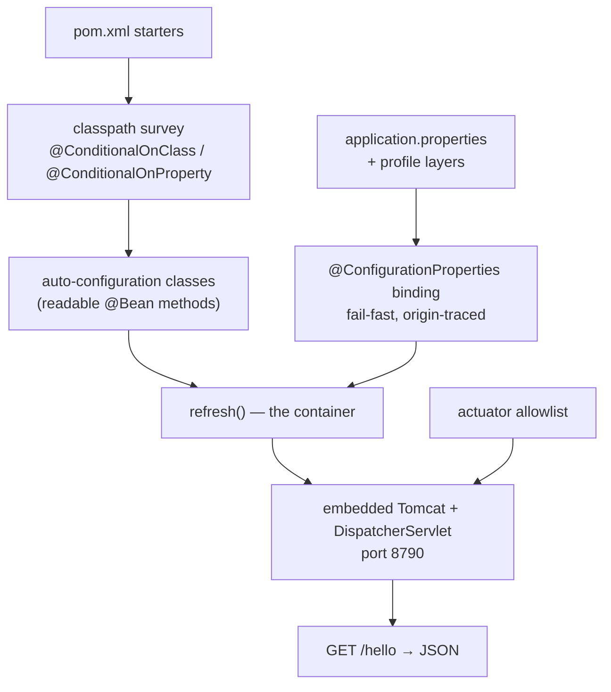

# Spring Boot

## 1. Learning Objectives

After this lesson you can:

- [ ] Say what auto-configuration actually is — conditional bean declarations applied
      from your classpath — and point at the executed proof: a two-class application
      (no `DispatcherServlet`, no Tomcat wiring, no web XML) that starts Tomcat and
      serves JSON (executed: `Tomcat started on port 8790` after `spring-boot-starter-web`
      alone)
- [ ] Package and run a production-shape fat jar (`executed: java -jar
  target/spring-smoke-0.0.1-SNAPSHOT.jar`, `Started SmokeApplication in 6.458 seconds`)
- [ ] Bind typed configuration with `@ConfigurationProperties` and prove the binding
      from HTTP (executed: `/config` → `{"name":"spring-smoke","owner":"batch13"}`)
- [ ] Activate a profile and watch only the declared override take effect (executed:
      `The following 1 profile is active: "dev"` and `/config` →
      `spring-smoke-dev`)
- [ ] Use the actuator as the operational surface — health, info, and the `env`
      endpoint's secret-masking default (executed: every value returned as `******`)
- [ ] Diagnose a Boot startup failure from its banner and origin-traced config errors
      rather than guessing

## 2. Prerequisites

- [Spring Fundamentals](spring-fundamentals.md) — the container, scopes, profiles, and
  `refresh()`. Boot's entire job is *finding configuration for that container* and
  starting the web server it hosts; if `refresh()` is a mystery, this lesson's
  conveniences will feel like magic instead of defaults.
- [Java Backend Development](java-backend-development.md) — the layered graph Boot
  will host.

## 3. Introduction

Spring's reputation for XML ceremony earned Spring Boot its first million users, but
"convention over configuration" is the wrong summary. Boot is a **classpath reader and
a decision engine**: it inspects which libraries you added, then declares the beans
those libraries imply — an embedded servlet container, a `DispatcherServlet` mapping, a
JSON converter — as *ordinary* `@Configuration` that you could have written yourself.
This lesson proves that claim on a lab you can run: `spring-boot-starter-web` +
`spring-boot-starter-actuator`, two Java classes, two properties files, and a battery
of HTTP probes against the result.

## 4. The Problem It Solves

Before Boot, starting a Spring web app meant assembling the same fixed preamble: XML
(or `WebApplicationInitializer`) declaring the `DispatcherServlet`, an `applicationContext.xml`
naming the context loaders, a servlet container external to the process, a deployment
descriptor to package into it — and none of it was *your* application logic. Each
environment repeated it, each upgrade tweaked it, and "it works locally, fails in the
war" was a genre of bug. The deeper waste: every Spring app needed the same beans
(servlet container, JSON, connection pool), so every team wrote the same conditional
wiring with the same mistakes. Boot moves that preamble into the framework where it
can be tested once — and, crucially, makes every default **conditional and overridable**,
so the convention is a starting proposal, not a cage.

## 5. Core Concepts

### Starters: the classpath *is* the configuration

A starter is a dependency aggregator — `spring-boot-starter-web` pulls Spring MVC,
Tomcat, Jackson, and the Boot auto-configurations that match them. That last part is
the trick: auto-configuration classes are gated on **classpath conditions**. No
`@ConditionalOnClass(Tomcat.class)` → no web server beans. Executed from the lab's
`pom.xml` (Boot 4.1.1 parent, `java.version=21`):

```xml
<dependency>spring-boot-starter-web</dependency>
<dependency>spring-boot-starter-actuator</dependency>
<dependency>spring-boot-starter-test</dependency>   <!-- scope test -->
```

That is the complete wiring section of the application.

### The executed proof: what's *not* in the code

The whole application is `SmokeApplication` (`@SpringBootApplication @RestController
@EnableConfigurationProperties`) plus a `LabProperties` record. There is no servlet
container code, no JSON configuration, no servlet mapping, no thread-pool setup:

```console
$ java -jar target/spring-smoke-0.0.1-SNAPSHOT.jar
...
INFO  o.s.boot.tomcat.TomcatWebServer : Tomcat started on port 8790 (http) with context path '/'
INFO  com.example.smoke.SmokeApplication : Started SmokeApplication in 6.458 seconds (process running for 7.625)
```

```console
$ curl -s http://127.0.0.1:8790/hello
{"message":"spring boot is alive"}
```

One class file in, a listening HTTP server with JSON out. *Somewhere* a
`DispatcherServlet` was registered, a `WebServerFactory` chose Tomcat and port 8790's
default context path, and Jackson chose `application/json` — all from conditions on
the classpath. That is auto-configuration: **not magic, but your own future code,
written in advance, gated on `@ConditionalOn*` annotations you can read.**

### Fat jar: the deployment unit that needs no server installed

`mvn package` runs the `spring-boot-maven-plugin`, which repackages the jar with the
app *and* its dependencies (nested jars in `BOOT-INF/lib`), and the run above is the
whole deployment: `java -jar` — no app server, no install step. That single command is
what makes Boot containers-friendly: the image contains a JDK and this jar, nothing
else. It also explains the cold-start cost quoted in the lesson — the container build
plus Tomcat init *is* the 6.458 s.

### Typed configuration: `@ConfigurationProperties`

Loose `@Value`-injected strings don't scale past a handful of keys. Boot's typed
binding maps a property *prefix* onto a record or class:

```java
@ConfigurationProperties(prefix = "lab")          // application.properties → lab.name, lab.owner
public record LabProperties(String name, String owner) {}
```

Executed over HTTP (the endpoint just returns the injected record):

```console
$ curl -s http://127.0.0.1:8790/config
{"name":"spring-smoke","owner":"batch13"}
```

The values came from `application.properties` — the binding was **fail-fast and typed**:
a missing key under a required prefix, or a wrong type, fails at startup with an
origin trace (`application.properties 4:10` style), not at first request.

### Profiles: override exactly what's declared

```properties
# application-dev.properties
lab.name=spring-smoke-dev
```

Executed with `--spring.profiles.active=dev`:

```console
INFO com.example.smoke.SmokeApplication : The following 1 profile is active: "dev"
$ curl -s http://127.0.0.1:8790/config
{"name":"spring-smoke-dev","owner":"batch13"}
```

Note what changed: `name` overrode the default file, `owner` still came from the base
file. Profile properties **layer** over (not instead of) the base — the previous
lesson's profile selection, now with a property-source merge rule.

### Actuator: the operational surface, secure by default

`spring-boot-starter-actuator` exposes the app's health model as endpoints.
Executed battery (default profile, all on `127.0.0.1:8790`):

```console
$ curl -s .../actuator/health
{"groups":["liveness","readiness"],"status":"UP"}
$ curl -s .../actuator/info
{}
$ curl -s .../actuator/env/lab.name
{"activeProfiles":[],"defaultProfiles":["default"],
 "property":{"source":"Config resource 'class path resource [application.properties]' ...",
             "value":"******"}
```

- `management.endpoints.web.exposure.include=health,info,env` — **explicit allowlist**;
  by default only `health` is open. Exposure is a deliberate act.
- Every value the `env` endpoint returned was `******` — Boot **masks property values**
  in the response (the security default that surprised the batch's first run and is
  the reason secrets don't belong in properties files at all).

### Failure modes are startup modes

A wrong key (`server.prot=8791`) doesn't silently do nothing: Boot fails on
`Configuration property 'server.port' ... origin` — origin-traced, source file and
line. Combined with profiles and masking, Boot's config story is: *typed, layered,
traced, and secret-hostile* — each property a startup assertion.

## 6. How It Works



Every arrow in this diagram is inspectable: `--debug` prints the auto-configuration
*report* — which classes matched, which were skipped and by which condition. When Boot
does something you don't expect, the report is the diff between your expectation and
its conditions.

## 7. Practical Examples

**Example 1 — the application, in full (executed as quoted above)**

```java
@SpringBootApplication          // component scan + @EnableAutoConfiguration + @Configuration
@RestController
@EnableConfigurationProperties(LabProperties.class)
public class SmokeApplication {
    private final LabProperties lab;
    public SmokeApplication(LabProperties lab) { this.lab = lab; }   // ctor injection (lesson 6)
    @GetMapping("/hello")  public String hello() { return "{\"message\":\"spring boot is alive\"}"; }
    @GetMapping("/config") public Map<String, String> config() {
        return Map.of("name", lab.name(), "owner", lab.owner());
    }
    public static void main(String[] args) { SpringApplication.run(SmokeApplication.class, args); }
}
```

- The `main` is the only ceremony: `SpringApplication.run` builds the context, finds
  the web server from the classpath, and blocks on the container.
- **How to run it:** `mvn -q package` then `java -jar target/spring-smoke-0.0.1-SNAPSHOT.jar`;
  probes with `curl -s http://127.0.0.1:8790/hello`.
- **Expected output:** the banner lines and four probe responses quoted in section 5.
- **Assumptions:** Spring Boot 4.1.1 (parent), Java 21 target on a JDK 25.0.4.1 runtime,
  Windows 11 + Git Bash.

**Example 2 — the profile switch, side by side**

```console
$ java -jar app.jar                     → /config {"name":"spring-smoke","owner":"batch13"}
$ java -jar app.jar --spring.profiles.active=dev
INFO ... The following 1 profile is active: "dev"
         /config {"name":"spring-smoke-dev","owner":"batch13"}
```

- `Started SmokeApplication in 6.458 seconds` (default) vs `4.458 seconds` (dev, warm
  page cache) — startup time is observable, and worth watching as the app grows.
- **How to run it:** as above with the `--spring.profiles.active` flag — the same flag
  works as `SPRING_PROFILES_ACTIVE` in an environment, which is how deployments choose
  profiles without rebuilding.

## 8. Real-World Applications

This lab's shape *is* production Boot: the fat jar is what CI ships, the container
image runs `java -jar`, `server.port` comes from the environment, and the actuator
`health` endpoint is what a load balancer probes (its `liveness`/`readiness` groups
map directly onto Kubernetes probes — visible in the captured `/actuator/health`
response). Every Spring Cloud, data, and security starter works by the same mechanism:
add the dependency, get the conditional beans, override what you need. The operational
consequences are the ones you meet on call: the auto-configuration report explains
surprising wiring, origin-traced config errors point at file and line, profile layering
means one artifact for every environment, and value-masking is why configuration holds
*references* to secrets, never the secrets themselves.

## 9. Common Mistakes

| Mistake | Why it happens | How to recognize it | How to prevent it |
|---|---|---|---|
| Treating auto-config as magic / fighting defaults | never having read a conditional | overriding a bean Boot already provides "to be safe" | print the auto-config report (`--debug`) and *read* what matched before overriding |
| Secrets in `properties` files | dev habit; masking is invisible until exposed | a real key in `application.properties` | env vars / secret managers only — remember every `env` value returned `******` |
| `@Value` scattered for structured config | reaches for the familiar annotation | a dozen string injections, no validation, typos fail silently | `@ConfigurationProperties` records — typed, grouped, origin-traced at startup |
| One `application.properties` edited per environment | didn't know profiles layer | env-specific values in the base file, diff churn between deploys | base file + `application-<profile>.properties`; one artifact, many environments |
| Expecting profile properties to *replace* the base file | mental model of swap, not layer | "I set the profile but other values vanished" — or didn't | layering is merge: remember `owner` surviving the `dev` override |
| Opening all actuator endpoints | exposure default misunderstood | `/actuator/env` reachable unauthenticated in prod | exposure allowlist per environment; sensitive endpoints behind auth |
| Debugging startup failures at runtime | not noticing boot aborts | port held / context failed, then curl timeouts | read the banner first — Boot fails fast with the origin (file:line) of the config error |
| Fat-jar build without `spring-boot-maven-plugin` | vanilla jar layout | `no main manifest attribute` | keep the starter-parent + plugin pair; never hand-roll the manifest |

## 10. Best Practices

- **One fat jar per artifact, environment injected at run time** — profiles via
  env vars, ports and URLs via config; nothing environment-specific in the build.
- **Group configuration into `@ConfigurationProperties` records per feature** — one
  record, one prefix, constructor binding; validation annotations (`@Min`, `@NotBlank`)
  turn typos into startup failures with names.
- **Override deliberately and sparsely** — before replacing an auto-configured bean,
  read its report entry; often a property exists (`server.port`, `management.endpoints...`)
  that does the same job without owning the bean.
- **Keep the exposure allowlist minimal** (`health` for probes; `info`/`env` only where
  a network boundary protects them) and never rely on masking as the *only* protection.
- **Watch startup time as a budget** — the 6.458 s lab number is your baseline; a
  suddenly slower boot usually means a classpath condition pulling in more graph.

## 11. Limitations and Trade-Offs

Auto-configuration's cost is **opacity**: defaults you didn't write are defaults you
didn't review — mitigated only by the debug report and this lesson's stance of treating
every default as code that exists. **Debugging time is now a fixed tax** on growth:
understanding why *this* `@ConditionalOnProperty` fired takes reading framework
sources, where the pre-Boot equivalent was your own XML. **Configuration sprawl** —
hundreds of keys with precedence rules (command line > env > profile file > base file)
— is real; a wrong mental model of that order produces the "my env var did nothing"
class of bugs. **Fat-jar startup cost** (6.458 s here) is slower than a warmed JVM or a
native image, and acceptable only for long-running services. Finally, Boot *pins* you
into its opinions: escaping to a non-Tomcat container or a custom lifecycle is possible
but fights the current. The lab's own scope: no Spring Cloud, no AOT/native image, one
web profile — production deployments layer external configuration sources and health
integration on exactly the mechanisms shown here.

## 12. Practical Exercises

### Introductory

1. **Exercise 7.1** — predict then run: before starting the jar, list every bean you
   believe `spring-boot-starter-web` + `@SpringBootApplication` creates (aim: Tomcat
   factory, `DispatcherServlet`, Jackson, `ViewResolver`, …), then start with
   `--debug` and extract the auto-configuration report's `Did not match` reasons for
   three classes you expected.
   **Completion criteria:** prediction list vs report; the condition named for each
   non-match; one sentence restating auto-configuration as conditional declarations.
2. **Exercise 7.2** — prove the profile layer: start with and without
   `--spring.profiles.active=dev` and capture both `/config` responses; state precisely
   which key changed and why the other didn't.
   **Completion criteria:** two captures; the merge rule (profile properties layer over
   base) written from memory; the active-profile log line quoted.

### Intermediate

3. **Exercise 7.3** — break the config on purpose: misspell `server.port` as
   `server.prot`, start, capture the failure with its origin trace, fix it, capture the
   clean start. Then add a typed `@ConfigurationProperties` record for the two lab keys
   with `@NotBlank` on `name`, and capture the validation failure with an empty value.
   **Completion criteria:** two failure transcripts, both naming source and key; a
   working run after each fix; one paragraph on why startup failure beats a null at
   request time (ties to lesson 6's fail-fast).
4. **Exercise 7.4** — actuator hardening: with the app running, request
   `/actuator/env` before *and* after removing it from the exposure allowlist, capture
   both statuses, and show `env/lab.name` masking (`******`) even while exposed.
   **Completion criteria:** `200` then `404` captures; the masking capture; a one-line
   justification for which endpoints you would expose behind a proxy in production.

### Independent problem-solving

5. **Exercise 7.5** — take your layered probe from BACK-05 and put it under Boot:
   `@RestController` = the controller, `@Service` = the service, `@Repository` =
   the repository (interface + two `@Bean` implementations selected by a profile), then
   replay all four of BACK-05's requests against port 8790 and diff the status codes
   with the plain-JDK transcript.
   **Completion criteria:** same four outcomes (201/400/404/…) on both stacks; the diff
   annotated with what Boot added (auto-configured server, JSON, error dispatch) versus
   what stayed yours (the three layers); startup log captured with the active profile
   named.

*Solutions: attempt first. They live in `exercises/solutions/` of this subject.*

## 13. Knowledge Check

1. A teammate says Boot "generates code." What's the accurate version, and how would
   you *show* them? … *(Nothing is generated: auto-configuration is conditional
   `@Bean` methods compiled into the starter jars. Show the `--debug` report — the
   matched/skipped list with each condition — or the two-class app that starts Tomcat
   with no web code of its own.)*
2. `/config` returned `spring-smoke-dev` under the `dev` profile but `owner` unchanged.
   Why? … *(Profile properties layer over the base file: `lab.name` was overridden,
   `lab.owner` fell through. It's a merge, not a replacement.)*
3. Why does `env` return `******`, and does that make it safe to commit secrets to
   `application.properties`? … *(Masking prevents disclosure through the endpoint —
   it does not encrypt the file. Values in the file are readable by anyone with the
   jar/repo; keep secrets in env/secret stores, referenced not stored.)*

## 14. Completion Criteria

Observable evidence that you have understood this lesson:

- [ ] You started the fat jar and reproduced the banner + all four HTTP probes from a
      clean shell
- [ ] You extracted an auto-configuration report and explained one *match* and one
      *skip* by its condition
- [ ] You produced one origin-traced config failure and one profile-layered override,
      each captured
- [ ] You can name the exposure allowlist's current contents and defend it
- [ ] You can state which of your config keys would move to environment variables
      before this lab went to production, and why

## 15. Summary

- Auto-configuration is **conditional declarations from your classpath** — starters
  are dependency aggregators whose real product is the matched `@Bean` set; the debug
  report makes the set inspectable.
- The two-class lab proved the whole claim: `java -jar` → Tomcat on 8790 → JSON, with
  no server wiring in the source.
- `@ConfigurationProperties` makes configuration typed, grouped, and origin-traced;
  profile properties **layer over** the base file (`spring-smoke` → `spring-smoke-dev`
  with `owner` surviving).
- The actuator is the operational surface: explicit exposure allowlist, and every
  `env` value masked `******` — secrets are referenced, never stored.
- Boot's defaults are code you didn't write but own anyway: read the report, override
  deliberately, and keep startup fast and honest.

## 16. Next Steps

- Next lesson: [Dependency Injection](dependency-injection.md) — the patterns behind
  constructor injection and how they make each layer testable in isolation.
- Practice: [exercise sets](exercises/README.md) for this subject.
- Where it is applied: [Project 04 — REST API](../20-PROJECT-LABORATORY/project-04-rest-api/README.md)
  — this lesson's exact lab grown into the curriculum's running API.
