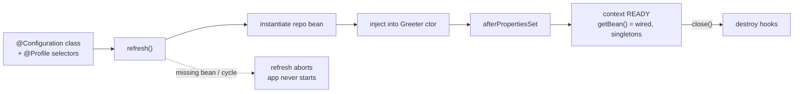

# Spring Fundamentals

## 1. Learning Objectives

After this lesson you can:

- [ ] State who builds and wires the object graph — the container, not your `main` — and
      point at the executed proof (the lab's `main` contains **no** `new Greeter(...)`,
      yet the constructor runs)
- [ ] Execute and order the bean lifecycle: constructor → dependency injection →
      `afterPropertiesSet` → use → `destroy` (executed: the probe's `ctor`/`life` lines
      in that exact order, `destroy` only when the context closes)
- [ ] Demonstrate singleton scope by identity (executed: two `getBean` calls, `a == b:
      true`) and name where prototype/request/session differ
- [ ] Activate a profile and watch a bean swap (executed: `lab` → `lab-mode`,
      `prod` → `prod-mode` from the same class)
- [ ] Diagnose the two fail-fast exits the container gives you for free (executed:
      missing bean → `NoSuchBeanDefinitionException: interface java.lang.Runnable`;
      cycle → `BeanCurrentlyInCreationException` at startup, refresh cancelled)
- [ ] Choose a configuration style — `@Bean` methods vs component scanning — and defend
      it for a given codebase

## 2. Prerequisites

- [Java Backend Development](java-backend-development.md) — the layered graph (arrows
  pointing inward) that this lesson's container *wires for you*.
- [Java Programming](../04-JAVA-PROGRAMMING/README.md) — interfaces, exceptions,
  records; the probe uses only those plus Spring's annotations.

## 3. Introduction

**Inversion of control** (IoC) sounds abstract until you say the concrete thing:
your code stops *creating* its collaborators and starts *declaring* them. In the
layered probe, `main` assembled `new OrderService(new InMemoryOrderRepository())` — one
line, fine for two objects. A real service has dozens: repositories, services,
validators, HTTP clients, mappers. The **container** is the piece that reads your
declarations once, builds every object, resolves every constructor parameter, and hands
you the finished root object. Spring's **ApplicationContext** is that container; this
lesson runs it directly — no Spring Boot, no web server, just `spring-context` and five
executed probes.

## 4. The Problem It Solves

Without a container, wiring lives in code: a `main` (or a growing `ServiceRegistry`
class) that news up every object in dependency order. Three costs compound: **change
ripples** — swapping storage means editing the composition root and every place that
reached for the old implementation; **half-built states** — objects observable before
their dependencies exist (the classic NPE-at-request-time caused by a wiring mistake);
and **no test seam** — testing one object means dragging its whole construction graph.
Service locators were the attempted fix (a global `registry.get(Service.class)`) and
just moved the problem: dependencies became hidden and every test needed the registry
mocked. The container's answer is *constructor-injected, startup-resolved,
fail-fast* wiring: if the graph can't be built, the application doesn't start.

## 5. Core Concepts

### The container and the bean

A **bean** is an object the container manages: created once (by default), wired, then
lifecycle-managed. You declare beans two ways — a `@Configuration` class whose `@Bean`
methods *are* the declarations (the probe's style: explicit, readable, no scanning
magic), or stereotype annotations (`@Component`/`@Service`/`@Repository`) found by
component scanning. The **ApplicationContext** adds what the older BeanFactory didn't:
environments/profiles, events, and application-level services — in practice it is *the*
container.

### Who creates what (the executed proof)

The probe's `main` does exactly this:

```java
AnnotationConfigApplicationContext ctx = new AnnotationConfigApplicationContext();
ctx.getEnvironment().setActiveProfiles("lab");
ctx.register(AppConfig.class);
ctx.refresh();                                  // ← the graph is built HERE
Greeter a = ctx.getBean(Greeter.class);
```

**Executed startup trace** — `main` never calls `new Greeter`, yet:

```console
--- 1. container builds the graph (no 'new Greeter' anywhere in main)
  bean   creating greetingRepo (once per context)
  ctor   Greeter with InMemoryGreetingRepo
  life   afterPropertiesSet (bean ready)
```

Read the order: the repository bean first (it's a parameter), then the `Greeter`
constructor *with its dependency already resolved*, then the init hook. **Dependency
injection happens between construction and initialization** — the object never exists
in an unwired state.

### Scope: how many instances

The default scope is **singleton** — one instance per container. Executed:

```console
--- 2. singleton scope: two lookups, one instance
  identity a == b: true  hashCode=2e385cce
```

`getBean` twice returns the *same object*; shared mutable state in a singleton is
therefore a real hazard (thread-safety becomes the bean's problem). The other scopes:
**prototype** (a fresh instance per *getBean* — the container builds it and stops
managing it, so no `destroy` hook runs), and in web applications **request**/**session**
(one bean per HTTP request/session). Choosing is a lifetime decision: stateless
services are singletons by nature; anything holding per-caller state is not.

### Lifecycle hooks

`InitializingBean.afterPropertiesSet()` (interface form; `@PostConstruct` is the
annotation form) runs *after* injection — validate your dependencies, warm caches.
`DisposableBean.destroy()` (or `@PreDestroy`) runs when the context closes — release
resources. Executed order across the probe's run: `ctor` → `afterPropertiesSet` →
…use… → `destroy (container closing)` — and section 5's close is the *only* place
`destroy` appeared: Spring manages the shutdown, not your code.

### Profiles: one graph, per environment

`@Profile("lab")` / `@Profile("prod")` on a `@Bean` method selects it by active
profile. Executed from the identical class file:

```console
$ java ContainerLab lab   →   profile label: lab-mode
$ java ContainerLab prod  →   profile label: prod-mode
```

Profiles are for *wiring differences* (which repository, which URLs) — a second
`@Bean` returning a `String` is the smallest possible demonstration; real profiles
swap whole subsystems. What profiles are **not** for: secrets (environment variables /
secret stores — see Spring Boot's config precedence, next lesson).

### Fail-fast: the container's two refusals

```console
--- 4. fail-fast wiring: a bean nobody defined
  NoSuchBeanDefinitionException: interface java.lang.Runnable
```

```console
WARN ... cancelling refresh attempt: UnsatisfiedDependencyException: ... bean 'a' ...
  root cause: BeanCurrentlyInCreationException: Error creating bean with name 'a':
  Requested bean is currently in creation: Is there an unresolvable circular reference
  or an asynchronous initialization dependency?
```

Both are **startup** failures, not 3 a.m. production ones: a missing dependency or a
cycle (`A(B)` ⇄ `B(A)`) aborts `refresh()` before a single request is served. This is
the payoff promised in section 4 — wiring mistakes can't degrade into runtime NPEs,
because there is no running app until the graph is complete.

## 6. How It Works



The container runs this once per application. Everything downstream — Spring Boot's
auto-configuration, `@RestController` injection, test contexts — is this same diagram
with more sources of declarations. Learn to read `refresh()` as "build the graph or
die," and Spring's startup errors become ordinary dependency reports.

## 7. Practical Examples

**Example 1 — declaring and consuming (the probe's core)**

```java
@Configuration
static class AppConfig {
    @Bean GreetingRepo greetingRepo() {              // producer: one per context
        System.out.println("  bean   creating greetingRepo (once per context)");
        return new InMemoryGreetingRepo();
    }

    @Bean Greeter greeter(GreetingRepo repo) {       // parameter = the injection point
        return new Greeter(repo);
    }
}

static class Greeter implements InitializingBean, DisposableBean {
    private final GreetingRepo repo;
    Greeter(GreetingRepo repo) {                     // constructor injection
        this.repo = repo;
        System.out.println("  ctor   Greeter with " + repo.getClass().getSimpleName());
    }
    public void afterPropertiesSet() { ... }         // init: after injection
    public void destroy() { ... }                    // cleanup: on context close
}
```

- The container *reads the parameter list* of `greeter(...)` — that's the whole
  mechanism. No XML, no reflection over fields (with `@Bean` styles), no service
  locator: dependencies are visible in one place, the constructor.
- **How to run it:** `javac -cp "$(cat cp.txt)" ContainerLab.java && java -cp
  ".;$(cat cp.txt)" ContainerLab lab` (classpath from the lab's `mvn
  dependency:build-classpath`; spring-context 6.x from the smoke project's dependency
  tree).
- **Expected output:** the full five-section transcript quoted across this lesson.
- **Assumptions:** Java 25.0.4.1, Spring Framework 6.2.x line as resolved by Spring Boot
  4.1.1's dependency management, Windows 11 + Git Bash.

**Example 2 — scope, profiles, and both refusals, one run each**

```console
--- 2. singleton scope: two lookups, one instance
  identity a == b: true  hashCode=2e385cce
  greet(): hello from in-memory
--- 3. the default profile's bean
  profile label: lab-mode          ← run with profile "prod": prod-mode
--- 4. fail-fast wiring: a bean nobody defined
  NoSuchBeanDefinitionException: interface java.lang.Runnable
--- 5. context closes: destroy hooks run
  life   destroy (container closing)
  closed.
```

- `a == b` is the scope claim tested the only way that matters — identity, not equality.
- Section 4's message is the container *naming what's missing* — compare with manual
  wiring, where the same mistake is an NPE at first use, far from its cause.
- The cycle transcript (section 5's output) is the same philosophy with a harder error:
  the refresh is cancelled, `main` continues only to print the exception, and nothing
  served a request in between.

## 8. Real-World Applications

Every Spring application is this container at scale: `@RestController`, `@Service`,
`@Repository`, `@ConfigurationProperties` are all bean *declarations*, and the request
thread that later calls your service got it injected exactly like `Greeter` got its
repo. Understanding `refresh()` explains the framework's most-cited behaviors:
startup failures that prevent deployment (fail-fast is a *feature* in Kubernetes, where
a crash-looping pod is visible and a half-wired app is not), singleton thread-safety
yours to maintain, profiles as the environment mechanism Boot layers config onto, and
"circular dependency" errors that read as gibberish until you picture section 6's
graph being built. Paired with the next lesson: Boot *finds* the configuration; this
lesson's container *is* the machinery.

## 9. Common Mistakes

| Mistake | Why it happens | How to recognize it | How to prevent it |
|---|---|---|---|
| Mutable state in a singleton bean | unawareness of scope | two "independent" calls share a counter | assume request threads share the bean; make fields final/immutable |
| Business logic in `@Bean` methods / config classes | configuration class is convenient | decision code inside `@Configuration` | config classes only *declare*; logic lives in the layers (BACK-05) |
| `getBean()` as a service locator | avoiding constructor plumbing | a bean fetching its own dependencies at runtime | constructor injection only; `getBean` inside application code is a review smell (one exception: frameworks retrieving contextual beans) |
| Circular dependencies patched with `@Lazy` | masking a design cycle | the probe's `BeanCurrentlyInCreationException` answered with annotations instead of a redesign | draw the cycle; usually both sides want a third, shared abstraction |
| Prototypes for stateless beans | fear of "global" | new instance per lookup, init cost, no destroy hook | singletons are the default for a reason; prototype only for genuinely per-consumer state |
| Profiles carrying secrets | config habits from scripts | credentials in `application-prod.properties` | profiles choose *wiring*; values come from env/secret stores |
| Lifecycle work in constructors | habit from plain Java | NPEs inside ctor because injected beans aren't ready yet | heavy init belongs in `afterPropertiesSet`/`@PostConstruct` — after injection |

## 10. Best Practices

- **Constructor injection as the only injection style** — final fields, no framework
  magic needed in your classes, tests construct objects directly. The rule bends only
  for optional dependencies, where an `ObjectProvider`/`@Autowired(required=false)`
  keeps the constructor honest.
- **Keep `@Configuration` classes declarative** — methods return wired objects; if a
  method has `if`/loops beyond simple conditionals, its logic belongs elsewhere.
- **Prefer `@Bean` methods for third-party types** (classes you can't annotate) and
  component scanning for your own — both are declarations; the difference is who owns
  the source.
- **Read startup errors as reports**: the missing-bean and cycle messages name the bean
  and the parameter — copy the bean name, `grep` it, fix the graph. Startup failure is
  the cheapest error you will ever get.
- **State your singleton assumptions out loud** in code review for any bean with a
  mutable field — that single question has caught more production bugs than most
  linters.

## 11. Limitations and Trade-Offs

The container is not free: **startup cost** — graph building, reflection, classpath
scanning (Boot's cold start in the smoke run was `6.687 s`, most of it container work;
fine for services, wrong for CLI tools); **debuggability** — a stack trace that routes
through framework frames and a wiring error that surfaces *indirectly* (the fix:
understand `refresh()` — this lesson — rather than fear it); **hidden dependencies**
compared to plain `new` — mitigated by constructor injection, which keeps every
dependency in one visible list; **singleton shared state** as the standing
thread-safety tax; and **magic ceiling** — component scanning and auto-wiring work
until someone renames a package or shadows a bean, at which point explicit `@Bean`
methods win. The probe's own gaps: no Boot (next lesson), no web scopes, no events,
no AOP — each a later lesson's subject.

## 12. Practical Exercises

### Introductory

1. **Exercise 6.1** — run the probe and order the lifecycle: capture the five lines
   (`bean creating`, `ctor`, `afterPropertiesSet`, `destroy`, `closed`) with your
   predicted order written down first, and annotate which lines *couldn't* appear
   without injection having already happened.
   **Completion criteria:** predicted vs executed order; the one-sentence rule
   "injection between ctor and init"; `destroy`'s single appearance explained by the
   `close()` call.
2. **Exercise 6.2** — prove singleton scope three ways: two `getBean` calls (`==`), a
   field mutated on `a` observed through `b`, and a `@Bean` method print count (one
   line despite two lookups).
   **Completion criteria:** three captures; the identity vs equality distinction stated;
   one sentence on what this implies for thread-safety.

### Intermediate

3. **Exercise 6.3** — add a third profile (`staging`) selecting a different
   `GreetingRepo` implementation; run all three profiles and capture each greeting.
   **Completion criteria:** three transcripts (`lab`/`prod`/`staging` messages); the
   selection rule written (active profile → which `@Bean` survives); one sentence on
   why two `@Bean` methods must not share a name under one profile (the ambiguity
   error — capture it if you trigger it).
4. **Exercise 6.4** — reproduce both fail-fasts yourself: delete a `@Bean` method
   (missing-dependency run) and then add a cycle (`Greeter` needing a bean that needs
   `Greeter`); capture both startup failures with their exact messages, then restore.
   **Completion criteria:** two failing transcripts naming the bean; the "what
   *would* have happened without the container" comparison (NPE at first request vs
   never-starts); your restore diff.

### Independent problem-solving

5. **Exercise 6.5** — wire a real mini-service by hand in a `@Configuration`: three
   layers from BACK-05 (controller/service/repository) plus a validator and an
   identifier generator, all constructor-injected by the container, with two
   implementations of the repository chosen by profile — then write the one-paragraph
   guide a teammate needs to read your startup log and know which wiring is live.
   **Completion criteria:** the graph runs under two profiles with distinct captured
   behavior; every dependency visible in constructors (grep for `getBean` in your code
   = zero hits); the guide names the log lines that reveal the active wiring.

*Solutions: attempt first. They live in `exercises/solutions/` of this subject.*

## 13. Knowledge Check

1. Your app logs `NoSuchBeanDefinitionException` at startup and serves nothing. Is that
   a production incident or the system working? … *(Working — fail-fast. The wiring was
   broken; without the container it would have been an NPE at first use, possibly at
   3 a.m. Fix the graph; the crash was the feature.)*
2. Why does a prototype-scoped bean's `@PreDestroy` never run? … *(The container
   builds it and hands it over — it stops managing the instance, so it has no
   reference to destroy. If cleanup matters, you own it.)*
3. A teammate "fixes" the cycle error with `@Lazy` on one constructor parameter. What
   did they buy, and what did they cost? … *(Startup succeeds — the dependency resolves
   on first use instead. But the cycle is still the design: now the failure, if any,
   moves to runtime, and two beans that must know each other stay coupled. Draw the
   cycle and find the third abstraction that breaks it.)*

## 14. Completion Criteria

Observable evidence that you have understood this lesson:

- [ ] You ran the container probe twice (lab/prod) with predictions for identity and
      profile output before each run
- [ ] The lifecycle order is written from memory and matches your capture
- [ ] Both fail-fast errors were reproduced by your own edits, with the messages quoted
- [ ] You can classify five beans of yours as singleton/prototype/request and defend
      each
- [ ] You can explain `refresh()` in three sentences to a teammate who fears Spring
      errors

## 15. Summary

- The container builds the object graph at `refresh()`; your code declares, never
  constructs collaborators.
- Injection happens between construction and initialization — objects are never
  observable half-wired; init hooks run after, destroy hooks on close.
- Singleton is one instance shared by every caller — identity proved with `==`, and
  mutable singletons are a thread-safety decision.
- Profiles select wiring at startup (`lab` → `lab-mode`, `prod` → `prod-mode` executed
  from one class file).
- Missing beans and cycles both abort startup with the culprit named — wiring errors
  are the cheapest kind, because the app refuses to run broken.

## 16. Next Steps

- Next lesson: [Spring Boot](spring-boot.md) — auto-configuration: how Boot finds this
  configuration, binds your properties, and starts Tomcat without you wiring any of it.
- Practice: [exercise sets](exercises/README.md) for this subject.
- Where it is applied: [Project 04 — REST API](../20-PROJECT-LABORATORY/project-04-rest-api/README.md)
  — the container that hosts every layer you build there.