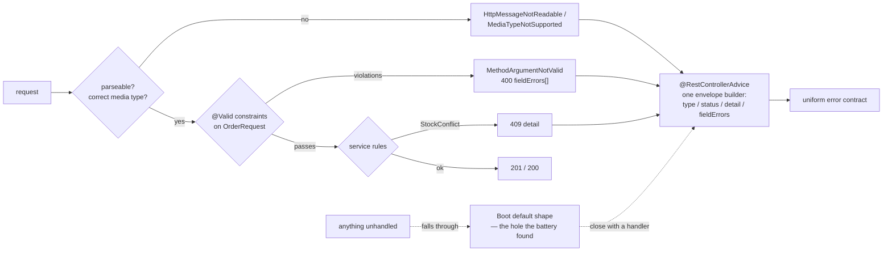

# Validation and Error Handling

## 1. Learning Objectives

After this lesson you can:

- [ ] Separate the three failure families and place each one — **format** (Bean
      Validation on the record, `400` + `fieldErrors`), **parse/media** (Jackson and
      content negotiation, same envelope after the fix), **state** (service rules,
      `409`) — executed as twelve requests across one battery
- [ ] Declare constraints where they belong: on the request **record's components**
      (`@NotBlank`, `@Size`, `@Min`/`@Max`), with messages a *client* can act on
      (executed: `{"field":"qty","message":"must be at least 1"}`)
- [ ] Prove the "one error contract" claim by breaking it: an uncovered exception
      returned Boot's default `timestamp/status/error/path` shape while the rest of
      the API returned `type/status/detail` — then closing the hole (executed:
      `V2/V3/V4` before vs `V2r/V3r/V4r` after, same three requests)
- [ ] Choose an unknown-field policy deliberately (executed: `{"admin":true}` silently
      accepted → `201`) and defend the trade-off
- [ ] Say what a validation error is *not* — never log it as an incident, never
      return stack traces, never leak field internals beyond the contract

## 2. Prerequisites

- [Controllers, Services, Repositories](controllers-services-repositories.md) —
  the three-layer placement this lesson's failures move through, including the advice
  that already maps `StockConflict` → `409`.
- [Spring Boot](spring-boot.md) — `spring-boot-starter-validation` is the only new
  starter; the envelope lives in the auto-configured error dispatch's exception chain.

## 3. Introduction

Validation code is where an API's honesty lives: either every refusal a client can
provoke arrives in one predictable shape, or every integration partner grows a
per-endpoint error parser. This lesson executes the case honestly, seam included: the
lab's first battery showed **two error contracts living in one API** — the advice's
envelope and Boot's default `timestamp/status/error` fallback — because three
exception types nobody handled fell through. That capture, plus the fix and the
re-run, is the argument for treating error handling as a *contract with exhaustiveness
checks*, not as a stack of `try/catch`.

## 4. The Problem It Solves

An endpoint that invents its own error responses produces three species of bug: shape
drift (endpoint B returns `{"msg"}` where endpoint A returns `{"message"}`), info
leaks (stack traces, SQL fragments, and field values echoed back to strangers), and
*contract lies* — a `200` with an `error` key, or a `400` that a client can't
distinguish from a parse failure. The root cause is always the same: validation
decisions scattered across parse calls, service checks, and hand-rolled status
choices, with no single place to audit. The fix is structural — **constraints declared
once on the type, one translation table for exceptions, and an envelope whose fields
never vary** — and the proof is the before/after battery in section 5: same requests,
one shape.

## 5. Core Concepts

### Constraints live on the request type

```java
public record OrderRequest(
        @NotBlank(message = "must not be blank")
        @Size(max = 16, message = "must be at most 16 characters")
        String sku,
        @NotNull(message = "must be present")
        @Min(value = 1, message = "must be at least 1")
        @Max(value = 10, message = "must be at most 10")
        Integer qty) {}
```

Executed — every constraint firing in one request:

```console
=== V5 POST {"sku":"","qty":0}
status=400  {"fieldErrors":[
             {"field":"qty","message":"must be at least 1"},
             {"field":"sku","message":"must not be blank"}]}
=== V1 POST {"sku":"SKU-A"}          ← absent field
status=400  {"fieldErrors":[{"field":"qty","message":"must be present"}]}
```

Three properties of this output matter: **all** violations reported at once (clients
fix one round-trip, not five), **sorted by field** (stable — the advice sorts; test
assertions can rely on order), and messages phrased for the *caller's* action, not the
annotation's internals. `@Valid` on the controller parameter is the trigger; the
constraints themselves are plain data on the record — reusable anywhere the type is.

### The three failure families, executed

| # | Request | Status | Shape | Origin |
|---|---|---|---|---|
| V5 | two bad fields | 400 | `fieldErrors[]` (our envelope) | Bean Validation, at the edge |
| E5 | qty 5 > stock 3 | **409** | `detail` naming the conflict | service rule, via advice |
| V3 | `{"sku":"SKU-A",` | 400 | `malformed-body` (our envelope, after fix) | Jackson parse |
| V4 | `Content-Type: text/plain` | 415 | `unsupported-media-type` (after fix) | content negotiation |
| V6 | unknown `"admin":true` | **201** | — (field ignored) | Jackson default policy |

- Format problems are the *request's* fault → `400`. State conflicts are the *world's*
  fault → `409`. Media mismatch is the *protocol's* → `415`. The status code names
  which party must change.
- **V2 (`"qty":"two"`)** is the instructive one: syntactically valid JSON, wrong
  shape — Jackson throws a *parse-family* exception, so it lands with V3, not with
  V5's field validation. The family split follows the exception type, not intuition.

### The seam: an error contract is only as strong as its fall-through

The first run's capture — same API, a *second* contract:

```console
=== V2 POST qty "two"  (before the fix)
status=400  {"timestamp":"2026-10-28T08:24:12.171Z","status":400,
             "error":"Bad Request","path":"/api/orders"}
=== V3 malformed JSON / === V4 text/plain
status=400 / 415  {same default four-key shape}
```

Nothing was "broken" — the server answered correctly — yet a client parsing
`type/status/detail` would crash on these three, and `timestamp`-style default bodies
are exactly what makes clients write per-endpoint parsers. Two handlers added:

```java
@ExceptionHandler(HttpMessageNotReadableException.class)          // 400 malformed-body
@ExceptionHandler(HttpMediaTypeNotSupportedException.class)        // 415 unsupported-media-type
```

Re-run, same requests:

```console
=== V2r / V3r  status=400  {"type":".../malformed-body","status":400,
                             "detail":"request body could not be parsed or does not match the expected shape"}
=== V4r        status=415  {"type":".../unsupported-media-type","status":415,
                             "detail":"content-type must be application/json"}
```

**One contract, now exhaustive across everything the client can actually trigger.**
The lesson isn't the two handlers — it's the method: provoke every failure you can
think of, diff the *shapes*, and close every hole until one envelope type is the only
shape in the log.

### Unknown fields: a policy, not an accident

```console
=== V6 POST {"sku":"SKU-A","qty":2,"admin":true}
status=201  {"id":1,"sku":"SKU-A","qty":2}
```

Jackson's default **ignores unknown properties** — and the field was silently dropped
rather than honored (the response proves no `admin` was applied). Defensible either
way: lenient lets clients and servers evolve independently (a mobile client on an old
build keeps working); strict fails fast on typos and makes "is this field honored?"
obvious. Choose per API and state it — silent *ignoring* is only safe because
ignore ≠ execute; the dangerous version of leniency is unknown fields being *bound to
something that matters*.

### What a validation error is not

- **Not an incident**: `400`s are normal traffic — never page on them, never log them
  at `ERROR` (log level discipline is [Logging](logging.md)'s subject; this lesson's
  rule: refuse-shaped-by-contract, not refuse-shaped-by-panic).
- **Not a place for internals**: no stack traces, no Hibernate constraint names, no
  SQL — the envelope's `detail` is written for the client, by the layer that owns the
  contract.
- **Not optional to test**: a client *will* send `"qty":"two"`; the battery is the
  test you can re-run.

## 6. How It Works



Read the dotted arrows: they are the contract's *failure mode*, and the discipline is
to keep probing them until only the solid path exists.

## 7. Practical Examples

**Example 1 — the envelope builder (the whole contract in one method)**

```java
private static ResponseEntity<Map<String, Object>> envelope(
        int status, String type, String detail, List<FieldError> fieldErrors) {
    Map<String, Object> body = new LinkedHashMap<>();
    body.put("type", type);              // stable machine-readable discriminator
    body.put("status", status);
    body.put("detail", detail);          // human text, safe to show
    if (!fieldErrors.isEmpty()) body.put("fieldErrors", fieldErrors);
    return ResponseEntity.status(status).body(body);
}
```

- `type` is a URI-shaped code (RFC 9457 problem-style) so clients *branch on it*;
  `detail` is prose so humans can read logs and support tickets.
- Field errors are **additive**: scalar responses never carry the key, so clients
  check presence, not shape roulette.
- **How to run it:** the twelve-request battery — `mvn -q -DskipTests package`,
  `java -jar target/spring-smoke-0.0.1-SNAPSHOT.jar`, then the `curl` lines quoted
  across section 5 (V1–V6 before adding the two handlers, V2r–V4r after).
- **Expected output:** exactly the quoted transcripts; V-series ids start at 1 per run
  (in-memory store).
- **Assumptions:** Spring Boot 4.1.1, `spring-boot-starter-validation` in the pom,
  JDK 25 runtime (Java 21 target), Windows 11 + Git Bash.

**Example 2 — where each status is *decided***

```java
// controller (edge):   @Valid triggers format checks     → 400 via advice
// service (rules):     throw new StockConflict(...)      → 409 via advice
// advice (translate):  exception type → status + envelope, one file, one shape
```

- No status literal appears in `OrderService` or the record; no domain noun appears
  in the advice's `type` beyond the exception class it names.
- That three-line audit is the reviewable form of this lesson: *who chooses the
  status, who writes the body, and who guarantees they match every other endpoint.*

## 8. Real-World Applications

The battery's shape is what API clients are written against in production: form UIs
read `fieldErrors` to mark inputs (`sku` → "must not be blank" lands under the right
textbox without bespoke client logic), API gateways count `type` values in dashboards
(`/validation` vs `/stock-conflict` are dimensions, not text greps), and contract
tests assert *exhaustively* that every failure endpoint returns the same envelope —
the exercise this lesson's fall-through capture exists to motivate. The
unknown-field decision reappears in every versioned public API; the `415`/`400`
family split is what lets a mobile client distinguish "your connection mangled the
body" from "your payload was wrong"; and the "validation errors are normal traffic"
rule is what keeps on-call sane — real incident alerts are keyed to `5xx` and
anomalies in `type` distributions, which only exist because the contract was uniform
enough to chart.

## 9. Common Mistakes

| Mistake | Why it happens | How to recognize it | How to prevent it |
|---|---|---|---|
| Validation in the controller's method body | annotations forgotten | `if (req.qty() == null) return ...` chains before the service call | constraints on the record + `@Valid`; body logic only for genuinely cross-field rules (then at the service) |
| Business rules as constraints | `@Pattern` for stock levels | a constraint class importing service concepts | format on the type, state in the service — the V5/E5 split (`400` vs `409`) is the tell |
| Catch-all `Exception` handler added to "fix" shape drift | symptom treated | one envelope for `400`s, default shape for `500`s | handle the *families* you can provoke; run the battery after every new endpoint |
| Default Boot error body left live | never diffed shapes | `timestamp/status/error/path` in any response | provoke, diff, close — V2r–V4r is the pattern |
| Echoing input back in `detail` | debugging habit | reflected payloads in errors (an XSS/leak vector in some clients) | detail strings are constants or service messages, never raw input |
| Unknown fields bound, not ignored | `FAIL_ON_UNKNOWN_PROPERTIES` tuning | an extra JSON key silently changing behavior | decide the policy; ensure ignore ≠ execute (V6's response proves the drop) |
| `400` for everything, `500` for rules | status laziness | conflicts and not-founds reported as client bugs | family table in section 5, enforced by the advice's one-mapping-per-exception rule |

## 10. Best Practices

- **Declare constraints on the transport type** (request/response records) — they
  travel with the type, are visible at the definition site, and are reusable.
- **Write messages for the caller**: what was wrong and what "correct" looks like
  (`must be at most 10`) — never annotation class names.
- **Sort and report all field errors** — stability in the array makes clients and
  tests deterministic (the advice sorts by field; keep it).
- **One envelope builder, one mapping per exception family** — and a battery of
  provocation requests re-run whenever the advice changes; shapes are diffed, not
  assumed.
- **Choose unknown-field policy and write it down** in the API docs; lenient is the
  common default *because* ignore is not execute.
- **Log validation failures at `INFO`/`DEBUG` with counts only** — full payloads in
  logs are a privacy problem, and `400` volume is a client-quality metric, not an
  alert.

## 11. Limitations and Trade-Offs

Bean Validation covers the *shape* of one object: **cross-field and cross-request
rules** (stock, uniqueness, "end after start") can't be declared on a record without
dragging the rule into the transport type — the placement rule sends them to the
service, which means some invalid requests legitimately reach the service layer
before rejection (E5 is exactly that, by design). **Group sequencing** (validate
"create" shape now, "persist" shape later) adds machinery most APIs never need and
misuse when they do. The **advice remains a chokepoint**: every new exception type
must be added *deliberately* — that's a feature (no silent fall-through after this
lesson) but it's also a merge-conflict and review-load cost. The battery itself has
limits: it covers what *you* thought to provoke — property-based or fuzz testing
of the contract is the honest extension, referenced in
[Backend Testing](backend-testing.md). Finally, the envelope follows the
problem-style `type/status/detail` shape; a team adopting RFC 9457's exact field
names (`title`, `instance`) trades novelty for client-library compatibility — pick
one, document it, and never mix.

## 12. Practical Exercises

### Introductory

1. **Exercise 10.1** — run the twelve-request battery and build the failure-family
   table from your own captures: request, status, envelope keys, originating class.
   Then explain V2's placement (parse family, not field family) in one paragraph.
   **Completion criteria:** filled table with real transcripts; the V2 paragraph
   naming the exception type involved; the `400`-vs-`409`-vs-`415` rule restated in
   your words.
2. **Exercise 10.2** — reorder the record's annotations mentally, then execute: send
   V5's body with the fields swapped in the JSON and confirm `fieldErrors` order is
   unchanged (advice sorts), and send both-invalid vs only-invalid bodies to see
   subsets reported.
   **Completion criteria:** two captures showing deterministic ordering; one sentence
   on why sorting matters to a client diffing responses.

### Intermediate

3. **Exercise 10.3** — break the contract on purpose: add an endpoint that throws a
   bare `RuntimeException`, capture the fall-through shape (the lesson's V2 seam
   again, this time as *your* bug), then close it with a `500` handler returning the
   envelope **without** leaking `ex.getMessage()` internals — explain the message
   policy you chose.
   **Completion criteria:** default-shape capture; the handler; the fixed-shape
   re-run; one sentence distinguishing what a `500` detail may say versus a `400`.
4. **Exercise 10.4** — cross-record constraint: add a `note` field with `@Size(max=200)`
   and a rule in the service that `sku` must be `SKU-*`; execute one request violating
   each and prove the two families return `400 fieldErrors` vs `409 detail`
   respectively.
   **Completion criteria:** two captures; the placement diff (record vs service); your
   justification for why the `SKU-*` pattern check did *not* become a `@Pattern`
   annotation.

### Independent problem-solving

5. **Exercise 10.5** — write the API's error contract as a one-page client guide:
   the envelope fields, the family table with statuses and `type` URIs, the unknown-field
   policy, ordering guarantees for `fieldErrors`, and what a client should do with
   each. Then hand it to someone (or sleep on it) and implement a client-side parser
   from the guide alone — every ambiguity you hit while parsing is a defect in the
   contract, so fix the guide and note each one.
   **Completion criteria:** the guide; a parser written against it; a numbered list of
   ambiguities discovered and how the guide changed — at least the exercise's own
   rough edges, ideally one you didn't expect.

*Solutions: attempt first. They live in `exercises/solutions/` of this subject.*

## 13. Knowledge Check

1. A client sends `{"sku":"SKU-A","qty":"two"}`. Which handler family answers, what
   status, and why isn't it field validation? … *(Parse family — Jackson can't coerce
   the type into `Integer`, so `HttpMessageNotReadableException` fires before `@Valid`
   ever runs. `400` with `malformed-body` after the fix. Validation checks values of
   correctly-typed fields; parsing checks the body has the declared types at all.)*
2. You add a new endpoint and a `404` starts returning `{"timestamp":...}`. What went
   wrong and what's the process fix? … *(Some exception path has no handler — the
   fall-through seam. Process: add the provocation request to the battery, handle the
   family, re-run until every captured shape is the envelope.)*
3. Should a `StockConflict`'s `detail` ever include the *stock numbers*? … *(Yes —
   they're domain facts the caller needs and the service already wrote the message;
   but never raw stack traces, SQL, or unrelated internal ids. The line: message
   authored by the domain for the client, not a dump of the failure's context.)*

## 14. Completion Criteria

Observable evidence that you have understood this lesson:

- [ ] The twelve-request battery executed, with your family table filled from real
      captures — including the before/after seam (V2–V4 → V2r–V4r)
- [ ] All responses in your API return one envelope shape — proven by diffing keys,
      not by reading code
- [ ] Unknown-field policy chosen, executed, and written into your docs
- [ ] A deliberate contract break (Exercise 10.3) produced, caught, and closed
- [ ] You can name, for each status code your API returns, the class that decides it

## 15. Summary

- Constraints belong on the request type; violations arrive **all at once, sorted**,
  with caller-actionable messages (V1/V5).
- Three families, three statuses: format `400`, parse/media `400`/`415`, state `409` —
  chosen by originators, translated by one advice.
- The real work is **exhaustiveness**: the first battery caught Boot's default shape
  leaking through three unhandled paths; two handlers closed it, and the re-run
  proved the contract uniform.
- Unknown fields are a policy decision (`admin:true` → `201`, dropped not honored) —
  document it.
- Validation errors are normal traffic, safe detail text, and a re-runnable battery —
  never incidents, never stack traces.

## 16. Next Steps

- Next lesson: [JPA and Hibernate](jpa-and-hibernate.md) — the same discipline for
  persistence: mapping, fetching, and the N+1 trap measured with query counts.
- Practice: [exercise sets](exercises/README.md) for this subject.
- Where it is applied: [Project 04 — REST API](../20-PROJECT-LABORATORY/project-04-rest-api/README.md)
  — the contract this lesson builds is graded as part of the project's API review.