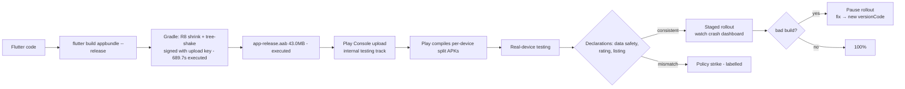

# Android Release

## 1. Learning Objectives

After this lesson you can:

- [ ] Produce both Android artifacts from the command line and say which one the
      store wants (executed: `flutter build apk --debug` → `√ Built build\app\
      outputs\flutter-apk\app-debug.apk` in 881.7 s on a cold Gradle; `flutter
      build appbundle --release` → `√ Built ...app-release.aab (43.0MB)` in
      689.7 s)
- [ ] Read a release build's own report card — tree-shaken icons
      (`MaterialIcons-Regular.otf` … `1645184 → 1368 bytes (99.9% reduction)`)
      and the size delta between artifacts (executed: debug APK 154,535,224
      bytes vs release bundle 45,096,061 bytes)
- [ ] Explain why Play takes an **AAB** and how the store builds APKs per device
      configuration from it
- [ ] Set up release signing — keystore, `key.properties`, `signingConfigs` —
      and state exactly what a leaked keystore means
- [ ] Configure `applicationId`, version codes, and min/target SDK correctly, and
      say which Play policy currently forces each target decision
- [ ] Complete the Play Console path — listing, data safety form, content rating,
      and staged rollout — and name which parts are declarations under penalty

## 2. Prerequisites

- [Mobile Development Fundamentals](mobile-development-fundamentals.md) — the
  `android/` folder, Gradle, and the manifest this lesson configures.
- [Mobile Testing](mobile-testing.md) — the green suite you run before any build.
- [iOS Release](ios-release.md) — the sibling; its comparison table assumes this
  lesson's artifact model.

*Provenance: the build captures below are **executed on the authoring machine**
(Windows 11, Git Bash; Flutter 3.47.7, Gradle **9.3.1** wrapper, Android SDK
36.1.0 — verified in [VERSIONS.md](../VERSIONS.md)). Store-side steps (Play
Console listing, signing-keys upload, staged rollout) are **labelled reference**
against Google's official documentation: no account action was performed here.*

## 3. Introduction

Android's release story is unusually mechanical: two build commands, a keystore,
a set of declarations, and a console. What makes apps fail is the *semantics*
behind the mechanics — artifact choice, signing custody, version monotonicity,
and the data-safety declarations that are legal statements about your app. This
lesson executes the mechanical half and tabulates the rest.

## 4. The Problem It Solves

Distributing a debug build would be simple and wrong: debug APKs are unsigned
with a well-known key, carry debug-only overhead, and aren't store-eligible.
Play's answer to per-device fragmentation is the **AAB**: you upload *one*
artifact describing the app, and the store compiles optimized APKs for each
device configuration (ABI, screen density, language) — smaller downloads, no
more "which APK do I ship" matrix. The trade: the artifact you test locally is
not byte-identical to what users install, which is why bundle-explorer and
internal testing tracks exist. Signing is the other half of the problem — an app
identity you must custody forever, because losing the key means losing the app.

## 5. Core Concepts

### The two artifacts, executed

```
$ flutter build apk --debug
Running Gradle task 'assembleDebug'...   881.7s        # cold: Gradle 9.3.1 fetched
√ Built build\app\outputs\flutter-apk\app-debug.apk     # 154,535,224 bytes

$ flutter build appbundle --release
Font asset "MaterialIcons-Regular.otf" was tree-shaken, reducing it from
  1645184 to 1368 bytes (99.9% reduction).
Running Gradle task 'bundleRelease'...   689.7s
√ Built build\app\outputs\bundle\release\app-release.aab (43.0MB)
```

Read the numbers as lessons: the debug APK is ~147 MB because debug mode keeps
symbols and skips shrinking; the release bundle is **43 MB** because R8 shrinks
Dex and icon tree-shaking removes 99.9% of MaterialIcons (the engine keeps only
the codepoints you use). The first build's 881.7 s is Gradle's one-time
distribution download — subsequent builds are warm and far faster.

### Why the store takes an AAB

Play parses the bundle and generates **split APKs** per configuration: users get
only their ABI/density/language slice. Consequences: upload one artifact; updates
roll out atomically; your testing must cover the *installed* result (internal
testing track first — the bundle you sign-off on is rebuilt by Play).

### Release signing

```properties
# android/key.properties (never committed)
storeFile=/path/to/upload-keystore.jks
storePassword=***
keyAlias=upload
keyPassword=***
```

```kotlin
// android/app/build.gradle.kts — signingConfigs.release reads key.properties
android { signingConfigs { create("release") { /* from key.properties */ } } }
```

- **Debug key vs upload key:** local debug builds use `~/.android/debug.keystore`
  (well-known, worthless); release builds must be signed with *your* key.
- **Custody:** the keystore + passwords are the app's identity. Lose it and you
  cannot update the app (Google's key-reset process exists but is severe);
  leak it and someone else can publish as you. Play's *app signing key* storage
  separates Google-held signing from your upload key — the upload key can be
  rotated, which is the design's pressure valve.
- `key.properties` lives outside version control; in CI it's injected as a
  secret file.

### Identity and versions

- `applicationId` — the permanent identity; changing it is a *new app*. Store
  listing changes (display name, icon) are free; the id is not.
- `versionCode` — integer, strictly increasing per upload (the store's
  monotonicity rule); `versionName` — the human `1.2.0`. CI derives
  `versionCode` from build number.
- `minSdk`/`targetSdk` — min decides who can install; target decides which
  behavior-consent rules apply (background limits, notification permission,
  photo-picker expectations — the ones that bite come from Play's *target API
  level requirement*, updated annually).

### The Play Console path (labelled)

1. Create app → upload AAB to **internal testing** → test on real devices.
2. **Data safety form** — what data is collected, how it's used, whether it's
   shared or deletable. A declaration contradicted by the app is a policy
   violation; pair it with the lessons' data inventory ([Secure
   Storage](secure-storage.md), API layer).
3. **Content rating** questionnaire → rating certificate.
4. Store listing: screenshots per device class, short/full description, privacy
   policy URL (required), contact email.
5. **Release** — staged rollout (choose %: 10% → watch → 100%), with an
   immediate-pause kill switch.

## 6. How It Works



The executable part stops at D; everything right of it is declaration work whose
consequences (strikes, removal) exceed any build error you'll ever see.

## 7. Practical Examples

**Example 1 — the executed build pair**

```bash
# how to run (Windows 11 / Git Bash, Android SDK 36.1.0):
cd scaffold
flutter build apk --debug        # → app-debug.apk (154,535,224 bytes), 881.7s cold
flutter build appbundle --release # → app-release.aab (43.0MB), 689.7s, icons 99.9% shaken
```

- Full captures in section 5. Warm rebuilds are much faster — the times above
  include Gradle 9.3.1's first download.
- **Expected output:** both `√ Built` lines; `BUILD_EXIT=0` / `AAB_EXIT=0`.
- **Assumptions:** licenses accepted for Android SDK 36.1.0; no emulator needed.

**Example 2 — release signing wiring (labelled; run before store upload)**

```bash
keytool -genkey -v -keystore upload-keystore.jks -keyalg RSA \
        -keysize 2048 -validity 10000 -alias upload
# then wire android/key.properties → signingConfigs.release (section 5)
flutter build appbundle --release   # signed this time; verify with:
apksigner verify --print-certs build/app/outputs/bundle/release/app-release.aab
```

- **Expected behavior:** the bundle's certificate fingerprint equals your
  keystore's — that fingerprint is what Play matches on every future upload.
- The keystore generation itself was **not executed** here (no store identity is
  created by this repository); treat section 5's custody rules as the real lesson.

## 8. Real-World Applications

Standard practice: keystore in a password manager + Play's app-signing service,
`versionCode` from CI build number, AAB uploaded by CI to the internal track on
every merge to main, staged rollout at 10% with crash-rate alarms, and a
documented pause procedure. Teams that skip internal testing discover Play's
device recompilation only in production — the very reason the track exists. The
same discipline table applies to the alternative stores (which take APKs, not
bundles) once your app outgrows one channel.

## 9. Common Mistakes

| Mistake | Why it happens | How to recognize it | Prevent it with |
|---|---|---|---|
| Committing `key.properties`/keystore | Local convenience | Key in git history — treat as incident | gitignore + CI secret file; rotate upload key |
| Non-monotonic versionCode | Manual numbering | Upload rejected: version code used | derive from CI build number |
| Testing only the debug APK | It's what you run daily | Release-only crashes (R8 stripping) | internal track with the actual AAB |
| applicationId changed mid-life | Rename idea | New listing, old users stranded | id is immutable; rename the label instead |
| Data safety form guessed | Form seen as admin work | Policy strike — removal risk | inventory data from the code (API + storage lessons) |
| Full rollout on day one | "It's tested" | bad build reaches everyone | staged rollout + pause plan |
| Forgetting targetSdk deadline | Build works locally | Play blocks new uploads | annual target bump in the roadmap |

## 10. Best Practices

- **Sign with an upload key, let Play hold the app signing key** — rotation
  becomes possible, custody becomes manageable.
- **CI owns builds:** versionCode, tree-shaken icons left on, artifacts attached
  to each commit. The executed timings give your CI budget.
- **Internal track first, always** — the Play-built split APK is the real product.
- **Declare from evidence:** the data-safety form is written from the storage and
  API lessons' inventory, not from memory.
- **Staged rollout with a named owner watching crash metrics** — rollout is a
  monitorable event, not a button.
- **Rehearse the pause** once, before you need it. *Stops applying to nothing —
  the pause you've never clicked is the one you'll fumble during an incident.*

## 11. Limitations and Trade-Offs

- **You tested a different artifact** — local APK vs Play-rebuilt splits; that gap
  is inherent to AAB and only closed by track testing.
- **R8 can strip reflective code** — release-only crashes usually trace here;
  keep rules minimal and *documented*, and test release builds routinely.
- **Keystore custody is unforgiving** — lost key means a new listing; the reset
  path exists but is not a support ticket you want to need.
- **Policy surfaces move** — target-SDK deadlines, data-safety fields, and
  account-verification requirements change; verify against current Play docs at
  release time rather than from this page.
- **Windows builds Android fine; iOS does not reciprocate** — the cross-platform
  claim's one hard platform asymmetry, owned in [iOS Release](ios-release.md).

## 12. Practical Exercises

### Introductory

1. **Exercise 18.1** — reproduce both executed builds and record your machine's
   timings and artifact sizes. Then rebuild warm and explain the delta.
   **Completion criteria:** four numbers (cold apk, warm apk, bundle, bundle
   time) plus the cause of the debug/release size gap stated with R8 and
   tree-shaking named.
2. **Exercise 18.2** — unpack the difference: what's inside an AAB vs an APK, and
   why Play needs the former to make the latter. **Completion criteria:** a
   written comparison you can give without notes.

### Intermediate

3. **Exercise 18.3** — generate a throwaway keystore, wire `key.properties`,
   build a signed bundle, and print its certificate fingerprint. **Completion
   criteria:** fingerprint capture matching your keystore, with the keystore file
   confirmed absent from `git status`.
4. **Exercise 18.4** — deliberately break `versionCode` monotonicity (upload
   attempt with an older code) in a test app you control, and capture the
   store's rejection. **Completion criteria:** the rejection text (or, if you
   won't create a listing, the exact documented error) quoted.

### Independent problem-solving

5. **Exercise 18.5** — write the release runbook for your app: signing custody,
   CI versioning, internal-track criteria, data-safety inventory source, staged
   rollout percentages with exit criteria, and the pause/rollback procedure.
   **Completion criteria:** the runbook executed once end-to-end on a throwaway
   app — every step labelled with where it ran (local/CI/Console), and the two
   declaration forms filled from your app's real data flows.

*Solutions: attempt first. They live in `solutions/` of this subject.*

## 13. Knowledge Check

1. Your debug APK is 147 MB and your AAB is 43 MB. Name three mechanisms that
   account for the difference, at least one of which was captured in the build
   output.
2. A colleague loses the upload keystore. What exactly still works, what doesn't,
   and which Play-held artifact saves the app?
3. Explain why "tested the AAB" is not the same as "tested what users install,"
   and name the control that closes the gap.

## 14. Completion Criteria

Observable evidence that you have understood this lesson:

- [ ] You have reproduced both executed builds and can read the tree-shaking and
      timing lines as evidence
- [ ] You can state what an AAB is for and how Play produces per-device APKs
- [ ] You can wire release signing and explain the upload-key vs app-signing-key
      split
- [ ] You can name the versionCode/versions rules and the targetSdk obligation
- [ ] You can diagnose all seven mistakes in section 9 on sight

## 15. Summary

- Executed: debug APK (154,535,224 B, 881.7 s cold) and release AAB (43.0 MB,
  689.7 s, icons 99.9% tree-shaken) — the numbers are the debugging story.
- Play takes an AAB and builds device-split APKs; test on its internal track.
- Signing custody is app identity: upload key yours, app signing key Play's.
- versionCode is monotonic; applicationId is immutable; targetSdk is a deadline.
- Data safety and rating forms are declarations with consequences — inventory from
  the code.

## 16. Next Steps

- Next lesson: [iOS Release](ios-release.md) — the same app through Apple's
  signing, plist, and review chain.
- Practice: [exercise sets](exercises/README.md) for this subject.
- Where it is applied: [Project 06](../20-PROJECT-LABORATORY/README.md) — its
  release-readiness milestone is this lesson's runbook filled with real values.
