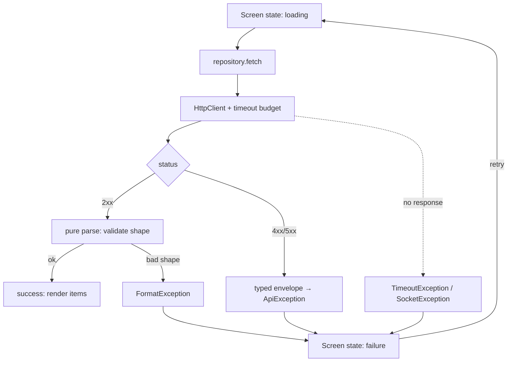

# API Integration

## 1. Learning Objectives

After this lesson you can:

- [ ] Make a real HTTP request from Dart and read status, headers, and body as
      separate facts (executed against a local server: `W9 GET /orders: status=200
      items=3 first="Widget 1"`)
- [ ] Handle the four failure classes a client must survive — HTTP error status,
      malformed body, timeout, and offline — each caught where the `await` is
      (executed: `404` envelope with `type`/`detail`, `caught=FormatException
      "Unexpected character"`, `caught=TimeoutException "0:00:00.150000"`)
- [ ] Build the four UI states — loading, error, retry, success — and prove the
      screen walks all of them (executed: `loading (attempt 1)` → `error (attempt
      1)` → `loading (attempt 2)` → `items=1`)
- [ ] Deserialize defensively: validate the shape before trusting the fields, and
      keep parsing in a pure function you can test without a network
- [ ] Choose where JSON → object mapping lives (models with `fromJson` vs a
      serializer layer) and keep it consistent across screens
- [ ] Wire retry so it re-enters the same state machine without duplicating
      requests or losing the screen's place

## 2. Prerequisites

- [Asynchronous Dart](asynchronous-dart.md) — `Future`, typed catches, and
  `Future.wait`; every client in this lesson is that material applied.
- [Forms and Validation](forms-and-validation.md) — the submit handler this lesson's
  client sits behind.
- [State Management](state-management.md) — loading/error/success *is* screen state.

*Toolchain: Flutter 3.47.7 / Dart 3.13.5, Windows 11 — verified in
[VERSIONS.md](../VERSIONS.md). Transcripts are real captures: a `dart:io` `HttpServer`
bound to `127.0.0.1` on an ephemeral port inside the batch's test battery (W9–W9b),
with `HttpOverrides` cleared because flutter_test stubs `HttpClient` by default —
a fact worth knowing before you debug your own first failing test.*

## 3. Introduction

An offline demo app and a shipped app differ almost entirely in what happens when
the network misbehaves — which is most of the time on a phone. This lesson treats
the client as a state machine with five outcomes (success, HTTP error, parse error,
timeout, offline) and executes each one against a real local server, then walks the
UI through loading → error → retry → success.

## 4. The Problem It Solves

`jsonDecode(response.body)` in a button handler "works" until any of four things
happens: the server returns 404 with a JSON body (you parse the error as data), the
server returns 200 with HTML (you parse garbage), the radio drops mid-request (you
hang or crash), or the retry doubles the charge (your handler ran twice). The
industry's answer is boring and structural: one client module, status checked
before parsing, timeouts always set, parsing pure and validated, and UI states that
can't be skipped.

## 5. Core Concepts

### Status first, then body

Executed W9 — three responses from one local server:

```
W9 GET /orders: status=200 items=3 first="Widget 1"
W9 GET /missing: status=404 type=https://errors.example.invalid/not-found detail="no such order"
W9 malformed body: caught=FormatException "Unexpected character"
```

Three different failures, three different handlers:

1. **HTTP status** — `404` came with a *valid JSON error envelope* (`type`, `status`,
   `detail` — the RFC 9457 shape your backend lessons already emit). It's not a
   parse failure; it's a typed rejection you can route (404 → "gone", 401 → re-login).
2. **Parse failure** — status 200, body is not the JSON you expected. The envelope
   can't be trusted either, so this is caught at `jsonDecode` as `FormatException`.
3. **Transport failure** — no response at all: timeout or offline, caught around
   the await (below).

### Timeouts are not optional

```
W9 timeout: caught=TimeoutException "0:00:00.150000"
```

A 150 ms budget against a server that takes 2 s: `Future.timeout` (or
`connectionTimeout`) converts "hangs forever" into a typed error your UI renders.
Mobile networks make unbounded waits the norm unless you set a bound — pick budgets
per operation (list: 5–10 s; submit: longer but still bounded).

### Deserialize defensively

```dart
List<Item> parseItems(String body) {
  final decoded = jsonDecode(body);
  if (decoded is! List) throw const FormatException('expected a JSON list');
  return decoded
      .map((e) => Item.fromJson(e as Map<String, dynamic>))
      .toList(growable: false);
}
```

- The shape check (`is! List`) turns a wrong-shaped 200 into a *typed* failure
  instead of a cascade of `NoSuchMethodError`s deep in the UI.
- `parseItems` is pure: string in, objects out — unit-test it with fixture strings,
  no server needed. Your real client gets tested with fixtures *and* against a
  server; the parsing policy itself never needs a network.

### The four UI states, executed (W9b)

```dart
enum LoadState { loading, success, failure }
// initState → _load(): setState(loading) → await fetch → success | failure
// failure shows a retry button calling the same _load()
```

```
W9b state1: "loading (attempt 1)"
W9b state2: "error (attempt 1)"
W9b state3: "loading (attempt 2)"
W9b state4: items="items: 1" titles="Widget 1"
```

One fake fetch that fails the first call and succeeds the second walks the screen
through every state — the standard battery for any data-driven screen. Two details
that matter: the attempt counter is visible (users learn something is retrying, not
frozen), and every `setState` after an `await` sits behind `if (!mounted) return;`.

### Where the mapping lives

- Small app: `Model.fromJson` static factories, one per type — done.
- Larger app: a `serializers.dart` per domain so models stay free of wire-format
  knowledge.
The rule that actually matters: *one mapping per type*, never `jsonDecode` scatterings
inside widgets.

### Client architecture

```
UI (state machine) → repository (async API, pure parsing) → http client (status/timeouts)
```

The repository is where retries-with-backoff, caching, and auth headers attach —
the same seam [Local Storage](local-storage.md) later adds an offline cache behind.

## 6. How It Works



Every arrow leaving `C` lands in exactly one of three places, and the screen has
exactly one failure state for all of them — with the *message* chosen by which
exception arrived. That's why the async lesson's typed catches were worth drilling.

## 7. Practical Examples

**Example 1 — the executed client battery (W9)**

```dart
// setUp: HttpOverrides.global = null;   // flutter_test stubs HttpClient!
server = await HttpServer.bind(InternetAddress.loopbackIPv4, 0);
// routes: /orders (200 JSON), /missing (404 envelope), /broken (bad JSON), /slow (2s)

final req = await client.getUrl(Uri.parse(url('/orders')));
final res = await req.close();
final items = parseItems(await res.transform(utf8.decoder).join());
print('W9 GET /orders: status=${res.statusCode} items=${items.length} ...');
```

Complete capture in section 5. **How to run:** `flutter test --reporter expanded
test/api_storage_test.dart`.

**Example 2 — the repository seam (reference, on W9's pattern)**

```dart
class ApiException implements Exception {
  ApiException(this.status, this.detail);
  final int status;
  final String detail;
}

class OrdersRepository {
  OrdersRepository(this.client, this.base);
  final HttpClient client;
  final Uri base;

  Future<List<Item>> fetchOrders({Duration budget = const Duration(seconds: 8)}) async {
    final res = await client.getUrl(base.resolve('/orders'))
        .timeout(budget) as HttpClientResponse;   // budget before await
    final body = await res.transform(utf8.decoder).join();
    if (res.statusCode != 200) {
      final env = jsonDecode(body) as Map<String, dynamic>;
      throw ApiException(res.statusCode, env['detail'] as String? ?? 'request failed');
    }
    return parseItems(body);   // pure, already tested
  }
}
```

- Order of operations is the lesson: **timeout → status → parse**. Any other order
  either hangs, mis-parses errors, or does both.

## 8. Real-World Applications

Every screen in the subject's app: lists fetched with the W9b battery as their
acceptance test, checkout posts that must be idempotent (backend lesson BACK-04's
key), search with debounce + cancellation, and pull-to-refresh that re-enters
`_load()` rather than forking a second fetch path. The repository seam is also where
the offline cache ([Offline Functionality](offline-functionality.md)) later slots in
without touching a single widget.

## 9. Common Mistakes

| Mistake | Why it happens | How to recognize it | How to prevent it |
|---|---|---|---|
| Parsing before checking status | Body "looks JSON anyway" | Error objects rendered as data | Status gate first (Example 2's order) |
| No timeout | Defaults work in the office | Infinite spinner on bad networks | Budget every request (executed: 150 ms → typed error) |
| Scattering `jsonDecode` in widgets | It's one line | Same shape parsed five ways | Pure `fromJson` per type; widgets never see JSON |
| Retry without state discipline | Button wired to fetch directly | Double requests; spinner stuck | Retry calls the same `_load`; attempt counter visible |
| Ignoring `mounted` after await | setState after disposal throws | Crash on back-during-fetch | `if (!mounted) return;` before every post-await setState |
| Trusting 200 = your shape | Server evolved | `NoSuchMethodError` in the field path | Shape validation in the parser (executed: typed `FormatException`) |

## 10. Best Practices

- **One client module owns status, timeouts, and error mapping** — screens see
  exceptions with messages, never raw statuses.
- **Pure parsers, fixture tests** — parsing policy tested without a socket; the
  integration battery (W9) proves the wiring.
- **Timeouts as budgets per operation type**, not one global number.
- **The four states are non-negotiable** — a screen without a visible failure state
  is a screen that hides failures.
- **Make retry idempotent** — a GET or an idempotency-keyed POST (see BACK-04 in
  [Backend Engineering](../11-BACKEND-ENGINEERING/README.md)). *Stops applying to
  non-idempotent operations, which need keys rather than retries.*

## 11. Limitations and Trade-Offs

- **`dart:io` `HttpClient` doesn't run on web** — cross-platform apps abstract the
  client (e.g. `package:http`) behind the repository; same architecture, one more
  layer.
- **One test = one fake server** — battery tests cover branches, not real-world
  weirdness (TLS, redirects, gzip); keep a thin layer of true integration coverage.
- **Error envelopes only help if your backend sends them** — pair with the API
  contract lessons; a bare 500 with an HTML body degrades to the parse-error path.
- **Timeouts cancel nothing server-side** — the request may still complete; for
  writes, that's another reason idempotency keys exist.
- **flutter_test's HttpClient stub** (which this battery had to clear) protects
  tests from network dependence — fighting it blindly gives false-green tests; the
  cleared-override group plus a stubbed-unit group is the honest split.

## 12. Practical Exercises

### Introductory

1. **Exercise 11.1** — reproduce the four W9 captures: bind a local server, hit all
   four routes, and capture status/envelope/parse-error/timeout. **Completion
   criteria:** all four lines with their typed catches named.
2. **Exercise 11.2** — reproduce the W9b state walk with your own flaky fetcher
   (fail once, succeed twice). **Completion criteria:** four state lines and a call
   count of 2.

### Intermediate

3. **Exercise 11.3** — add a `500` route whose body is HTML, not JSON, and show the
   *correct* handling for each: envelope-based for JSON errors, degraded generic
   message for the HTML one. **Completion criteria:** two captures showing two
   different user-facing messages from one error state.
4. **Exercise 11.4** — write fixture-based unit tests for `parseItems`: valid list,
   empty list, object-instead-of-list, missing field, wrong type for a field.
   **Completion criteria:** five passing cases with no server involved.

### Independent problem-solving

5. **Exercise 11.5** — design a client for an API that rate-limits with `429` and
   `Retry-After`. Decide: where the backoff lives, what the UI shows during it, and
   what happens on the third consecutive failure. **Completion criteria:** a written
   policy plus an executed test where your client backs off once (mocked clock) and
   the screen reports "slow down" instead of a generic error.

*Solutions: attempt first. They live in `solutions/` of this subject.*

## 13. Knowledge Check

1. A screen renders an error object's `title` field as if it were an item. Which of
   the three failure classes slipped through, and which line in Example 2 stops it?
2. Your request "works in the office" but spins forever on a train. Name the missing
   mechanism and the exact capture W9 produced to prove it works.
3. Why is `parseItems` being pure a testing decision rather than a style decision?
   What could you not test if it read the clock or a file?

## 14. Completion Criteria

Observable evidence that you have understood this lesson:

- [ ] You have reproduced all four W9 captures and all four W9b states
- [ ] You can write the repository seam in the timeout → status → parse order from
      memory and justify each step's position
- [ ] You can name the four failure classes and which exception carries each
- [ ] You can produce a fixture test suite for a parser without a network
- [ ] You can diagnose all six mistakes in section 9 on sight

## 15. Summary

- Check status before parsing; envelope errors are typed rejections, not garbage.
- Bound every request — `TimeoutException` is a feature (executed at 150 ms).
- Parsing is pure and shape-validated; widgets never see JSON.
- Loading → error → retry → success is the minimum state set; retry re-enters it.
- `mounted` guards every post-await `setState`; flutter_test stubs `HttpClient`
  until you clear it.

## 16. Next Steps

- Next lesson: [Local Storage](local-storage.md) — what happens to this data when
  the app closes: preferences, files, and databases.
- Practice: [exercise sets](exercises/README.md) for this subject.
- Where it is applied: [Project 06](../20-PROJECT-LABORATORY/README.md) — its API
  layer ships the W9 battery as its acceptance test.
