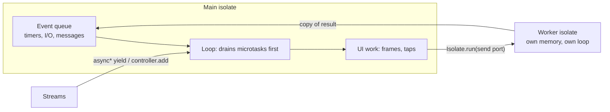

# Asynchronous Dart

## 1. Learning Objectives

After this lesson you can:

- [ ] Predict event ordering across synchronous code, microtasks, timers, and
      `await` — then verify it (executed: `1 sync` → `2 microtask` → `3 timer
      (event)` → `1b after first await`)
- [ ] Replace sequential awaits with `Future.wait` and **measure** the win (executed:
      `sequential=188ms parallel=96ms results=[orders, lines]` — two 80 ms fetches)
- [ ] Catch errors where the `await` is, with typed handlers (executed: `3 caught:
      boom took longer than 10ms` from `on TimeoutException catch`)
- [ ] Choose the right stream shape: generate with `async*`, fan out with
      `broadcast()` — and diagnose the exact failure when you get it wrong (executed:
      `Bad state: Stream has already been listened to.` with a full trace naming the
      second `listen`)
- [ ] Prove isolates actually run in parallel rather than trusting the docs
      (executed: `one-run=97ms two-isolates=129ms checksum=1701830==1701830` — two
      workers in about one run's time, equal results, while `5 main isolate alive
      while workers run` proves the main isolate wasn't blocked)
- [ ] Say what an isolate does *not* share — memory — and choose between it and the
      event loop for a given workload

## 2. Prerequisites

- [Dart Fundamentals](dart-fundamentals.md) — functions, closures, and records; this
  lesson leans on arrow functions and `throws` heavily.
- [Null Safety](null-safety.md) — async code produces exactly the absent-values this
  subject models with `?`.

*Toolchain: Dart 3.13.5 (stable), Windows 11 / Git Bash — verified in
[VERSIONS.md](../VERSIONS.md). Captures: probes `d5_async.dart` and
`d5b_single_subscription.dart`, executed in the batch's lab; timings quoted are that
machine's real measurements.*

## 3. Introduction

Mobile apps spend most of their life *waiting* — for the network, for storage, for
the next frame. A language that blocks while waiting freezes the UI thread, and a
frozen UI on a phone looks like a dead app. Dart's answer has three layers: an event
loop that never blocks, `async`/`await` that makes waiting readable, and isolates for
the rare CPU work that would still stall the loop. This lesson teaches each layer
with measured, executed evidence — including the two failure modes you will actually
hit: mis-ordered callbacks and a stream listened twice.

## 4. The Problem It Solves

Synchronous networking code (`data = http.get(url)` in old-style languages) blocks
the thread: frames drop, taps queue, the OS eventually kills the app. Callbacks fixed
the blocking but nested into pyramids where error handling and ordering fell apart.
`async`/`await` gives readable straight-line code *on top of* a non-blocking loop —
but it introduces its own traps: work you forgot to await, ordering you assumed but
never verified, and parallelism you didn't get because you awaited sequentially.
Each trap below is executed, not described.

## 5. Core Concepts

### The event loop, executed as an ordering test

Dart runs one main isolate: a loop that drains **microtasks** (from `scheduleMicrotask`
and every `await`) before **events** (timers, I/O). Probe `d5`, section 1 — predict,
then run:

```dart
print('1 sync');
unawaited(Future<void>(() => print('3 timer (event)')));
scheduleMicrotask(() => print('2 microtask'));
await Future<void>.delayed(Duration.zero);
print('1b after first await');
```

```
1 sync
2 microtask
3 timer (event)
1b after first await
```

- Sync first; every microtask before any timer — including `Duration.zero`, which is
  an *event*, not "immediately".
- `unawaited(...)` documents "I chose not to await this" — the analyzer's rule, not
  decoration.

### Futures and sequential-vs-parallel

A `Future<T>` is a value that arrives later. `await` suspends the *function*, not the
isolate — the loop keeps serving frames. The classic performance bug is awaiting
in a row when the operations are independent:

```dart
final seq = Stopwatch()..start();
final a = await fetch('orders', 80);
final b = await fetch('lines', 80);
seq.stop();

final par = Stopwatch()..start();
final results = await Future.wait([fetch('orders', 80), fetch('lines', 80)]);
par.stop();
print('2 sequential=${seq.elapsedMilliseconds}ms '
    'parallel=${par.elapsedMilliseconds}ms results=$results');
```

```
2 sequential=188ms parallel=96ms results=[orders, lines]
```

Two 80 ms fetches: sequential ≈ 160 ms plus overhead; parallel ≈ one fetch's time.
The rule: **await sequentially only when the second call needs the first's result.**

### Errors land at the await

Throwing inside an async function rejects the future; the error is reported where you
`await` it, and `on <Type> catch` selects it:

```dart
try {
  await fetch('boom', 10, fail: true);
} on TimeoutException catch (e) {
  print('3 caught: ${e.message}');
}
// 3 caught: boom took longer than 10ms
```

An unawaited future with no listener instead becomes an **unhandled async error** —
the failure mode behind "my catch block never runs".

### Streams: `async*` generators, then broadcast

A `Stream<T>` delivers a sequence of values. Single-subscription streams (what most
producers create) support exactly **one** listener — the executed crash in `d5b` is
that rule enforced:

```dart
final bus = StreamController<int>();           // NOT broadcast
bus.stream.listen((v) => print('4A listener saw $v'));
bus.stream.listen((v) => print('4B listener saw $v'));  // boom
bus.add(1);
```

```
Unhandled exception:
Bad state: Stream has already been listened to.
#0      _StreamController._subscribe (dart:async/stream_controller.dart:695:7)
#1      _ControllerStream._createSubscription (dart:async/stream_controller.dart:854:20)
#2      _StreamImpl.listen (dart:async/stream_impl.dart:516:42)
#3      main (file:///C:/Users/PC/AppData/Local/Temp/b14/d5b_single_subscription.dart:8:14)
```

`#3` is the second `listen`. The fix is a type decision, not a try/catch:

```dart
final bus = StreamController<int>.broadcast();
bus.stream.listen((v) => print('4A listener saw $v'));
bus.stream.listen((v) => print('4B listener saw $v'));
for (var i = 1; i <= 2; i++) bus.add(i);
await bus.close();
```

```
4 tick 1
4 tick 2
4 tick 3
4A listener saw 1
4B listener saw 1
4A listener saw 2
4B listener saw 2
```

(The `4 tick n` lines come first from the `async*` generator `ticks(3)`, consumed with
`await for`.) Producers you write yourself use `async*` + `yield`; events many parts
of the app observe use `broadcast`.

### Isolates: parallelism with no shared memory

The event loop never blocks — so CPU-bound work *stalls it anyway*. Isolates are
separate isolations of memory with message-passing between them. Probe `d5` section 5
runs the same 10-million-iteration checksum twice, in parallel:

```dart
final one = Stopwatch()..start();
sumOfSquares(1000000);
one.stop();

final par = Stopwatch()..start();
final futures = [
  Isolate.run(() => sumOfSquares(1000000)),
  Isolate.run(() => sumOfSquares(1000000)),
];
await Future<void>.delayed(Duration.zero);
print('5 main isolate alive while workers run');
final r = await Future.wait(futures);
par.stop();
print('5 one-run=${one.elapsedMilliseconds}ms '
    'two-isolates=${par.elapsedMilliseconds}ms checksum=${r[0]}==${r[1]}');
```

```
5 main isolate alive while workers run
5 one-run=97ms two-isolates=129ms checksum=1701830==1701830
```

Two runs cost 129 ms in parallel versus 97 ms for one alone — not 194 ms for two —
and both checksums match, proving identical work. The `5 main isolate alive` line
prints *before* the workers finish, proving the main isolate kept running.

**What isolates don't share:** no object references cross — values are copied. An
isolate is for CPU work (parsing, image filters, crypto), not for holding state your
UI reads.

## 6. How It Works



The loop alternates queued events; every `await` continuation is a microtask, which
is why microtasks always precede timers. Isolates never touch each other's heap —
communication is copy-by-value over ports, which is why spawning is cheap-ish,
crossing is not free, and `checksum=` equality is a meaningful test rather than a
coincidence.

## 7. Practical Examples

**Example 1 — the full battery (executed)**

```bash
# how to run (batch lab, Windows 11 / Git Bash):
cd /c/Users/PC/AppData/Local/Temp/b14
dart run d5_async.dart
dart run d5b_single_subscription.dart   # intentionally crashes
```

Complete captured transcript of `d5_async.dart`:

```
1 sync
2 microtask
3 timer (event)
1b after first await
2 sequential=188ms parallel=96ms results=[orders, lines]
3 caught: boom took longer than 10ms
4 tick 1
4 tick 2
4 tick 3
4A listener saw 1
4B listener saw 1
4A listener saw 2
4B listener saw 2
5 main isolate alive while workers run
5 one-run=97ms two-isolates=129ms checksum=1701830==1701830
```

- **Assumptions:** Dart 3.13.5; timings are this machine's — on yours the *ratios*
  are the evidence (parallel ≈ half of sequential, two isolates ≈ one run), not the
  absolute milliseconds.
- **How to run:** `dart run d5_async.dart`; the crash probe is run separately so the
  happy path completes.

**Example 2 — a reusable fetch with timeout and typed failure (reference)**

```dart
Future<T> withTimeout<T>(Future<T> future, Duration limit) =>
    future.timeout(limit, onTimeout: () => throw TimeoutException('over $limit'));

// usage — the error surfaces at the await, in *your* frame:
try {
  final orders = await withTimeout(api.fetchOrders(), const Duration(seconds: 5));
  render(orders);
} on TimeoutException catch (e) {
  renderError('Slow network — ${e.message}');
} on SocketException {
  renderError('Offline — check your connection');
}
```

- **Expected output:** any failure path renders an error state instead of throwing
  into the void — the pattern every later lesson's loading/error/empty UI builds on.
- **How to run:** reference shape for your lab; wire it against a real endpoint in
  [API Integration](api-integration.md).

## 8. Real-World Applications

Every screen in the subject's app: a fetch with `Future.wait` for its two calls, a
`Stream` of search input debounced into query events, a broadcast stream for a cart
touched by several widgets, isolates for anything bigger than a parse (CSV import,
image compression). The ordering discipline is what makes loading spinners stop at
the right moment and taps feel instant — and the `broadcast` decision is made once,
architecturally, not per-call-site.

## 9. Common Mistakes

| Mistake | Why it happens | How to recognize it | How to prevent it |
|---|---|---|---|
| Forgetting `await` | Statement looks complete | Error "escapes" your try/catch; UI updates early | Make futures `unawaited(...)` or `Future.wait` them — analyzer flags the rest |
| Sequential awaits out of habit | Straight-line code is easy | Total time ≈ sum of latencies | Ask: does call 2 *need* call 1's result? If not, `Future.wait` |
| Two `listen`s on a single-subscription stream | Controller created ad hoc | `Bad state: Stream has already been listened to` at the second listener | Decide broadcast-vs-once when you create the controller |
| CPU work on the main isolate | It's just a loop | Jank during parse/encode, ANR-style hangs | `Isolate.run` for hot loops; verify with a stopwatch as in section 5 |
| Swallowing async errors | `catch (_)` in a callback | Silent no-ops, empty screens | Catch typed, log, and convert to a visible error state |
| Assuming `Duration.zero` runs "now" | The name suggests immediacy | Timer body runs after microtasks | Remember: it's an *event*; microtasks drain first |

## 10. Best Practices

- **Await only what you need; use `Future.wait` for the rest** — parallelism is the
  default, sequential the exception. *Sequential is right when each call's input
  depends on the previous result.*
- **Name your timeout policy once** (helper from Example 2) — per-call magic numbers
  diverge into inconsistent UX.
- **Choose stream type at creation:** single-subscription for one consumer pipelines,
  `broadcast` for fan-out. Retrofitting later changes semantics, not just a flag.
- **Prove parallelism with a stopwatch** the first time you rely on it — the section 5
  measurement takes ten seconds and ends the guessing.
- **Run `dart analyze` after async edits** — its `unawaited_futures` findings are the
  cheapest bug class you'll ever delete.

## 11. Limitations and Trade-Offs

- **One event loop per isolate means CPU work blocks it** — isolates fix that but at
  the cost of copying; a 50 MB image crossing twice may cost more than the work.
- **`Future.wait` fails fast:** one rejection rejects the whole batch and cancels
  nothing already running — use `wait` with `eagerError: true` intentionally, or
  `Future.wait` + per-future catch when partial results matter.
- **Streams have no backpressure by default** — a fast producer can out-run a slow
  consumer; bounded controllers or sampling are your tools.
- **Timings are machine-specific** — evidence of *shape* (ratios, ordering), never a
  benchmark you quote cross-machine.
- **Isolates don't fix I/O** — waiting on network in an isolate just moves the wait.

## 12. Practical Exercises

### Introductory

1. **Exercise 5.1** — reproduce section 5's ordering test from a blank file: write
   the four lines, write your predicted order *before running*, then run.
   **Completion criteria:** prediction and capture match; one sentence explaining why
   the timer loses to the microtask.
2. **Exercise 5.2** — run both stream probes: the crash and the `broadcast` fix.
   **Completion criteria:** the `Bad state` trace quoted with `#3`'s line identified
   as the second `listen`, plus the four-listener output after the fix.

### Intermediate

3. **Exercise 5.3** — take three fake calls of 50/30/90 ms: measure sequential vs
   `Future.wait`, then repeat with the third call's input *depending* on the first's
   result and show why the batch must shrink. **Completion criteria:** two timing
   captures and a stated rule for which calls belong in the batch.
4. **Exercise 5.4** — write a debounce over a `StreamController` (input events →
   300 ms pause → one query event) and prove it with a listener: five rapid adds
   produce one emission. **Completion criteria:** captured listener output showing
   5 → 1; `dart analyze` clean.

### Independent problem-solving

5. **Exercise 5.5** — an import screen must parse a 10 MB CSV, show progress, and
   stay responsive; cancellation must work. Design it: which parts are stream, which
   are isolate, how progress crosses back to the UI, and where cancellation is
   checked. **Completion criteria:** a written design naming each mechanism from this
   lesson, plus a runnable prototype where a stopwatch proves the UI isolate never
   blocks longer than one chunk's parse time.

*Solutions: attempt first. They live in `solutions/` of this subject.*

## 13. Knowledge Check

1. Your try/catch around `await fetchOrders()` never fires, yet the app logs the
   error. What are the two most likely causes, and how does the analyzer help?
2. Two 100 ms calls ran sequentially (≈200 ms). A colleague adds `await` to "make it
   safer" in front of the batch — what happens, and why?
3. When would you *not* use an isolate for a slow computation? Name a workload where
   copying dominates and propose the alternative.

## 14. Completion Criteria

Observable evidence that you have understood this lesson:

- [ ] You can predict and then produce the four-line ordering from section 5 on a
      blank editor
- [ ] You can quote your own sequential-vs-parallel timings and interpret them as
      ratios
- [ ] You can reproduce the single-subscription crash and fix it with a design
      decision, not a try/catch
- [ ] You can state what isolates share (nothing) and demonstrate parallel speedup
      with a stopwatch measurement
- [ ] You can diagnose all six mistakes in section 9 on sight

## 15. Summary

- One loop: microtasks drain before events; `await` schedules continuations, it
  never blocks the isolate.
- Independent awaits belong in `Future.wait` — proven by measurement, not hope.
- Async errors surface at the `await`; typed catches render visible error states.
- Streams: `async*` to produce, `broadcast` to fan out — the second `listen` crash is
  a design error the runtime names for you.
- Isolates add parallelism for CPU work by copying values — measure the win, respect
  the boundary.

## 16. Next Steps

- Next lesson: [Flutter Fundamentals](flutter-fundamentals.md) — turning these
  futures and streams into rendered UI: the widget tree, `MaterialApp`, and build.
- Practice: [exercise sets](exercises/README.md) for this subject.
- Where it is applied: [Project 06](../20-PROJECT-LABORATORY/README.md) — its
  loading, error, and empty states are these exact patterns wired to real fetches.
