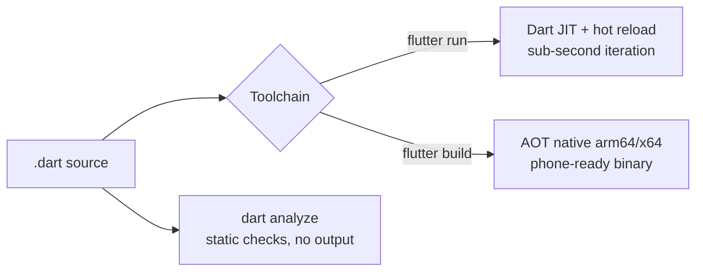

# Dart Fundamentals

## 1. Learning Objectives

After this lesson you can:

- [ ] Read Dart's type system in practice — inferred vs declared, and what the
      compiler actually stored (executed: `D1 types: int 4.5 double`)
- [ ] Build collections with spread, `if`, and `for` inside the literal, then merge
      maps safely (executed: `D1 grown: [0, 1, 2, 3, 99, 10, 20, 30]` and
      `D1 merged: {a: 2, b: 2, c: 3}` — the conditional overwrote key `a`)
- [ ] Write functions with named parameters, defaults, arrow bodies, and closures
      passed as values (executed: `D1 fn: 5 hi dart! 49`)
- [ ] Use Dart 3 records and pattern matching to return and destructure several
      values without a class (executed: `D1 record: 7 seven`, and a switch expression
      producing `D1 switch-expr: on its way`)
- [ ] Model with classes: named constructors, `const` factories, mixins, extensions,
      cascades, and interface-by-`implements` (executed: `D2 order: id=7 lines=1
      total=2 valid=true`, `D2 config: default 0:00:30.000000`, `D2 mixin+ext:
      GET /API/ORDERS`, `D2 shapes: area sum=9.14159 count=2`)
- [ ] Run and format with the toolchain — `dart run`, `dart analyze`, `dart format`
      — and interpret a real analyzer finding

## 2. Prerequisites

- [Mobile Development Fundamentals](mobile-development-fundamentals.md) — the
  platform model this language runs on.
- [02-PROGRAMMING-FUNDAMENTALS](../02-PROGRAMMING-FUNDAMENTALS/README.md) —
  variables, control flow, and functions; Dart syntax is new, the ideas are not.

*Toolchain: Dart 3.13.5 (stable) via Flutter 3.47.7, Windows 11 / Git Bash — verified
in [VERSIONS.md](../VERSIONS.md). Transcripts below are real captures of probes
`d1_fundamentals.dart` and `d2_classes.dart` executed in the batch's lab.*

## 3. Introduction

Dart is the language half of Flutter's proposition: statically typed, sound-null-safe,
compiled ahead of time for phones and just in time for development. Its syntax will
feel familiar if you've seen Java or TypeScript, but three features — null safety
(its own lesson), records and patterns, and cascades — earn their place by removing
boilerplate you'd otherwise write. This lesson is the syntax and the toolchain;
[next](null-safety.md) the compiler feature that changes how you model data.

## 4. The Problem It Solves

Cross-platform code has an unusual constraint: it must be *legible to the compiler*
because there's no debugger-friendly native layer to fall back on, and it must run in
two very different runtimes. Dynamically typed scripting made refactors risky and
late errors common; heavyweight enterprise typing made UI code unreadable. Dart splits
the difference — types you can mostly infer, patterns that destructure without ceremony,
and an analyzer that tells you what's wrong before a phone ever sees the code.

## 5. Core Concepts

### Types and inference

`var` infers from the initializer; a declared type is checked by the compiler.
Dart's `int` is 64-bit on native, arbitrary-precision semantics don't exist — and
`double` is always floating point. Executed:

```dart
var inferred = 42;          // int, inferred
const explicit = 4.5;       // double
print('D1 types: ${inferred.runtimeType} $explicit ${explicit.runtimeType}');
// D1 types: int 4.5 double
```

`const` is a *compile-time constant* (one per program); `final` is assigned once at
runtime. That distinction matters the first time you try to `const` a list built
from a runtime value.

### Collection literals and their inline forms

Lists and maps are built with literals that take **spread** (`...`), **collection-if**,
and **collection-for** — the whole collection pipeline in one expression:

```dart
final list = <int>[1, 2, 3];
final grown = [0, ...list, if (explicit > 4) 99, for (final v in list) v * 10];
print('D1 grown: $grown');
// D1 grown: [0, 1, 2, 3, 99, 10, 20, 30]

final map = {'a': 1, 'b': 2};
final merged = {...map, 'c': 3, if (map.containsKey('a')) 'a': map['a']! + 1};
print('D1 merged: $merged');
// D1 merged: {a: 2, b: 2, c: 3}
```

Note the merged map: the conditional entry **replaced** `'a': 1` with `2` — later
spread entries win. That's a feature in merging configs and a footgun when you didn't
mean to overwrite. (The `!` in `map['a']!` is null-safety — covered next lesson.)

### Functions

Positional and named parameters, defaults, `=>` arrow bodies, closures as first-class
values:

```dart
int add(int a, int b) => a + b;
String greet(String name, {String suffix = '!'}) => 'hi $name$suffix';
final op = (int x) => x * x;
print('D1 fn: ${add(2, 3)} ${greet("dart")} ${op(7)}');
// D1 fn: 5 hi dart! 49
```

Named parameters are Dart's answer to boolean-trap APIs: `{int retries = 3, bool
force = false}` reads at the call site.

### Records and patterns (Dart 3)

A **record** is an anonymous, immutable aggregate; a **pattern** destructures it:

```dart
(int, String) pair = (7, 'seven');
final (numId, label) = pair;
print('D1 record: $numId $label');   // D1 record: 7 seven
```

Records replace "tiny helper classes" for multi-returns, and switch expressions turn
multi-branch mapping into an expression:

```dart
const status = 'shipped';
final wording = switch (status) {
  'draft' => 'not yet visible',
  'shipped' => 'on its way',
  _ => 'unknown',
};
print('D1 switch-expr: $wording');   // D1 switch-expr: on its way
```

The `_` arm is exhaustive — add a case and the compiler tells you it's unreachable.

### Classes and the object model

Executed probe **d2** covers the model end to end:

```dart
final order = Order(id: 7, sku: 'SKU-A')..addLine('book', 2);   // cascade
print('D2 order: id=${order.id} lines=${order.lineCount} '
    'total=${order.total} valid=${order.isValid}');
// D2 order: id=7 lines=1 total=2 valid=true
```

- **Cascade (`..`)** chains mutations on one expression instead of a temporary.
- **Getters** (`int get total => ...`) expose computed views without method-call
  ceremony.
- **`const` constructors** make immutable singletons free:

```dart
class Config {
  const Config.defaults() : name = 'default', timeout = const Duration(seconds: 30);
  final String name;
  final Duration timeout;
}
final a = const Config.defaults();
print('D2 config: ${a.name} ${a.timeout}');
// D2 config: default 0:00:30.000000
```

- **Mixins and extensions** add behavior without inheritance:

```dart
mixin Logger { /* entries, log(), describe() */ }
extension Shout on String { String get trimmed => trim(); }

final f = Fetcher()..log('GET /api/orders');
print('D2 mixin+ext: ${f.describe().toUpperCase().trimmed}');
// D2 mixin+ext: GET /API/ORDERS
```

- **Every class is an interface.** `abstract class Shape` + `class Circle implements
  Shape` is Dart's contract mechanism — no `interface` keyword needed:

```dart
final shapes = <Shape>[Circle(1), Rect(2, 3)];
// sum of areas...
print('D2 shapes: area sum=$sum count=${shapes.length}');
// D2 shapes: area sum=9.14159 count=2
```

**Private** is `_name` — library-private (file-private), not class-private. There is
no `private` keyword; convention and the underscore do the work.

## 6. How It Works

Dart compiles two ways off one source:



`dart analyze` runs the same front end as the compiler without producing a program —
which is why its errors match what `dart run` would reject. Hot reload works because
the JIT keeps program state while swapping code; a change to `main()` needs a restart,
a change to a widget body doesn't. Knowing which is which explains most confusing
reload behavior.

## 7. Practical Examples

**Example 1 — the full syntax battery (executed)**

```dart
// how to run:  dart run d1_fundamentals.dart
// (full source in the batch's lab; sections shown with their real output)
```

Captured transcript (abridged to the checkpoint lines):

```
D1 types: int 4.5 double
D1 grown: [0, 1, 2, 3, 99, 10, 20, 30]
D1 merged: {a: 2, b: 2, c: 3}
D1 fn: 5 hi dart! 49
D1 record: 7 seven
D1 switch-expr: on its way
D1 enum: info isInfo=true
D1 null-aware: shown=fallback len=0
D1 platform: isAndroid=false isIOS=false isWindows=true
```

- **Expected output:** identical values; timing-dependent lines don't exist in d1.
- **Assumptions:** Dart 3.13.5, Windows 11 / Git Bash.

**Example 2 — a small model, executed (d2)**

```dart
class Order {
  Order({required this.id, required this.sku});
  final int id;
  final String sku;
  final List<(String, int)> _lines = [];

  void addLine(String name, int qty) => _lines.add((name, qty));

  int get lineCount => _lines.length;
  int get total => _lines.fold(0, (acc, l) => acc + l.$2);
  bool get isValid => _lines.isNotEmpty && total > 0;
}
```

```
$ dart run d2_classes.dart
D2 order: id=7 lines=1 total=2 valid=true
D2 config: default 0:00:30.000000
D2 mixin+ext: GET /API/ORDERS
D2 shapes: area sum=9.14159 count=2
```

- `_lines` is library-private; the record `l.$2` is the quantity — patterns inside
  `fold` without inventing a line-item class.
- **How to run:** `dart run d2_classes.dart`; **analyzer:** `dart analyze` → clean.

## 8. Real-World Applications

These are the shapes you'll use all subject: records for a function returning
`(bool ok, String error)`; switch expressions for mapping API status codes; mixins
for shared `Logger`/`Timestamped` behavior across model classes; extensions for
domain helpers on primitives; `implements` for the repository contracts that
[API Integration](api-integration.md) and state management lean on. The order model
above is deliberately the same aggregate a real order screen renders.

## 9. Common Mistakes

| Mistake | Why it happens | How to recognize it | How to prevent it |
|---|---|---|---|
| Confusing `const` and `final` | Both mean "can't change" colloquially | `const` fails at compile time on a runtime value | `const` = compile-time literal; `final` = assign-once runtime |
| Spread-order surprises | Later keys silently overwrite | Merged config loses a default | Build maps explicitly when order matters; test the merge |
| Class-private vs library-private | `_x` feels class-scoped | Another class in the same file sees `_x` | Split privacy boundaries into separate libraries |
| Overusing inheritance for reuse | OOP habit | Deep `extends` chains, fragile overrides | Prefer `mixin`/composition; `implements` for contracts |
| Ignoring analyzer output | It's just text | Issues surface at first `flutter run` | Run `dart analyze` on save; treat findings as errors |

## 10. Best Practices

- **Prefer `var` with an obvious initializer; declare types at API boundaries.**
  Readers get inference where it's clear and documentation where it counts.
- **Use named parameters for anything with more than two arguments** — call sites
  stay self-describing. *Stops applying in tight numeric loops where positional is
  genuinely clearer.*
- **Records for data-in-transit, classes for behavior.** If it needs methods or
  identity, it's a class.
- **`const` constructors by default** on immutable models — they enable canonical
  instances and cheaper rebuilds in Flutter.
- **Let the analyzer be the first reviewer:** `dart format .` then `dart analyze`
  before committing.

## 11. Limitations and Trade-Offs

- **No operator overloading, no structural typing** — deliberate restrictions that
  keep cross-team code predictable; heavy metaprogramming users will feel them.
- **Records are flat and immutable** — nesting gets noisy; no named fields means
  typos in `.$2` are unguarded (a tiny class with named getters wins past ~3 fields).
- **`int` is 64-bit, not arbitrary precision** — big-number math needs `BigInt`,
  which is slow and verbose.
- **JIT/AOT divergence exists** — rare, but reflection-free AOT means some
  dynamic-feeling patterns behave differently in release builds; test release mode.

## 12. Practical Exercises

### Introductory

1. **Exercise 3.1** — run both probes yourself and reproduce the four `D2` lines
   from memory. **Completion criteria:** terminal output matching section 7 exactly,
   plus `dart analyze` clean.
2. **Exercise 3.2** — write a `describe()` using a switch expression over a five-case
   enum, and a record-returning function `parseId(String)` → `(int?, String?)`.
   **Completion criteria:** compiles with no analyzer issues; an invalid input
   returns `(null, reason)` without throwing.

### Intermediate

3. **Exercise 3.3** — rebuild the `Order` model with three lines and prove the
   merge-overwrite behavior: add a key that already exists via spread and show which
   value survives. **Completion criteria:** output showing the surviving value and
   one sentence stating the ordering rule.
4. **Exercise 3.4** — implement the `Shape` hierarchy with a third shape and a
   `List<Shape>.totalArea()` extension. **Completion criteria:** all shapes compute
   through one loop; analyzer clean.

### Independent problem-solving

5. **Exercise 3.5** — design a `Result<T>`-style API using either records or a
   sealed class hierarchy for a function that can fail with a typed error. You choose;
   **completion criteria:** a written trade-off of your two options against section
   11, plus compiling code for the one you chose and a test proving the error path
   can't be ignored by the caller.

*Solutions: attempt first. They live in `solutions/` of this subject.*

## 13. Knowledge Check

1. What's the difference between `const` and `final`, and what error would each
   produce if you got it wrong?
2. Why does the merged map in section 5 show `a: 2`? State the ordering rule and one
   case where it would be a bug.
3. When would a record *not* be the right choice for a return value? Give a concrete
   threshold and justify it.

## 14. Completion Criteria

Observable evidence that you have understood this lesson:

- [ ] You can rewrite both probe programs from a blank editor and get the same output
- [ ] You can explain each `D2` line — cascade, getter, const constructor, mixin,
      extension, implements — without notes
- [ ] You can run `dart run`, `dart analyze`, and `dart format` and interpret each
      result
- [ ] You can diagnose all five mistakes in section 9 on sight
- [ ] You can name one design decision per limitation in section 11 that you would
      make differently as a result

## 15. Summary

- `var`/`final`/`const` split inference, assign-once, and compile-time constant.
- Collection literals carry spread, `if`, and `for`; later spread entries win.
- Records and switch expressions remove most tiny-class boilerplate.
- Every class is an interface; mixins and extensions add behavior without hierarchy.
- One source, two builds: JIT with hot reload for iteration, AOT for release.

## 16. Next Steps

- Next lesson: [Null Safety](null-safety.md) — how `String?` moves an entire bug
  class from production into the compiler.
- Practice: [exercise sets](exercises/README.md) for this subject.
- Where it is applied: [Project 06](../20-PROJECT-LABORATORY/README.md) — the app's
  models and helpers are written in exactly this style.
