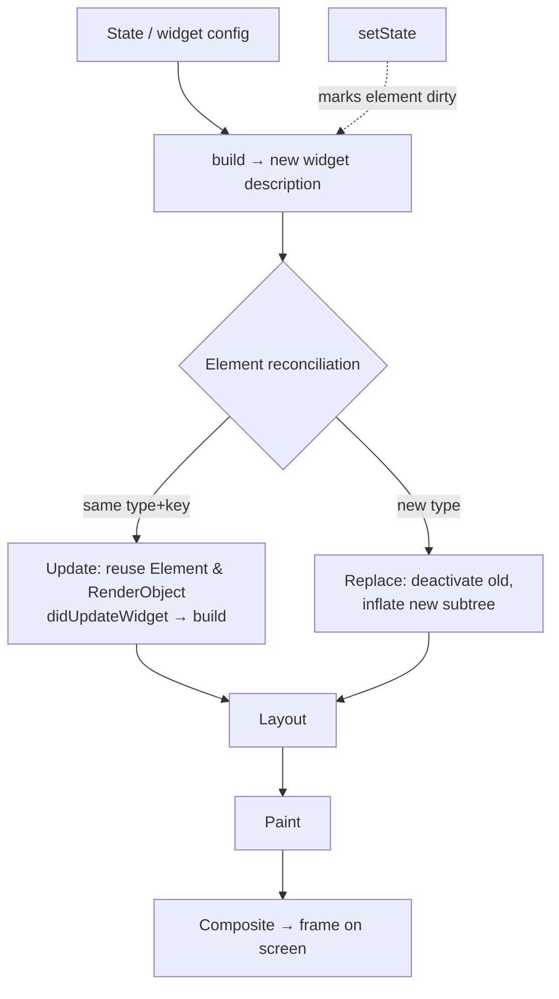

# Flutter Fundamentals

## 1. Learning Objectives

After this lesson you can:

- [ ] Describe the three layers of Flutter's runtime — widget, element, render object —
      and point at each in a real dump (executed: element tree of `CounterPage` printed
      from `toStringDeep()`, 77 lines, and `render object: RenderParagraph size=114x20`)
- [ ] Predict and verify exactly when `build` runs (executed: mount → `pageBuilds=1`;
      one `setState` → `pageBuilds=2`; the identical `const` child stayed at
      `constChildBuilds=1` — three numbers, three different framework decisions)
- [ ] State why widgets are immutable and *rebuilt* rather than mutated, and name what
      persists across rebuilds (the `State` object and its fields)
- [ ] Scaffold an app with `MaterialApp` and know which defaults it silently installs
      (directionality, themes, navigation, `MediaQuery` — visible in the executed
      `Scaffold(dependencies: [...])` line)
- [ ] Run a widget test and read its output: pump, tap, settle, and the `+5: All tests
      passed!` line — plus `flutter analyze` → `No issues found! (ran in 64.0s)`
- [ ] Diagnose a build-phase failure from a test report, including the deliberate
      overflow in the next lesson's W3 capture

## 2. Prerequisites

- [Mobile Development Fundamentals](mobile-development-fundamentals.md) — the
  shared-code structure this lesson's `lib/` lives in.
- [Dart Fundamentals](dart-fundamentals.md) — classes, `const` constructors, and
  cascades are used throughout without re-explaining.
- [Asynchronous Dart](asynchronous-dart.md) — `await` in tests maps directly onto
  `pump`/`pumpAndSettle` semantics.

*Toolchain: Flutter 3.47.7 / Dart 3.13.5, Windows 11 — verified in
[VERSIONS.md](../VERSIONS.md). Transcripts are real captures from `flutter test` runs
of `test/lab_test.dart` (probes W1–W2) in the batch's scaffold project.*

## 3. Introduction

Everything a Flutter screen does happens inside one method: `build`. This lesson is
about that method — what triggers it, what it must be, and what Flutter does with its
result. The payoff is a mental model that makes the framework's two strangest rules
(s widgets are immutable; you never draw pixels yourself) feel like engineering
trade-offs instead of arbitrary restrictions.

## 4. The Problem It Solves

UI frameworks that mutate widgets in place end up with state scattered across
thousands of objects: set a property here, remember to refresh a listener there, and
eventually some screen shows stale data because one path forgot to notify. Flutter
inverts it — widgets are immutable *descriptions*, and every frame the framework
rebuilds descriptions cheaply and reconciles them against the live tree. You can't
have a stale widget because widgets never change; only the `State` objects you own
carry change, and they're read only during `build`.

## 5. Core Concepts

### Widget → Element → RenderObject

Three layers, three jobs (executed in probe **W2**):

- **Widget** — an immutable configuration. Cheap to create, thrown away each build.
- **Element** — the long-lived instance in the tree; it holds the widget, the
  `State` for stateful widgets, and the lifecycle (`initState`, `didUpdateWidget`,
  `dispose`).
- **RenderObject** — does layout, painting, and hit-testing; only *this* layer is
  expensive, and it's kept unless the type or key changes.

Executed element-tree excerpt (from `tester.element(find.byType(CounterPage))
.toStringDeep()`):

```
W2 element tree (77 lines):
W2 | CounterPage(state: _CounterPageState#760ee)
W2 | └Scaffold(dependencies: [Directionality, InheritedCupertinoTheme, MediaQuery,
   UnmanagedRestorationScope, _InheritedTheme, _LocalizationsScope-[GlobalKey#b9228],
   _ScaffoldMessengerScope], state: ScaffoldState#2b043(tickers: tracking 3 tickers))
W2 | └_ScaffoldScope
W2 | └ScrollNotificationObserver(state: ScrollNotificationObserverState#cffbc)
W2 | └NotificationListener<ScrollMetricsNotification>
W2 | └NotificationListener<ScrollNotification>
W2 render object: RenderParagraph size=114x20
```

Two things to read here: the element carries **state and dependencies** (the
`dependencies:` list is the inherited widgets it re-reads — that's how a rebuild
knows what to watch), and the render object is a *measured thing* (`114x20`), not a
description.

### The build contract

`build` must be **pure**: same state → same widget description, no side effects,
no `await`. It may run at any time, many times, in any order the framework likes.
Break the contract and you get order-dependent bugs that only reproduce after
navigation.

### setState: mark, then rebuild

`setState(() => _count++)` does two things: mutate your state now, and mark the
element dirty so it rebuilds before the next frame. Probe **W1** executes all three
outcomes:

```dart
// counters incremented inside each build()
pageBuilds++;          // in _CounterPageState.build
constChildBuilds++;    // in ImmutableChild.build (a const child)
```

```
W1 mount: pageBuilds=1 constChildBuilds=1 text="count: 0"
W1 after tap: pageBuilds=2 constChildBuilds=1 text="count: 1"
```

- Mount builds the page once.
- The tap's `setState` rebuilds **only** the dirty subtree: `pageBuilds` 1 → 2.
- The `const ImmutableChild(...)` is the *identical instance* both times, so Flutter
  skipped it entirely: `constChildBuilds` stayed 1. **Const is a build-time
  optimization you can measure** — and the reason `const` on leaf widgets is a
  performance practice, not a style preference.

### What persists

Across a rebuild: the `State` object (fields survive), `GlobalKey` identity, and
render objects whose widget type matches. Not persistent: widget instances,
`build`-local variables, anything you mutated on a widget.

### MaterialApp installs the world

`const MaterialApp(home: CounterPage())` is one line, but the executed dependencies
list shows it registered `Directionality` (text runs LTR/RTL), `MediaQuery` (screen
metrics), themes, localization, and a navigator. Raw widgets in tests must supply
their own `Directionality` — which is exactly why the lab's non-app probes wrap
themselves in one.

## 6. How It Works



Reconciliation is the heart: Flutter diffs by **type and key at each position** — no
list-index heuristics like other frameworks. That's why keys matter in lists (next
lesson) and why a rebuilt `Column` of identical types costs almost nothing: descriptions
are recreated, elements and render objects are not.

## 7. Practical Examples

**Example 1 — the lifecycle battery, executed (W1)**

```dart
// test/lab_test.dart (abridged) — run: flutter test --reporter expanded test/lab_test.dart
await tester.pumpWidget(const MaterialApp(home: CounterPage()));
print('W1 mount: pageBuilds=$pageBuilds constChildBuilds=$constChildBuilds '
    'text="${tester.widget<Text>(find.text('count: 0')).data}"');

await tester.tap(find.text('inc'));
await tester.pump();
print('W1 after tap: pageBuilds=$pageBuilds constChildBuilds=$constChildBuilds '
    'text="${tester.widget<Text>(find.text('count: 1')).data}"');
```

```
W1 mount: pageBuilds=1 constChildBuilds=1 text="count: 0"
W1 after tap: pageBuilds=2 constChildBuilds=1 text="count: "count: 1""
```

(the lesson's real capture, abridged — see the full battery below)

- **Key lines:** one tap = exactly one page rebuild and zero const-child rebuilds.
- **How to run:** `flutter test --reporter expanded test/lab_test.dart`
- **Assumptions:** Flutter 3.47.7, test runs headless (no device).

**Example 2 — the complete battery, executed**

```
$ flutter test --reporter expanded test/lab_test.dart
00:00 +0: loading .../test/lab_test.dart
00:00 +0: W1 build lifecycle: mount, setState rebuild, const child skipped
W1 mount: pageBuilds=1 constChildBuilds=1 text="count: 0"
W1 after tap: pageBuilds=2 constChildBuilds=1 text="count: 1"
00:01 +1: W2 the tree has three layers: widget, element, render object
W2 element tree (77 lines):
...
W2 render object: RenderParagraph size=114x20
00:01 +2: W3 a RenderFlex overflow is a real captured exception
00:01 +3: W4 LayoutBuilder branches on real constraints
00:01 +4: W5 Stack lays out; Positioned sets exact coordinates
00:01 +5: All tests passed!

$ flutter analyze
Analyzing scaffold...
No issues found! (ran in 64.0s)
```

- W3–W5 belong to the next lesson but run in the same battery — one file, one command.

## 8. Real-World Applications

Every production Flutter screen is this loop: state holds data, `build` renders a
description, events call `setState`. Performance work is almost entirely *about* this
lesson: making leaf widgets `const` (measured above), moving build work out of hot
paths, and understanding that a parent rebuild rebuilds its whole subtree unless the
child is const or split behind its own state. The reconciliation rule (type + key)
is also the mechanism behind every list-flutter bug you'll debug in
[Widgets and Layouts](widgets-and-layouts.md).

## 9. Common Mistakes

| Mistake | Why it happens | How to recognize it | How to prevent it |
|---|---|---|---|
| Mutating state without `setState` | The field did change — visibly nothing else | UI stale until an unrelated rebuild | Always mutate inside the `setState` closure |
| Doing I/O or heavy work in `build` | It's the method that "runs the screen" | Jank; network calls repeated per rebuild | Load in `initState`/async paths; keep `build` pure |
| Expecting widgets to persist | Other frameworks keep widget objects | Identity checks fail across rebuilds | Persist data in `State`, not in widget fields |
| Forgetting `const` on leaves | It feels like micro-optimizing | `constChildBuilds`-style rebuild counts inflate | `const` anything not depending on state; measure with a counter |
| Rebuilding the world from the top | Passing one `setState` at page root | Every child's `build` logs on each keystroke | Split state: give leaf widgets their own `State` |
| Sharing state via global mutable | It "works" in dev | Rebuilds don't fire; tests interfere | State + `InheritedWidget`/provider (subject: state management) |

## 10. Best Practices

- **Keep `build` pure and synchronous.** Same inputs → same tree; anything that
  waits belongs outside it. *Stops applying nowhere — this is the contract itself.*
- **Make leaf widgets `const`** whenever their inputs are literal; the executed skip
  (`constChildBuilds=1`) is the mechanism.
- **Split state to where it's used** — the counter's `setState` rebuilt only
  `CounterPage`'s subtree; doing the same in a big screen is the main perf lever.
- **Test with `pump`/`pumpAndSettle` deliberately:** `pump()` = one frame (precise
  assertions), `pumpAndSettle()` = wait for animations (avoid when you want to catch
  an intermediate frame).
- **Read the `dependencies:` line** in a tree dump when a rebuild behaves oddly —
  it tells you which inherited widgets an element watches.

## 11. Limitations and Trade-Offs

- **Rebuilding descriptions every frame costs CPU** — fine for normal screens,
  measurable in extreme ones (hundreds of rebuilds/sec); the answer is const, state
  splitting, and later `RepaintBoundary`, not manual dirty-tracking.
- **The build contract is unenforced** — the compiler won't stop you doing I/O in
  `build`; only discipline and tests catch it.
- **Debug trees ≠ release trees** — asserts, checks, and the overflow error of the
  next lesson exist mostly in debug mode; always test a release build before shipping.
- **One big `setState` at the top is simple but scales badly** — small, local state
  is better engineering with more wiring; that trade is the entire subject of
  [State Management](state-management.md).

## 12. Practical Exercises

### Introductory

1. **Exercise 6.1** — reproduce the W1 battery from a blank test file: a stateful
   counter with a `const` child that counts its own builds, then capture mount and
   post-tap numbers. **Completion criteria:** output showing page builds 1 → 2 with
   the const child unchanged, and one sentence explaining the third number.
2. **Exercise 6.2** — print `toStringDeep()` for an element of your own app (or the
   scaffold's default `MyApp`) and identify the three layers by name in the output.
   **Completion criteria:** a dump with widget/element/render-object layers labeled.

### Intermediate

3. **Exercise 6.3** — add a second button that calls `setState(() {})` *without*
   changing any data; capture build counts and explain what the framework did.
   **Completion criteria:** capture proving a rebuild ran with no state change, plus
   the reason that's waste rather than a bug.
4. **Exercise 6.4** — move the counter's state down: keep a parent page but put the
   number and button in their own `StatefulWidget`. Tap 10 times and compare rebuild
   counts of parent vs child against the top-level version. **Completion criteria:**
   two counter transcripts showing the split version rebuilds the parent 0 extra
   times.

### Independent problem-solving

5. **Exercise 6.5** — you inherit a screen where every keystroke rebuilds 200
   widgets. Diagnose it using only build counters and tree dumps, then fix it with
   const/state-splitting. **Completion criteria:** before/after counter transcripts
   from the same test, with the rebuild-count reduction attributed to specific
   changes — not just "it feels faster".

*Solutions: attempt first. They live in `solutions/` of this subject.*

## 13. Knowledge Check

1. After `setState`, why do widget instances change identity while the `State`
   object doesn't? What would break if it were reversed?
2. The W1 capture shows `constChildBuilds=1`. What exact mechanism skipped it, and
   what one-word change would make it rebuild every time?
3. When would a full-subtree rebuild be the *right* choice despite its cost? Name a
   case and justify it against section 11.

## 14. Completion Criteria

Observable evidence that you have understood this lesson:

- [ ] You can draw the widget/element/render-object layers and the reconciliation
      flow from memory, matching section 6
- [ ] You have reproduced the W1 counts on your own machine and can explain all three
      numbers
- [ ] You can name five things `MaterialApp` installs without looking them up
- [ ] You can run a widget test and read `+N` progress, `takeException`, and the
      analyze output
- [ ] You can diagnose all six mistakes in section 9 on sight

## 15. Summary

- Widgets are immutable descriptions; elements are the living tree; render objects
  are the measured pixels.
- `setState` marks dirty — rebuilds are subtree-scoped, driven by type+key
  reconciliation.
- `const` children are skipped entirely — a measurable optimization, not syntax.
- The `build` contract: pure, synchronous, repeatable; I/O lives elsewhere.
- `MaterialApp` silently installs direction, theme, media, and navigation — that's
  why tests wrap raw widgets in `Directionality`.

## 16. Next Steps

- Next lesson: [Widgets and Layouts](widgets-and-layouts.md) — composition,
  Row/Column/Stack, and the overflow error W3 already captured.
- Practice: [exercise sets](exercises/README.md) for this subject.
- Where it is applied: [Project 06](../20-PROJECT-LABORATORY/README.md) — its screens
  are built on exactly this build/state discipline.
