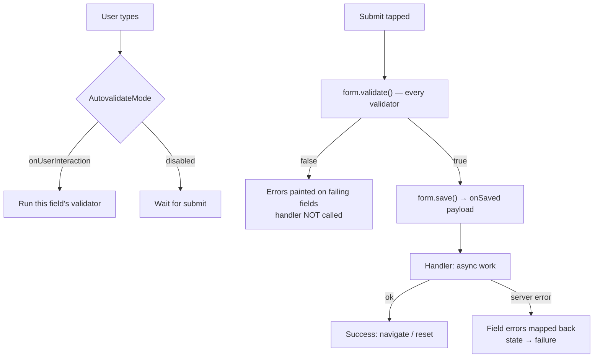

# Forms and Validation

## 1. Learning Objectives

After this lesson you can:

- [ ] Structure a form with `Form`, `GlobalKey<FormState>`, and per-field validators,
      and read what happens on a failed submit (executed: `W8 empty submit:
      email-error="Enter an email" password-error="At least 8 characters"`)
- [ ] Explain `AutovalidateMode` choices — `disabled`, `onUserInteraction`,
      `always` — and which one produces which feedback at which moment (executed:
      W8's bad-values round shows errors *without* a submit, while `callback=not
      called` proves invalid data never reached the handler)
- [ ] Extract a validated payload with `save()`/`onSaved` and hand it to a handler
      exactly once (executed: `W8 valid submit: email=ada@example.com password=
      correct horse errors-gone=true`)
- [ ] Write validators as pure, testable functions — unit-testable without a widget
      in sight
- [ ] Design validation for async realities: uniqueness checks, server errors, and
      the field-level vs form-level split
- [ ] Handle submit states (idle/submitting/failed) so a double-tap can't place two
      orders

## 2. Prerequisites

- [State Management](state-management.md) — form draft *is* screen state; the submit
  flow is a mini state machine.
- [Widgets and Layouts](widgets-and-layouts.md) — `Column`/`Expanded` structure for
  form layout, and input-clipping behavior.

*Toolchain: Flutter 3.47.7 / Dart 3.13.5, Windows 11 — verified in
[VERSIONS.md](../VERSIONS.md). Transcripts are real captures from the batch's
`test/nav_state_form_test.dart` (probe W8); `+4: All tests passed!` for the W6–W8
battery.*

## 3. Introduction

Forms are where an app's data quality is decided: every bad record in your backend
started as an input field that accepted it. Flutter gives you the plumbing — form
scope, validation hooks, error display — but not the policy: what counts as valid,
when to tell the user, and how a server-side failure folds back into the same UI.
This lesson executes the plumbing and argues the policy.

## 4. The Problem It Solves

Hand-rolled validation scatters `if (email.isEmpty)` across button handlers, shows
different errors on different screens, and — worst — lets invalid data through on
the paths that forgot a check. HTML's built-in validation taught the industry the
shape: a declarative rule per field, a single validate-then-submit gate, and errors
attached to the field that owns them. `Form` implements exactly that shape inside
Flutter, with one extra property: validators are *functions of the value*, unit-testable
in isolation, so your validation policy can be tested without rendering anything.

## 5. Core Concepts

### The form gate

`Form` + `GlobalKey<FormState>` gives three operations:

- `validate()` — runs every field's validator, displays errors, returns one bool.
- `save()` — runs every field's `onSaved`, collecting the payload.
- `reset()` — clears values and error state.

Executed **W8** — all three rounds:

```
W8 empty submit: email-error="Enter an email" password-error="At least 8 characters"
W8 bad values: email-error="That is not an email address"
   password-error="At least 8 characters" callback=not called
W8 valid submit: email=ada@example.com password=correct horse errors-gone=true
```

Read the three lines as one story: round 1 — the gate rejects empties and shows both
errors; round 2 — with autovalidate on, typing wrong values shows errors immediately
and **`callback=not called`** proves the handler never saw invalid data; round 3 —
valid values pass, `save()` moved them into the payload, and the errors cleared.

### Validators as pure functions

```dart
String? _email(String? v) {
  if (v == null || v.isEmpty) return 'Enter an email';
  if (!v.contains('@')) return 'That is not an email address';
  return null;   // null == valid: the contract is in the type
}
```

- Return type `String?` *is* the contract: `null` passes, a message fails.
- No widgets, no state, no context — so the whole policy is unit-testable.
- Order matters: most fundamental failure first (empty before format), because the
  user should fix one thing at a time.

### When to show errors — AutovalidateMode

| Mode | When errors appear | Use |
|---|---|---|
| `disabled` | only on `validate()` (submit) | long forms, discouraged alone |
| `onUserInteraction` | after the user touches that field | **default recommendation** |
| `always` | immediately on every change | rarely — shows errors before typing |

W8 uses `onUserInteraction`: empty fields show nothing *until* you submit (round 1),
and once touched, errors track your corrections (round 2 → 3). This is the policy
that avoids scolding users for empty fields they haven't reached yet.

### Payload extraction

`TextFormField.onSaved` writes into plain fields of the `State`; `form.save()` after
a passing `validate()` assembles the payload once. Controllers
(`TextEditingController`) are the alternative — better when a widget *reads* the text
live (live search, formatting); `onSaved` is better when you only need the final
value. Either way: **one source per field** — never mix a controller and `onSaved`
for the same input.

### The submit state machine

Validation passing ≠ submission succeeding. The handler needs three states —
`idle → submitting → success | failure` — with `submitting` disabling the button.
A double-submit is a real production bug (two orders, two charges); the fix is a
guard flag checked before the await, exactly like the async lesson's mounted-check
discipline.

### Server-side and async validation

- **Format** (client, instant) vs **truth** (server: "username taken") — only the
  second one can lie, so it belongs in an async validator with a `pending` state
  shown as such.
- Server field errors from your API map back onto fields by name — the error
  envelope lesson from [Backend Engineering](../11-BACKEND-ENGINEERING/README.md)'s
  API contract shows the shape this pairs with.

## 6. How It Works



The gate is synchronous and total: no invalid value crosses it (W8's
`callback=not called`). Everything after the gate is the async submit flow, whose
failures must land *back on the form* — as field errors when the server names them,
or as a form-level message when it doesn't.

## 7. Practical Examples

**Example 1 — the executed validation rounds (W8)**

```dart
// test (abridged) — flutter test --reporter expanded test/nav_state_form_test.dart
await tester.tap(find.text('sign up'));
await tester.pump();
print('W8 empty submit: email-error="${textOf(tester, 'Enter an email')}" ...');

await tester.enterText(find.byKey(const Key('email')), 'notanemail');
await tester.enterText(find.byKey(const Key('password')), 'short');
await tester.pump();
print('W8 bad values: ... callback=${gotEmail == null ? 'not called' : 'CALLED'}');

await tester.enterText(find.byKey(const Key('email')), 'ada@example.com');
await tester.enterText(find.byKey(const Key('password')), 'correct horse');
await tester.tap(find.text('sign up'));
await tester.pump();
print('W8 valid submit: email=$gotEmail password=$gotPassword ...');
```

Full capture shown in section 5. Key assertion: `gotEmail == 'ada@example.com'` —
the payload equals exactly what the fields held.

- **How to run:** `flutter test --reporter expanded test/nav_state_form_test.dart`
- **Assumptions:** Flutter 3.47.7; `enterText` bypasses the keyboard, not the
  validators.

**Example 2 — submit states with double-tap protection (reference)**

```dart
enum SubmitState { idle, submitting, success, failure }

Future<void> _submit() async {
  if (_status == SubmitState.submitting) return;      // the guard that matters
  if (!_formKey.currentState!.validate()) return;
  setState(() => _status = SubmitState.submitting);
  try {
    await api.signup(_payload());
    setState(() => _status = SubmitState.success);
  } on ApiException catch (e) {
    applyServerErrors(e.fieldErrors, _formKey.currentState!); // name → field
    setState(() => _status = SubmitState.failure);
  }
}
// button: onPressed: _status == SubmitState.submitting ? null : _submit
```

- The guard *and* the disabled button are both needed: the guard is authoritative,
  the button is the honest signal.
- **Expected behavior:** a double-tap during the await performs one request; server
  `fieldErrors` appear on the fields they name.

## 8. Real-World Applications

Signup, checkout, search filters, profile editing, onboarding wizards — every
production app runs this pattern dozens of screens deep. The split matters most in
checkout: address format validated locally for speed, postal-code existence
validated by the server, and a submit guard preventing duplicate orders. The
validators-as-pure-functions habit also lets you share the *same* rules between the
form and an equivalent CLI/admin tool — one policy, two surfaces.

## 9. Common Mistakes

| Mistake | Why it happens | How to recognize it | How to prevent it |
|---|---|---|---|
| Validating in the button handler | `Form` feels indirect | Checks scattered; some screens miss one | All policy in validators; handler assumes valid data |
| `autovalidateMode: always` | "Immediate feedback" sounds good | Errors before the user typed a char | `onUserInteraction` |
| Blocking submit only with a disabled button | Visual approach | Two orders on a slow network (tap twice pre-await) | Authoritative guard flag in `_submit` (section 7) |
| Reading text in two places | Controller *and* `onSaved` | Values disagree after edits | One source per field |
| Showing only "invalid email" | One generic message | User can't tell *which* rule failed | Message states the rule: "Needs an @" |
| Ignoring server field errors | Client validates "everything" | Server rejections shown as a toast far from the field | Map API `fieldErrors` back by field name |

## 10. Best Practices

- **Validators are pure functions** — unit-test them with a table of
  values/messages; the widget test then only proves wiring.
- **`onUserInteraction` as the default mode;** submit-time validation still gates.
- **Messages name the rule** — "Enter an email" teaches; "Invalid input" doesn't.
- **Most fundamental failure first** in each validator chain.
- **Guard the await** — `submitting` flag + disabled button + one request per tap.
- **Test all three rounds** (empty, bad, good) — W8 is the template; every form in
  the app earns the same three-case battery. *Stops applying to trivial fields like
  a search box, where debounced behavior replaces submission.*

## 11. Limitations and Trade-Offs

- **`Form` is synchronous** — async validation (uniqueness) needs manual state
  around it; `validate()` can't await.
- **Validator messages are static strings** — localization means reaching for
  message keys or per-locale functions; plan it before the second language.
- **`Form.value`-style shortcuts don't exist in all versions** — payload assembly is
  your `onSaved`/controller code to write and test.
- **Client validation is UX, not security** — the server re-validates everything;
  never let the form be the only gate (this subject's backend lessons enforce the
  server side).
- **Deep custom fields (rich text, chips) skip the built-ins** — you implement
  `FormField` yourself or manage validation manually; budget for it.

## 12. Practical Exercises

### Introductory

1. **Exercise 10.1** — reproduce all three W8 rounds from a blank file. Then add a
   third field (`username`, min 3 chars, no spaces) and extend round 2's capture to
   show its error. **Completion criteria:** four captured error messages and the
   `callback=not called` line still present.
2. **Exercise 10.2** — unit-test the three validators as pure functions with a
   table (empty/short/valid for each). **Completion criteria:** a test file that
   never pumps a widget and covers at least nine cases, all green.

### Intermediate

3. **Exercise 10.3** — implement the double-submit guard: a fake API that takes
   500 ms, a test that taps submit twice, and an assertion that the handler ran
   exactly once. **Completion criteria:** failing capture without the guard, passing
   capture with it, request count shown in both.
4. **Exercise 10.4** — simulate a server rejection: your handler receives
   `fieldErrors: {username: 'taken'}` and must paint it on the username field.
   **Completion criteria:** capture showing the server's message on the right field
   after a valid local pass.

### Independent problem-solving

5. **Exercise 10.5** — design validation for a 6-step checkout: which fields are
   locally formatted, which are server-truth, what each step shows while pending,
   and how a failure at step 5 preserves steps 1–4's input. **Completion criteria:**
   a per-field table (rule, where validated, when shown, failure recovery) plus an
   executed test of the hardest step's pending/failure behavior.

*Solutions: attempt first. They live in `solutions/` of this subject.*

## 13. Knowledge Check

1. W8 round 2 shows `callback=not called`. Why is that line — not the visible error
   text — the actual proof that validation works?
2. A teammate sets `autovalidateMode: always` "so users see errors sooner."
   Describe the exact UX at form open and say which mode you'd choose instead.
3. Client validation passes but the API rejects with a field error. Walk the
   message's path back to the screen, and name what breaks if the API doesn't send
   field names.

## 14. Completion Criteria

Observable evidence that you have understood this lesson:

- [ ] You have reproduced all three W8 rounds from a blank file
- [ ] You can write a validator table test with no widgets and explain why that's
      the better test
- [ ] You can implement the submit guard and demonstrate the double-tap failure
      without it
- [ ] You can map a server `fieldErrors` response onto form fields
- [ ] You can diagnose all six mistakes in section 9 on sight

## 15. Summary

- `validate()` is the gate — invalid data never reaches the handler (executed:
  `callback=not called`).
- Validators are pure `String? → String?` functions: policy you can unit-test.
- `onUserInteraction` shows errors after touch, not before typing.
- `save()`/`onSaved` (or controllers — pick one) assembles the payload once.
- Submit is a state machine; guard the await so one tap means one request.
- Client validation is UX; the server re-validates everything.

## 16. Next Steps

- Next lesson: [API Integration](api-integration.md) — where the submit handler's
  `api.signup()` actually goes: clients, JSON, loading and error states.
- Practice: [exercise sets](exercises/README.md) for this subject.
- Where it is applied: [Project 06](../20-PROJECT-LABORATORY/README.md) — its forms
  ship with the three-round battery as their acceptance test.
