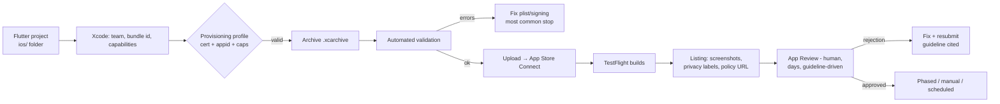

# iOS Release

## 1. Learning Objectives

After this lesson you can:

- [ ] Walk the iOS release chain end to end — Apple ID, certificates, provisioning
      profiles, Xcode archive, App Store Connect, review — and say which step
      fails most often for newcomers
- [ ] Explain provisioning profiles as the *join* of app id, certificate, and
      device entitlements — and predict what breaks when any element changes
- [ ] Configure the `Info.plist` facts the OS and the store both read (bundle id,
      version/build, usage strings, transport security) and name the crash each
      missing usage string causes
- [ ] Handle the iOS-specific rules that break Android-ported apps: forced TLS,
      notification consent timing, screenshot rules for certain categories, and
      the app-lifecycle differences already taught in
      [Mobile Development Fundamentals](mobile-development-fundamentals.md)
- [ ] Set version/build numbers so upgrade installs and crash symbolication both
      work
- [ ] Choose a release strategy — TestFlight first, phased release, hot-fix path —
      and justify it against App Store review latency

## 2. Prerequisites

- [Mobile Development Fundamentals](mobile-development-fundamentals.md) — the
  `ios/` folder this lesson operates on and the platform seams it owns.
- [Android Release](android-release.md) — the sibling process; this lesson's
  comparison tables assume it.
- [Mobile Testing](mobile-testing.md) — what you must have green before archiving.

*Provenance — read this first: the authoring machine is **Windows 11**, and iOS
builds require **macOS with Xcode**. Everything below is therefore **labelled
reference**: procedures verified against Apple's official documentation (linked in
each section), not executed here. No capture on this page pretends to be a
machine transcript; the exercises run each step on a Mac. This is the same
honesty rule [VERSIONS.md](../VERSIONS.md) applies to Gradle and Docker lessons.*

## 3. Introduction

iOS is the platform where distribution is a *negotiation*: Apple provides the
store, the review process, the signing infrastructure, and the rules — your job is
to satisfy all four without leaking user data or surprising reviewers. This lesson
is the map of that negotiation, with the three concepts (bundle, profile, review)
that determine whether an app ships today or in a week.

## 4. The Problem It Solves

Signing exists to guarantee provenance: only the holder of Apple-issued
credentials can update a given app, and devices only run code tied to an
authorized profile. The cost is a chain of artifacts that confuses everyone once:
certificates (who), identifiers (what), devices (which), and the profile that
joins them. Add App Review — a human process with published guidelines — and
"release" becomes a project rather than a command. The Android lesson's
`flutter build appbundle` has no iOS equivalent for exactly these reasons: the
final steps live in Xcode and App Store Connect, not in your terminal.

## 5. Core Concepts

### The signing chain

- **Apple Development/Distribution certificate** — *who* is signing (your team).
- **App ID (bundle identifier)** — *which app*; it must match `ios/Runner.xcodeproj`
  and can never change after submission (renaming an app is a listing change, not
  an id change).
- **Provisioning profile** — the signed join: *this cert* may sign *this app id*
  for *distribution via App Store / TestFlight / ad hoc*. Development profiles
  additionally list device UDIDs.
- **Capabilities** — checkboxes (push notifications, keychain groups, iCloud)
  baked into the profile; adding one means regenerating it.

Failure prediction table (the exercise drills this):

| Change | What breaks | Fix |
|---|---|---|
| New signing team | "Signing requires a development team" | select team; profiles regenerate |
| Bundle id mismatch | Archive fails at provisioning | align Xcode + App Store Connect id |
| New capability (push) | entitlement error at archive | add capability, re-issue profile |
| Expired certificate | Upload rejected | renew; profiles follow |

### Info.plist: the store's and OS's shared document

```xml
<key>CFBundleIdentifier</key>        <!-- must equal the App ID -->
<key>CFBundleShortVersionString</key><!-- marketing version: 1.2.0 — user facing -->
<key>CFBundleVersion</key            <!-- build number: 47 — increments every upload -->
<key>NSCameraUsageDescription</key>  <!-- missing = instant crash on request -->
<key>NSPhotoLibraryUsageDescription</key>
<key>NSLocationWhenInUseUsageDescription</key>
```

Two version fields do two jobs: **short version** is what users see and compare;
**build** must strictly increase per upload (CI increments it) — otherwise
TestFlight and symbolication get confusing fast. Usage strings appear in the
permission dialog verbatim: writing " Needed for the app" here is how apps get
rejected for poor purpose description.

### Forced TLS (ATS)

App Transport Security blocks plaintext HTTP by default. The honest options:
serve HTTPS (do that), or add narrowly-scoped exceptions for specific domains.
A blanket `NSAllowsArbitraryLoads` is a review flag and a real vulnerability
posture — the lesson's stance: exceptions must name a domain and a reason.

### The release path

1. **Green suite** — `flutter test` all tiers ([Mobile Testing](mobile-testing.md)).
2. **Version/build** — bump both (`--build-number` in CI).
3. **Archive** — Xcode Product → Archive (or `xcodebuild -archivePath` from CI).
4. **Validate & upload** — Xcode Organizer or `xcrun altool`/notary API; the
   automated validator catches most plist/signing issues before review.
5. **TestFlight** — internal testers (no review) then external (light review).
6. **App Store listing** — screenshots per device class, privacy nutrition labels
   (what data, what use, is it linked to identity), privacy policy URL — the
   labels are a *legal representation*; match them to what the app does.
7. **Review** — human, guideline-driven (4.5.x/5.x are the common refusals:
   broken links, login walls without demo access, missing demo account);
   typically days, occasionally hours.
8. **Release** — manual, phased (7-day staged rollout), or scheduled.

### What breaks Android-ported apps

| Area | Android habit | iOS reality |
|---|---|---|
| Back navigation | hardware/gesture back pops | no system back — on-screen affordance required |
| Notifications | channels, no prompt needed pre-13 | explicit consent prompt; provisional mode is silent |
| Background work | WorkManager-ish flexibility | strict suspension; push-driven only |
| Data safety | Play data form | privacy *nutrition labels* + privacy manifest (required files) |
| Instant update | almost instant | phased rollout; review on hot fix |

Each row ties back to lessons already executed: the permission gate (W13), the
lifecycle map (MOB-02), and the offline contract (W14) — none of them are
iOS-exempt; they simply need iOS's paperwork.

## 6. How It Works



The loop back from `J` is why release strategy matters: review latency is
unbounded, so a hot-fix plan (expedited review, available for critical bugs) and
TestFlight-first testing are structural decisions, not afterthoughts.

## 7. Practical Examples

**Example 1 — version discipline (labelled; runs with Xcode)**

```bash
# CI-style bump before archiving — both numbers move, differently:
flutter build ipa --release --build-name=1.2.0 --build-number=47
# CFBundleShortVersionString=1.2.0  (user facing)
# CFBundleVersion=47                (must be > every previous upload)
```

- **Expected behavior:** App Store Connect accepts the build; users see 1.2.0.
- **How to run:** on macOS with Xcode; on this authoring machine it is documented,
  not executed.

**Example 2 — the privacy label as a contract (reference)**

```text
Data types collected:  Contact Info (email) — linked to identity — app functionality
Analytics:             none
Tracking:              no
```

- Written to match reality; the store's questionnaire and the in-app behavior must
  agree — a mismatch is both a rejection risk and a legal one.
- The privacy manifest (`PrivacyInfo.xcprivacy`) enumerates required-reason APIs
  on-device; missing entries produce upload warnings that will become errors.

## 8. Real-World Applications

Every App Store app follows this chain; teams automate steps 2–5 in CI (certificates
in the CI keychain, `fastlane match`-style profile sync, `xcodebuild` archives),
leaving humans for listing copy, screenshots, and review notes. The private-enterprise
path (in-house distribution, custom app marketplaces in the EU) reuses the same
signing concepts with different distribution profiles — understanding the chain
transfers, only the destination changes.

## 9. Common Mistakes

| Mistake | Why it happens | How to recognize it | Prevent it with |
|---|---|---|---|
| Same build number twice | Manual bumping | "The bundle version must be higher" | CI increments per upload |
| Missing usage string | Feature built on Android first | crash on the permission request | plist checklist per permission (section 5) |
| Blanket ATS exception | Debugging HTTP left in | review flag + plaintext exposure | HTTPS, or per-domain exception with a reason |
| Privacy labels guessed | Filled once, app evolved | mismatch between labels and behavior | labels reviewed each release against actual code paths |
| No demo account for review | Login wall surprise | rejection 2.1 | reviewer notes + working test credentials |
| Testing only on simulator | Device-only behavior missed | release-only crashes | TestFlight on real devices before rollout |
| Changing bundle id late | Rename idea | impossible: id is identity | settle the id before first submission |

## 10. Best Practices

- **Automate everything repeatable**: version bump, archive, upload, symbol upload.
  Review and screenshots stay human.
- **TestFlight on real devices is a release gate**, not a courtesy — the executed
  suite in [Mobile Testing](mobile-testing.md) runs on your machine; devices run
  the platform.
- **Privacy labels reviewed with each release**, from the diff: what data does
  *this* version touch?
- **Phased release by default** — a bad build reaches a fraction first; watch
  crash metrics before 100%.
- **Expedited review reserved for real emergencies** — overuse burns the option.
- **Keep the App Store story honest**: screenshots of shipped UI, changelog that
  says what changed. *Stops applying to nothing — this one is unconditional.*

## 11. Limitations and Trade-Offs

- **Review latency is real and uncontrollable** — plan hot-fixes accordingly;
  compare with Android's near-instant staged rollouts.
- **Signing is team-scoped and revocable** — a compromised distribution
  certificate is an incident; rotate with a plan.
- **Simulators ≠ devices** — camera, background push, and keychain behaviors all
  diverge; TestFlight coverage is mandatory, not optional.
- **EU-specific paths** (alternative marketplaces, different rules) add branches
  this lesson maps but doesn't fully cover; check current Apple guidance at
  release time — policies move.
- **This page's provenance** — documented on a Windows machine against Apple's
  docs; when *you* execute the exercises, your captured outputs become the
  executed evidence this lesson points to.

## 12. Practical Exercises

### Introductory

1. **Exercise 19.1** — draw the signing chain (cert, app id, profile, capability)
   from memory, then verify against Apple's docs and mark any difference.
   **Completion criteria:** your diagram plus three verified rows; the failure
   table in section 5 predicted correctly for three given changes.
2. **Exercise 19.2** — list every `Info.plist` key your current app needs and the
   crash/rejection each omission causes. **Completion criteria:** a table with one
   row per permission the app requests.

### Intermediate

3. **Exercise 19.3** — on a Mac: archive a Flutter app, run automated validation,
   and capture both a deliberate failure (remove a usage string) and the clean
   run. **Completion criteria:** both outputs — the validator's error naming the
   missing key, and the green validation.
4. **Exercise 19.4** — build two release strategies for the same app (immediate
   full vs phased + TestFlight-first) and state which bug-severity class each
   tolerates. **Completion criteria:** a written comparison naming review latency
   as the constraint.

### Independent problem-solving

5. **Exercise 19.5** — plan v1.0's complete submission: versions, signing,
   privacy labels (data-type table), screenshots per device class, review notes
   with a demo account, and the post-release monitoring plan. **Completion
   criteria:** the full checklist filled with *your* app's real values — every
   step that requires macOS/Xcode labelled as such with the machine that will run
   it named.

*Solutions: attempt first. They live in `solutions/` of this subject.*

## 13. Knowledge Check

1. A teammate increments only `CFBundleShortVersionString` for each upload. What
   exact error follows, and which field did the store actually check?
2. The app crashes the first moment the camera permission is requested. Name the
   missing artifact, where it lives, and why the OS behaves this way.
3. Compare the fastest possible hot-fix path on iOS versus Android and attribute
   each delay to a mechanism from this lesson and the Android one.

## 14. Completion Criteria

Observable evidence that you have understood this lesson:

- [ ] You can draw the signing chain and predict failures from section 5's table
- [ ] You can list the Info.plist keys for every permission your app uses, with
      the consequence of each omission
- [ ] You can state both version fields' purposes and the increment rule
- [ ] You can walk the release path with its two review loops without notes
- [ ] You can diagnose all seven mistakes in section 9 on sight

## 15. Summary

- Signing joins *who* (cert), *what* (app id), and *capabilities* into a profile;
  changing any element regenerates it.
- Two versions: short version for users, build for the store — build always
  increases.
- Usage strings, ATS, and privacy labels are contracts — each omission has a
  named failure.
- Release is TestFlight → listing → human review → phased rollout; review latency
  is the structural constraint.
- Provenance: documented on Windows against Apple docs; executed on a Mac per the
  exercises.

## 16. Next Steps

- Next: the subject's capstone brief — [Project 06](projects/README.md) — where
  both release paths become a checklist against a real app.
- Practice: [exercise sets](exercises/README.md) for this subject.
- Where it is applied: [Project 06](../20-PROJECT-LABORATORY/README.md) — its
  shipping checklist includes both stores' contracts.
